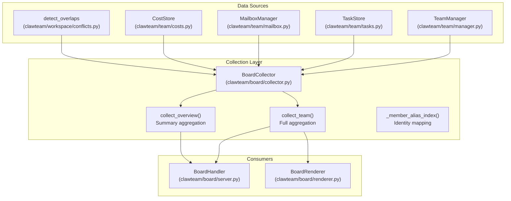
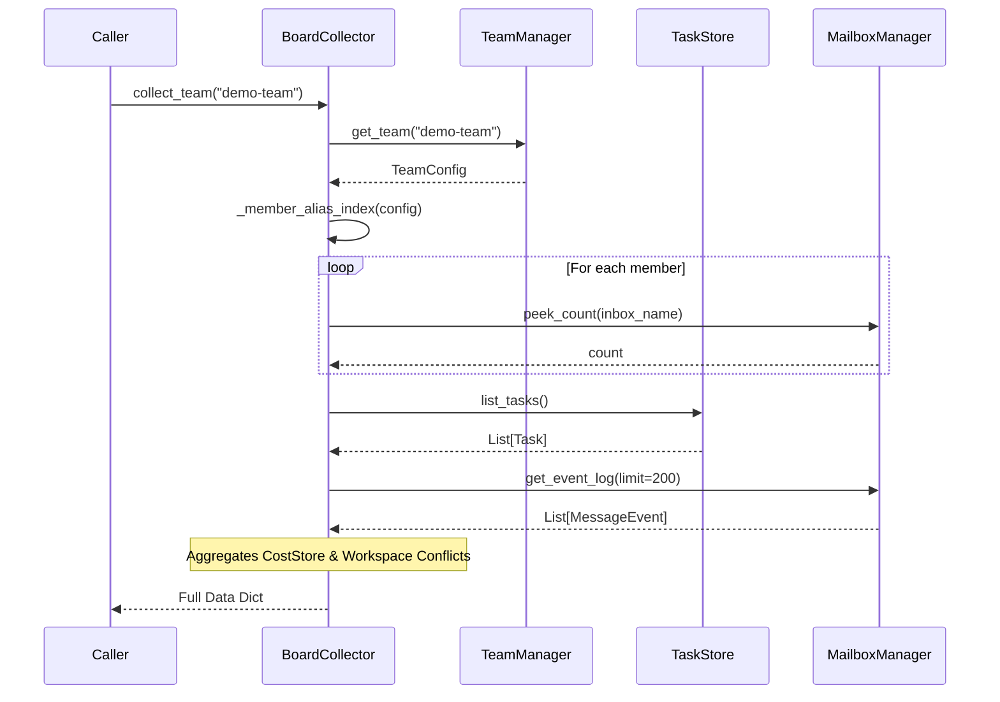

<!-- source: DeepWiki mcp.deepwiki.com · repo HKUDS/ClawTeam · page 11.3 Board Data Collection · fetched 2026-11-09 -->

# Board Data Collection

<details>
<summary>Relevant source files</summary>

The following files were used as context for generating this wiki page:

- [clawteam/board/collector.py](clawteam/board/collector.py)
- [clawteam/board/server.py](clawteam/board/server.py)
- [clawteam/board/static/index.html](clawteam/board/static/index.html)
- [tests/test_board.py](tests/test_board.py)

</details>


## Purpose and Scope

This document details the `BoardCollector` architecture, which aggregates data from multiple ClawTeam subsystems (teams, tasks, inboxes, costs, and workspaces) into unified dictionary structures for monitoring and observability. The collector serves as the data layer for both terminal-based boards and the web dashboard, providing a consistent interface for querying team state.

For information about consuming this data in terminal displays, see [Terminal Boards](#6.1). For web dashboard integration, see [Web Dashboard](#6.2). For the underlying storage mechanisms, see [Storage Layer](#11.1).

**Sources:** [clawteam/board/collector.py:1-143](), [clawteam/board/server.py:1-17]()

---

## Architecture Overview

The `BoardCollector` class acts as an aggregation layer that queries multiple storage subsystems and combines their data into plain Python dictionaries suitable for rendering.

### Board Collection System Architecture



**Sources:** [clawteam/board/collector.py:12-143](), [clawteam/board/server.py:120-146](), [clawteam/board/collector.py:16-34]()

---

## Data Source Components

The `BoardCollector` queries five primary subsystems, each managing a distinct aspect of team state:

| Component | Source File | Provides | Method Used |
|-----------|-------------|----------|-------------|
| `TeamManager` | `clawteam/team/manager.py` | Team configuration, members, leader | `get_team()`, `discover_teams()`, `inbox_name_for()` |
| `TaskStore` | `clawteam/team/tasks.py` | Task list with status, dependencies | `list_tasks()` |
| `MailboxManager` | `clawteam/team/mailbox.py` | Inbox message counts, event log | `peek_count()`, `get_event_log()` |
| `CostStore` | `clawteam/team/costs.py` | Token usage, cost tracking | `summary()` |
| `detect_overlaps` | `clawteam/workspace/conflicts.py` | Workspace file conflict data | `detect_overlaps()` |

**Sources:** [clawteam/board/collector.py:7-9](), [clawteam/board/collector.py:21-27](), [clawteam/board/collector.py:146-148](), [clawteam/board/collector.py:162-163]()

---

## Collection Methods

### `collect_team(team_name: str) -> dict`

Aggregates complete board data for a single team. This is the primary method used by both terminal renderers and the web dashboard.



**Implementation Details:**

1. **Member Aliasing**: Uses `_member_alias_index` to map logical names to canonical `memberKey` identifiers (e.g., `user_name`). [clawteam/board/collector.py:16-34]()
2. **Task Grouping**: Organizes tasks into `pending`, `in_progress`, `completed`, and `blocked` statuses based on the `TaskStatus` enum. [clawteam/board/collector.py:96-104]()
3. **Identity Normalization**: For message history, it normalizes `from` and `to` fields into `fromLabel`/`fromKey` and `toLabel`/`toKey` for consistent UI display. [clawteam/board/collector.py:122-139]()
4. **Conflict Detection**: Integrates workspace overlap data, categorizing conflicts by severity (high/medium). [clawteam/board/collector.py:160-174]()

**Sources:** [clawteam/board/collector.py:63-191]()

---

### `collect_overview() -> list[dict]`

Returns summary data for all discovered teams.

1. Calls `TeamManager.discover_teams()` to find available teams. [clawteam/board/collector.py:117-118]()
2. Iterates through teams, calling `collect_team_summary()` for each. [clawteam/board/collector.py:120-132]()
3. **Error Handling**: If a team is "broken" (e.g., invalid config), it catches the `ValueError` and provides a fallback dict using metadata from the discovery phase. [clawteam/board/collector.py:133-141]()

**Sources:** [clawteam/board/collector.py:111-143](), [tests/test_board.py:178-228]()

---

## Web Dashboard Integration

The `BoardHandler` (a `BaseHTTPRequestHandler`) serves the collected data via a lightweight API.

### Server Caching

To prevent expensive disk I/O on every HTTP request, the server uses a `TeamSnapshotCache`.

- **TTL Cache**: Stores full team snapshots with a configurable `ttl_seconds`. [clawteam/board/server.py:97-102]()
- **Concurrency**: Uses a `threading.Lock` to ensure thread safety while allowing the slow `BoardCollector` run to happen outside the lock to prevent blocking other readers. [clawteam/board/server.py:105-117]()

### API Endpoints

| Endpoint | Logic |
|----------|-------|
| `/api/overview` | Directly calls `collector.collect_overview()`. [clawteam/board/server.py:133-134]() |
| `/api/team/{name}` | Uses `team_cache.get()` to retrieve the snapshot. [clawteam/board/server.py:135-140]() |
| `/api/events/{name}` | Serves Server-Sent Events (SSE) by repeatedly polling the cache. [clawteam/board/server.py:141-146]() |
| `/api/proxy` | Proxies GitHub content (READMEs) for the UI, enforcing strict hostname allowlists. [clawteam/board/server.py:147-162]() |

**Sources:** [clawteam/board/server.py:97-162](), [tests/test_board.py:72-112]()

---

## Data Structure Specification

### Full Team Snapshot (`collect_team`)

```json
{
  "team": { "name": "...", "leaderName": "...", "budgetCents": 0 },
  "members": [
    { "name": "worker", "memberKey": "alice_worker", "inboxCount": 5 }
  ],
  "tasks": { "pending": [], "in_progress": [], "completed": [], "blocked": [] },
  "messages": [
    { "content": "...", "fromKey": "...", "fromLabel": "...", "isBroadcast": true }
  ],
  "cost": { "totalCostCents": 0, "byAgent": {} },
  "conflicts": { "overlaps": [], "totalOverlaps": 0 }
}
```

**Sources:** [clawteam/board/collector.py:176-191](), [tests/test_board.py:128-176]()

### Team Summary (`collect_team_summary`)

```json
{
  "name": "demo",
  "description": "...",
  "leader": "leader_name",
  "members": 2,
  "tasks": 10,
  "pendingMessages": 5
}
```

**Sources:** [clawteam/board/collector.py:54-61](), [tests/test_board.py:14-39]()

---

## Performance and Reliability

- **Stateless Collection**: The `BoardCollector` itself is stateless, relying on the underlying `TaskStore` and `MailboxManager` file-based state. [clawteam/board/collector.py:42-43]()
- **Graceful Degradation**: Optional modules (Costs, Workspace Conflicts) are wrapped in `try/except` blocks. If these subsystems fail or are uninitialized, the board still renders the core team and task data. [clawteam/board/collector.py:145-174]()
- **Serialization**: Uses `model_dump_json(by_alias=True)` to ensure Pydantic models are correctly converted to dictionaries with camelCase keys expected by the Web UI. [clawteam/board/collector.py:103](), [clawteam/board/collector.py:123]()

**Sources:** [clawteam/board/collector.py:102-104](), [clawteam/board/collector.py:140-141](), [clawteam/board/collector.py:156-157]()

---

