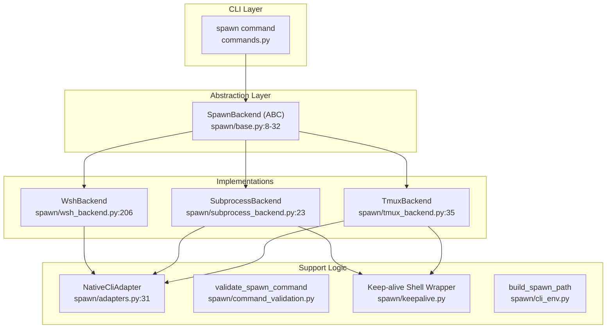
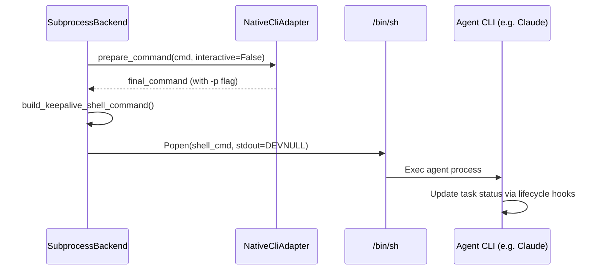

<!-- source: DeepWiki mcp.deepwiki.com · repo HKUDS/ClawTeam · page 11.4 Spawn Backends · fetched 2026-11-09 -->

# Spawn Backends

Relevant source files

The following files were used as context for generating this wiki page:

- [clawteam/spawn/adapters.py](clawteam/spawn/adapters.py)
- [clawteam/spawn/base.py](clawteam/spawn/base.py)
- [clawteam/spawn/command_validation.py](clawteam/spawn/command_validation.py)
- [clawteam/spawn/subprocess_backend.py](clawteam/spawn/subprocess_backend.py)
- [clawteam/spawn/tmux_backend.py](clawteam/spawn/tmux_backend.py)
- [clawteam/spawn/wsh_backend.py](clawteam/spawn/wsh_backend.py)
- [tests/test_adapters.py](tests/test_adapters.py)
- [tests/test_spawn_backends.py](tests/test_spawn_backends.py)

Spawn backends provide the mechanism for launching agent processes with isolated execution environments and proper identity configuration. The spawn backend abstraction allows ClawTeam to support multiple process isolation strategies (tmux sessions, direct subprocesses, or TideTerm blocks) through a unified interface, enabling flexible deployment models while maintaining consistent agent coordination.

For information about workspace isolation using git worktrees, see [Workspace Isolation](#7). For details on how agents are spawned through the CLI, see [Spawning Agents](#3.2).

---

## Purpose and Scope

The spawn backend system addresses three core requirements:

1.  **Process Isolation**: Each agent runs in an isolated environment with unique identity variables.
2.  **Backend Flexibility**: Support both interactive development (tmux, wsh) and automated execution (subprocess).
3.  **Uniform Interface**: Abstract backend-specific details behind a consistent API.

This document covers the spawn backend architecture, the primary implementations (`TmuxBackend`, `SubprocessBackend`, and `WshBackend`), and how they integrate with the broader ClawTeam system.

**Sources:**
- [clawteam/spawn/base.py:1-32]()
- [clawteam/spawn/tmux_backend.py:35-40]()
- [clawteam/spawn/subprocess_backend.py:23-28]()

---

## Architecture Overview

**Diagram: Spawn Backend System Architecture**

The system follows a strategy pattern where the `SpawnBackend` interface decouples the high-level spawning logic from the specific terminal or process manager used.

-   **NativeCliAdapter**: Handles the nuances of different LLM CLIs (Claude, Codex, Gemini, etc.), mapping generic flags like `skip_permissions` to specific CLI arguments like `--dangerously-skip-permissions` or `--yolo` [clawteam/spawn/adapters.py:31-146]().
-   **Command Validation**: Ensures the executable exists in the path and the working directory is valid before attempting to spawn [clawteam/spawn/command_validation.py:1-250]().
-   **Keep-alive Wrapper**: Generates shell scripts that wrap the agent process to allow for automatic restarts and execution of `lifecycle on-exit` hooks [clawteam/spawn/subprocess_backend.py:123-137]().

**Sources:**
- [clawteam/spawn/base.py:8-32]()
- [clawteam/spawn/adapters.py:31-146]()
- [clawteam/spawn/tmux_backend.py:35-110]()

---

## Backend Interface

The `SpawnBackend` abstract base class defines the contract all backend implementations must fulfill [clawteam/spawn/base.py:8-32]().

### spawn() Method

The `spawn()` method is the core interface for launching agent processes:

| Parameter | Type | Purpose |
| :--- | :--- | :--- |
| `command` | `list[str]` | Command and arguments to execute (e.g. `["claude"]`) |
| `agent_name` | `str` | Agent's unique name within team |
| `agent_id` | `str` | Globally unique agent identifier |
| `agent_type` | `str` | Agent type (e.g. "leader", "general-purpose") |
| `team_name` | `str` | Team this agent belongs to |
| `prompt` | `str \| None` | Initial prompt text for the agent |
| `env` | `dict[str, str] \| None` | Additional environment variables |
| `cwd` | `str \| None` | Working directory (often a git worktree path) |
| `keepalive` | `bool` | Whether to wrap the process in a restart loop |

**Returns**: A status message string describing the spawn result (e.g., PID or session name).

**Sources:**
- [clawteam/spawn/base.py:11-27]()

---

## Tmux Backend

The `TmuxBackend` implementation creates isolated tmux windows for each agent, enabling interactive observation and debugging.

### Implementation Details

The `TmuxBackend` performs the following steps during `spawn()`:

1.  **Environment Normalization**: Sets `TERM=xterm-256color` if the parent shell is "dumb" to ensure interactive CLIs start correctly [clawteam/spawn/tmux_backend.py:70-71]().
2.  **Identity Injection**: Exports `CLAWTEAM_AGENT_ID`, `CLAWTEAM_AGENT_NAME`, and other identity variables [clawteam/spawn/tmux_backend.py:73-79]().
3.  **Path Preparation**: Prepends the current `clawteam` executable's directory to `PATH` so the agent can find the CLI [clawteam/spawn/tmux_backend.py:86]().
4.  **Env File Sourcing**: To avoid tmux command-length limits, environment variables are written to a temporary `.env.sh` file which is sourced by the shell inside the tmux pane [clawteam/spawn/tmux_backend.py:146-154]().
5.  **Interactive Prompts**: For CLIs like Claude, it uses `tmux send-keys` to inject the initial prompt into the terminal buffer after the process has started [clawteam/spawn/tmux_backend.py:214-220]().

**Sources:**
- [clawteam/spawn/tmux_backend.py:65-170]()
- [clawteam/spawn/tmux_backend.py:214-220]()

---

## Subprocess Backend

The `SubprocessBackend` spawns agents as direct child processes. It is optimized for non-interactive or automated workloads.

### Subprocess Execution Model

**Diagram: Subprocess Backend Execution Flow**

### Implementation Details

1.  **Detachment**: Redirects `stdout` and `stderr` to `subprocess.DEVNULL` because unread pipes can block long-lived agent runs [clawteam/spawn/subprocess_backend.py:143-146]().
2.  **Lifecycle Hooks**: On Unix systems, it wraps the command in a shell script that executes `clawteam lifecycle on-exit` regardless of whether the agent succeeded or failed [clawteam/spawn/subprocess_backend.py:130-137]().
3.  **Registry**: Persists the agent's PID and command to a registry file so the system can monitor liveness without keeping a persistent process handle [clawteam/spawn/subprocess_backend.py:151-164]().

**Sources:**
- [clawteam/spawn/subprocess_backend.py:123-147]()
- [clawteam/spawn/subprocess_backend.py:151-164]()

---

## Wsh Backend

The `WshBackend` is a specialized backend for TideTerm/WaveTerminal environments. It spawns agents in isolated "blocks" and communicates via JSON-RPC.

-   **Block Management**: Each agent gets a unique block ID. The backend polls the `wsh` executable to ensure the block is observable [clawteam/spawn/wsh_backend.py:43-70]().
-   **Output Capture**: Uses the `wavefile://` protocol to capture terminal output for monitoring [clawteam/spawn/wsh_backend.py:80-98]().
-   **RPC Injection**: Injects prompts and runtime messages using a `WshRpcClient` over a Unix socket [clawteam/spawn/wsh_backend.py:217-232]().

**Sources:**
- [clawteam/spawn/wsh_backend.py:206-233]()
- [clawteam/spawn/wsh_backend.py:80-98]()

---

## Command Preparation and Adapters

The `NativeCliAdapter` is used by all backends to translate generic ClawTeam intent into CLI-specific syntax.

| Feature | Claude | Codex | Pi / Gemini |
| :--- | :--- | :--- | :--- |
| **Skip Permissions** | `--dangerously-skip-permissions` | `--dangerously-bypass-approvals...` | `--yolo` (Gemini) |
| **Prompt Delivery** | `-p prompt` (non-interactive) | `prompt` (positional) | `-p prompt` |
| **Interactive Prompt** | Injected via terminal buffer | Injected via terminal buffer | `-i prompt` (Gemini) |
| **Workspace Dir** | Implicit (cwd) | Implicit (cwd) | `-w path` (Kimi/Nanobot) |

**Sources:**
- [clawteam/spawn/adapters.py:49-140]()
- [clawteam/spawn/adapters.py:156-180]()

---

## Registry and Session Capture

Backends interact with the `registry` and `session_capture` modules to ensure agents are trackable even after the spawning process exits.

-   **Agent Registry**: Stores metadata including the backend type, PID, and the original command. This is used by `list_running()` to check process health [clawteam/spawn/subprocess_backend.py:151-158]().
-   **Session Capture**: Saves the configuration used to launch the agent (prompt, command, workspace) to `~/.clawteam/sessions/`, enabling features like session resume and the web dashboard overview [clawteam/spawn/subprocess_backend.py:159-164]().

**Sources:**
- [clawteam/spawn/subprocess_backend.py:151-164]()
- [clawteam/spawn/tmux_backend.py:90-96]()

---

