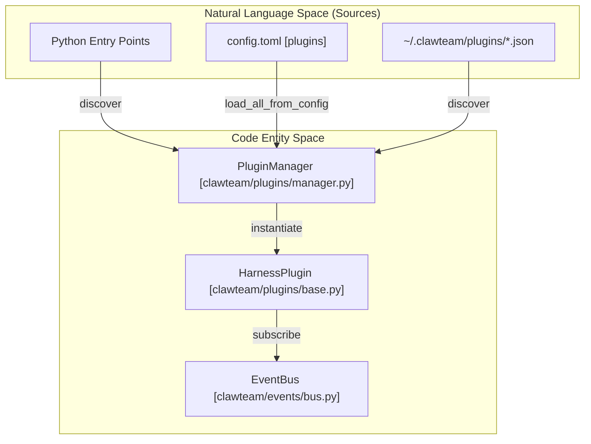
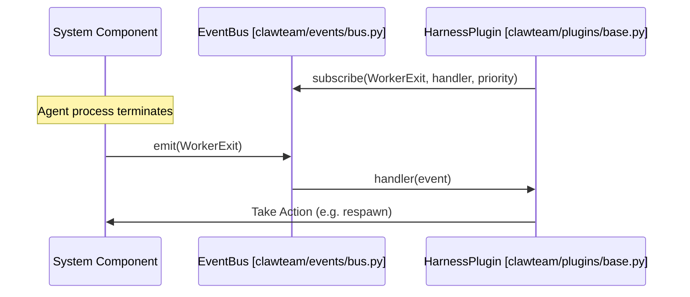
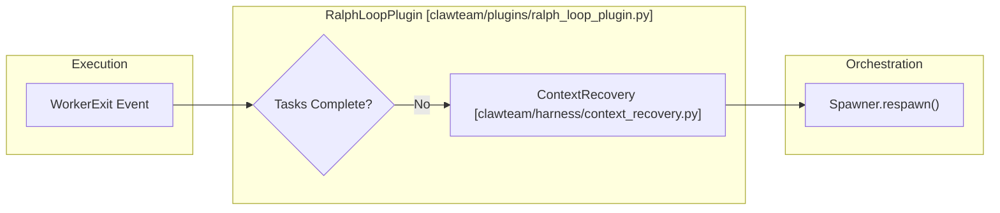

<!-- source: DeepWiki mcp.deepwiki.com · repo HKUDS/ClawTeam · page 11.6 Plugin System · fetched 2026-11-09 -->

# Plugin System

Relevant source files

The following files were used as context for generating this wiki page:

- [clawteam/events/bus.py](clawteam/events/bus.py)
- [clawteam/harness/__init__.py](clawteam/harness/__init__.py)
- [clawteam/harness/context_recovery.py](clawteam/harness/context_recovery.py)
- [clawteam/harness/exit_journal.py](clawteam/harness/exit_journal.py)
- [clawteam/plugins/__init__.py](clawteam/plugins/__init__.py)
- [clawteam/plugins/base.py](clawteam/plugins/base.py)
- [clawteam/plugins/manager.py](clawteam/plugins/manager.py)
- [clawteam/plugins/ralph_loop_plugin.py](clawteam/plugins/ralph_loop_plugin.py)
- [tests/test_event_bus.py](tests/test_event_bus.py)

The ClawTeam plugin system provides a modular architecture for extending the framework's behavior during agent orchestration. Plugins can subscribe to system-wide events, contribute validation gates to specific lifecycle phases, and inject context into agent prompts to facilitate complex workflows like automated re-spawning and state recovery.

## Plugin Architecture

The architecture is built around a centralized `PluginManager` that handles discovery and lifecycle, and a `HarnessPlugin` base class that defines the extension interface.

### HarnessPlugin Base Class
All plugins must inherit from `HarnessPlugin` [clawteam/plugins/base.py:13-13](). This base class provides the structure for hooking into the `HarnessContext`, which grants access to the event bus, task store, and agent spawner [clawteam/plugins/base.py:14-18]().

Key methods for extension include:
*   `on_register(ctx)`: Invoked when the plugin is loaded; typically used to subscribe to events via `ctx.bus` [clawteam/plugins/base.py:25-30]().
*   `contribute_gates()`: Allows plugins to inject `PhaseGate` objects into orchestration phases (e.g., DISCUSS, PLAN, EXECUTE) to block transitions until specific conditions are met [clawteam/plugins/base.py:35-37]().
*   `contribute_prompts()`: Injects additional text into the system prompts of agents based on their current phase and role [clawteam/plugins/base.py:39-41]().

### Plugin Discovery and Loading
The `PluginManager` [clawteam/plugins/manager.py:13-13]() identifies available plugins through three primary channels:
1.  **Entry Points**: Plugins registered under the `clawteam.plugins` group in Python package metadata [clawteam/plugins/manager.py:31-37]().
2.  **Configuration**: Modules explicitly listed in the `plugins` section of the ClawTeam configuration file [clawteam/plugins/manager.py:42-53]().
3.  **Local Directory**: JSON manifests found in the `~/.clawteam/plugins/` directory [clawteam/plugins/manager.py:56-69]().

**Plugin Discovery Data Flow**

The following diagram illustrates how the `PluginManager` maps external sources to internal `HarnessPlugin` entities.

Sources: [clawteam/plugins/manager.py:21-82](), [clawteam/plugins/base.py:13-18](), [clawteam/events/bus.py:42-49]()

## Event-Driven Interaction

Plugins primarily interact with the system via the `EventBus` [clawteam/events/bus.py:42-49](). When a plugin is registered, it receives a `HarnessContext` containing the global bus [clawteam/plugins/manager.py:146-150]().

Plugins can subscribe to various `HarnessEvent` types, such as `WorkerExit`, `TaskCompleted`, or `BeforeWorkerSpawn` [tests/test_event_bus.py:6-11](). The bus supports priority-based execution, allowing plugins to intercept events before or after other handlers [clawteam/events/bus.py:60-70]().

**Event Handling Logic**

Sources: [clawteam/events/bus.py:56-101](), [clawteam/plugins/base.py:25-30]()

## Built-in: RalphLoopPlugin

The `RalphLoopPlugin` [clawteam/plugins/ralph_loop_plugin.py:17-17]() is a core implementation of the "Ralph" technique—persistent iteration loops for agents. It ensures that if an agent exits (crashes or finishes its process) while it still has incomplete tasks assigned to it, the system automatically re-spawns that agent.

### Implementation Details
1.  **Subscription**: It subscribes to the `WorkerExit` event with high priority [clawteam/plugins/ralph_loop_plugin.py:38-38]().
2.  **Task Verification**: Upon exit, it queries the `TaskStore` for the specific agent. If tasks are found with a status other than `completed`, it triggers a re-spawn [clawteam/plugins/ralph_loop_plugin.py:55-62]().
3.  **Iteration Control**: It tracks re-spawn counts per agent to prevent infinite loops, defaulting to a maximum of 5 iterations [clawteam/plugins/ralph_loop_plugin.py:30-32]().

### Context Recovery
When the `RalphLoopPlugin` re-spawns an agent, it uses the `ContextRecovery` class [clawteam/harness/context_recovery.py:11-11]() to build a "Resume Context" [clawteam/harness/context_recovery.py:35-35](). This context is role-scoped to ensure the agent only receives relevant information:

| Role | Context Provided | Source |
| :--- | :--- | :--- |
| **Executor** | Own tasks, own git commits, and assigned sprint contract | [clawteam/harness/context_recovery.py:56-57](), [clawteam/harness/context_recovery.py:99-108]() |
| **Planner** | Own tasks and the project specification draft | [clawteam/harness/context_recovery.py:56-57](), [clawteam/harness/context_recovery.py:116-119]() |
| **Evaluator** | All team tasks and the full project specification | [clawteam/harness/context_recovery.py:59-59](), [clawteam/harness/context_recovery.py:109-115]() |

The recovery prompt includes five layers: iteration info, task progress, git summaries, artifact context, and teammate status [clawteam/harness/context_recovery.py:34-48]().

**Ralph Loop Data Flow**

Sources: [clawteam/plugins/ralph_loop_plugin.py:40-80](), [clawteam/harness/context_recovery.py:23-49]()

---

