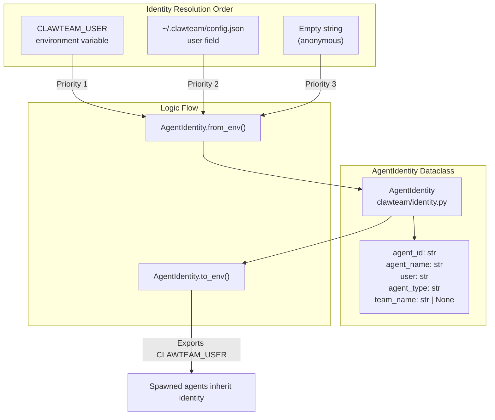
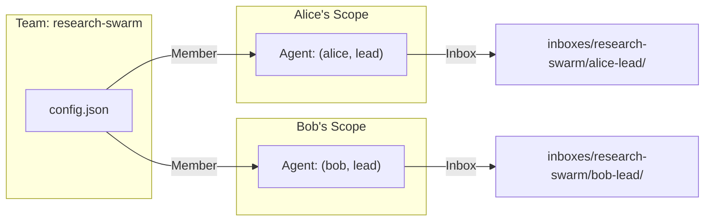
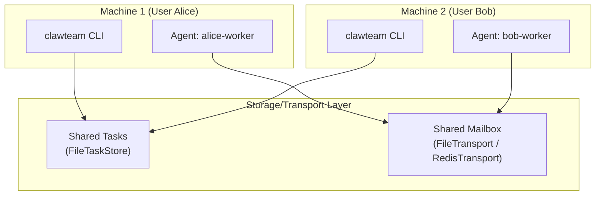
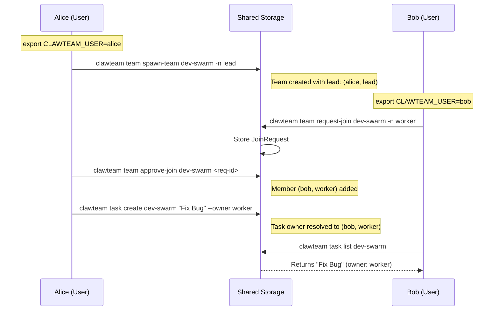

<!-- source: DeepWiki mcp.deepwiki.com · repo HKUDS/ClawTeam · page 12 Multi-User Collaboration · fetched 2026-11-09 -->

# Multi-User Collaboration

Relevant source files

The following files were used as context for generating this wiki page:

- [README.md](README.md)
- [ROADMAP.md](ROADMAP.md)
- [clawteam/store/file.py](clawteam/store/file.py)
- [clawteam/team/mailbox.py](clawteam/team/mailbox.py)
- [clawteam/team/manager.py](clawteam/team/manager.py)
- [scripts/clawteam_local_install](scripts/clawteam_local_install)
- [scripts/install_clawteam.sh](scripts/install_clawteam.sh)

This document explains ClawTeam's multi-user collaboration features, which allow multiple human users to share agent teams and coordinate work across machines. The system supports user identity tracking, agent namespacing, and cross-machine collaboration through shared filesystems or transport abstractions.

---

## Overview

ClawTeam's multi-user collaboration system (introduced in v0.3) enables:

- **User Identity**: Each agent is associated with a human user via `CLAWTEAM_USER` environment variable or persistent configuration.
- **Agent Namespacing**: Agents are uniquely identified by `(user, agent_name)` composite keys, preventing collisions between users.
- **Cross-Machine Collaboration**: Multiple users can share teams via shared filesystems (SSHFS, NFS, cloud drives) or via the pluggable Transport layer (e.g., Redis).
- **Transparent Operation**: All existing ClawTeam commands work seamlessly in multi-user mode with minimal configuration.

**Current State (v0.2.0/v0.3)**: Multi-user support is implemented via file-based coordination and identity environment variables [README.md:38-39]().

Sources: [README.md:38-39](), [ROADMAP.md:142-162](), [ROADMAP.md:188-193]()

---

## User Identity System

### AgentIdentity Resolution

The `AgentIdentity` class tracks which human user owns an agent. This is essential for distinguishing between "Alice's worker" and "Bob's worker" in a shared team.

**Identity Data Flow**
When a command is executed, `AgentIdentity.from_env()` resolves the current user [clawteam/identity.py:37-53](). This identity is then used to:
1. **Filter Team Members**: `TeamManager.get_member` uses the `user` parameter to find specific agents [clawteam/team/manager.py:59-75]().
2. **Assign Task Ownership**: Tasks created or updated store the agent's name, which may be prefixed or scoped by user [clawteam/store/file.py:77-121]().
3. **Resolve Mailboxes**: Inboxes are resolved based on the member's user property [clawteam/team/manager.py:220-234]().

Sources: [clawteam/identity.py:37-53](), [clawteam/team/manager.py:59-75](), [clawteam/team/manager.py:220-234]()

---

## Agent Namespacing with Composite Identity

In multi-user mode, agents are uniquely identified by the combination of `user` and `agent_name`. The `TeamMember` model explicitly stores the `user` field [clawteam/team/models.py:118]().

### Implementation in Team Management

The `TeamManager` class handles this composite identity during team operations:

| Function | Logic | Code Citation |
| :--- | :--- | :--- |
| `add_member` | Validates `member_name` and `user` to prevent duplicates. | [clawteam/team/manager.py:140-167]() |
| `get_member` | Allows searching for a member by name within a specific user's scope. | [clawteam/team/manager.py:59-75]() |
| `inbox_name_for` | Generates a directory name: `{user}-{name}` or just `{name}`. | [clawteam/team/manager.py:220-234]() |

### Mailbox Isolation

Mailboxes are isolated at the filesystem (or transport) level using these composite names. The `MailboxManager` relies on `TeamManager.resolve_inbox` to determine where messages should be delivered [clawteam/team/mailbox.py:93-95]().

Sources: [clawteam/team/models.py:118](), [clawteam/team/manager.py:140-167](), [clawteam/team/manager.py:220-234](), [clawteam/team/mailbox.py:93-95]()

---

## Cross-Machine Collaboration

ClawTeam supports collaboration across different physical machines using two primary strategies: Shared Filesystems and Transport Abstractions.

### 1. Shared Filesystem (v0.2+)
By setting `CLAWTEAM_DATA_DIR` to a path on a network-mounted drive (NFS, SSHFS, or SMB), multiple users can interact with the same team state [ROADMAP.md:109-118]().

- **Task Synchronization**: `FileTaskStore` uses advisory locking (`fcntl` on Unix, `msvcrt` on Windows) to ensure that multiple agents/users don't corrupt task JSON files during concurrent updates [clawteam/store/file.py:54-75]().
- **Message Delivery**: `FileTransport` (the default) writes message files to the shared `inboxes/` directory [clawteam/team/mailbox.py:32-39]().

### 2. Transport Abstraction (v0.3+)
The `Transport` interface allows swapping file-based messaging for networked protocols like Redis or P2P [ROADMAP.md:15-28]().

- **Redis Transport**: Enables high-frequency messaging without filesystem latency [ROADMAP.md:57-69]().
- **P2P Transport**: Uses ZeroMQ for direct agent-to-agent communication [README.md:19]().

Sources: [clawteam/store/file.py:54-75](), [clawteam/team/mailbox.py:32-39](), [ROADMAP.md:15-28](), [ROADMAP.md:57-69](), [ROADMAP.md:109-118]()

---

## Permissions and Access Control

In the current implementation (v0.3), permissions are largely managed at the operating system level via filesystem access controls.

### Current Logic
- **Discovery**: Any user who can read the `teams/` directory can discover teams [clawteam/team/manager.py:115-133]().
- **Joining**: A user can `request-join` a team. The leader (the agent matching `lead_agent_id` in `TeamConfig`) must then approve the request [clawteam/team/manager.py:140-167]().
- **Task Locking**: When an agent starts a task, it acquires a lock. Other agents cannot modify a locked task unless they "force" the update [clawteam/store/file.py:156-162]().

### Permission Roadmap (v0.6)
Future versions plan to introduce a formal permission model:
- **Namespace isolation**: Strict `user1/worker1` vs `user2/worker1` separation.
- **Token Authentication**: Verifying identity when connecting to Redis or shared backends.
- **Role-Based Access**: Defining who can create teams vs. who can only join.

Sources: [clawteam/team/manager.py:115-133](), [clawteam/team/manager.py:140-167](), [clawteam/store/file.py:156-162](), [ROADMAP.md:142-162]()

---

## Multi-User Workflow Example

The following sequence demonstrates how Alice and Bob collaborate on a shared task using composite identities.

**Key Code Interactions:**
1. `TeamManager.create_team` initializes the team with Alice as the lead [clawteam/team/manager.py:78-112]().
2. `TeamManager.add_member` adds Bob's identity to the `members` list in `config.json` [clawteam/team/manager.py:140-167]().
3. `FileTaskStore.create` persists the task with Bob's agent as the owner [clawteam/store/file.py:77-121]().

Sources: [clawteam/team/manager.py:78-112](), [clawteam/team/manager.py:140-167](), [clawteam/store/file.py:77-121]()

---

