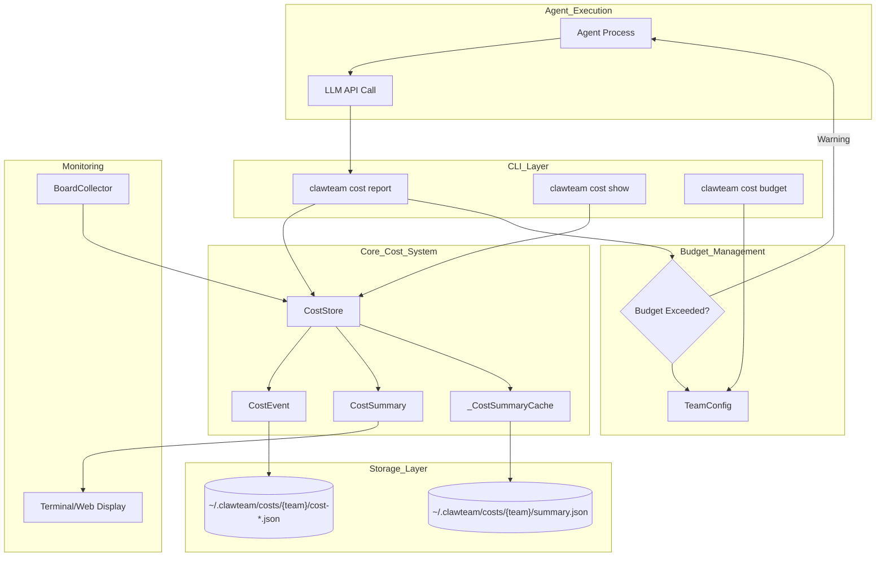
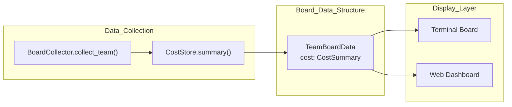

<!-- source: DeepWiki mcp.deepwiki.com · repo HKUDS/ClawTeam · page 13 Cost Tracking · fetched 2026-11-09 -->

# Cost Tracking

<details>
<summary>Relevant source files</summary>

The following files were used as context for generating this wiki page:

- [clawteam/spawn/sessions.py](clawteam/spawn/sessions.py)
- [clawteam/team/costs.py](clawteam/team/costs.py)
- [tests/test_costs.py](tests/test_costs.py)
- [tests/test_lifecycle.py](tests/test_lifecycle.py)
- [tests/test_registry.py](tests/test_registry.py)

</details>


Cost tracking in ClawTeam monitors token usage and associated costs for AI model interactions across all agents in a team. The system provides real-time cost reporting, budget enforcement, and historical analysis to help teams manage their AI spending.

For information about general team monitoring and observability, see [Monitoring and Observability](#6). For details on the board display system that visualizes cost data, see [Terminal Boards](#6.1) and [Web Dashboard](#6.2).

---

## Overview

The cost tracking system consists of three primary components: the `CostStore` for persistence, CLI commands for reporting and querying, and integration with the board monitoring system. Agents report their token usage after each API interaction, and the system automatically checks against team budgets, providing warnings when limits are exceeded.

**Sources:** [clawteam/cli/commands.py:889-1027](), [clawteam/board/collector.py:79-93]()

---

## Architecture



**Sources:** [clawteam/team/costs.py:21-75](), [clawteam/cli/commands.py:889-1027](), [clawteam/board/collector.py:79-93]()

---

## Cost Data Model

The system uses Pydantic models to structure cost data. Each cost report creates a `CostEvent` capturing details of a single interaction.

### CostEvent
[clawteam/team/costs.py:21-33]()

| Field | Type | Description |
|-------|------|-------------|
| `id` | string | Auto-generated 8-char hex ID |
| `agent_name` | string | Agent that made the API call |
| `provider` | string | LLM provider (e.g., "anthropic") |
| `model` | string | Model name |
| `input_tokens` | integer | Input tokens consumed |
| `output_tokens` | integer | Output tokens generated |
| `cost_cents` | float | Total cost in cents (USD) |
| `reported_at` | ISO8601 | Timestamp (UTC) |

### CostSummary
[clawteam/team/costs.py:36-46]()

| Field | Type | Description |
|-------|------|-------------|
| `team_name` | string | Name of the team |
| `total_cost_cents` | float | Sum of all costs for the team |
| `total_input_tokens` | integer | Sum of all input tokens |
| `total_output_tokens` | integer | Sum of all output tokens |
| `event_count` | integer | Number of cost events recorded |
| `by_agent` | dict | Per-agent cost breakdown (agent name → cost) |

**Sources:** [clawteam/team/costs.py:21-46]()

---

## Implementation Details

### Storage and Performance
Cost events are stored as individual JSON files in `~/.clawteam/costs/{team_name}/` [clawteam/team/costs.py:76-79](). To avoid expensive re-reading of all event files, the `CostStore` maintains a rolling cache in `summary.json` [clawteam/team/costs.py:82-83]().

The cache synchronization logic `_sync_summary_cache` [clawteam/team/costs.py:163-200]() performs:
1. File system scan for `cost-*.json` files.
2. Comparison of file size and `mtime_ns` against the cached `_CostCacheEntry` [clawteam/team/costs.py:49-60]().
3. Incremental updates to totals using `_add_cache_entry` [clawteam/team/costs.py:123-134]() and `_remove_cache_entry` [clawteam/team/costs.py:136-149]().
4. Atomic writes to the cache file using `atomic_write_text` [clawteam/team/costs.py:112-117]().

### Budget Management
Budgets are managed through the `TeamConfig` object [clawteam/team/models.py](). The CLI `cost budget` command sets the `budget_cents` field [clawteam/cli/commands.py:1003-1027]().

**Enforcement Logic:**
Enforcement is non-blocking. After every `cost report`, the system:
1. Records the event via `CostStore.report()` [clawteam/cli/commands.py:921]().
2. Retrieves the current `CostSummary` [clawteam/cli/commands.py:928]().
3. Compares `summary.total_cost_cents` against `config.budget_cents` [clawteam/cli/commands.py:932-933]().
4. Prints a warning if the budget is exceeded [clawteam/cli/commands.py:935-939]().

**Sources:** [clawteam/team/costs.py:163-200](), [clawteam/cli/commands.py:921-939]()

---

## CLI Command Reference

### cost report
Report token usage and cost for an agent.
[clawteam/cli/commands.py:896-940]()

```bash
clawteam cost report <team> \
  --input-tokens 1500 \
  --output-tokens 800 \
  --cost-cents 4.2 \
  --provider anthropic \
  --model claude-3-5-sonnet \
  --agent alice
```

### cost show
Show cost summary and event history. Supports filtering by agent and JSON output.
[clawteam/cli/commands.py:942-1000]()

```bash
clawteam cost show my-team --agent alice --json
```

### cost budget
Set team budget in dollars.
[clawteam/cli/commands.py:1003-1027]()

```bash
clawteam cost budget my-team 50.00
```

---

## Integration with Board System

The `BoardCollector` aggregates cost data for the terminal and web dashboards by calling `CostStore(team_name).summary()` [clawteam/board/collector.py:79-84]().



**Sources:** [clawteam/board/collector.py:79-93](), [clawteam/team/costs.py:302-313]()

---

## Storage Structure

```
~/.clawteam/costs/{team}/
├── summary.json                  # Rolling cache of totals
├── cost-20240101-1000-abcd.json  # Individual event
└── cost-20240101-1005-efgh.json  # Individual event
```

Files are named with timestamps and UUIDs to ensure chronological sorting and prevent write collisions [clawteam/team/costs.py:236-241]().

**Sources:** [clawteam/team/costs.py:76-83](), [clawteam/team/costs.py:236-241]()

---

