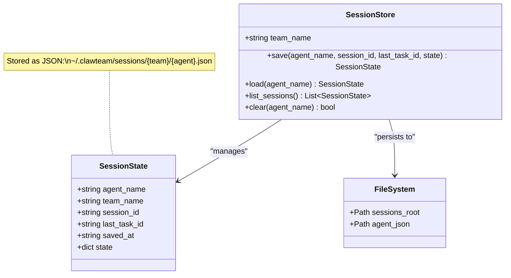
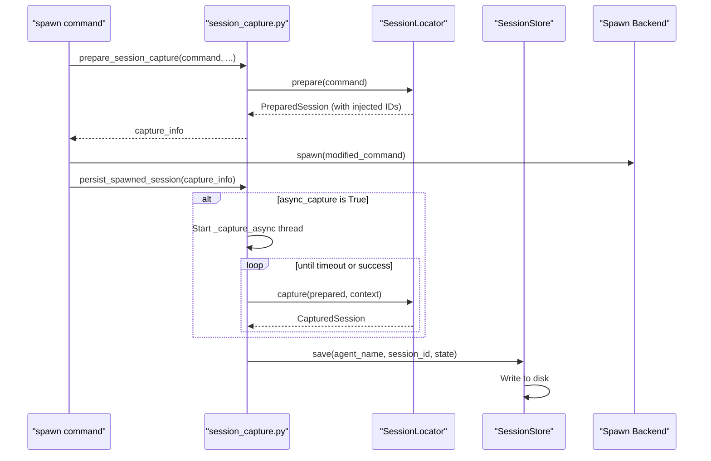

<!-- source: DeepWiki mcp.deepwiki.com · repo HKUDS/ClawTeam · page 14 Session Management · fetched 2026-11-09 -->

# Session Management

<details>
<summary>Relevant source files</summary>

The following files were used as context for generating this wiki page:

- [clawteam/spawn/session_capture.py](clawteam/spawn/session_capture.py)
- [clawteam/spawn/session_locators/__init__.py](clawteam/spawn/session_locators/__init__.py)
- [clawteam/spawn/session_locators/base.py](clawteam/spawn/session_locators/base.py)
- [clawteam/spawn/sessions.py](clawteam/spawn/sessions.py)
- [clawteam/team/costs.py](clawteam/team/costs.py)
- [tests/test_session_capture.py](tests/test_session_capture.py)

</details>


Session Management enables agents to persist their execution state and resume from where they left off after interruption. This is particularly useful for agents using session-based tools like Claude Code or Codex, allowing them to continue their work across process restarts without losing conversation context.

---

## Overview

The Session Management system provides a persistence mechanism for agents to checkpoint their work. It includes a sophisticated "Session Capture" system that can automatically discover native client session IDs (like those from Claude Code, Codex, or Gemini CLI) even when they aren't explicitly provided.

**Key Components:**
- **`SessionStore`**: Handles the physical persistence of `SessionState` to disk.
- **`SessionLocator`**: Protocol-based system for detecting and resuming sessions for specific CLI clients.
- **`SessionCapture`**: Logic for matching spawned processes to their corresponding native tool sessions.

**Sources:**
- [clawteam/spawn/sessions.py:1-44]()
- [clawteam/spawn/session_capture.py:1-31]()

---

## Session Data Model



The `SessionState` class includes a `state` dictionary [clawteam/spawn/sessions.py:30]() used to store client-specific metadata such as `confidence` levels, `cwd`, and the original `command` [clawteam/spawn/session_capture.py:191-198]().

**Sources:**
- [clawteam/spawn/sessions.py:20-31]()
- [clawteam/spawn/sessions.py:39-44]()

---

## Session Capture and Locators

ClawTeam uses a registry of `SessionLocator` implementations to handle different AI CLI tools.

```mermaid
graph TD
    subgraph "Code Entity Space"
        SLC["SessionLocator Protocol"]
        CSL["ClaudeSessionLocator"]
        DXL["CodexSessionLocator"]
        GSL["GeminiSessionLocator"]
        OCL["OpenClawSessionLocator"]
    end

    subgraph "Natural Language Space"
        CL["Claude Code CLI"]
        DX["Codex CLI"]
        GM["Gemini CLI"]
    end

    SLC <|-- CSL
    SLC <|-- DXL
    SLC <|-- GSL
    SLC <|-- OCL

    CSL -.-> CL
    DXL -.-> DX
    GSL -.-> GM
```

### Locator Functions
Each locator implements the `SessionLocator` protocol [clawteam/spawn/session_locators/base.py:89-105]():
- `matches(command)`: Checks if a command belongs to this client.
- `prepare(command, context)`: Modifies the command to ensure the session can be captured (e.g., injecting a unique ID).
- `capture(prepared, context)`: Searches local logs or environment to find the session ID after the process starts.
- `resume_command(command, session_id)`: Generates the specific CLI syntax to resume that session.

**Sources:**
- [clawteam/spawn/session_locators/base.py:89-105]()
- [clawteam/spawn/session_locators/__init__.py:21-28]()

---

## Session Capture Workflow

The capture workflow bridges the gap between spawning an agent and identifying the session ID generated by the underlying tool.



### Confidence Levels
When capturing sessions, the system uses a ranking system [clawteam/spawn/session_locators/base.py:15-19]() to decide if a newly discovered session should overwrite an existing one:
- `exact` (30): Matches a specific unique ID injected during preparation.
- `hinted` (20): Matches via metadata like agent name or task ID in recent logs.
- `latest` (10): Matches the most recent session found in the tool's history.

**Sources:**
- [clawteam/spawn/session_capture.py:34-63]()
- [clawteam/spawn/session_capture.py:66-112]()
- [clawteam/spawn/session_capture.py:202-204]()

---

## CLI Integration

### Resuming Sessions
When `spawn --resume` is called, the system looks up the stored session and uses the appropriate locator to rebuild the command.

```python
# Example of how resume commands are built for different tools
# [tests/test_session_capture.py:55-59]
build_resume_command(["claude"], "sess-1")       # -> ["claude", "--resume", "sess-1"]
build_resume_command(["codex"], "sess-2")        # -> ["codex", "resume", "sess-2"]
```

### Saving Current Sessions
The `save_current_agent_session` function allows an active agent to persist its own environment. It prioritizes environment variables like `CODEX_THREAD_ID` or `CLAUDE_CODE_SESSION`.

**Sources:**
- [clawteam/spawn/session_capture.py:115-136]()
- [clawteam/spawn/session_capture.py:139-153]()

---

## Storage Layout

Sessions are stored in the ClawTeam data directory, organized by team.

```
~/.clawteam/
└── sessions/
    └── {team_name}/
        ├── {agent_name}.json
        └── {agent_name}.json.tmp (during atomic write)
```

The `SessionStore` uses atomic writes [clawteam/spawn/sessions.py:66-71]() by writing to a `.tmp` file and then calling `os.replace` to prevent data corruption.

**Sources:**
- [clawteam/spawn/sessions.py:33-36]()
- [clawteam/spawn/sessions.py:46-72]()

---

## Client-Specific Logic

| Client | Discovery Mechanism | Resume Syntax |
| :--- | :--- | :--- |
| **Claude** | `--session-id` injection or `CLAUDE_CODE_SESSION` env | `claude --resume <id>` |
| **Codex** | Matches `user_message` in `.jsonl` rollout files to `CurrentSessionHint` | `codex resume <id>` |
| **Gemini** | Scans `~/.gemini/tmp/` for `session.json` matching the CWD | `gemini --resume <id>` |
| **OpenCode** | Calls `opencode session list` and matches CWD | `opencode --session <id>` |

**Sources:**
- [clawteam/spawn/session_locators/base.py:23-54]()
- [tests/test_session_capture.py:74-111]()
- [tests/test_session_capture.py:161-191]()

---

