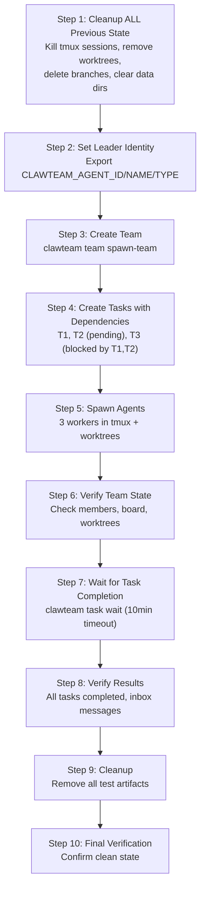
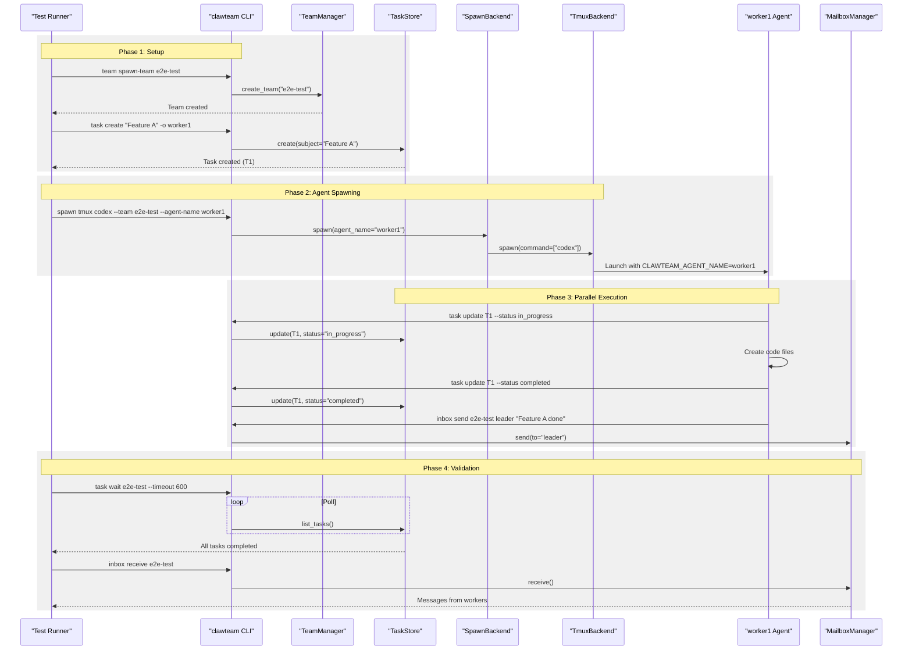
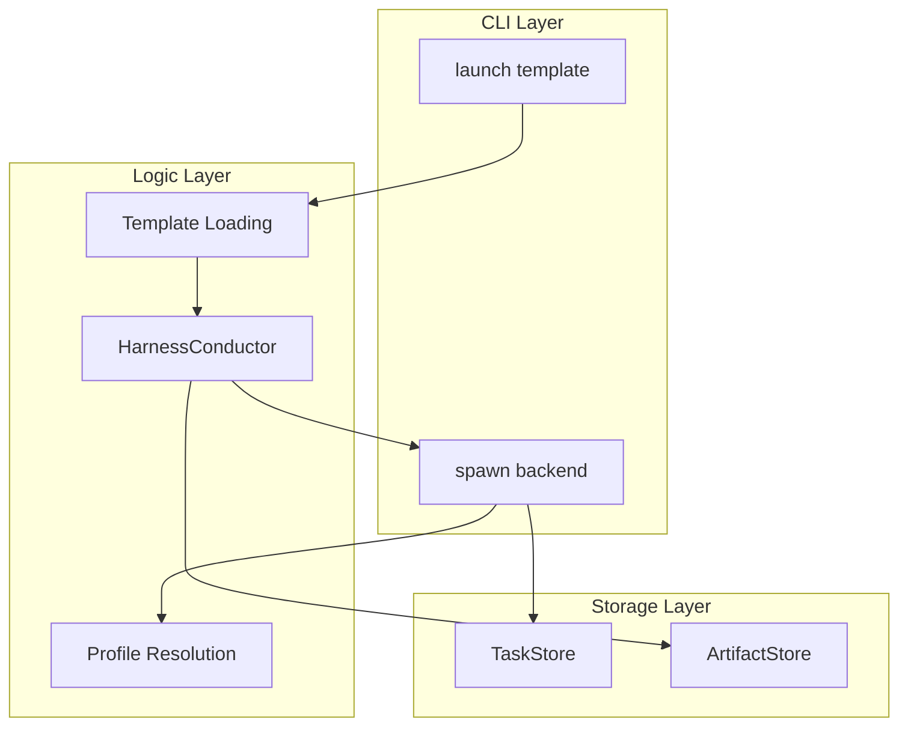

<!-- source: DeepWiki mcp.deepwiki.com · repo HKUDS/ClawTeam · page 15.1 End-to-End Testing · fetched 2026-11-09 -->

# End-to-End Testing

<details>
<summary>Relevant source files</summary>

The following files were used as context for generating this wiki page:

- [clawteam/harness/conductor.py](clawteam/harness/conductor.py)
- [clawteam/harness/contract_executor.py](clawteam/harness/contract_executor.py)
- [clawteam/harness/prompts.py](clawteam/harness/prompts.py)
- [clawteam/spawn/profiles.py](clawteam/spawn/profiles.py)
- [clawteam/spawn/tmux_backend.py](clawteam/spawn/tmux_backend.py)
- [tests/__init__.py](tests/__init__.py)
- [tests/conftest.py](tests/conftest.py)
- [tests/test_harness.py](tests/test_harness.py)
- [tests/test_manager.py](tests/test_manager.py)
- [tests/test_models.py](tests/test_models.py)
- [tests/test_profiles.py](tests/test_profiles.py)
- [tests/test_spawn_backends.py](tests/test_spawn_backends.py)
- [tests/test_spawn_cli.py](tests/test_spawn_cli.py)
- [tests/test_templates.py](tests/test_templates.py)

</details>


This document describes ClawTeam's comprehensive end-to-end test suite, which validates the complete agent lifecycle from team creation through task execution to cleanup. The E2E test exercises all major subsystems—team management, task dependencies, agent spawning, workspace isolation, messaging, and monitoring—in a single integrated workflow.

For information about the overall testing strategy and contribution guidelines, see [Testing and Development](#15). For architectural details about the components being tested, see [Architecture Deep Dive](#11).

## Purpose and Scope

The E2E test validates ClawTeam's ability to coordinate multiple autonomous agents working on interdependent tasks. It simulates a realistic software engineering workflow where a leader agent creates a team, defines tasks with dependencies, spawns worker agents in isolated environments, and monitors their progress to completion. The test verifies correct behavior across the entire stack: CLI commands, storage layer, task dependency resolution, agent spawning, workspace isolation, inter-agent messaging, and resource cleanup.

**Sources:** [tests/test_spawn_backends.py:1-25](), [tests/test_spawn_cli.py:32-51]()

## Prerequisites

The E2E test requires the following components to be available on the system:

| Component | Requirement | Purpose |
|-----------|-------------|---------|
| ClawTeam | `pip install -e .` from repo root | Core framework under test |
| tmux | Available in `$PATH` | Default backend for agent isolation [clawteam/spawn/tmux_backend.py:61-62]() |
| Agent CLI | `codex`, `claude`, etc. | Agent execution [clawteam/spawn/tmux_backend.py:13-23]() |
| Git repository | Current directory must be a git repo | Enables worktree isolation |
| File system access | `~/.clawteam/` writable | Persistent storage [clawteam/team/models.py:30-30]() |

The test environment must allow for environment variable propagation, as the spawning backends rely on injecting `CLAWTEAM_*` variables into the agent runtime [clawteam/spawn/tmux_backend.py:73-79]().

**Sources:** [clawteam/spawn/tmux_backend.py:61-89](), [tests/test_spawn_backends.py:136-145]()

## Test Architecture

### Overall Flow

The E2E test procedure exercises the complete ClawTeam lifecycle:



**Sources:** [tests/test_spawn_cli.py:32-51](), [clawteam/harness/conductor.py:106-149]()

### Test Execution Sequence

The following sequence diagram shows the interaction between test components and ClawTeam subsystems during the E2E test:



**Sources:** [clawteam/spawn/tmux_backend.py:46-108](), [clawteam/harness/contract_executor.py:56-99](), [tests/test_spawn_backends.py:190-200]()

## Detailed Test Steps

### Step 1: Complete State Cleanup

The first step removes all residual state. This ensures a reproducible starting point.

**Commands executed:**
- Kill `clawteam-*` tmux sessions.
- Remove all team/task/workspace data in the directory defined by `get_data_dir()` [clawteam/team/models.py:30-30]().

**Sources:** [tests/conftest.py:10-19](), [tests/test_spawn_cli.py:32-38]()

### Step 2: Leader Identity Propagation

Set environment variables that establish the test runner's identity as the team leader.

```bash
export CLAWTEAM_AGENT_ID="e2e-leader-001"
export CLAWTEAM_AGENT_NAME="leader"
export CLAWTEAM_AGENT_TYPE="leader"
export CLAWTEAM_AGENT_LEADER="1"
```

The `TmuxBackend` specifically checks for `CLAWTEAM_AGENT_LEADER` to determine if the spawned agent has leader privileges [clawteam/spawn/tmux_backend.py:78-78]().

**Sources:** [clawteam/spawn/tmux_backend.py:73-79]()

### Step 3: Team Creation

Create a new team using `team spawn-team`, which initializes the team structure.

**Command:**
```bash
clawteam team spawn-team e2e-test -n leader
```

**Expected behavior:**
- `TeamManager.create_team` is called [tests/test_spawn_cli.py:34-38]().
- Team metadata is persisted to the data directory.

**Sources:** [tests/test_spawn_cli.py:32-38](), [clawteam/team/manager.py:6-6]()

### Step 4: Task Dependency Chain Creation

Create tasks that form a dependency graph using the `TaskStore` [clawteam/harness/contract_executor.py:59-59]().

**Logic:**
- Task T1 and T2 are created as `pending`.
- Task T3 is created with `blocked_by=[T1.id, T2.id]` [clawteam/harness/contract_executor.py:87-87]().

**Sources:** [clawteam/harness/contract_executor.py:56-99](), [clawteam/team/models.py:17-26]()

### Step 5: Agent Spawning with Workspace Isolation

Spawn agents using the selected backend. The `TmuxBackend` creates separate windows [clawteam/spawn/tmux_backend.py:38-39](), while the `SubprocessBackend` runs them as background tasks [tests/test_spawn_backends.py:106-117]().

**Backend Selection:**
The system uses `get_backend` to resolve the requested strategy [tests/test_spawn_cli.py:39-39]().

**Sources:** [clawteam/spawn/tmux_backend.py:35-60](), [tests/test_spawn_backends.py:60-70]()

### Step 6: Team State Verification

Verify that the team is correctly configured with all members. `TeamManager.list_members` is used to validate the roster [tests/test_spawn_cli.py:50-50]().

**Sources:** [tests/test_spawn_cli.py:32-51]()

### Step 7: Task Completion Wait

Use the `task wait` command to block until all tasks complete. The `ContractExecutor` provides a `check_wave_completion` helper that iterates through tasks in the `TaskStore` to verify they have reached `TaskStatus.completed` [clawteam/harness/contract_executor.py:109-121]().

**Sources:** [clawteam/harness/contract_executor.py:109-121](), [clawteam/team/models.py:121-125]()

### Step 8: Results Verification

Validate that all tasks completed successfully. The `HarnessOrchestrator` and `PhaseRunner` track history and artifacts produced during the run [clawteam/harness/phases.py:13-15](), [tests/test_harness.py:106-112]().

**Sources:** [tests/test_harness.py:46-54](), [clawteam/harness/artifacts.py:4-4]()

### Step 9: Complete Cleanup

Remove all test artifacts. This includes clearing the `TaskStore` and `MailboxManager` for the specific team.

**Sources:** [tests/conftest.py:10-19]()

### Step 10: Final Clean State Verification

Confirm that no orphaned processes or data files remain. The `RegistryHealthCheck` can be used to identify "dead" agents that were not properly cleaned up [clawteam/harness/conductor.py:21-29]().

**Sources:** [clawteam/harness/conductor.py:21-29]()

## Validation Coverage

The E2E test validates the following components:

### Component Testing Matrix

| Component | Tested Functionality | Validation Method |
|-----------|---------------------|-------------------|
| **Spawn Backend** | Environment propagation and command execution | `test_subprocess_backend_prepends_current_clawteam_bin_to_path` [tests/test_spawn_backends.py:39-46]() |
| **Profile System** | Mapping provider-specific env vars and models | `test_apply_profile_maps_claude_provider_and_model` [tests/test_profiles.py:14-22]() |
| **Task Store** | Persistence and dependency tracking | `test_defaults` for `TaskItem` [tests/test_models.py:18-26]() |
| **Harness** | Phase advancement and gate blocking | `test_advance_through_phases` [tests/test_harness.py:47-54]() |
| **Template System** | Variable substitution in task definitions | `test_basic_substitution` [tests/test_templates.py:17-19]() |

**Sources:** [tests/test_spawn_backends.py:39-75](), [tests/test_profiles.py:14-30](), [tests/test_harness.py:46-54]()

### Integration Points Tested

The following cross-component interactions are validated:



**Key integration scenarios:**

1. **Profile to Command Mapping:** Ensures that choosing a profile like `moonshot-kimi` correctly resolves to the `kimi` executable with appropriate `--model` and `KIMI_API_KEY` [tests/test_spawn_cli.py:151-161]().
2. **Contract to Task Conversion:** Validates that `SprintContract` definitions are correctly parsed and instantiated as `TaskItem` objects in the `TaskStore` with proper wave-based dependencies [clawteam/harness/contract_executor.py:71-93]().
3. **Harness Phase Gating:** Verifies that the `HarnessConductor` will not advance phases if an `ArtifactRequiredGate` is not satisfied [tests/test_harness.py:56-63]().

**Sources:** [clawteam/spawn/profiles.py:86-142](), [clawteam/harness/contract_executor.py:29-54](), [tests/test_harness.py:56-71]()

---

