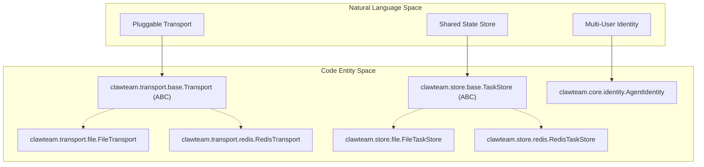
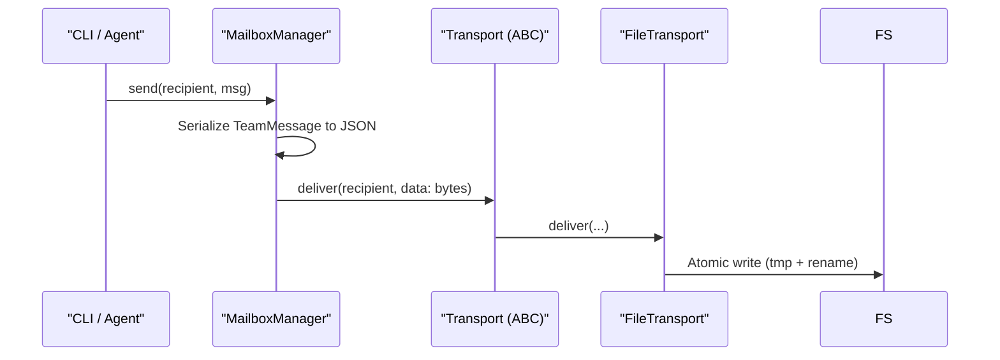
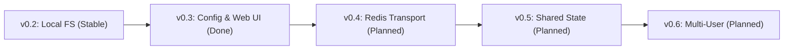

<!-- source: DeepWiki mcp.deepwiki.com · repo HKUDS/ClawTeam · page 15.2 Roadmap · fetched 2026-11-09 -->

# Roadmap

<details>
<summary>Relevant source files</summary>

The following files were used as context for generating this wiki page:

- [.github/workflows/ci.yml](.github/workflows/ci.yml)
- [ROADMAP.md](ROADMAP.md)
- [docs/index.html](docs/index.html)
- [docs/transport-architecture.md](docs/transport-architecture.md)
- [package.json](package.json)
- [website/index.html](website/index.html)
- [website/src/App.jsx](website/src/App.jsx)

</details>


This document describes the planned architectural evolution of ClawTeam from its current single-machine, file-based implementation to a distributed, multi-user system with pluggable storage backends. It details the phased approach for introducing transport abstractions, Redis support, shared state management, and enhanced collaboration features.

---

## Current State (v0.2-v0.3)

ClawTeam currently operates as a single-user, single-machine system with file-based storage. All coordination happens through the local filesystem at `~/.clawteam/` [ROADMAP.md:3-12]().

### Architecture Characteristics

| Aspect | Implementation |
|--------|----------------|
| **User Model** | Single user per machine (with user identity prefixing) |
| **Machine Support** | Native file I/O; requires shared FS for multi-machine |
| **Storage Backend** | Pure filesystem (`~/.clawteam/`) |
| **Dependencies** | Zero external dependencies (Redis/P2P optional) |
| **Communication** | File-based message passing (default) |
| **Configuration** | Environment variables + config file |

### v0.3 Completed Features

As of v0.3, the following features have been implemented:

- **Config System**: `clawteam config show/set/get/health` commands [ROADMAP.md:189-189]().
- **Multi-User Support**: `CLAWTEAM_USER` environment variable and `(user, name)` composite unique identity [ROADMAP.md:190-190]().
- **Web UI**: `clawteam board serve` with SSE real-time updates [ROADMAP.md:191-191]().
- **Cross-Machine Support**: SSHFS/cloud storage + `CLAWTEAM_DATA_DIR` for zero-code-change distribution [ROADMAP.md:192-192]().

**Sources:** [ROADMAP.md:3-12](), [ROADMAP.md:184-193]()

---

## Architectural Evolution Overview

The following diagram bridges the high-level roadmap concepts to the specific code entities planned for implementation.

### Mapping Roadmap to Code Entities



**Sources:** [ROADMAP.md:40-51](), [docs/transport-architecture.md:5-45]()

---

## Phase 1: Transport Abstraction Layer (v0.3/v0.4)

The goal is to make the message communication layer pluggable without changing upper-layer interfaces [ROADMAP.md:15-17]().

### Architecture Change



### Implementation Tasks

| Task | Description | Source |
|------|-------------|--------|
| **Define Transport Interface** | `send()`, `receive()`, `peek()`, `peek_count()`, `broadcast()` | [ROADMAP.md:34-34]() |
| **Refactor FileTransport** | Extract current file operations from `mailbox.py` | [ROADMAP.md:35-35]() |
| **TaskStore Abstraction** | Extract `FileTaskStore` and define base interface | [ROADMAP.md:37-37]() |

**Sources:** [ROADMAP.md:15-55](), [docs/transport-architecture.md:1-58]()

---

## Phase 2: Redis Transport (v0.4)

Phase 2 introduces support for cross-machine messaging using Redis as a high-frequency, real-time communication channel [ROADMAP.md:57-69]().

### Cross-Machine Configuration

```bash
# Machine A (Leader)
export CLAWTEAM_TRANSPORT=redis
export CLAWTEAM_REDIS_URL=redis://192.168.1.100:6379
clawteam team spawn-team dev-team -n leader

# Machine B (Worker)
export CLAWTEAM_TRANSPORT=redis
export CLAWTEAM_REDIS_URL=redis://192.168.1.100:6379
clawteam inbox receive dev-team --agent worker1
```

### Key Tasks
- **RedisTransport Implementation**: Use `LPUSH`/`RPOP` for messaging [ROADMAP.md:75-75]().
- **Connection Management**: URL configuration and connection pooling [ROADMAP.md:76-76]().
- **Mixed Mode**: Messages via Redis, but configuration/tasks still via shared filesystem [ROADMAP.md:79-79]().

**Sources:** [ROADMAP.md:57-98]()

---

## Phase 3: Shared State Layer (v0.5)

Phase 3 aims to move team configuration and task data out of the local filesystem and into a shared storage backend [ROADMAP.md:101-105]().

### Routes for Shared State

| Route | Implementation | Complexity |
|-------|----------------|------------|
| **Route A: NFS** | Mount shared drive to `CLAWTEAM_DATA_DIR` | Zero code changes [ROADMAP.md:109-117]() |
| **Route B: Redis Store** | `RedisTeamStore` and `RedisTaskStore` using Redis Hashes | Requires new Store classes [ROADMAP.md:119-128]() |

### Implementation Details (Route B)
- **RedisTeamStore**: Team config stored in Redis Hash [ROADMAP.md:133-133]().
- **RedisTaskStore**: Task data stored in Redis Hash [ROADMAP.md:134-134]().
- **Migration Tool**: `clawteam migrate file-to-redis` [ROADMAP.md:135-135]().

**Sources:** [ROADMAP.md:101-139]()

---

## Phase 4: Multi-User Collaboration (v0.6)

This phase enables agents owned by different users to form a single team [ROADMAP.md:142-145]().

### Features
- **User Identity**: Distinguish agents by owner (e.g., `user1/worker1`) [ROADMAP.md:150-152]().
- **Permissions**: Control who can create teams, join, or view tasks [ROADMAP.md:151-151]().
- **Token Authentication**: Identity verification for Redis connections [ROADMAP.md:153-153]().

**Sources:** [ROADMAP.md:142-162]()

---

## Development Roadmap Summary



### Parallel Work Division
For development, work is split between Transport (Messaging) and Store (State) tracks:
- **Person A**: Transport Abstraction -> RedisTransport -> RedisTeamStore [ROADMAP.md:199-205]().
- **Person B**: Store Abstraction -> FileTaskStore -> RedisTaskStore [ROADMAP.md:200-206]().

**Sources:** [ROADMAP.md:180-210]()

---

