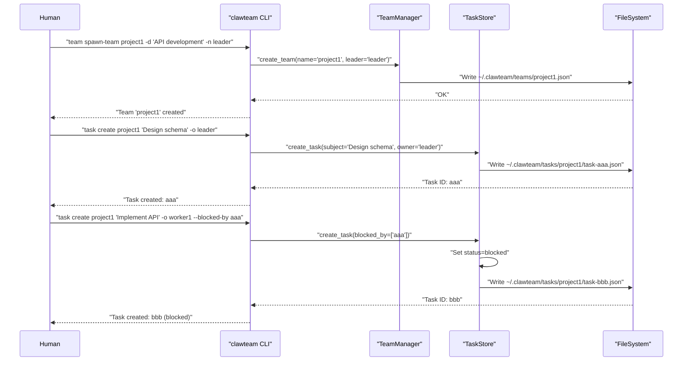
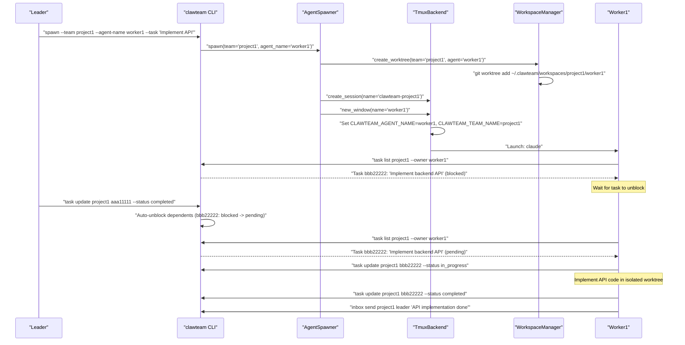
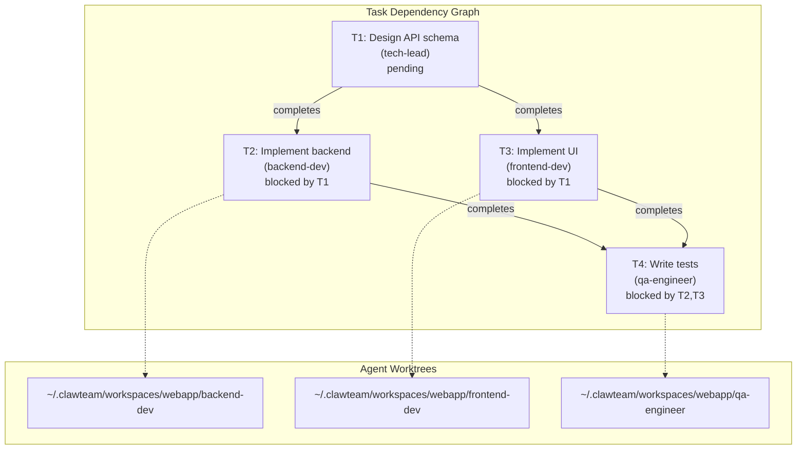
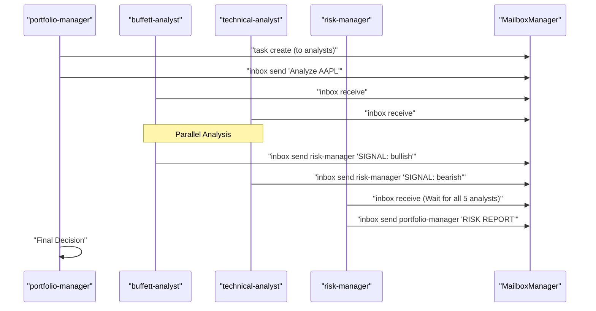

<!-- source: DeepWiki mcp.deepwiki.com · repo HKUDS/ClawTeam · page 16 Example Workflows · fetched 2026-11-09 -->

# Example Workflows

<details>
<summary>Relevant source files</summary>

The following files were used as context for generating this wiki page:

- [LICENSE](LICENSE)
- [README.md](README.md)
- [clawteam/templates/code-review.toml](clawteam/templates/code-review.toml)
- [clawteam/templates/hedge-fund.toml](clawteam/templates/hedge-fund.toml)
- [clawteam/templates/research-paper.toml](clawteam/templates/research-paper.toml)
- [clawteam/templates/software-dev.toml](clawteam/templates/software-dev.toml)
- [clawteam/templates/strategy-room.toml](clawteam/templates/strategy-room.toml)
- [scripts/clawteam_local_install](scripts/clawteam_local_install)
- [scripts/install_clawteam.sh](scripts/install_clawteam.sh)
- [skills/clawteam/references/workflows.md](skills/clawteam/references/workflows.md)

</details>


This page demonstrates real-world ClawTeam workflows through complete, executable examples. Each workflow shows the full command sequence from team creation through agent coordination to cleanup, with expected outputs and state transitions.

For detailed breakdowns of specific team archetypes, see [Software Engineering Team](#16.1) and [AI Hedge Fund Team](#16.2). For CLI command syntax, see [CLI Command Reference](#10).

---

## Workflow Categories

ClawTeam workflows fall into three categories based on initialization approach:

| Category | Description | Example |
|----------|-------------|---------|
| **Manual Coordination** | Human directly executes commands as team leader | Basic task assignment |
| **Agent-Driven** | AI agent (e.g., Claude Code) calls `clawteam` commands | Multi-agent software development |
| **Template-Based** | Pre-configured team launched with `clawteam launch` | Hedge fund analysis team |

All workflows follow the same core pattern: team creation → task definition → agent spawning → coordination → cleanup.

**Sources:** [README.md:352-396](), [skills/clawteam/references/workflows.md:1-208]()

---

## Workflow 1: Basic Team Coordination

This workflow demonstrates fundamental ClawTeam operations: creating a team, assigning tasks with dependencies, spawning workers, and monitoring progress.

### Setup Phase



**Commands:**

```bash
# 1. Set leader identity
export CLAWTEAM_AGENT_ID="leader-001"
export CLAWTEAM_AGENT_NAME="leader"
export CLAWTEAM_AGENT_TYPE="leader"

# 2. Create team
clawteam team spawn-team project1 -d "API development" -n leader

# 3. Create tasks with dependency
clawteam task create project1 "Design API schema" -o leader
# Expected: Task created: aaa11111

clawteam task create project1 "Implement backend API" -o worker1 --blocked-by aaa11111
# Expected: Task created: bbb22222 (status: blocked)

# 4. Verify board state
clawteam board show project1
```

**Sources:** [skills/clawteam/references/workflows.md:3-35](), [clawteam/templates/software-dev.toml:7-33]()

### Execution Phase



**Commands:**

```bash
# 5. Spawn worker agent
clawteam spawn --team project1 --agent-name worker1 \
  --task "Implement the backend API endpoints in your git worktree. Mark task as completed when done."

# 6. Leader completes design task
clawteam task update project1 aaa11111 --status completed

# 7. Verify auto-unblock
clawteam task list project1 --status pending

# 8. Monitor worker progress
clawteam board attach project1

# 9. Check for completion messages
clawteam inbox receive project1
```

**Sources:** [skills/clawteam/references/workflows.md:37-81](), [clawteam/templates/software-dev.toml:35-52]()

---

## Workflow 2: Multi-Agent Development (Parallel Work)

This workflow demonstrates parallel agent execution using a template for complex task dependencies and inter-agent messaging.



**Template-Based Launch:**

```bash
# Launch a full team from the software-dev template
clawteam launch software-dev --team webapp --goal "Build a RESTful todo app with React"

# Monitor in real-time
clawteam board live webapp --interval 5
```

**Sources:** [clawteam/templates/software-dev.toml:1-129](), [README.md:271-302]()

---

## Workflow 3: AI Hedge Fund (Consolidation Pattern)

This workflow demonstrates the "Specialist Synthesis" pattern, where multiple agents report to a manager who waits for all inputs before acting.



**Template Logic:**
The `portfolio-manager` and `risk-manager` use a polling loop to wait for specialist completion:
```bash
# Logic inside template
sleep 45 && clawteam board show {team_name}
# Repeat until ALL analyst tasks show "completed"
```

**Sources:** [clawteam/templates/hedge-fund.toml:1-164](), [clawteam/templates/strategy-room.toml:14-32]()

---

## Workflow 4: Strategy Room (Decision Pattern)

This workflow focuses on cross-functional tradeoff analysis using the `strategy-room` template.

| Agent | Role | Focus |
|-------|------|-------|
| `strategy-lead` | Coordinator | Frames problem, creates tasks, finalizes recommendation |
| `systems-analyst` | Architect | Evaluates boundaries, tradeoffs, and operational complexity |
| `delivery-planner`| Project Manager | Breaks down milestones and sequencing |
| `risk-mapper` | Security/Risk | Identifies failure modes and hidden assumptions |
| `decision-editor` | Synthesizer | Consolidates specialist outputs into a strategy memo |

**Sources:** [clawteam/templates/strategy-room.toml:1-128]()

---

## Summary of Patterns

ClawTeam workflows leverage these core patterns:

1.  **Chain Dependency:** Task A blocks Task B (e.g., Design blocks Code).
2.  **Fan-Out/Fan-In:** One leader spawns multiple specialists who report back to a single synthesizer.
3.  **Polling Wait:** Leaders use `sleep` and `board show` or `task wait` to coordinate without blocking the CLI process indefinitely.
4.  **Isolated Workspaces:** Each agent operates in a unique `git worktree` to prevent merge conflicts during development.

**Sources:** [skills/clawteam/references/workflows.md:164-208](), [clawteam/templates/code-review.toml:1-105]()

---

