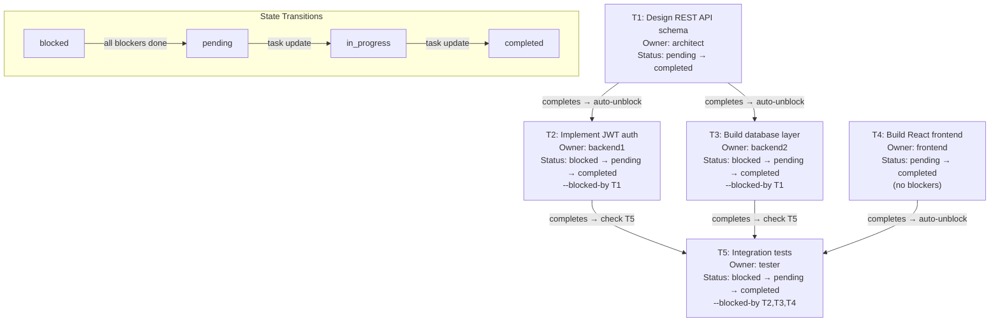

<!-- source: DeepWiki mcp.deepwiki.com · repo HKUDS/ClawTeam · page 16.1 Software Engineering Team · fetched 2026-11-09 -->

# Software Engineering Team

<details>
<summary>Relevant source files</summary>

The following files were used as context for generating this wiki page:

- [LICENSE](LICENSE)
- [README.md](README.md)
- [clawteam/templates/code-review.toml](clawteam/templates/code-review.toml)
- [clawteam/templates/hedge-fund.toml](clawteam/templates/hedge-fund.toml)
- [clawteam/templates/research-paper.toml](clawteam/templates/research-paper.toml)
- [clawteam/templates/software-dev.toml](clawteam/templates/software-dev.toml)
- [clawteam/templates/strategy-room.toml](clawteam/templates/strategy-room.toml)
- [scripts/clawteam_local_install](scripts/clawteam_local_install)
- [scripts/install_clawteam.sh](scripts/install_clawteam.sh)
- [skills/clawteam/references/workflows.md](skills/clawteam/references/workflows.md)

</details>


This document demonstrates how ClawTeam coordinates a multi-agent team for software development tasks. It walks through a complete example of building a full-stack web application with authentication, showing how a leader agent orchestrates multiple specialized worker agents through task dependencies, parallel execution, and inter-agent messaging.

For information about launching pre-configured teams from templates, see [Team Templates](). For general coordination patterns across different domains, see [Example Workflows]().

**Sources:** [README.md:271-301](), [skills/clawteam/references/workflows.md:37-80]()

---

## Overview

The software engineering workflow demonstrates ClawTeam's ability to coordinate parallel development across multiple components. A leader agent decomposes a complex project (building a full-stack todo application with authentication, database, and React frontend) into discrete tasks, spawns specialized worker agents in isolated git worktrees, and manages dependencies to ensure correct execution order.

**Key Capabilities Demonstrated:**
- Task dependency chains with automatic unblocking.
- Parallel agent execution in isolated workspaces.
- Inter-agent communication via `inbox send` and `inbox receive`.
- Git worktree-based workspace isolation.
- Coordinated shutdown and workspace merging.

**Sources:** [README.md:272-301]()

---

## Team Structure

```mermaid
graph TB
    subgraph "Software Engineering Team: webapp"
        Leader["Leader Agent<br/>claude (tmux session)"]
        
        Architect["Architect Agent<br/>clawteam-webapp/architect<br/>Task: Design REST API schema"]
        Backend1["Backend Agent 1<br/>clawteam-webapp/backend1<br/>Task: Implement JWT auth"]
        Backend2["Backend Agent 2<br/>clawteam-webapp/backend2<br/>Task: Build database layer"]
        Frontend["Frontend Agent<br/>clawteam-webapp/frontend<br/>Task: Build React frontend"]
        Tester["Tester Agent<br/>clawteam-webapp/tester<br/>Task: Integration tests"]
    end
    
    subgraph "Git Worktrees (Workspace Isolation)"
        WT_Arch["git worktree<br/>clawteam/webapp/architect<br/>branch"]
        WT_BE1["git worktree<br/>clawteam/webapp/backend1<br/>branch"]
        WT_BE2["git worktree<br/>clawteam/webapp/backend2<br/>branch"]
        WT_FE["git worktree<br/>clawteam/webapp/frontend<br/>branch"]
        WT_Test["git worktree<br/>clawteam/webapp/tester<br/>branch"]
    end
    
    subgraph "Shared State (~/.clawteam/)"
        TeamData["teams/webapp.json<br/>members, leader"]
        TaskStore["tasks/webapp/<br/>T1.json, T2.json, ...]
        InboxDir["inboxes/webapp/<br/>architect/, backend1/, ..."]
    end
    
    Leader -->|"clawteam spawn"| Architect
    Leader -->|"clawteam spawn"| Backend1
    Leader -->|"clawteam spawn"| Backend2
    Leader -->|"clawteam spawn"| Frontend
    Leader -->|"clawteam spawn"| Tester
    
    Architect -->|"works in"| WT_Arch
    Backend1 -->|"works in"| WT_BE1
    Backend2 -->|"works in"| WT_BE2
    Frontend -->|"works in"| WT_FE
    Tester -->|"works in"| WT_Test
    
    Leader -->|"reads/writes"| TeamData
    Leader -->|"creates tasks"| TaskStore
    Architect -->|"task update"| TaskStore
    Backend1 -->|"task update"| TaskStore
    Backend2 -->|"task update"| TaskStore
    Frontend -->|"task update"| TaskStore
    Tester -->|"task update"| TaskStore
    
    Architect -->|"inbox send"| InboxDir
    Backend1 -->|"inbox send"| InboxDir
    Tester -->|"inbox send"| InboxDir
```

**Sources:** [README.md:273-301](), [skills/clawteam/references/workflows.md:37-59]()

---

## Task Dependency Graph



**Dependency Resolution Logic:**
1. Tasks T2 and T3 start in `blocked` status due to `--blocked-by T1` [skills/clawteam/references/workflows.md:20-24]().
2. Task T5 starts in `blocked` status due to `--blocked-by T2,T3,T4` [skills/clawteam/references/workflows.md:26-27]().
3. When T1 completes via `clawteam task update webapp <T1-id> --status completed`, the system automatically transitions dependents to `pending` [skills/clawteam/references/workflows.md:32-35]().

**Sources:** [README.md:280-295](), [skills/clawteam/references/workflows.md:16-35]()

---

## Complete Workflow Sequence

```mermaid
sequenceDiagram
    participant Human
    participant Leader as Leader Agent<br/>(claude)
    participant CLI as clawteam CLI
    participant Architect
    participant Backend1
    participant Backend2
    participant Frontend
    participant Tester
    participant TaskStore as tasks/webapp/
    participant Inbox as inboxes/webapp/
    participant Worktree as git worktrees
    
    Human->>Leader: "Build full-stack todo app with auth"
    
    rect rgb(240, 240, 240)
        note over Leader,CLI: Phase 1: Team Creation
        Leader->>CLI: team spawn-team webapp<br/>-d "Full-stack todo app" -n leader
        CLI->>TaskStore: Create team state
    end
    
    rect rgb(240, 240, 240)
        note over Leader,TaskStore: Phase 2: Task Definition
        Leader->>CLI: task create webapp "Design REST API schema"<br/>-o architect
        CLI->>TaskStore: Create T1 (pending)
        
        Leader->>CLI: task create webapp "Implement JWT auth"<br/>-o backend1 --blocked-by T1
        CLI->>TaskStore: Create T2 (blocked)
        
        Leader->>CLI: task create webapp "Build database layer"<br/>-o backend2 --blocked-by T1
        CLI->>TaskStore: Create T3 (blocked)
        
        Leader->>CLI: task create webapp "Build React frontend"<br/>-o frontend
        CLI->>TaskStore: Create T4 (pending)
        
        Leader->>CLI: task create webapp "Integration tests"<br/>-o tester --blocked-by T2,T3,T4
        CLI->>TaskStore: Create T5 (blocked)
    end
    
    rect rgb(240, 240, 240)
        note over Leader,Tester: Phase 3: Agent Spawning
        Leader->>CLI: spawn --team webapp<br/>--agent-name architect --task "Design API schema"
        CLI->>Worktree: Create worktree clawteam/webapp/architect
        CLI->>Architect: Launch in tmux window<br/>CLAWTEAM_TEAM=webapp<br/>CLAWTEAM_AGENT_NAME=architect
        
        Leader->>CLI: spawn --team webapp<br/>--agent-name backend1
        CLI->>Worktree: Create worktree clawteam/webapp/backend1
        CLI->>Backend1: Launch in tmux window
        
        Leader->>CLI: spawn --team webapp --agent-name backend2
        CLI->>Backend2: Launch (worktree + tmux)
        
        Leader->>CLI: spawn --team webapp --agent-name frontend
        CLI->>Frontend: Launch (worktree + tmux)
        
        Leader->>CLI: spawn --team webapp --agent-name tester
        CLI->>Tester: Launch (worktree + tmux)
    end
    
    rect rgb(240, 240, 240)
        note over Architect,Tester: Phase 4: Parallel Execution
        
        par Architect Workflow
            Architect->>CLI: task list webapp --owner architect
            CLI->>TaskStore: Query tasks
            TaskStore-->>Architect: T1: Design REST API (pending)
            Architect->>CLI: task update webapp T1<br/>--status in_progress
            Architect->>Architect: Design OpenAPI spec in worktree
            Architect->>CLI: task update webapp T1<br/>--status completed
            CLI->>TaskStore: Mark T1 completed<br/>→ Auto-unblock T2, T3
        
        and Backend1 Workflow
            Backend1->>CLI: task list webapp --owner backend1
            TaskStore-->>Backend1: T2: JWT auth (blocked)
            Note over Backend1: Waits...
            TaskStore->>Backend1: T2 auto-unblocked!
            Backend1->>CLI: task update webapp T2<br/>--status in_progress
            Backend1->>Backend1: Implement JWT in worktree
            Backend1->>CLI: task update webapp T2<br/>--status completed
        
        and Backend2 Workflow
            Backend2->>CLI: task list webapp --owner backend2
            TaskStore-->>Backend2: T3: Database (blocked)
            Note over Backend2: Waits...
            TaskStore->>Backend2: T3 auto-unblocked!
            Backend2->>CLI: task update webapp T3<br/>--status in_progress
            Backend2->>Backend2: Build PostgreSQL models
            Backend2->>CLI: task update webapp T3<br/>--status completed
        
        and Frontend Workflow
            Frontend->>CLI: task list webapp --owner frontend
            TaskStore-->>Frontend: T4: React UI (pending)
            Frontend->>CLI: task update webapp T4<br/>--status in_progress
            Frontend->>Frontend: Build React components
            Frontend->>CLI: task update webapp T4<br/>--status completed
        
        and Tester Workflow
            Tester->>CLI: task list webapp --owner tester
            TaskStore-->>Tester: T5: Integration tests (blocked)
            Note over Tester: Waits for T2, T3, T4...
            TaskStore->>Tester: T5 auto-unblocked!
            Tester->>CLI: task update webapp T5<br/>--status in_progress
            Tester->>Tester: Write pytest tests
            Tester->>CLI: task update webapp T5<br/>--status completed
        end
    end
    
    rect rgb(240, 240, 240)
        note over Architect,Leader: Phase 5: Communication
        Architect->>CLI: inbox send webapp leader<br/>"OpenAPI spec ready: /api/docs"
        CLI->>Inbox: Store message in inboxes/webapp/leader/
        
        Backend1->>CLI: inbox send webapp leader<br/>"Auth endpoints ready: /api/auth/*"
        CLI->>Inbox: Store message
        
        Tester->>CLI: inbox send webapp leader<br/>"All 47 tests passing ✅"
        CLI->>Inbox: Store message
        
        Leader->>CLI: inbox receive webapp
        CLI->>Inbox: Retrieve messages
        Inbox-->>Leader: 3 messages received
    end
    
    rect rgb(240, 240, 240)
        note over Leader,Worktree: Phase 6: Workspace Cleanup
        Leader->>CLI: workspace merge webapp architect
        CLI->>Worktree: Merge clawteam/webapp/architect → main
        
        Leader->>CLI: workspace merge webapp backend1
        Leader->>CLI: workspace merge webapp backend2
        Leader->>CLI: workspace merge webapp frontend
        Leader->>CLI: workspace merge webapp tester
        
        Leader->>CLI: workspace cleanup webapp architect
        CLI->>Worktree: Remove worktree + branch
        
        Leader->>CLI: workspace cleanup webapp backend1
        Leader->>CLI: workspace cleanup webapp backend2
        Leader->>CLI: workspace cleanup webapp frontend
        Leader->>CLI: workspace cleanup webapp tester
    end
```



**Sources:** [README.md:275-301](), [skills/clawteam/references/workflows.md:37-80]()

---

## CLI Commands by Phase

### Phase 1: Team Creation

```bash
# Leader sets its identity
export CLAWTEAM_AGENT_ID="leader-001"
export CLAWTEAM_AGENT_NAME="leader"
export CLAWTEAM_AGENT_TYPE="leader"

# Create team
clawteam team spawn-team webapp -d "Full-stack todo app" -n leader
```

**Sources:** [README.md:279](), [skills/clawteam/references/workflows.md:42-43]()

---

### Phase 2: Task Definition with Dependencies

```bash
# T1: API design (no blockers)
clawteam task create webapp "Design REST API schema" -o architect
# => Task ID: T1 (status: pending)

# T2: Auth (blocked by T1)
clawteam task create webapp "Implement JWT auth" -o backend1 --blocked-by T1
# => Task ID: T2 (status: blocked)

# T3: Database (blocked by T1)
clawteam task create webapp "Build database layer" -o backend2 --blocked-by T1
# => Task ID: T3 (status: blocked)

# T4: Frontend (no blockers)
clawteam task create webapp "Build React frontend" -o frontend
# => Task ID: T4 (status: pending)

# T5: Testing (blocked by T2, T3, T4)
clawteam task create webapp "Integration tests" -o tester --blocked-by T2,T3,T4
# => Task ID: T5 (status: blocked)
```

**Sources:** [README.md:280-285](), [skills/clawteam/references/workflows.md:16-27]()

---

### Phase 3: Agent Spawning

```bash
# Spawn architect agent
clawteam spawn tmux claude --team webapp --agent-name architect --agent-type architect
# Launches: tmux window with CLAWTEAM_TEAM=webapp, CLAWTEAM_AGENT_NAME=architect
```

**Sources:** [README.md:286-291](), [skills/clawteam/references/workflows.md:45-48]()

---

### Phase 4: Worker Agent Perspective

From inside a spawned worker agent (e.g., `architect`):

```bash
# Agent checks its identity (auto-set via environment variables)
clawteam identity show
# Output: agentName: architect, teamName: webapp

# Agent queries its assigned tasks
clawteam task list webapp --owner architect

# Agent claims the task
clawteam task update webapp T1 --status in_progress

# Agent marks task complete (triggers auto-unblock of T2 and T3)
clawteam task update webapp T1 --status completed

# Agent notifies leader via inbox
clawteam inbox send webapp leader "OpenAPI spec ready at /api/docs."
```

**Sources:** [skills/clawteam/references/workflows.md:65-80](), [README.md:292-295]()

---

### Phase 5: Inter-Agent Communication

```bash
# Architect sends design document to backend agents
clawteam inbox send webapp backend1 "Here's the OpenAPI spec: api/openapi.yaml."

# Leader checks inbox
clawteam inbox receive webapp
```

**Sources:** [README.md:296-299](), [skills/clawteam/references/workflows.md:53-56]()

---

### Phase 6: Workspace Merging and Cleanup

```bash
# Leader merges each agent's work back to main branch
clawteam workspace merge webapp architect

# Leader cleans up worktrees and branches
clawteam workspace cleanup webapp architect
```

**Sources:** [README.md:300]()

---

## Monitoring the Team

### Terminal Kanban Board

```bash
# Static snapshot
clawteam board show webapp

# Auto-refreshing view (updates every 3 seconds)
clawteam board live webapp --interval 3
```

**Sources:** [skills/clawteam/references/workflows.md:147-158]()

---

### Web Dashboard

```bash
# Start web server
clawteam board serve --port 8080
```

**Sources:** [README.md:193-197]()

---

## Software Development Templates

ClawTeam includes pre-configured templates for common software engineering roles.

### `software-dev` Template
This template defines a complete team with a Tech Lead, Backend Developer, Frontend Developer, QA Engineer, and DevOps Engineer [clawteam/templates/software-dev.toml:1-129]().

| Role | Responsibility | Source |
| :--- | :--- | :--- |
| **Tech Lead** | Breakdown tasks, review code, merge worktrees | [clawteam/templates/software-dev.toml:10-33]() |
| **Backend Dev** | Design APIs, Database schema, Business logic | [clawteam/templates/software-dev.toml:36-52]() |
| **Frontend Dev** | Responsive UI, API integration, UX optimization | [clawteam/templates/software-dev.toml:55-71]() |
| **QA Engineer** | Unit/Integration tests, verify bug fixes | [clawteam/templates/software-dev.toml:74-90]() |
| **DevOps** | CI/CD pipelines, deployment environments | [clawteam/templates/software-dev.toml:93-108]() |

### `code-review` Template
A specialized team for multi-perspective code analysis [clawteam/templates/code-review.toml:1-105]().

- **Security Reviewer**: Input validation, secrets, CVEs [clawteam/templates/code-review.toml:34-50]().
- **Performance Reviewer**: Algorithm complexity, database patterns [clawteam/templates/code-review.toml:53-69]().
- **Architecture Reviewer**: SOLID principles, module boundaries [clawteam/templates/code-review.toml:72-88]().

**Sources:** [clawteam/templates/software-dev.toml:1-129](), [clawteam/templates/code-review.toml:1-105]()

---

## Comparison to Manual Coordination

### Without ClawTeam
Human manually coordinates developers, manages Slack channels, manually tracks dependencies, and resolves workspace conflicts [README.md:203-211]().

### With ClawTeam
Human provides the goal. The Leader agent spawns the swarm, delegates tasks with `--blocked-by`, and delivers results autonomously [README.md:24-28]().

**Sources:** [README.md:24-28](), [README.md:203-211]()

---

