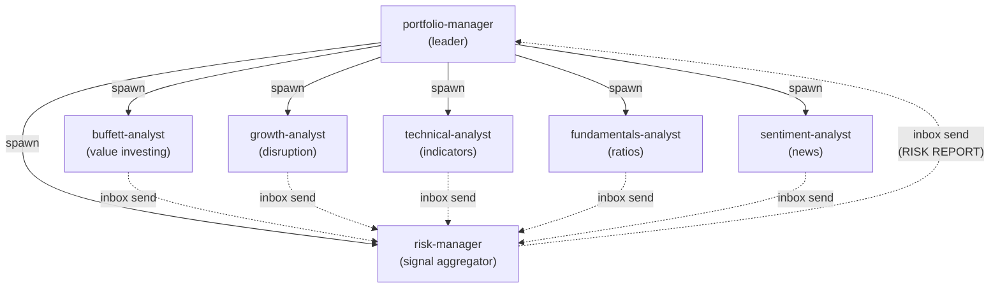
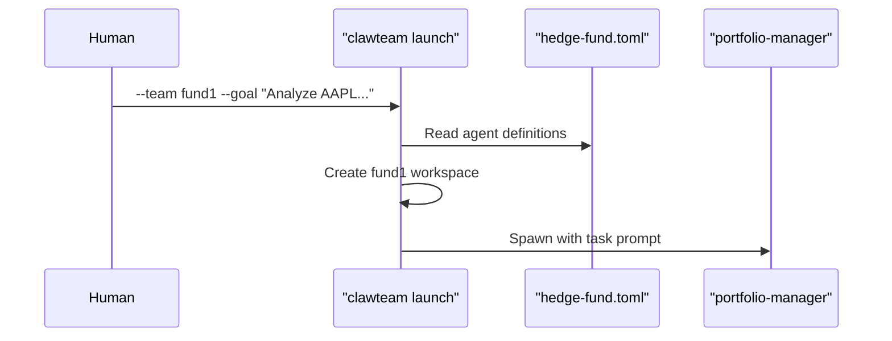

<!-- source: DeepWiki mcp.deepwiki.com · repo HKUDS/ClawTeam · page 16.2 AI Hedge Fund Team · fetched 2026-11-09 -->

# AI Hedge Fund Team

<details>
<summary>Relevant source files</summary>

The following files were used as context for generating this wiki page:

- [README.md](README.md)
- [clawteam/templates/code-review.toml](clawteam/templates/code-review.toml)
- [clawteam/templates/hedge-fund.toml](clawteam/templates/hedge-fund.toml)
- [clawteam/templates/research-paper.toml](clawteam/templates/research-paper.toml)
- [clawteam/templates/software-dev.toml](clawteam/templates/software-dev.toml)
- [clawteam/templates/strategy-room.toml](clawteam/templates/strategy-room.toml)
- [scripts/clawteam_local_install](scripts/clawteam_local_install)
- [scripts/install_clawteam.sh](scripts/install_clawteam.sh)

</details>


This page documents the AI Hedge Fund example workflow, which demonstrates a pre-configured multi-agent team template for investment analysis. The template implements a 7-agent system where specialized analyst agents independently evaluate securities using different investment strategies, then coordinate their findings through a risk manager to produce a unified portfolio recommendation.

For general information about team templates and the `launch` command, see [Team Templates](#8). For details on how agents spawn and coordinate, see [Agent Lifecycle](#9) and [Agent Communication](#5).

## Overview

The hedge fund template showcases ClawTeam's ability to instantiate complex team hierarchies from TOML configuration files. It implements a realistic investment committee structure with specialized analyst roles, demonstrating:

- **Role specialization**: Each agent has a distinct investment strategy and evaluation framework.
- **Signal aggregation**: Multiple independent analyses are consolidated by a risk manager.
- **Hierarchical coordination**: Leader (`portfolio-manager`) orchestrates, analysts execute, risk manager synthesizes.
- **Message-based consensus**: Agents communicate via `inbox send`/`inbox receive` to share findings.

The template is defined in `clawteam/templates/hedge-fund.toml` [clawteam/templates/hedge-fund.toml:1-164]() and can be invoked via:
```bash
clawteam launch hedge-fund --team fund1 --goal "Analyze AAPL, MSFT, NVDA for Q2 2026"
```

**Sources:** [README.md:86-102](), [clawteam/templates/hedge-fund.toml:1-164]()

## Team Structure

The hedge fund template defines 7 agents organized into three tiers:

| Agent Name | Role | Type | Responsibilities |
|------------|------|------|------------------|
| `portfolio-manager` | Orchestrator | `portfolio-manager` | Receives goal, coordinates analysts, makes final buy/sell/hold decisions [clawteam/templates/hedge-fund.toml:8-27]() |
| `buffett-analyst` | Value Investor | `value-analyst` | Analyzes moat, ROE, DCF models [clawteam/templates/hedge-fund.toml:30-45]() |
| `growth-analyst` | Growth Investor | `growth-analyst` | Evaluates TAM, disruption potential, network effects [clawteam/templates/hedge-fund.toml:48-63]() |
| `technical-analyst` | Technician | `technical-analyst` | Charts patterns, EMA, RSI, Bollinger bands [clawteam/templates/hedge-fund.toml:66-81]() |
| `fundamentals-analyst` | Fundamentalist | `fundamentals-analyst` | Computes P/E, D/E, FCF ratios [clawteam/templates/hedge-fund.toml:84-100]() |
| `sentiment-analyst` | Sentiment Tracker | `sentiment-analyst` | Scrapes news, monitors insider trading [clawteam/templates/hedge-fund.toml:103-116]() |
| `risk-manager` | Aggregator | `risk-manager` | Consolidates all signals, computes position limits [clawteam/templates/hedge-fund.toml:119-136]() |

### Agent Hierarchy



**Sources:** [clawteam/templates/hedge-fund.toml:1-164]()

## Workflow Sequence

The hedge fund team follows a three-phase workflow: initialization, parallel analysis, and synthesis.

### Phase 1: Initialization



The `launch` command performs several operations:
1. Reads the `hedge-fund` TOML template [clawteam/templates/hedge-fund.toml:1-5]().
2. Spawns the `portfolio-manager` agent with the user-provided goal [clawteam/templates/hedge-fund.toml:7-12]().
3. Substitutes template variables: `{goal}`, `{team_name}` [clawteam/templates/hedge-fund.toml:10-12]().

**Sources:** [clawteam/templates/hedge-fund.toml:1-12]()

### Phase 2: Parallel Analysis

Analysts operate independently based on their specific frameworks defined in the template:

- **Buffett Analyst**: Focuses on "Moat analysis", "Financial health" (ROE >15%), and "Intrinsic value" [clawteam/templates/hedge-fund.toml:35-40]().
- **Growth Analyst**: Focuses on "Revenue growth trajectory" and "Disruptive innovation potential" [clawteam/templates/hedge-fund.toml:53-58]().
- **Technical Analyst**: Uses a "weighted ensemble" of Trend following, Momentum, and Mean reversion [clawteam/templates/hedge-fund.toml:71-76]().
- **Fundamentals Analyst**: Evaluates "4 dimensions" including Profitability and Valuation [clawteam/templates/hedge-fund.toml:89-93]().
- **Sentiment Analyst**: Combines "News sentiment analysis" (70%) and "Insider trading activity" (30%) [clawteam/templates/hedge-fund.toml:108-111]().

**Sources:** [clawteam/templates/hedge-fund.toml:30-116]()

### Phase 3: Synthesis

The risk manager and portfolio manager perform the final synthesis:

1. **Risk Manager Aggregation**: The `risk-manager` runs `clawteam inbox receive {team_name}` to collect signals from all 5 analysts [clawteam/templates/hedge-fund.toml:125-126](). It then computes volatility-adjusted position limits and correlation adjustments [clawteam/templates/hedge-fund.toml:127-130]().
2. **Portfolio Manager Final Decision**: The `portfolio-manager` waits for the `RISK REPORT` via the polling loop: `sleep 45 && clawteam board show {team_name}` [clawteam/templates/hedge-fund.toml:20-23](). It then makes the final decision: ticker, action, quantity, confidence, and reasoning [clawteam/templates/hedge-fund.toml:24-25]().

**Sources:** [clawteam/templates/hedge-fund.toml:14-27](), [clawteam/templates/hedge-fund.toml:119-136]()

## Launching the Team

### Basic Launch

```bash
clawteam launch hedge-fund --team fund1 --goal "Analyze AAPL, MSFT, NVDA for Q2 2026"
```

### Template Variables

The hedge-fund template uses variable substitution in its prompts:

| Variable | Substituted With |
|----------|------------------|
| `{goal}` | User-provided goal string |
| `{team_name}` | Team identifier (e.g., `fund1`) |
| `{agent_name}` | Agent's name (e.g., `buffett-analyst`) |

**Sources:** [clawteam/templates/hedge-fund.toml:11-12](), [clawteam/templates/hedge-fund.toml:42](), [clawteam/templates/hedge-fund.toml:47]()

## Coordination Protocol

The hedge fund team demonstrates ClawTeam's inbox-based coordination:

### Analyst → Risk Manager Communication

Each analyst sends a structured message to the risk manager:
```bash
clawteam inbox send {team_name} risk-manager "SIGNAL: [bullish|bearish|neutral] | CONFIDENCE: [0-100] | REASONING: [your analysis]"
```
**Sources:** [clawteam/templates/hedge-fund.toml:44](), [clawteam/templates/hedge-fund.toml:62](), [clawteam/templates/hedge-fund.toml:80](), [clawteam/templates/hedge-fund.toml:99](), [clawteam/templates/hedge-fund.toml:115]()

### Risk Manager → Portfolio Manager Communication

The risk manager sends a consolidated report:
```bash
clawteam inbox send {team_name} portfolio-manager "RISK REPORT: [consolidated analysis with position limits]"
```
**Sources:** [clawteam/templates/hedge-fund.toml:132]()

### Polling and Waiting

The Portfolio Manager is instructed to use a polling loop to monitor task completion:
```bash
sleep 45 && clawteam board show {team_name}
```
**Sources:** [clawteam/templates/hedge-fund.toml:22-23]()

## Monitoring the Team

### Terminal Board

Users can monitor the status of all analysts and their tasks:
```bash
clawteam board show fund1
```
**Sources:** [clawteam/templates/hedge-fund.toml:19]()

### Live Tmux Attachment

The template specifies the `tmux` backend [clawteam/templates/hedge-fund.toml:5](), allowing users to attach and view all agent terminals:
```bash
clawteam board attach fund1
```

### Web Dashboard

The team status, including task progress and cost tracking, is available via the web interface:
```bash
clawteam board serve
```

**Sources:** [README.md:171-172](), [clawteam/templates/hedge-fund.toml:5]()

---

