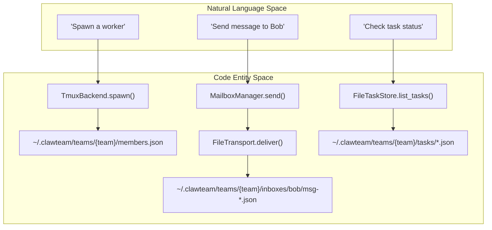
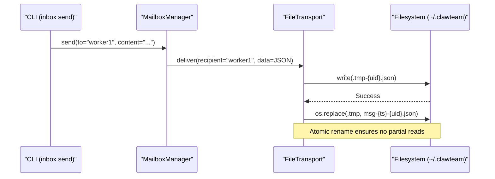

<!-- source: DeepWiki mcp.deepwiki.com · repo HKUDS/ClawTeam · page 17 Glossary · fetched 2026-11-09 -->

# Glossary

Relevant source files

The following files were used as context for generating this wiki page:

- [README.md](README.md)
- [clawteam/cli/commands.py](clawteam/cli/commands.py)
- [clawteam/spawn/adapters.py](clawteam/spawn/adapters.py)
- [clawteam/spawn/command_validation.py](clawteam/spawn/command_validation.py)
- [clawteam/spawn/tmux_backend.py](clawteam/spawn/tmux_backend.py)
- [clawteam/team/models.py](clawteam/team/models.py)
- [clawteam/team/tasks.py](clawteam/team/tasks.py)
- [clawteam/transport/file.py](clawteam/transport/file.py)
- [docs/skills/clawteam/SKILL.md](docs/skills/clawteam/SKILL.md)
- [docs/skills/clawteam/references/cli-reference.md](docs/skills/clawteam/references/cli-reference.md)
- [scripts/clawteam_local_install](scripts/clawteam_local_install)
- [scripts/install_clawteam.sh](scripts/install_clawteam.sh)
- [skills/clawteam/SKILL.md](skills/clawteam/SKILL.md)
- [skills/clawteam/references/cli-reference.md](skills/clawteam/references/cli-reference.md)
- [tests/test_adapters.py](tests/test_adapters.py)
- [tests/test_cli_commands.py](tests/test_cli_commands.py)
- [tests/test_mailbox.py](tests/test_mailbox.py)
- [tests/test_spawn_backends.py](tests/test_spawn_backends.py)
- [tests/test_task_store_locking.py](tests/test_task_store_locking.py)
- [tests/test_tasks.py](tests/test_tasks.py)

This page provides definitions for codebase-specific terminology, jargon, and abbreviations used throughout the ClawTeam framework. It is intended to help onboarding engineers navigate the system's architecture and implementation details.

## Core Entities

### Agent
An autonomous or semi-autonomous process (typically a CLI-based LLM client like Claude Code or Codex) that performs work within a team.
*   **Implementation**: Agents are identified by a unique `agent_id` and a human-readable `agent_name` [clawteam/team/models.py:74-76]().
*   **Roles**: Agents are categorized as either a **Leader** (orchestrator) or a **Worker** (executor) [clawteam/team/models.py:78]().

### Team
A logical grouping of agents collaborating on a specific project or set of tasks.
*   **Storage**: Team data (inboxes, tasks, members) is stored under `~/.clawteam/teams/{team_name}/` [clawteam/transport/file.py:49-60]().
*   **Management**: Handled by the `TeamManager` class [tests/test_cli_commands.py:8]().

### Task
A unit of work tracked on a shared team board.
*   **States**: `pending`, `in_progress`, `completed`, and `blocked` [tests/test_tasks.py:7]().
*   **Dependencies**: Tasks can be "blocked by" other tasks, creating a directed acyclic graph (DAG) of work [tests/test_tasks.py:113-117]().

### Inbox / Mailbox
A message queue used for inter-agent communication.
*   **Mechanism**: Implemented via a `Transport` layer (defaulting to `FileTransport`) [clawteam/transport/file.py:102]().
*   **Operations**: `send` (enqueue), `receive` (destructive dequeue), and `peek` (non-destructive view) [tests/test_mailbox.py:41-110]().

---

## Technical Jargon & Concepts

### Spawn Backend
The execution environment where an agent process is launched.
*   **Tmux Backend**: Launches agents in tiled `tmux` windows for visual monitoring [clawteam/spawn/tmux_backend.py:35-40]().
*   **Subprocess Backend**: Launches agents as background system processes [tests/test_spawn_backends.py:18]().

### Transport
The abstraction layer responsible for moving messages between agents.
*   **File Transport**: Uses the local filesystem with `fcntl` or `msvcrt` locking for atomicity [clawteam/transport/file.py:12-46]().
*   **P2P Transport**: An alternative transport for multi-machine coordination [clawteam/cli/commands.py:57]().

### Keepalive
A mechanism that ensures agent processes remain active or can be resumed if they crash or exit prematurely.
*   **Implementation**: Controlled via `build_keepalive_shell_command` which wraps the agent's entry point [clawteam/spawn/tmux_backend.py:156-163]().

### Native CLI Adapter
A component that translates generic ClawTeam commands into the specific syntax required by different LLM CLI tools (e.g., adding `--dangerously-skip-permissions` for Claude) [clawteam/spawn/adapters.py:31-64]().

---

## Data Flow Diagrams

### From Natural Language Space to Code Entity Space

The following diagram illustrates how a user's intent (Natural Language) maps to specific classes and storage locations in the codebase.

**User Intent Mapping**

**Sources:** [clawteam/spawn/tmux_backend.py:46-60](), [clawteam/transport/file.py:138-144](), [clawteam/team/tasks.py:10-12]().

### Inter-Agent Communication Flow

This diagram tracks a message from the caller's CLI command through the transport layer to the recipient's inbox.

**Message Delivery Pipeline**

**Sources:** [clawteam/transport/file.py:138-152](), [tests/test_mailbox.py:41-50]().

---

## Abbreviation Reference

| Abbreviation | Full Term | Description | Code Pointer |
| :--- | :--- | :--- | :--- |
| **MCP** | Model Context Protocol | Standard for connecting LLMs to data sources/tools. | [clawteam/spawn/adapters.py:177]() |
| **DAG** | Directed Acyclic Graph | Used for task dependency resolution. | [tests/test_tasks.py:113-117]() |
| **SSE** | Server-Sent Events | Used for real-time updates in the web dashboard. | (Referenced in UI logic) |
| **TUI** | Terminal User Interface | Refers to the interactive CLI wizards. | [clawteam/cli/commands.py:136-144]() |
| **UID** | Unique Identifier | Usually the first 8 characters of a UUID4. | [clawteam/transport/file.py:141]() |

---

## Storage Structure

| Path | Purpose | Implementation |
| :--- | :--- | :--- |
| `~/.clawteam/config.toml` | Global settings | `ClawTeamConfig` |
| `~/.clawteam/teams/{name}/inboxes/` | Agent message queues | `FileTransport` |
| `~/.clawteam/teams/{name}/tasks/` | Task board data | `FileTaskStore` |
| `~/.clawteam/teams/{name}/dead_letters/` | Failed/corrupt messages | `_quarantine_bytes` |

**Sources:** [clawteam/transport/file.py:49-72](), [clawteam/cli/commands.py:211-220](), [clawteam/transport/file.py:192-200]().