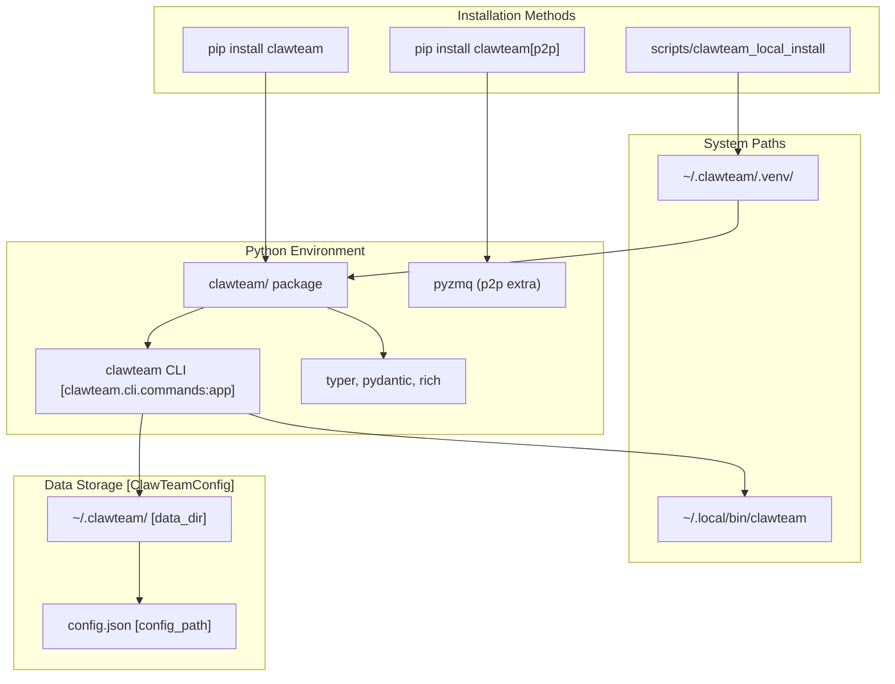
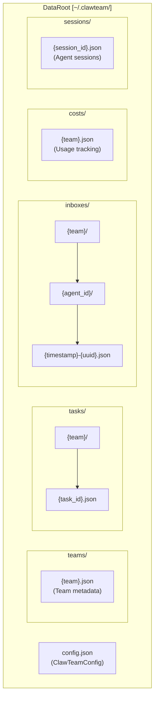
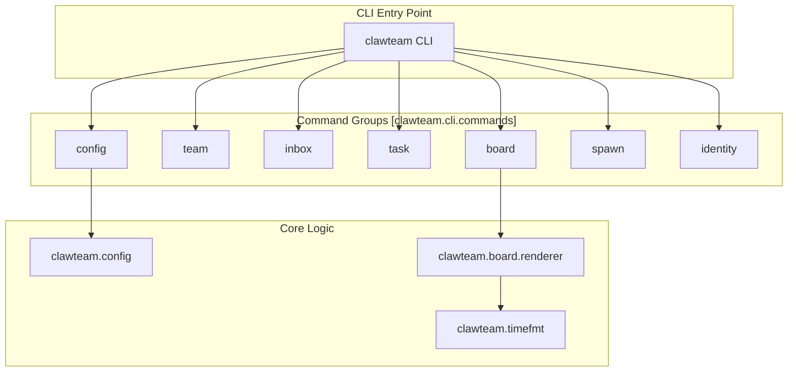

<!-- source: DeepWiki mcp.deepwiki.com · repo HKUDS/ClawTeam · page 2 Getting Started · fetched 2026-11-09 -->

# Getting Started

<details>
<summary>Relevant source files</summary>

The following files were used as context for generating this wiki page:

- [README.md](README.md)
- [clawteam/__init__.py](clawteam/__init__.py)
- [clawteam/board/renderer.py](clawteam/board/renderer.py)
- [clawteam/config.py](clawteam/config.py)
- [clawteam/timefmt.py](clawteam/timefmt.py)
- [pyproject.toml](pyproject.toml)
- [scripts/clawteam_local_install](scripts/clawteam_local_install)
- [scripts/install_clawteam.sh](scripts/install_clawteam.sh)
- [tests/test_config.py](tests/test_config.py)
- [tests/test_timefmt.py](tests/test_timefmt.py)

</details>


This guide covers the installation and initial setup of ClawTeam. It walks through system requirements, installation steps, verification procedures, and the basic file system layout. For a hands-on tutorial with step-by-step examples, see [Quick Start Tutorial](#2.1). For detailed configuration options, see [Configuration](#2.2).

---

## System Requirements

ClawTeam requires Python 3.10 or higher [pyproject.toml:6]() and runs on Linux, macOS, and Windows (with WSL for full tmux support).

| Requirement | Minimum | Recommended |
|------------|---------|-------------|
| Python | 3.10+ | 3.11+ |
| Disk Space | 10 MB | 100 MB+ for workspace isolation |
| Memory | 100 MB | 1 GB+ for multiple agents |
| OS | Linux, macOS, Windows (WSL) | Linux or macOS for tmux backend |

**Core Dependencies:**
- `typer` — CLI framework [pyproject.toml:22]()
- `pydantic` — Data validation [pyproject.toml:23]()
- `rich` — Terminal formatting [pyproject.toml:24]()

**Optional Dependencies:**
- `tmux` — Required for default `tmux` backend [clawteam/config.py:58]()
- `git` — Required for workspace isolation (git worktrees)
- `pyzmq` — Required for P2P transport [pyproject.toml:35-37]()

**Sources:** [pyproject.toml:1-40](), [clawteam/config.py:50-70]()

---

## Installation

### Standard Installation

Install ClawTeam via pip:

```bash
pip install clawteam
```

### Installation from Source

For development or to use the latest features, you can use the provided local installation script which sets up a virtual environment in `~/.clawteam/.venv` and links the binary [scripts/clawteam_local_install:1-156]():

```bash
git clone https://github.com/HKUDS/ClawTeam.git
cd ClawTeam
./scripts/clawteam_local_install
```

### Optional: P2P Transport

To enable ZeroMQ-based P2P transport for low-latency inter-agent messaging:

```bash
pip install "clawteam[p2p]"
```

This installs the `pyzmq` library required for the P2P transport backend [pyproject.toml:35-37]().

**Sources:** [pyproject.toml:35-37](), [scripts/clawteam_local_install:1-156](), [scripts/install_clawteam.sh:1-144]()

---

## Verifying Installation

After installation, verify that ClawTeam is correctly installed and accessible:

### Check CLI Availability

```bash
clawteam --version
```

Expected output:
```
ClawTeam CLI version 0.3.0
```

### Check System Health

```bash
clawteam config health
```

This command verifies:
- Data directory is accessible (`~/.clawteam/`)
- Configuration file is valid [clawteam/config.py:81-90]()
- Required directories exist
- File permissions are correct

### Display Current Configuration

```bash
clawteam config show
```

This displays all active configuration settings with their sources (environment variable, config file, or default) [clawteam/config.py:98-134]().

**Sources:** [clawteam/cli/commands.py:43](), [clawteam/config.py:76-134]()

---

## Installation Architecture



This diagram shows the installation flow and how the CLI maps to the filesystem and Python environment.

**Sources:** [pyproject.toml:42-44](), [clawteam/config.py:76-79](), [scripts/clawteam_local_install:10-146]()

---

## Data Directory Structure

ClawTeam stores all state in a file-based data directory, defaulting to `~/.clawteam/` [clawteam/config.py:76-79]().



### Directory Purposes

| Directory | Purpose | Key Code Entity |
|-----------|---------|-----------|
| `teams/` | Team metadata and membership | `TeamStore` |
| `tasks/{team}/` | Task board per team | `TaskStore` |
| `inboxes/{team}/{agent}/` | Message queues per agent | `MailboxManager` |
| `costs/` | Token usage tracking | `CostTracker` |
| `sessions/` | Spawn session state for resume | `SessionManager` |
| `config.json` | Persistent user settings | `ClawTeamConfig` |

### Data Persistence
All state files use JSON format. ClawTeam employs atomic writes via `atomic_write_text` to ensure data consistency [clawteam/config.py:11](), [clawteam/config.py:93-95]().

**Sources:** [clawteam/config.py:50-95](), [clawteam/board/renderer.py:101-150]()

---

## CLI Entry Point and Command Groups

The CLI is built using `typer` and organized into logical command groups [pyproject.toml:43]().



**Sources:** [pyproject.toml:43](), [clawteam/board/renderer.py:18-22](), [clawteam/timefmt.py:8-10]()

---

## Configuration Precedence

ClawTeam resolves configuration values using `get_effective` in the following order (highest to lowest priority) [clawteam/config.py:98-134]():

1. **Environment Variables**: Prefixed with `CLAWTEAM_` (e.g., `CLAWTEAM_USER`) [clawteam/config.py:103-119]().
2. **Config File**: Located at `~/.clawteam/config.json` [clawteam/config.py:76-79]().
3. **Built-in Defaults**: Defined in the `ClawTeamConfig` Pydantic model [clawteam/config.py:50-70]().

### Common Configuration Keys

| Key | Env Var | Default |
|-----|---------|---------|
| `user` | `CLAWTEAM_USER` | `""` |
| `default_backend` | `CLAWTEAM_DEFAULT_BACKEND` | `"tmux"` |
| `workspace` | `CLAWTEAM_WORKSPACE` | `"auto"` |
| `timezone` | `CLAWTEAM_TIMEZONE` | `"UTC"` |

**Sources:** [clawteam/config.py:50-70](), [clawteam/config.py:103-134]()

---

## Next Steps

1. **Follow the tutorial:** See [Quick Start Tutorial](#2.1) for a walkthrough of creating your first team.
2. **Configure settings:** See [Configuration](#2.2) to customize your environment.
3. **Monitor your team:** Use `clawteam board live` to watch agent progress in real-time [clawteam/board/renderer.py:51-90]().

**Sources:** [clawteam/board/renderer.py:51-90](), [README.md:352-383]()

---

