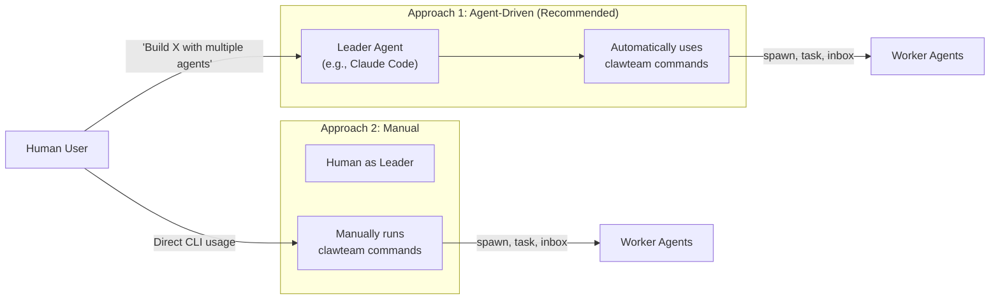
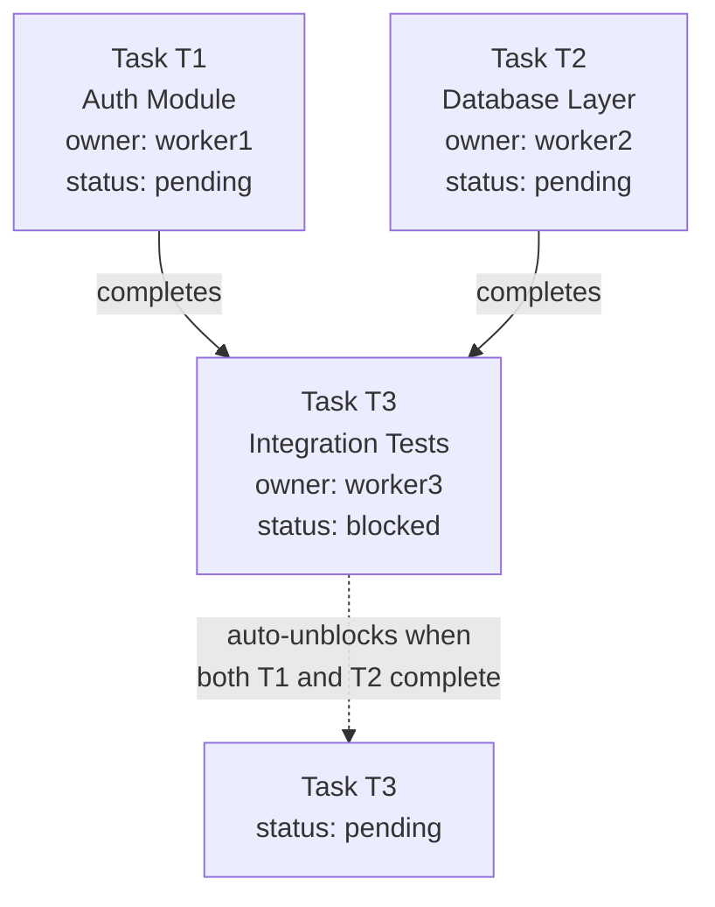
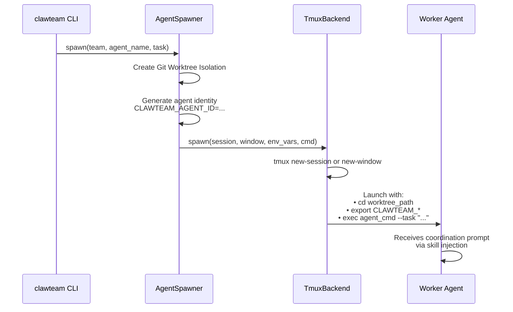
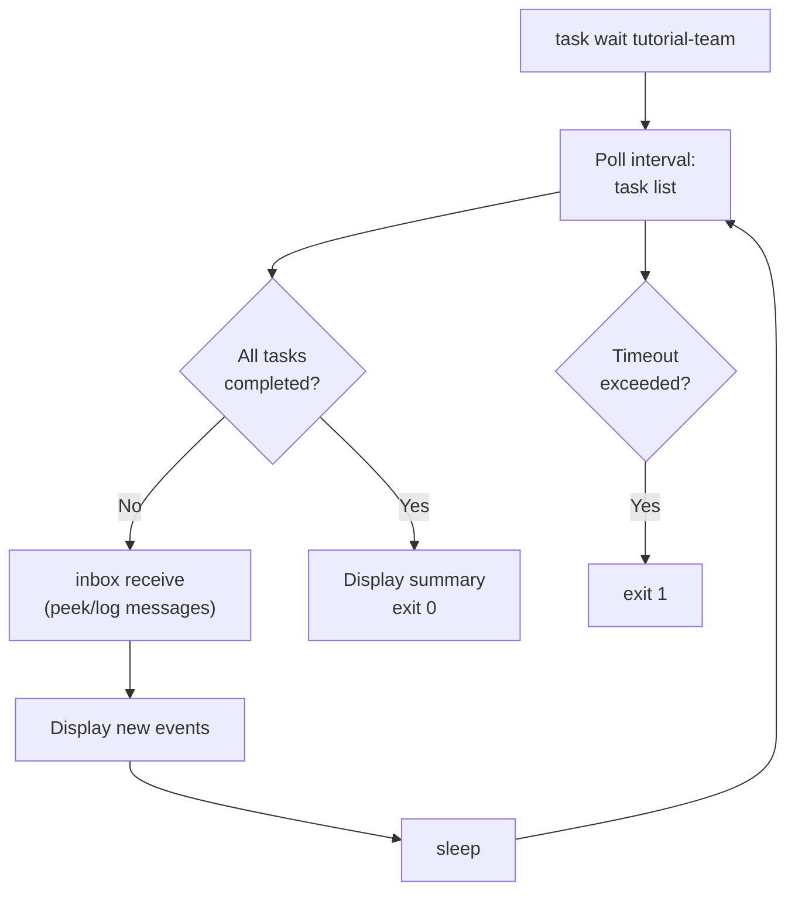

<!-- source: DeepWiki mcp.deepwiki.com · repo HKUDS/ClawTeam · page 2.1 Quick Start Tutorial · fetched 2026-11-09 -->

# Quick Start Tutorial

<details>
<summary>Relevant source files</summary>

The following files were used as context for generating this wiki page:

- [README.md](README.md)
- [clawteam/cli/commands.py](clawteam/cli/commands.py)
- [docs/skills/clawteam/SKILL.md](docs/skills/clawteam/SKILL.md)
- [docs/skills/clawteam/references/cli-reference.md](docs/skills/clawteam/references/cli-reference.md)
- [scripts/clawteam_local_install](scripts/clawteam_local_install)
- [scripts/install_clawteam.sh](scripts/install_clawteam.sh)
- [skills/clawteam/SKILL.md](skills/clawteam/SKILL.md)
- [skills/clawteam/references/cli-reference.md](skills/clawteam/references/cli-reference.md)
- [tests/test_cli_commands.py](tests/test_cli_commands.py)

</details>


This tutorial walks you through creating your first ClawTeam multi-agent system. You will create a team, spawn multiple agents with isolated workspaces, assign tasks with dependencies, and observe agents coordinating autonomously. By the end, you will understand the core ClawTeam workflow and be ready to build your own agent teams.

**Scope**: This page covers basic team creation, agent spawning, task management, and monitoring. For configuration details, see [Configuration](#2.2). For advanced team management features like join requests and approvals, see [Team Management](#3). For workspace isolation mechanics, see [Workspace Isolation](#7).

## Prerequisites

Before starting, ensure you have:

| Requirement | Description | Verification |
|-------------|-------------|--------------|
| **Python 3.10+** | ClawTeam runtime | `python --version` |
| **ClawTeam installed** | Via `pip install clawteam` | `clawteam --version` |
| **tmux** | Terminal multiplexer (default backend) | `tmux -V` |
| **Git repository** | For workspace isolation | `git status` (run in a repo) |
| **CLI agent** | Claude Code, Codex, or any CLI agent | `claude --version` |

**Note**: You must run ClawTeam commands from inside a git repository. Each spawned agent receives its own git worktree, ensuring code isolation.

**Sources**: [README.md:16-19](), [skills/clawteam/SKILL.md:27-49](), [scripts/install_clawteam.sh:25-31]()

## Two Approaches to ClawTeam

ClawTeam offers two workflows:



**Approach 1 (Agent-Driven)**: Give a natural language goal to an AI agent. The agent uses ClawTeam skills to spawn sub-agents, create tasks, and coordinate work. This is the recommended approach for production workflows.

**Approach 2 (Manual)**: Execute ClawTeam commands yourself to understand the system. This tutorial uses the manual approach for learning purposes.

**Sources**: [README.md:157-182](), [skills/clawteam/SKILL.md:3-15]()

## Step-by-Step Tutorial

This tutorial demonstrates a software development workflow: three agents working on independent features with one dependent integration task.

### Step 1: Set Leader Identity

Every ClawTeam agent needs an identity. Set environment variables to establish yourself as the leader:

```bash
export CLAWTEAM_AGENT_ID="tutorial-leader-001"
export CLAWTEAM_AGENT_NAME="leader"
export CLAWTEAM_AGENT_TYPE="leader"
```

**Identity Components**:

| Variable | Purpose | Example |
|----------|---------|---------|
| `CLAWTEAM_AGENT_ID` | Unique identifier (UUID-like) | `tutorial-leader-001` |
| `CLAWTEAM_AGENT_NAME` | Human-readable name | `leader` |
| `CLAWTEAM_AGENT_TYPE` | Agent role/category | `leader`, `worker`, `researcher` |

These variables are automatically propagated to spawned agents. For details on identity propagation, see [Agent Identity](#3.1).

**Sources**: [docs/skills/clawteam/references/cli-reference.md:12-26](), [skills/clawteam/SKILL.md:71-75]()

### Step 2: Create Team

```bash
clawteam team spawn-team tutorial-team \
  -d "Tutorial: multi-agent software development" \
  -n leader
```

**Expected Output**:
```
OK Team 'tutorial-team' created with leader 'leader'
```

**What Happens**: The `team spawn-team` command triggers the creation of team metadata and member records. It registers the current session as the leader.

**Sources**: [docs/skills/clawteam/references/cli-reference.md:31-48](), [skills/clawteam/SKILL.md:76]()

### Step 3: Create Tasks with Dependencies

Create three tasks: two independent features and one integration task blocked by both:

```bash
# Independent task 1
T1=$(clawteam --json task create tutorial-team \
  "Implement authentication module" \
  -o worker1 \
  -d "Add JWT-based authentication to auth.py" | \
  python3 -c "import sys,json;print(json.load(sys.stdin)['id'])")

# Independent task 2
T2=$(clawteam --json task create tutorial-team \
  "Implement database layer" \
  -o worker2 \
  -d "Add SQLAlchemy models to models.py" | \
  python3 -c "import sys,json;print(json.load(sys.stdin)['id'])")

# Dependent task (blocked by both T1 and T2)
T3=$(clawteam --json task create tutorial-team \
  "Write integration tests" \
  -o worker3 \
  -d "Test auth + database integration" \
  --blocked-by "$T1,$T2" | \
  python3 -c "import sys,json;print(json.load(sys.stdin)['id'])")

echo "Tasks created: T1=$T1 T2=$T2 T3=$T3"
```

**Task Dependency Graph**:



**Task States**:

| Task | Initial Status | Reason |
|------|---------------|--------|
| T1 | `pending` | No dependencies, ready to work |
| T2 | `pending` | No dependencies, ready to work |
| T3 | `blocked` | Depends on T1 and T2 via `--blocked-by` |

**Auto-Unblock Mechanism**: When a task is marked `completed`, any tasks blocked by it are automatically unblocked (moved from `blocked` to `pending` if no other blockers remain).

**Sources**: [docs/skills/clawteam/references/cli-reference.md:164-212](), [skills/clawteam/SKILL.md:138-140](), [tests/test_cli_commands.py:208-241]()

### Step 4: Verify Task Board

```bash
clawteam board show tutorial-team
```

**Expected Output** (formatted as Kanban board):

```
╭─────────────────────────────────────────────────────────────╮
│ PENDING                                                      │
├─────────────────────────────────────────────────────────────┤
│ [a1b2c3d4] Implement authentication module                  │
│   Owner: worker1                                             │
│                                                               │
│ [e5f6g7h8] Implement database layer                         │
│   Owner: worker2                                             │
╰─────────────────────────────────────────────────────────────╯

╭─────────────────────────────────────────────────────────────╮
│ BLOCKED                                                      │
├─────────────────────────────────────────────────────────────┤
│ [i9j0k1l2] Write integration tests                          │
│   Owner: worker3                                             │
│   Blocked by: a1b2c3d4, e5f6g7h8                            │
╰─────────────────────────────────────────────────────────────╯
```

**Sources**: [docs/skills/clawteam/references/cli-reference.md:226-234](), [skills/clawteam/SKILL.md:80]()

### Step 5: Spawn Worker Agents

Spawn three agents, each in an isolated tmux window (default) and git worktree:

```bash
clawteam spawn --team tutorial-team \
  --agent-name worker1 \
  --task "Implement JWT authentication in auth.py. Mark task complete when done."

clawteam spawn --team tutorial-team \
  --agent-name worker2 \
  --task "Add SQLAlchemy models in models.py. Mark task complete when done."

clawteam spawn --team tutorial-team \
  --agent-name worker3 \
  --task "Wait for auth and db tasks to complete. Then write integration tests."
```

**Spawn Process Diagram**:



**What Each Agent Receives**:

1. **Isolated Workspace**: Git worktree at `~/.clawteam/workspaces/tutorial-team/worker1/`.
2. **Identity Environment Variables**: `CLAWTEAM_AGENT_NAME`, `CLAWTEAM_TEAM_NAME`, etc.
3. **Coordination Skill**: Auto-injected instructions teaching the agent to use `clawteam` commands.

**Sources**: [skills/clawteam/SKILL.md:103-134](), [docs/skills/clawteam/references/cli-reference.md:24](), [clawteam/cli/commands.py:87-95]()

### Step 6: Monitor Agent Activity

**Option A: Watch All Agents Simultaneously**

```bash
clawteam board attach tutorial-team
```

This creates a tiled tmux layout showing all agent terminals side-by-side.

**Option B: Live Terminal Kanban Board**

```bash
clawteam board live tutorial-team --interval 3
```

**Option C: View Task List**

```bash
clawteam task list tutorial-team
```

**Sources**: [skills/clawteam/SKILL.md:118-121](), [docs/skills/clawteam/references/cli-reference.md:248-255]()

### Step 7: Wait for Completion

Use `task wait` to block until all tasks complete:

```bash
clawteam --json task wait tutorial-team --timeout 600
```

**How `task wait` Works**:



**Sources**: [skills/clawteam/SKILL.md:154-161](), [docs/skills/clawteam/references/cli-reference.md:297-301]()

### Step 8: Inter-Agent Communication (Manual Example)

While agents coordinate themselves via the skill protocol, you can manually send instructions:

```bash
clawteam inbox send tutorial-team worker1 "Please prioritize the login endpoint"
```

The agent will see this message when it runs `clawteam inbox receive`.

**Sources**: [docs/skills/clawteam/references/cli-reference.md:110-143](), [tests/test_cli_commands.py:111-137]()

### Step 9: Cleanup

Remove worktrees, branches, and team data:

```bash
# Delete the team and all associated data
clawteam team cleanup tutorial-team --force
```

**Sources**: [docs/skills/clawteam/references/cli-reference.md:98-105](), [skills/clawteam/SKILL.md:25]()

## What You Learned

✅ **Team Creation**: `team spawn-team` initializes the coordination environment.

✅ **Task Dependencies**: `--blocked-by` flag creates dependency chains with automatic unblocking.

✅ **Agent Spawning**: `spawn` creates isolated execution environments with injected identity.

✅ **Coordination**: Agents autonomously query tasks and report status using the CLI.

✅ **Communication**: `inbox` commands enable structured messaging between agents.

✅ **Monitoring**: `board` commands provide terminal-based observability.

## Next Steps

| Topic | Link | Description |
|-------|------|-------------|
| **Configure ClawTeam** | [Configuration](#2.2) | Set transport layer, data directory, and defaults |
| **Advanced Team Features** | [Team Management](#3) | Join requests, approvals, and lifecycle |
| **Task Dependencies** | [Task Dependencies](#4.1) | Complex dependency graphs and waiting |
| **Agent Communication** | [Agent Communication](#5) | Broadcast and message protocols |
| **Team Templates** | [Team Templates](#8) | Launch pre-configured teams from TOML |

**Sources**: [skills/clawteam/SKILL.md:50-66](), [README.md:184-210]()

---

