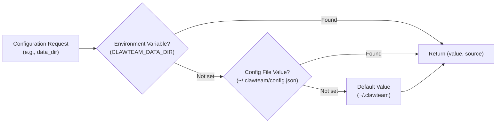
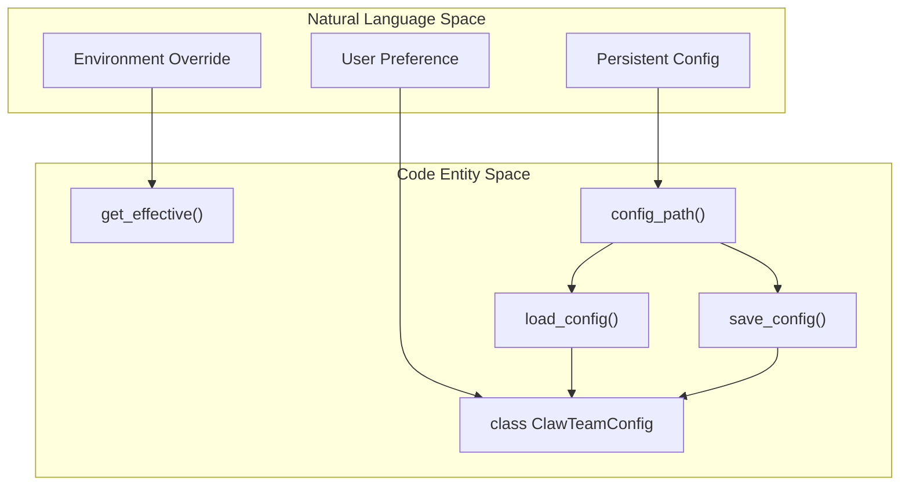
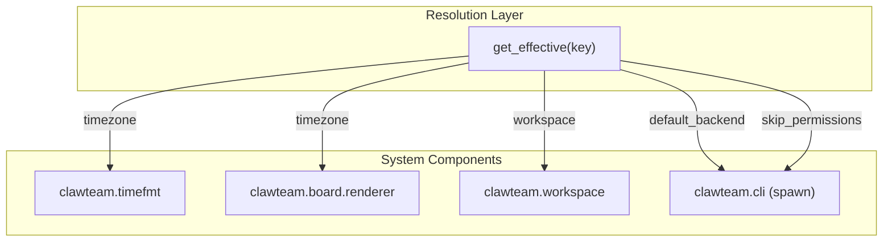

<!-- source: DeepWiki mcp.deepwiki.com · repo HKUDS/ClawTeam · page 2.2 Configuration · fetched 2026-11-09 -->

# Configuration

<details>
<summary>Relevant source files</summary>

The following files were used as context for generating this wiki page:

- [README.md](README.md)
- [clawteam/board/renderer.py](clawteam/board/renderer.py)
- [clawteam/config.py](clawteam/config.py)
- [clawteam/paths.py](clawteam/paths.py)
- [clawteam/timefmt.py](clawteam/timefmt.py)
- [scripts/clawteam_local_install](scripts/clawteam_local_install)
- [scripts/install_clawteam.sh](scripts/install_clawteam.sh)
- [tests/test_config.py](tests/test_config.py)
- [tests/test_paths.py](tests/test_paths.py)
- [tests/test_timefmt.py](tests/test_timefmt.py)
- [tests/test_windows_compat.py](tests/test_windows_compat.py)

</details>


This document describes the ClawTeam configuration system, which controls global settings such as data directory location, default team, transport backend, workspace behavior, and agent spawn defaults. Configuration values can be set via environment variables, a persistent config file, or CLI global options, with a well-defined precedence hierarchy.

For agent-specific identity configuration (agent name, ID, type), see [Agent Identity](#3.1). For team-specific settings like budget and description, see [Team Management](#3).

---

## Configuration Sources and Precedence

ClawTeam resolves configuration values from three sources with the following priority order:

1. **Environment variables** (highest priority)
2. **Configuration file** (`~/.clawteam/config.json`)
3. **Defaults** (lowest priority)

### Configuration Resolution Flow



**Sources:** [clawteam/config.py:98-134]()

---

## Configuration Model

The `ClawTeamConfig` class (aliased as `HarnessConfig`) defines all available configuration keys using Pydantic for validation.

| Key | Type | Default | Environment Variable | Description |
|-----|------|---------|---------------------|-------------|
| `data_dir` | `str` | `""` | `CLAWTEAM_DATA_DIR` | Override data directory (default: `~/.clawteam`) |
| `user` | `str` | `""` | `CLAWTEAM_USER` | User identity for multi-user scenarios |
| `default_team` | `str` | `""` | `CLAWTEAM_TEAM_NAME` | Default team name for commands |
| `transport` | `str` | `""` | `CLAWTEAM_TRANSPORT` | Transport backend: `file` or `p2p` |
| `workspace` | `str` | `"auto"` | `CLAWTEAM_WORKSPACE` | Git worktree mode: `auto`, `always`, or `never` |
| `default_backend` | `str` | `"tmux"` | `CLAWTEAM_DEFAULT_BACKEND` | Agent spawn backend: `tmux` or `subprocess` |
| `skip_permissions` | `bool` | `true` | `CLAWTEAM_SKIP_PERMISSIONS` | Pass `--dangerously-skip-permissions` to Claude |
| `timezone` | `str` | `"UTC"` | `CLAWTEAM_TIMEZONE` | Display timezone for human-readable timestamps |
| `spawn_ready_timeout`| `float` | `30.0` | `CLAWTEAM_SPAWN_READY_TIMEOUT` | Max seconds to poll for TUI readiness |

**Sources:** [clawteam/config.py:50-73](), [clawteam/config.py:103-119]()

---

## Configuration File Location

The configuration file is stored at a **fixed location** that is never affected by the `data_dir` setting. This ensures that configuration is always accessible regardless of where team data is stored.

```
~/.clawteam/config.json
```

The file is written using `atomic_write_text`, which uses a temporary file and an atomic replace operation to prevent corruption during concurrent access.

**Sources:** [clawteam/config.py:76-78](), [clawteam/config.py:93-95]()

---

## Code Entity Association

The following diagram maps natural language configuration concepts to specific classes and functions in the codebase.

### Configuration Entity Map



**Sources:** [clawteam/config.py:50-134]()

---

## Global CLI Options

Configuration can also be overridden **per-command** using global CLI options. These options set environment variables internally which take precedence over the config file.

| Option | Description |
|--------|-------------|
| `--data-dir PATH` | Override data directory for this command |
| `--transport TYPE` | Override transport backend (`file` or `p2p`) |

**Sources:** [clawteam/config.py:103-108]()

---

## Data Flow: Configuration to Subsystems

Configuration values propagate from the `get_effective` resolution function into various system components to control behavior.



**Sources:** [clawteam/timefmt.py:38-48](), [clawteam/board/renderer.py:112-121](), [clawteam/config.py:103-119]()

---

## Configuration Key Details

### timezone

**Purpose:** Controls how timestamps are rendered in the CLI and Web UI.
**Behavior:** If set to a valid `ZoneInfo` name (e.g., `Asia/Shanghai`), `format_timestamp` will convert UTC stored times to this local zone for display.

**Sources:** [clawteam/timefmt.py:24-49]()

### workspace

**Purpose:** Control automatic git worktree creation for agent isolation.
**Values:**
- `auto` (default): Create worktree if in a git repo, skip if not.
- `always`: Require git repo, fail if not present.
- `never`: Never create worktrees, agents share the same directory.

**Sources:** [clawteam/config.py:57]()

### skip_permissions

**Purpose:** Automatically pass `--dangerously-skip-permissions` to Claude Code CLI.
**Rationale:** In multi-agent workflows, agents need to execute tools autonomously without manual approval. This flag is on by default (`true`) for frictionless coordination.

**Sources:** [clawteam/config.py:59]()

---

## Installation and Path Configuration

The installation scripts (`install_clawteam.sh` and `clawteam_local_install`) set up the initial environment and link the binary.

1. **VENV_PATH:** Defaults to `~/.clawteam/.venv`.
2. **BIN_DIR:** Defaults to `~/.local/bin`.
3. **Python Requirement:** Requires Python 3.10 or higher.

The installer also probes for agent clients (like Claude Code, Cursor, or Nanobot) to install the `clawteam` skill.

**Sources:** [scripts/install_clawteam.sh:9-16](), [scripts/install_clawteam.sh:117-121](), [scripts/clawteam_local_install:57-69]()

---

