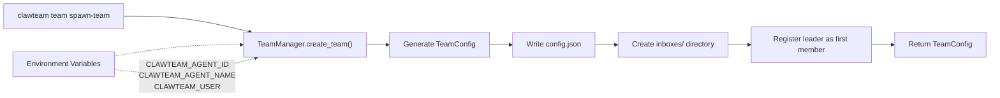
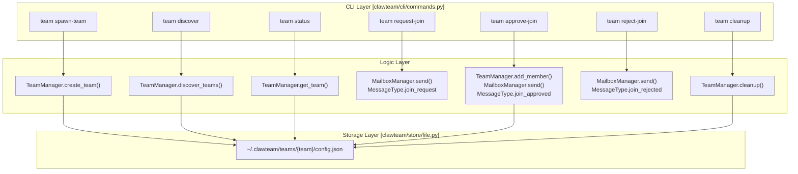
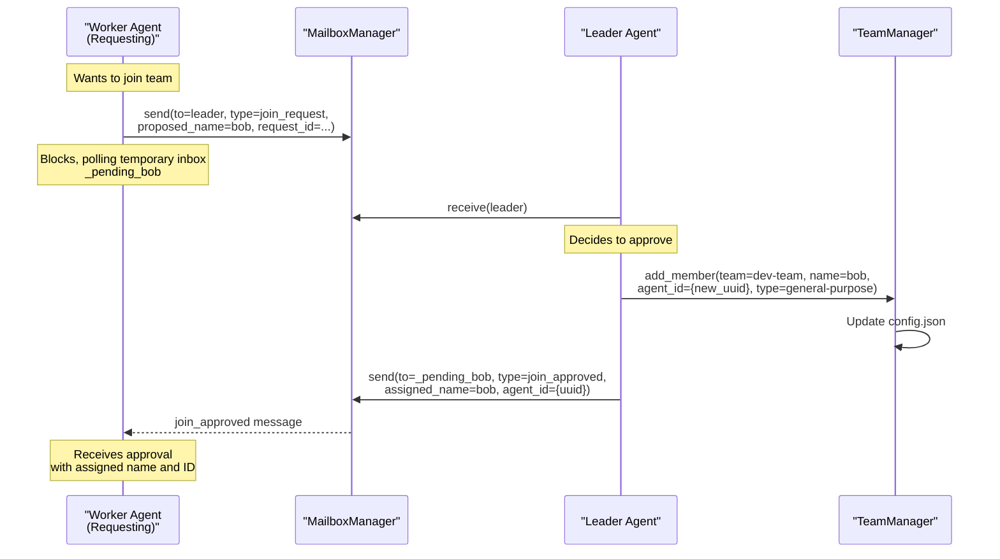

<!-- source: DeepWiki mcp.deepwiki.com · repo HKUDS/ClawTeam · page 3 Team Management · fetched 2026-11-09 -->

# Team Management

<details>
<summary>Relevant source files</summary>

The following files were used as context for generating this wiki page:

- [clawteam/cli/commands.py](clawteam/cli/commands.py)
- [clawteam/store/file.py](clawteam/store/file.py)
- [clawteam/team/mailbox.py](clawteam/team/mailbox.py)
- [clawteam/team/manager.py](clawteam/team/manager.py)
- [clawteam/team/watcher.py](clawteam/team/watcher.py)
- [tests/test_cli_commands.py](tests/test_cli_commands.py)

</details>


Team Management encompasses the creation, configuration, and lifecycle of agent teams in ClawTeam. A team is a collection of agents with a designated leader, shared task board, messaging system, and optional budget constraints. Teams provide the organizational structure for multi-agent coordination.

For information about individual agent identity and roles within teams, see [Agent Identity](#3.1). For spawning agent processes within teams, see [Spawning Agents](#3.2).

---

## Team Lifecycle

Teams progress through a defined lifecycle from creation to deletion. The leader agent is registered at team creation and has special privileges for approving join requests and coordinating work.

### Team Creation Flow



**Sources:** [clawteam/cli/commands.py:232-273](), [clawteam/team/manager.py:78-112]()

When a team is created via `clawteam team spawn-team <name>`, the system:

1. **Reads identity** from environment variables or CLI options (`CLAWTEAM_AGENT_ID`, `CLAWTEAM_AGENT_NAME`, `CLAWTEAM_USER`) [clawteam/cli/commands.py:254-262]().
2. **Creates team directory** at `~/.clawteam/teams/<name>/` [clawteam/team/manager.py:20-21]().
3. **Generates TeamConfig** with leader information [clawteam/team/manager.py:98-103]().
4. **Writes config.json** to persist team metadata [clawteam/team/manager.py:104-104]().
5. **Creates inboxes/** subdirectory for agent mailboxes [clawteam/team/manager.py:106-108]().
6. **Registers leader** as the first team member [clawteam/team/manager.py:92-97]().

```bash
# Example: Create a team with custom leader name
clawteam team spawn-team dev-team \
  -d "Backend development team" \
  -n alice \
  --agent-type leader
```

**Sources:** [clawteam/cli/commands.py:232-273](), [clawteam/team/manager.py:78-112]()

---

## CLI Commands to TeamManager Mapping

The team management CLI commands delegate to the `TeamManager` and `MailboxManager` classes for all operations:



**Sources:** [clawteam/cli/commands.py:228-529](), [clawteam/team/manager.py:50-210](), [clawteam/team/mailbox.py:32-141]()

| CLI Command | Logic Call | Purpose |
|-------------|-------------------|---------|
| `team spawn-team` | `TeamManager.create_team()` | Initialize new team with leader |
| `team discover` | `TeamManager.discover_teams()` | List all available teams |
| `team status` | `TeamManager.get_team()` | Get team config and member list |
| `team request-join` | `MailboxManager.send()` (join_request) | Request to join team |
| `team approve-join` | `TeamManager.add_member()` | Add approved member to team |
| `team reject-join` | `MailboxManager.send()` (join_rejected) | Reject join request |
| `team cleanup` | `TeamManager.cleanup()` | Delete team and all data |

**Sources:** [clawteam/cli/commands.py:228-529]()

---

## Team Discovery

The `team discover` command lists all teams by scanning the `~/.clawteam/teams/` directory via `TeamManager.discover_teams()` [clawteam/team/manager.py:115-133]():

```bash
# List all teams
clawteam team discover

# JSON output for scripting
clawteam --json team discover | jq '.[].name'
```

Returns for each team:
- **name**: Team identifier
- **description**: Team description text
- **leadAgentId**: Leader's agent ID
- **memberCount**: Number of team members

**Sources:** [clawteam/cli/commands.py:275-294](), [clawteam/team/manager.py:115-133]()

---

## Team Membership Management

### Static Member Addition

When spawning agents via `clawteam spawn`, members are automatically added to the team if they don't exist:

```bash
# Spawn creates agent AND adds to team
clawteam spawn tmux claude \
  --team dev-team \
  --agent-name bob \
  --agent-type researcher
```

The spawn command internally calls `TeamManager.add_member()` before launching the agent process [clawteam/cli/commands.py:1629-1640]().

### Member Roles

Team members have distinct roles defined by their `agent_type` in the `TeamMember` model [clawteam/team/models.py:10]():

| Agent Type | Role | Privileges |
|------------|------|------------|
| `leader` | Team coordinator | Approve join requests, receive idle notifications, coordinate shutdown |
| `general-purpose` | Standard worker | Execute tasks, report status |
| `researcher` | Specialized worker | Domain-specific tasks (e.g., research, analysis) |

**Sources:** [clawteam/team/manager.py:84-84](), [clawteam/team/manager.py:144-144]()

---

## Join Request Protocol

The join request protocol enables dynamic team membership. An agent requests to join, blocks waiting for approval, and receives assigned credentials upon approval.

### Join Request Sequence



**Sources:** [clawteam/cli/commands.py:297-423](), [clawteam/team/mailbox.py:72-141]()

### Request-Join Command

```bash
# Worker side: request to join (blocks until response)
clawteam team request-join dev-team bob \
  --capabilities "frontend specialist" \
  --timeout 120
```

**Behavior:**
1. Sends `join_request` message to leader's inbox [clawteam/cli/commands.py:318-327]().
2. Creates temporary inbox `_pending_{proposed_name}` [clawteam/team/manager.py:165-166]().
3. **Blocks and polls** the temporary inbox for response via `MailboxManager.receive()` [clawteam/cli/commands.py:338-358]().

**Sources:** [clawteam/cli/commands.py:297-368](), [tests/test_cli_commands.py:59-84]()

### Approve-Join Command

```bash
# Leader side: approve pending request
clawteam team approve-join dev-team join-abc123 \
  [--assigned-name bob]
```

**Behavior:**
1. Looks up `join_request` message by `request_id` [clawteam/cli/commands.py:388-393]().
2. Generates new `agent_id` and calls `TeamManager.add_member()` [clawteam/cli/commands.py:401-411]().
3. Sends `join_approved` message to the pending inbox [clawteam/cli/commands.py:413-421]().

**Sources:** [clawteam/cli/commands.py:371-423](), [tests/test_cli_commands.py:172-206]()

---

## Team Status

The `team status` command displays comprehensive team information by loading the `TeamConfig` via `TeamManager.get_team()` [clawteam/cli/commands.py:494-494]():

```bash
clawteam team status dev-team
```

**Output includes:**
- Team name and description
- Leader agent ID
- Member table (Name, ID, Type, User) [clawteam/cli/commands.py:496-529]().

**Sources:** [clawteam/cli/commands.py:484-529]()

---

## Team Configuration Model

Teams are persisted as `TeamConfig` objects serialized to JSON at `~/.clawteam/teams/{team}/config.json` [clawteam/team/manager.py:24-25]().

### TeamConfig Fields
Defined in `clawteam/team/models.py`.

| Field | Type | Description |
|-------|------|-------------|
| `name` | string | Unique team identifier |
| `description` | string | Human-readable description |
| `lead_agent_id` | string | Leader's agent ID |
| `members` | TeamMember[] | Array of team members |

**Sources:** [clawteam/team/manager.py:98-103]()

---

## Team Cleanup

The `team cleanup` command permanently deletes a team and all associated data via `TeamManager.cleanup()` [clawteam/team/manager.py:192-210]():

```bash
# Delete with confirmation prompt
clawteam team cleanup dev-team
```

**Deleted data includes:**
- Team configuration and inboxes [clawteam/team/manager.py:204-204]().
- Team tasks [clawteam/team/manager.py:205-205]().
- Team costs and sessions [clawteam/team/manager.py:206-207]().
- Git workspaces (best-effort) [clawteam/team/manager.py:195-201]().

**Sources:** [clawteam/cli/commands.py:466-481](), [clawteam/team/manager.py:192-210]()

---

## Multi-User Teams

When the `CLAWTEAM_USER` environment variable is set, teams support multi-user collaboration. The `user` field is recorded in the `TeamMember` model [clawteam/team/manager.py:92-97]() and displayed in `team status` output [clawteam/cli/commands.py:509-520]().

**Sources:** [clawteam/cli/commands.py:254-262](), [clawteam/team/manager.py:83-83]()

---

