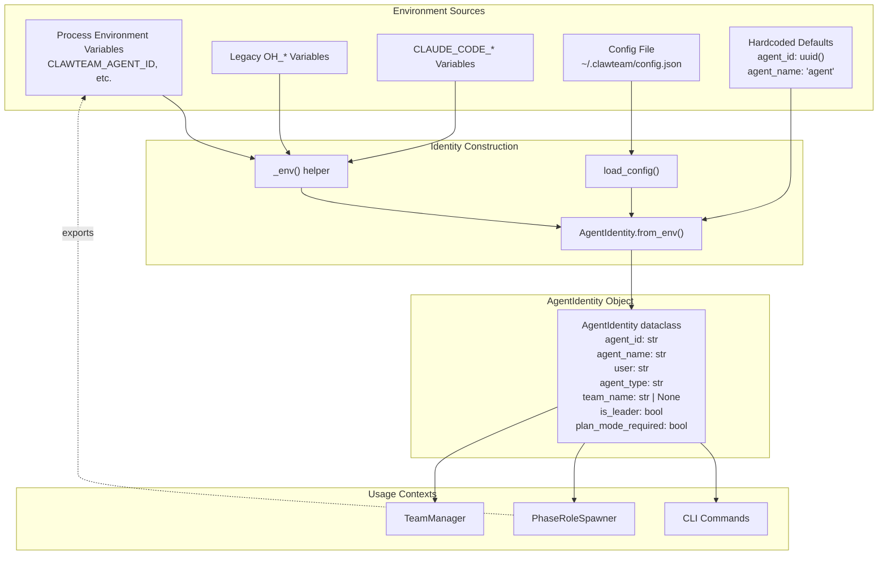
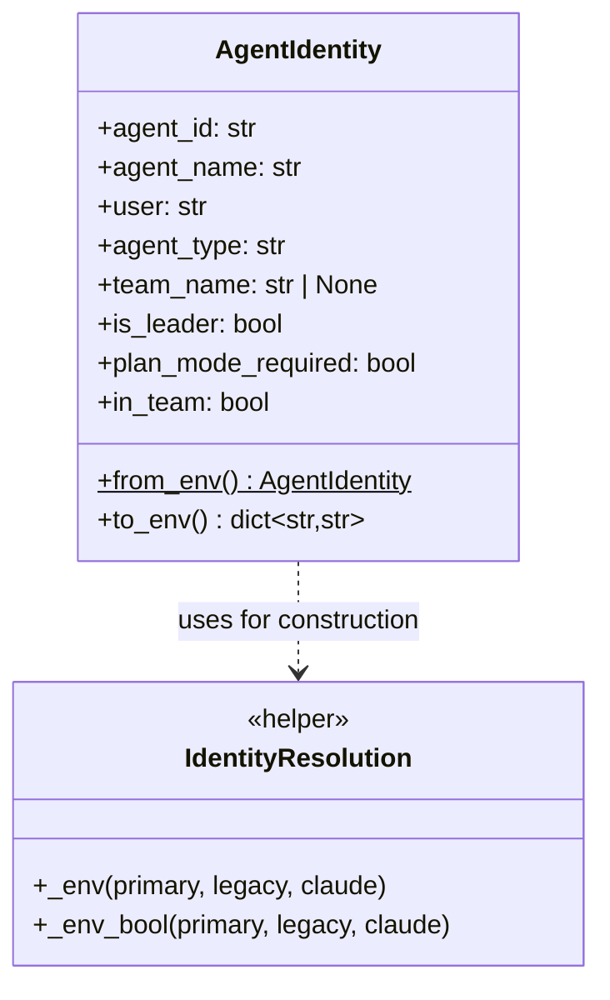
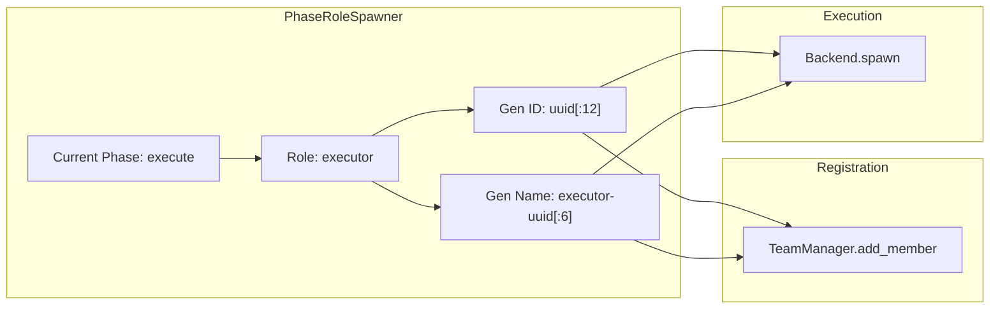

<!-- source: DeepWiki mcp.deepwiki.com · repo HKUDS/ClawTeam · page 3.1 Agent Identity · fetched 2026-11-09 -->

# Agent Identity

<details>
<summary>Relevant source files</summary>

The following files were used as context for generating this wiki page:

- [clawteam/harness/phases.py](clawteam/harness/phases.py)
- [clawteam/harness/spawner.py](clawteam/harness/spawner.py)
- [clawteam/identity.py](clawteam/identity.py)
- [clawteam/spawn/cli_env.py](clawteam/spawn/cli_env.py)
- [tests/test_identity.py](tests/test_identity.py)

</details>


Agent identity is the mechanism by which agents identify themselves within the ClawTeam coordination framework. Each agent has a unique identity comprising an ID, name, type, and team membership. This identity is primarily communicated through environment variables and is used throughout the system for authorization, task assignment, and message routing.

For information about team membership and join workflows, see [Team Management](#3). For details on how agents are spawned with their identity, see [Spawning Agents](#3.2).

---

## Purpose and Scope

Agent identity serves three critical functions:

1. **Authentication**: Uniquely identifies an agent process through `agent_id`.
2. **Authorization**: Determines what operations an agent can perform (e.g., leader vs worker privileges).
3. **Routing**: Enables message delivery and task assignment through human-readable `agent_name`.

This page covers:
- Environment variable mechanisms (`CLAWTEAM_*` variables).
- The `AgentIdentity` class structure.
- Identity resolution and propagation.
- Leader vs worker identity distinctions.
- Multi-user namespace isolation.

---

## Environment Variable Mechanism

Agent identity is established through environment variables that are automatically set when agents are spawned and read by all ClawTeam CLI commands.

### Core Environment Variables

| Variable | Description | Example | Required |
|----------|-------------|---------|----------|
| `CLAWTEAM_AGENT_ID` | Unique 12-character identifier | `a1b2c3d4e5f6` | Yes |
| `CLAWTEAM_AGENT_NAME` | Human-readable agent name | `alice`, `worker1` | Yes |
| `CLAWTEAM_AGENT_TYPE` | Agent role type | `leader`, `planner`, `executor` | No (default: `general-purpose`) |
| `CLAWTEAM_TEAM_NAME` | Team the agent belongs to | `dev-team` | No (for standalone agents) |
| `CLAWTEAM_USER` | Multi-user namespace identifier | `alice@example.com` | No (single-user mode) |
| `CLAWTEAM_AGENT_LEADER` | Boolean flag for leader status | `1`, `0` | No (default: `0`) |
| `CLAWTEAM_PLAN_MODE_REQUIRED` | Requires plan approval | `1`, `0` | No (default: `0`) |

**Sources:** [clawteam/identity.py:74-85](), [clawteam/identity.py:88-103]()

---

## Identity Resolution Flow



**Identity Resolution Process:**

1. **Environment variables** are checked first using the `_env()` helper, which prioritizes `CLAWTEAM_*` then legacy `OH_*` then `CLAUDE_CODE_*` [clawteam/identity.py:10-36]().
2. **Config file** (`~/.clawteam/config.json`) is consulted for the `user` field if not found in environment variables [clawteam/identity.py:67-72]().
3. **Defaults** are applied, such as a random 12-char hex ID and the name "agent" [clawteam/identity.py:52-53]().

**Sources:** [clawteam/identity.py:10-36](), [clawteam/identity.py:65-85]()

---

## AgentIdentity Class

The `AgentIdentity` dataclass [clawteam/identity.py:49-59]() encapsulates all identity information for an agent process.

### Class Structure



### Field Descriptions

| Field | Type | Purpose | Default |
|-------|------|---------|---------|
| `agent_id` | `str` | Unique identifier (12-char hex) | `uuid.uuid4().hex[:12]` |
| `agent_name` | `str` | Human-readable name for routing | `"agent"` |
| `user` | `str` | Multi-user namespace (optional) | `""` |
| `agent_type` | `str` | Role classification (e.g., `planner`, `executor`) | `"general-purpose"` |
| `team_name` | `str \| None` | Current team membership | `None` |
| `is_leader` | `bool` | Leader privileges flag | `False` |
| `plan_mode_required` | `bool` | Plan approval required flag | `False` |

### Property: `in_team`

Returns `True` if `team_name` is not `None` [clawteam/identity.py:61-62](). This is used throughout the CLI to determine if team-scoped tools (like inbox or task) should be active.

**Sources:** [clawteam/identity.py:49-62]()

---

## Identity Construction and Export

### Building Identity: `from_env()`

The `from_env()` class method constructs an `AgentIdentity` instance by checking multiple environment variable prefixes and the local configuration [clawteam/identity.py:65-85]().

**Key features:**
- **Triple-prefix support**: Checks `CLAWTEAM_*`, legacy `OH_*`, and `CLAUDE_CODE_*` for backwards compatibility [clawteam/identity.py:10-36]().
- **Config integration**: The `user` field is fetched from `load_config().user` if not found in environment variables [clawteam/identity.py:67-72]().
- **Boolean conversion**: `_env_bool()` converts string values like "1", "true", or "yes" into Python booleans [clawteam/identity.py:39-45]().

### Exporting Identity: `to_env()`

The `to_env()` method [clawteam/identity.py:87-103]() exports identity as a dictionary of environment variables. This is crucial for the `PhaseRoleSpawner` or standard spawn backends to propagate identity to child processes.

```python
# clawteam/identity.py:87-103
def to_env(self) -> dict[str, str]:
    env = {
        "CLAWTEAM_AGENT_ID": self.agent_id,
        "CLAWTEAM_AGENT_NAME": self.agent_name,
        "CLAWTEAM_AGENT_TYPE": self.agent_type,
        "CLAWTEAM_AGENT_LEADER": "1" if self.is_leader else "0",
        "CLAWTEAM_PLAN_MODE_REQUIRED": "1" if self.plan_mode_required else "0",
        "OH_PLAN_MODE_REQUIRED": "1" if self.plan_mode_required else "0",
    }
    # ... handles user and team_name ...
```

**Sources:** [clawteam/identity.py:10-45](), [clawteam/identity.py:65-103]()

---

## Identity in Automated Spawning

In the `harness` orchestration system, the `PhaseRoleSpawner` automatically generates and registers agent identities based on the current phase.

### Phase-Role Mapping

The harness maps specific phases to agent roles [clawteam/harness/phases.py:30-36]():
- `discuss` / `plan` -> `planner`
- `execute` -> `executor`
- `verify` -> `evaluator`

### Automated Identity Generation

When `PhaseRoleSpawner.spawn_for_phase` is called, it performs the following steps [clawteam/harness/spawner.py:47-72]():
1. Generates a random `agent_id` (12 chars) and a role-based `agent_name` (e.g., `executor-a1b2c3`).
2. Registers the agent in the `TeamManager` with the assigned `agent_type`.
3. Passes these identity details to the spawn backend (e.g., `tmux`).



**Sources:** [clawteam/harness/phases.py:30-36](), [clawteam/harness/spawner.py:47-93]()

---

## Leader vs Worker Identity

ClawTeam uses the `is_leader` flag and `agent_type` to differentiate agent capabilities.

### Leader Identity
- **Creation**: Usually the first agent in a team (e.g., the "conductor" in a harness run) [clawteam/harness/spawner.py:64-68]().
- **Capabilities**: Can approve join requests, manage the team lifecycle, and coordinate task distribution.
- **Environment**: `CLAWTEAM_AGENT_LEADER=1`.

### Worker Identity
- **Creation**: Spawned by a leader or a harness spawner [clawteam/harness/spawner.py:83-93]().
- **Capabilities**: Executes tasks, submits plans for approval, and communicates via the inbox.
- **Environment**: `CLAWTEAM_AGENT_LEADER=0`.

**Sources:** [clawteam/identity.py:79](), [clawteam/harness/spawner.py:64-72](), [clawteam/harness/spawner.py:83-93]()

---

## Multi-User Namespace Isolation

The `user` field in `AgentIdentity` allows ClawTeam to support multiple users operating on the same machine or shared storage.

1. **Resolution**: The user is read from `CLAWTEAM_USER` or the `user` field in `~/.clawteam/config.toml` [clawteam/identity.py:67-72]().
2. **Isolation**: Identity objects carry this user string, which is used by storage layers to partition data or by the `TeamManager` to verify ownership [clawteam/identity.py:98-99]().

**Sources:** [clawteam/identity.py:67-72](), [clawteam/identity.py:98-99]()

---

## Technical Implementation Details

### Executable Resolution
When agents are spawned, the system must ensure the `clawteam` CLI is available in the child process's `PATH`. The `resolve_clawteam_executable` function determines the absolute path to the current entrypoint [clawteam/spawn/cli_env.py:21-37]().

### Docker Runtime Identity
For agents running inside Docker, the `DockerClawteamRuntime` bundle mounts the host's `clawteam` source and provides a bootstrap script [clawteam/spawn/cli_env.py:58-62](). It also sets specific environment variables to ensure the containerized agent can identify itself correctly within the host's team structure [clawteam/spawn/cli_env.py:181-186]().

**Sources:** [clawteam/spawn/cli_env.py:21-37](), [clawteam/spawn/cli_env.py:58-62](), [clawteam/spawn/cli_env.py:181-186]()

---

