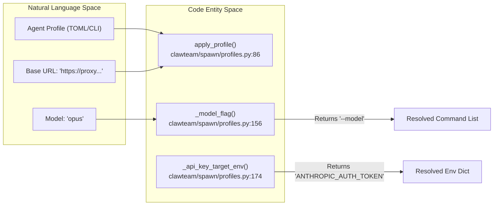
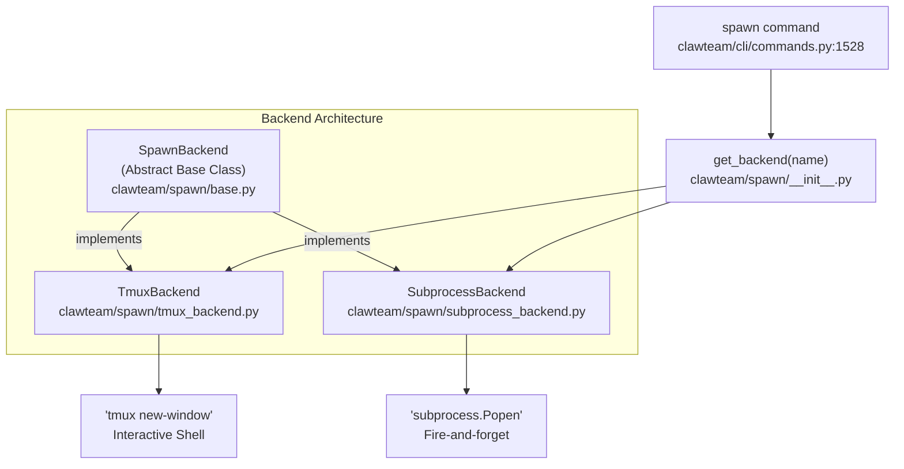
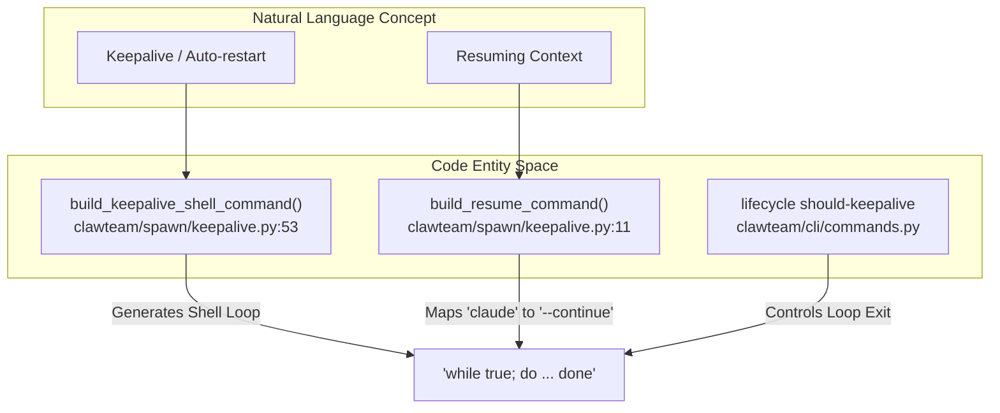

<!-- source: DeepWiki mcp.deepwiki.com · repo HKUDS/ClawTeam · page 3.2 Spawning Agents · fetched 2026-11-09 -->

# Spawning Agents

<details>
<summary>Relevant source files</summary>

The following files were used as context for generating this wiki page:

- [clawteam/spawn/keepalive.py](clawteam/spawn/keepalive.py)
- [clawteam/spawn/profiles.py](clawteam/spawn/profiles.py)
- [clawteam/spawn/prompt.py](clawteam/spawn/prompt.py)
- [clawteam/spawn/subprocess_backend.py](clawteam/spawn/subprocess_backend.py)
- [clawteam/spawn/tmux_backend.py](clawteam/spawn/tmux_backend.py)
- [tests/test_profiles.py](tests/test_profiles.py)
- [tests/test_prompt.py](tests/test_prompt.py)
- [tests/test_spawn_backends.py](tests/test_spawn_backends.py)
- [tests/test_spawn_cli.py](tests/test_spawn_cli.py)

</details>


## Purpose and Scope

This page details the agent spawning system in ClawTeam, which creates new agent processes with isolated environments and pre-configured identity. The spawning mechanism is the primary way agents (particularly leader agents) create worker agents to delegate work.

For information about agent identity and environment variables, see [Agent Identity](#3.1). For team creation and membership management, see [Team Management](#3).

## Overview

Agent spawning in ClawTeam is handled by the `spawn` command, which:

1.  Creates a new agent process with a unique identity.
2.  Optionally creates an isolated git worktree workspace.
3.  Injects identity environment variables (`CLAWTEAM_*`).
4.  Auto-injects a coordination prompt teaching the agent how to use ClawTeam commands.
5.  Registers the agent as a team member.
6.  Launches the agent using a configurable backend (tmux or subprocess).

The spawn command is designed to be called by both humans and AI agents, with sensible defaults requiring minimal configuration.

**Sources:** [clawteam/cli/commands.py:1528-1657](), [clawteam/spawn/prompt.py:27-108]()

## Spawn Command Syntax

```bash
clawteam spawn [BACKEND] [COMMAND...] --team <team> --agent-name <name> [OPTIONS]
```

### Positional Arguments

| Argument  | Default | Description                                                               |
| --------- | ------- | ------------------------------------------------------------------------- |
| `BACKEND` | `tmux`  | Spawn backend: `tmux` or `subprocess`                                     |
| `COMMAND` | `claude` | Command and arguments to execute (e.g., `claude`, `codex`, `python script.py`) |

### Key Options

| Option                                     | Default           | Description                                    |
| ------------------------------------------ | ----------------- | ---------------------------------------------- |
| `--team`, `-t`                             | `default`         | Team name to join                              |
| `--agent-name`, `-n`                       | `agent-<random>`  | Agent's identifier within the team             |
| `--agent-type`                             | `general-purpose` | Agent type/role (e.g., `leader`, `worker`)     |
| `--task`                                   | None              | Initial task/prompt for the agent              |
| `--workspace/--no-workspace`, `-w`         | `auto`            | Create isolated git worktree                   |
| `--repo`                                   | Current directory | Git repository path                            |
| `--skip-permissions/--no-skip-permissions` | `true`            | Skip tool approval (for `claude` command)      |
| `--profile`                                | None              | Use a pre-configured agent profile             |
| `--keepalive`                              | `false`           | Auto-restart agent if it exits prematurely     |

**Sources:** [clawteam/cli/commands.py:1528-1657](), [clawteam/spawn/profiles.py:46-83]()

## Agent Profiles

ClawTeam uses **Profiles** to simplify spawning complex agent configurations. A profile maps a name (e.g., `kimi-pro`) to a specific executable, model, API keys, and environment variables.

### Profile Resolution Logic

When spawning, ClawTeam resolves the profile in this order:
1.  Explicit `--profile` flag.
2.  If no explicit command is provided, use the `default_profile` from config.
3.  If exactly one profile exists in config, use it implicitly.

### Profile Mapping to Code Entities

The `apply_profile` function transforms a high-level profile definition into the specific command-line arguments and environment variables required by various LLM CLI tools.



**Sources:** [clawteam/spawn/profiles.py:46-142](), [tests/test_profiles.py:14-30]()

## Spawn Backends

The spawn system uses a pluggable backend architecture defined by the `SpawnBackend` abstract class.



**Sources:** [clawteam/spawn/base.py:1-29](), [clawteam/spawn/tmux_backend.py:35-40](), [clawteam/spawn/subprocess_backend.py:23-28]()

### Tmux Backend

The `TmuxBackend` creates agents in isolated tmux windows. This is the default backend as it allows for visual monitoring.

-   **Environment Setup:** It generates a temporary `.env.sh` file containing all `CLAWTEAM_*` variables, sources it within the tmux pane, and then deletes the file. This bypasses tmux command length limits.
-   **Interactive Adapters:** Uses `NativeCliAdapter` to prepare commands for interactive use (e.g., adding `--dangerously-bypass-approvals-and-sandbox` for Claude).
-   **Context Awareness:** Normalizes `TERM` to `xterm-256color` to ensure interactive CLIs don't fail in the tmux environment.

**Sources:** [clawteam/spawn/tmux_backend.py:64-171](), [clawteam/spawn/adapters.py:1-100]()

### Subprocess Backend

The `SubprocessBackend` launches agents as direct child processes.

-   **Headless Operation:** Redirects `stdout` and `stderr` to `subprocess.DEVNULL`.
-   **Lifecycle Hooks:** Wraps the command in a shell script that calls `clawteam lifecycle on-exit` when the agent process terminates, ensuring the team state is updated even if the process crashes.
-   **Registration:** Explicitly calls `register_agent` to persist the PID for liveness tracking.

**Sources:** [clawteam/spawn/subprocess_backend.py:123-166](), [tests/test_spawn_backends.py:77-135]()

## Resumable Keepalive Loops

ClawTeam supports a "Keepalive" mechanism that prevents agents from staying dead after a clean exit (e.g., finishing a task but the leader wants them to wait for more).

The `build_keepalive_shell_command` function generates a POSIX-compliant while-loop that:
1.  Executes the initial command.
2.  On exit, calls `lifecycle on-exit`.
3.  Checks `lifecycle should-keepalive`.
4.  If true, restarts the agent using a "resume" command (e.g., `claude --continue` or `codex resume --last`).



**Sources:** [clawteam/spawn/keepalive.py:11-91](), [clawteam/spawn/tmux_backend.py:156-171]()

## Auto-injected Coordination Prompt

The `build_agent_prompt` function in `clawteam/spawn/prompt.py` is critical for agent autonomy. It creates a system prompt that includes:

-   **Identity:** Name, ID, Team, and Leader name.
-   **Workspace:** The absolute path to the worktree and branch information.
-   **Coordination Protocol:** Specific CLI commands the agent should use (e.g., `clawteam task update ... --status completed`).
-   **Worker Loop Protocol:** Instructions on how to poll for new tasks and notify the leader when idle using `clawteam lifecycle idle`.
-   **Cross-Agent Context:** Injects a block containing recent changes from teammates or file overlap warnings via `inject_context`.

**Sources:** [clawteam/spawn/prompt.py:27-108](), [tests/test_prompt.py:7-107]()

## Complete Spawn Process Flow

| Phase | Description | Code Reference |
| :--- | :--- | :--- |
| **Identity Generation** | Generates a 12-character hex ID and validates the agent name. | [clawteam/cli/commands.py:1574-1580]() |
| **Workspace Setup** | Creates a git worktree if `--workspace` is enabled. | [clawteam/cli/commands.py:1582-1592]() |
| **Prompt Assembly** | Combines identity, task, and coordination rules into a string. | [clawteam/spawn/prompt.py:27-40]() |
| **Backend Selection** | Resolves `TmuxBackend` or `SubprocessBackend`. | [clawteam/cli/commands.py:1564-1568]() |
| **Execution** | The backend exports environment variables and executes the command. | [clawteam/spawn/tmux_backend.py:73-108]() |
| **Registration** | The agent is added to the team's membership list and session registry. | [clawteam/cli/commands.py:1628-1640]() |

**Sources:** [clawteam/cli/commands.py:1528-1657](), [clawteam/spawn/tmux_backend.py:46-171]()

---

