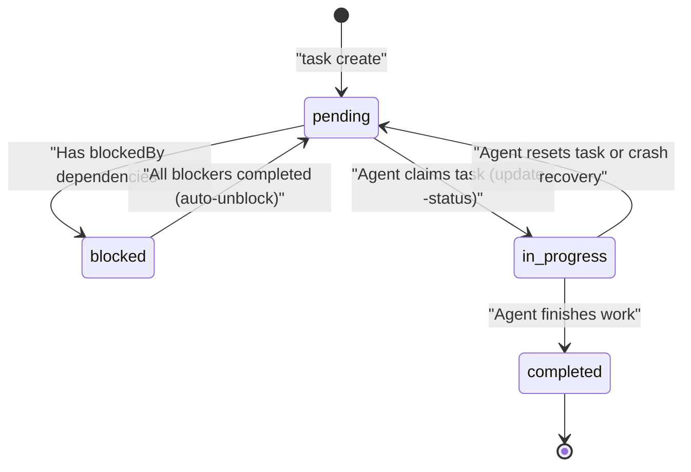
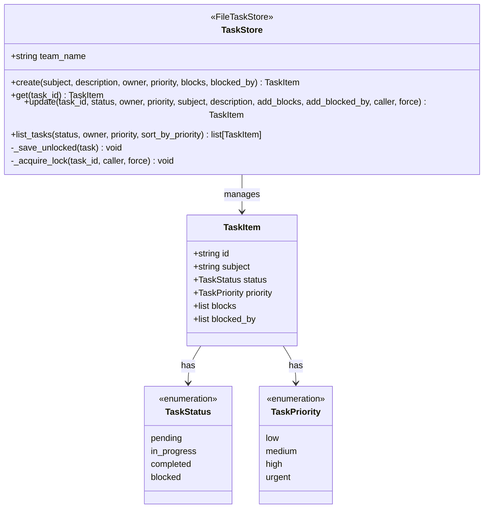
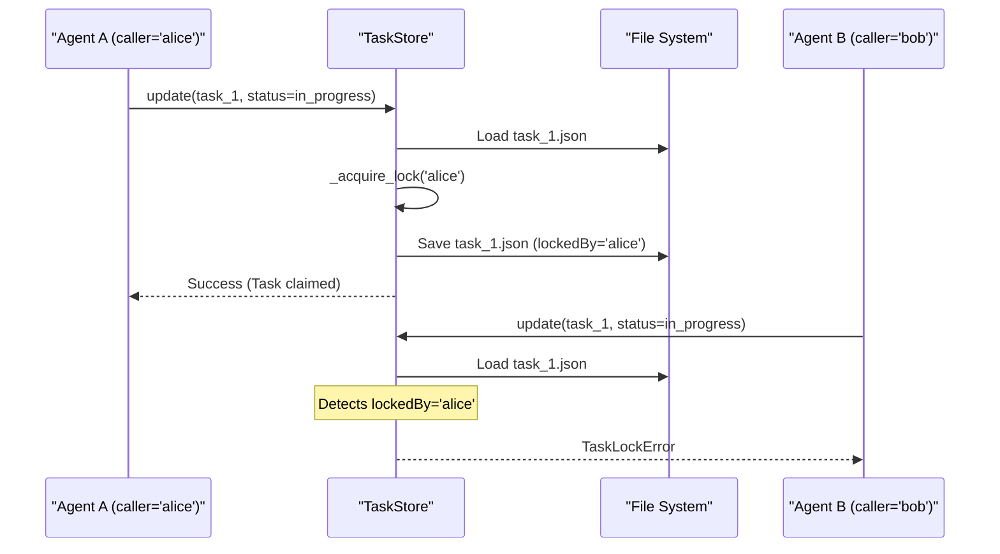

<!-- source: DeepWiki mcp.deepwiki.com · repo HKUDS/ClawTeam · page 4 Task Management · fetched 2026-11-09 -->

# Task Management

<details>
<summary>Relevant source files</summary>

The following files were used as context for generating this wiki page:

- [clawteam/cli/commands.py](clawteam/cli/commands.py)
- [clawteam/team/models.py](clawteam/team/models.py)
- [clawteam/team/tasks.py](clawteam/team/tasks.py)
- [docs/skills/clawteam/SKILL.md](docs/skills/clawteam/SKILL.md)
- [docs/skills/clawteam/references/cli-reference.md](docs/skills/clawteam/references/cli-reference.md)
- [skills/clawteam/SKILL.md](skills/clawteam/SKILL.md)
- [skills/clawteam/references/cli-reference.md](skills/clawteam/references/cli-reference.md)
- [tests/test_cli_commands.py](tests/test_cli_commands.py)
- [tests/test_task_store_locking.py](tests/test_task_store_locking.py)
- [tests/test_tasks.py](tests/test_tasks.py)

</details>


Task Management is ClawTeam's system for creating, assigning, tracking, and coordinating work items across multiple agents. Tasks serve as the primary work unit that agents query, claim, execute, and complete. The system provides CRUD operations, status tracking, dependency management, and concurrent access control through file-based persistence.

For information about task dependencies and automatic unblocking, see [Task Dependencies](#4.1). For task waiting patterns and coordination workflows, see [Task Waiting and Coordination](#4.2).

---

## Task Model

Tasks are represented by the `TaskItem` model with the following fields:

| Field | Type | Description |
|-------|------|-------------|
| `id` | string | Unique task identifier (auto-generated 8-char hex) |
| `subject` | string | Brief task description |
| `description` | string | Detailed task description (optional) |
| `owner` | string | Agent name assigned to the task |
| `status` | TaskStatus | `pending`, `in_progress`, `completed`, `blocked` |
| `priority` | TaskPriority | `low`, `medium`, `high`, `urgent` |
| `blocks` | list[string] | Task IDs that this task blocks |
| `blockedBy` | list[string] | Task IDs that block this task |
| `lockedBy` | string | Agent name holding the lock |
| `lockedAt` | string | ISO timestamp when lock was acquired |
| `createdAt` | string | ISO timestamp of task creation |
| `updatedAt` | string | ISO timestamp of last update |

### Task Status Transitions



**Sources:** [clawteam/team/models.py:36-40](), [clawteam/team/models.py:124-143](), [tests/test_tasks.py:31-36]()

---

## TaskStore Architecture

The `TaskStore` class manages task persistence and operations for a specific team. It delegates the heavy lifting to the `FileTaskStore` implementation.

### Storage Layout

```
~/.clawteam/
└── tasks/
    └── {team_name}/
        ├── {task_id_1}.json
        ├── {task_id_2}.json
        └── {task_id_3}.json
```

Each task is stored as an individual JSON file, enabling concurrent access from multiple agents without database locking overhead.

### Task Management Code Entities



**Sources:** [clawteam/team/tasks.py:9-14](), [clawteam/team/models.py:36-48](), [clawteam/team/models.py:124-143]()

---

## Task CRUD Operations

### Create Task

Creates a new task. If `blocked_by` is specified, the task status is automatically set to `blocked`.

```bash
clawteam task create <team> <subject> [options]
```

**Key Options:**
- `--owner, -o`: Assign to a specific agent [tests/test_tasks.py:23-25]()
- `--priority, -p`: Set importance (`low` to `urgent`) [tests/test_cli_commands.py:215-221]()
- `--blocked-by`: Comma-separated task IDs blocking this [tests/test_tasks.py:31-36]()

**CLI Implementation:** [clawteam/cli/commands.py:1145-1216]()

### Update Task

Updates task fields with concurrent access control through task locking. The `caller` (agent name) is required to acquire a lock.

```bash
clawteam task update <team> <task-id> [options]
```

**Auto-Unblock Trigger:** When a task is updated to `completed`, any tasks in the `blocks` list are checked. If all their `blockedBy` dependencies are resolved, they transition to `pending`. [tests/test_tasks.py:189-204]()

**CLI Implementation:** [clawteam/cli/commands.py:1248-1342]()

### List Tasks

Lists tasks for a team with filtering and sorting.

```bash
clawteam task list <team> [--status STATUS] [--owner NAME] [--priority LEVEL] [--sort-priority]
```

**CLI Implementation:** [clawteam/cli/commands.py:1345-1418]()

**Sources:** [clawteam/cli/commands.py:1145-1418](), [tests/test_tasks.py:142-187]()

---

## Task Locking Mechanism

`TaskStore` implements a locking mechanism to prevent race conditions when multiple agents attempt to claim the same task.

### Concurrent Claim Flow



**Sources:** [tests/test_task_store_locking.py:14-75](), [tests/test_tasks.py:60-65]()

---

## Integration with Agent Workflows

### Typical Agent Task Execution Loop

Workers are expected to follow a loop of checking assignments and notifying the leader of status.

```bash
# 1. Check tasks assigned to you
clawteam task list my-team --owner worker1 --status pending

# 2. Claim and work
clawteam task update my-team <id> --status in_progress

# 3. If idle, notify leader
clawteam lifecycle idle my-team
```

### Agent Exit Handling

When an agent process terminates, the `lifecycle on-exit` hook resets any `in_progress` tasks owned by that agent back to `pending` status to prevent tasks from being stuck in a locked state.

**CLI Implementation:** [clawteam/cli/commands.py:1594-1647]()

**Sources:** [skills/clawteam/SKILL.md:163-178](), [clawteam/cli/commands.py:1594-1647]()

---

## JSON Output for Scripting

All task commands support `--json` output for integration with external tools or MCP clients.

```bash
# Get all urgent tasks as JSON
clawteam --json task list my-team --priority urgent
```

**Sources:** [clawteam/cli/commands.py:77-84](), [docs/skills/clawteam/references/cli-reference.md:9-10]()

---

