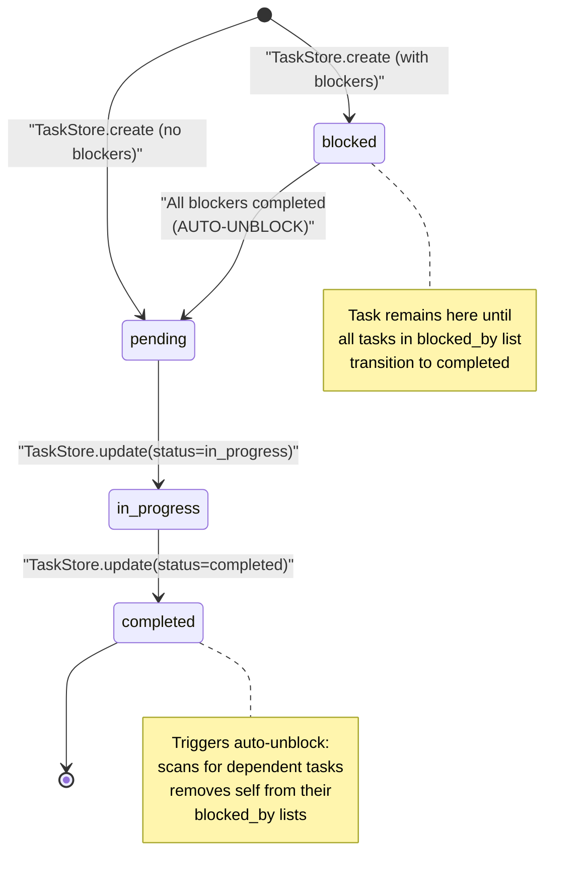
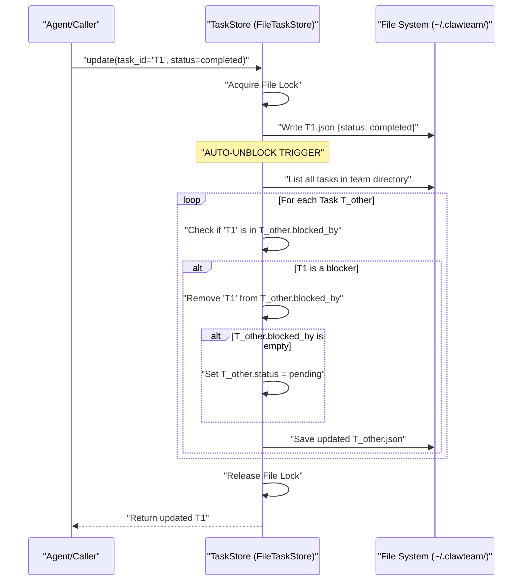
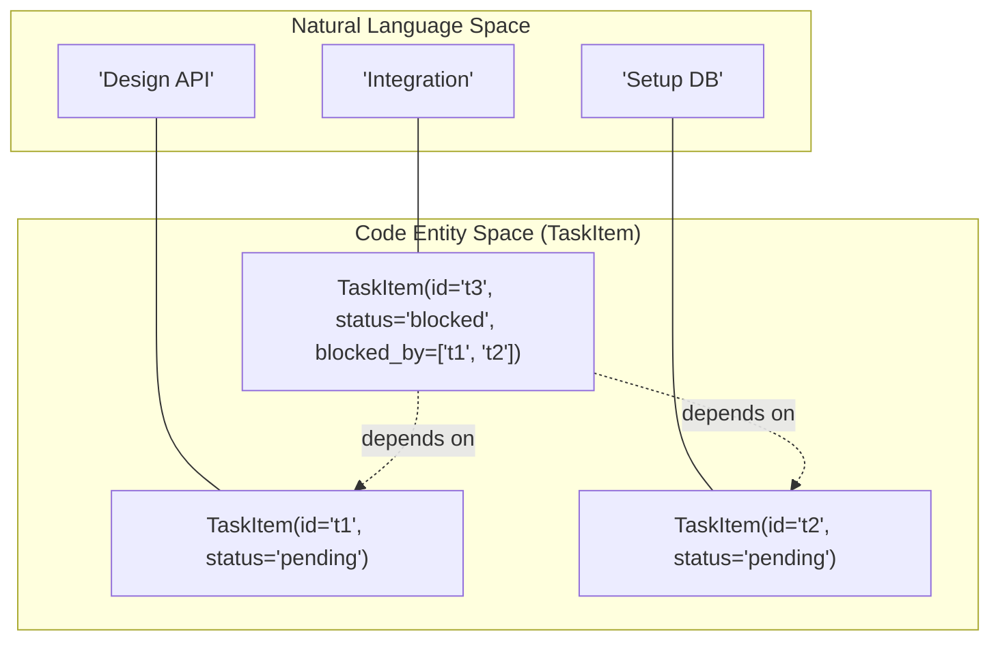

<!-- source: DeepWiki mcp.deepwiki.com · repo HKUDS/ClawTeam · page 4.1 Task Dependencies · fetched 2026-11-09 -->

# Task Dependencies

<details>
<summary>Relevant source files</summary>

The following files were used as context for generating this wiki page:

- [clawteam/team/models.py](clawteam/team/models.py)
- [clawteam/team/tasks.py](clawteam/team/tasks.py)
- [tests/test_task_store_locking.py](tests/test_task_store_locking.py)
- [tests/test_tasks.py](tests/test_tasks.py)

</details>


This document explains ClawTeam's task dependency system, which enables automatic workflow coordination through blocking relationships and automatic unblocking. Tasks can declare dependencies on other tasks using the `blocked_by` list, and the system automatically transitions blocked tasks to `pending` status when all their dependencies complete.

## Overview

The task dependency system implements directed acyclic graph (DAG) workflows. When a task is created with `blocked_by` dependencies, it starts in `blocked` status and cannot be worked on until all specified dependencies transition to `completed`. The auto-unblock mechanism monitors task completions and automatically transitions dependent tasks to `pending` when their blockers are satisfied.

**Sources:** [clawteam/team/models.py:36-41](), [clawteam/team/models.py:124-143](), [tests/test_tasks.py:31-36]()

## Task States and Transitions

### State Machine

Tasks in ClawTeam follow a lifecycle defined by the `TaskStatus` enum [clawteam/team/models.py:36-41]().



### State Descriptions

| State | Enum Value | Description | Can Be Worked On |
|-------|------------|-------------|------------------|
| `pending` | `TaskStatus.pending` | Ready to be claimed | ✅ Yes |
| `blocked` | `TaskStatus.blocked` | Waiting on dependencies | ❌ No |
| `in_progress` | `TaskStatus.in_progress` | Currently being worked | ✅ Yes |
| `completed` | `TaskStatus.completed` | Successfully finished | N/A |

**Sources:** [clawteam/team/models.py:36-41](), [tests/test_tasks.py:17-36]()

## Dependency Relationships

### Declaring Dependencies

Dependencies are declared at task creation using the `blocked_by` parameter in `TaskStore.create()` [tests/test_tasks.py:31-36](). If dependencies are added to an existing task via `TaskStore.update(add_blocked_by=[...])`, the task status is automatically set to `blocked` [tests/test_tasks.py:101-107]().

```python
# Create independent task
t1 = store.create("Design API")

# Create dependent task (blocked until t1 completes)
t2 = store.create("Implement backend", blocked_by=[t1.id])
# t2.status is now TaskStatus.blocked
```

### Dependency Graph Constraints

The `TaskStore` enforces graph integrity during updates:
1. **Self-Cycles**: A task cannot be blocked by itself [tests/test_tasks.py:108-112]().
2. **Multi-Task Cycles**: The system rejects updates that would create a cycle between tasks [tests/test_tasks.py:113-118]().

**Sources:** [tests/test_tasks.py:101-118]()

## Auto-Unblock Mechanism

### Trigger and Process

The auto-unblock mechanism is an internal logic of the `TaskStore` (implemented in the underlying `BaseTaskStore` or `FileTaskStore`) [clawteam/team/tasks.py:9-12](). It activates whenever a task's status is updated to `TaskStatus.completed`.



### Implementation Details

The `TaskStore` (aliased to `FileTaskStore`) handles persistence and dependency resolution [clawteam/team/tasks.py:12](). 

- **Atomic Updates**: Task updates are protected by a locking mechanism to prevent race conditions during dependency resolution [tests/test_task_store_locking.py:41-75]().
- **Recursive Unblocking**: When `T1` completes, it unblocks `T2`. If `T2` was the last blocker for `T3`, the chain resolves sequentially within the storage layer.

**Sources:** [clawteam/team/tasks.py:1-14](), [tests/test_task_store_locking.py:41-75](), [tests/test_tasks.py:189-200]()

## Practical Examples

### Diamond Dependency Pattern

ClawTeam handles parallel tasks converging into a single requirement.



1. **Initial State**: `T1` and `T2` are `pending`. `T3` is `blocked`.
2. **Update T1**: `store.update('t1', status=completed)`. `T3.blocked_by` becomes `['t2']`. Status remains `blocked`.
3. **Update T2**: `store.update('t2', status=completed)`. `T3.blocked_by` becomes `[]`. Status transitions to `pending`.

**Sources:** [clawteam/team/models.py:124-143](), [tests/test_tasks.py:189-210]()

## Data Models

### TaskItem

The `TaskItem` Pydantic model defines the schema for dependencies [clawteam/team/models.py:124-143]().

| Field | Type | Description |
|-------|------|-------------|
| `id` | `str` | Unique 8-char hex ID [clawteam/team/models.py:129]() |
| `status` | `TaskStatus` | Current state [clawteam/team/models.py:132]() |
| `blocks` | `list[str]` | List of task IDs that this task is blocking [clawteam/team/models.py:137]() |
| `blocked_by` | `list[str]` | List of task IDs blocking this task [clawteam/team/models.py:138]() |

**Sources:** [clawteam/team/models.py:124-143]()

### Storage Layout

Tasks are persisted as individual JSON files within the team's data directory. The data directory is determined by `get_data_dir()` [clawteam/team/models.py:15-23]().

```text
~/.clawteam/
└── teams/
    └── <team_name>/
        └── tasks/
            ├── <task_id_1>.json
            └── <task_id_2>.json
```

**Sources:** [clawteam/team/models.py:15-23](), [clawteam/team/tasks.py:9-12]()

---

