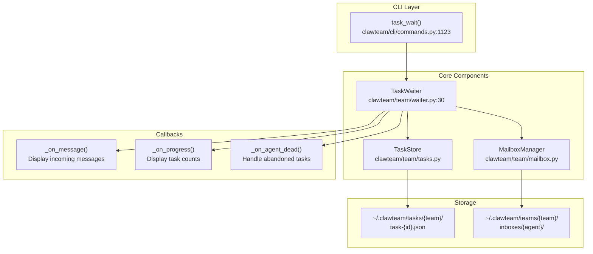
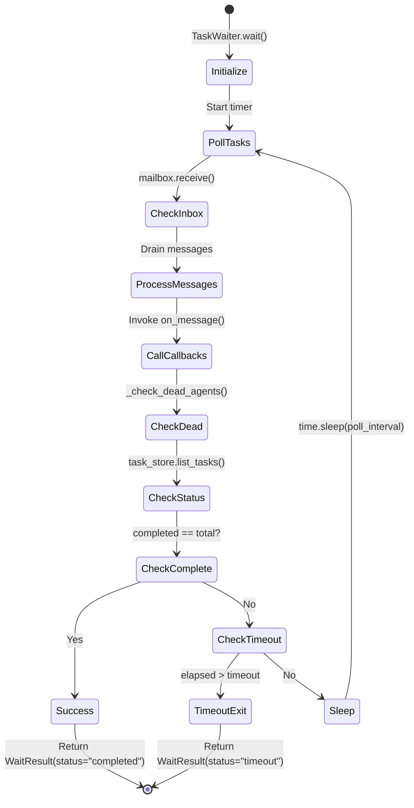
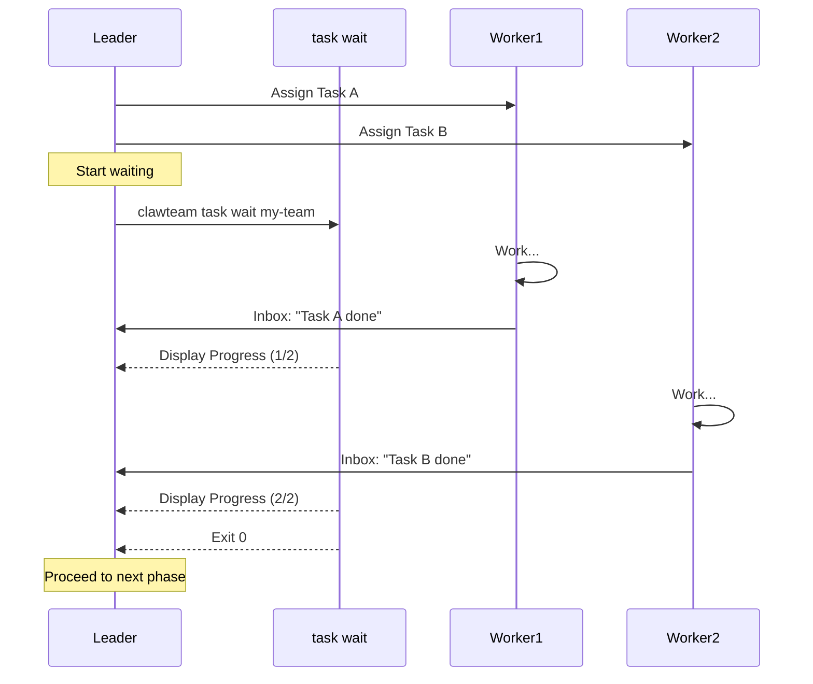

<!-- source: DeepWiki mcp.deepwiki.com · repo HKUDS/ClawTeam · page 4.2 Task Waiting and Coordination · fetched 2026-11-09 -->

# Task Waiting and Coordination

<details>
<summary>Relevant source files</summary>

The following files were used as context for generating this wiki page:

- [clawteam/cli/commands.py](clawteam/cli/commands.py)
- [clawteam/team/waiter.py](clawteam/team/waiter.py)
- [tests/test_cli_commands.py](tests/test_cli_commands.py)
- [tests/test_waiter.py](tests/test_waiter.py)

</details>


This page documents the task waiting and coordination system in ClawTeam, which enables agents and coordinators to block until all tasks in a team are completed. The `task wait` command provides a polling-based mechanism that monitors task status, displays progress updates, drains inbox messages, and detects agent failures during execution.

For information about task creation and dependency management, see [Task Management](#4) and [Task Dependencies](#4.1). For general agent communication patterns, see [Agent Communication](#5).

---

## Overview

The task waiting system solves the problem of coordinating distributed agent work. When a leader agent spawns multiple workers and assigns tasks, it needs a way to know when all work is complete. The `task wait` command provides this coordination primitive by:

1. Polling the task store at regular intervals to check task completion status.
2. Monitoring a designated agent's inbox for progress messages.
3. Tracking and reporting progress (completed/pending/in_progress/blocked counts).
4. Detecting dead agents (agents with `in_progress` tasks that stop responding).
5. Terminating on completion, timeout, or interruption (Ctrl+C).

This is particularly useful for:
- **Leader agents**: Waiting for all worker tasks to complete before proceeding.
- **End-to-end testing**: Validating that a team completes its work successfully.
- **CI/CD pipelines**: Blocking until agent workflows finish with proper exit codes.
- **Human monitoring**: Observing long-running multi-agent workflows.

**Sources:**
- [clawteam/team/waiter.py:30-39]()
- [clawteam/cli/commands.py:1123-1130]()

---

## Command Syntax and Options

The `task wait` command is defined at [clawteam/cli/commands.py:1123-1130]():

```bash
clawteam task wait <team> [options]
```

| Option | Type | Default | Description |
|--------|------|---------|-------------|
| `<team>` | string | required | Team name to monitor |
| `--agent`, `-a` | string | leader | Agent inbox to monitor for messages |
| `--poll-interval`, `-p` | float | 5.0 | Seconds between task status polls |
| `--timeout`, `-t` | float | none | Maximum seconds to wait (unlimited if omitted) |

**Agent Resolution**: If `--agent` is not specified, the command resolves the agent name in this order:
1. Current agent identity from `CLAWTEAM_AGENT_NAME` environment variable.
2. Team leader name from `TeamManager.get_leader_name(team)` [clawteam/cli/commands.py:1147-1153]().

**Exit Codes:**
- `0`: All tasks completed successfully.
- `1`: Timeout expired with incomplete tasks, or interrupted by user [clawteam/cli/commands.py:1255-1256]().

**Sources:**
- [clawteam/cli/commands.py:1123-1158]()

---

## TaskWaiter Architecture

The `TaskWaiter` class in `clawteam/team/waiter.py` serves as the engine for blocking coordination.



**TaskWaiter Initialization** ([clawteam/team/waiter.py:41-52]()):

The `TaskWaiter` class is instantiated with:
- `team_name`: Team to monitor.
- `agent_name`: Agent inbox to watch for messages.
- `mailbox`: `MailboxManager` instance for reading messages.
- `task_store`: `TaskStore` instance for querying task status.
- `poll_interval`: Seconds between status checks.
- `timeout`: Optional maximum wait time in seconds.
- `on_message`: Callback invoked for each new inbox message.
- `on_progress`: Callback invoked when task completion status changes.
- `on_agent_dead`: Callback invoked when an agent with `in_progress` tasks becomes unresponsive.

**Sources:**
- [clawteam/team/waiter.py:30-61]()
- [clawteam/cli/commands.py:1208-1219]()

---

## Polling and Wait Loop

The `wait()` method implements the core blocking loop, handling signal registration for clean interruptions [clawteam/team/waiter.py:66-80]().



**Polling Logic** ([clawteam/team/waiter.py:83-145]()):

The wait loop executes the following steps on each iteration:

1. **Drain Inbox**: `mailbox.receive()` retrieves messages [clawteam/team/waiter.py:85]().
2. **Detect Dead Agents**: `_check_dead_agents()` marks abandoned tasks as pending [clawteam/team/waiter.py:92]().
3. **Check Task Status**: `task_store.list_tasks()` retrieves all tasks to count status [clawteam/team/waiter.py:95-100]().
4. **Invoke Callbacks**: `on_progress()` is called if counts changed [clawteam/team/waiter.py:105-107]().
5. **Check Completion**: If `completed == total`, return success [clawteam/team/waiter.py:110-127]().
6. **Check Timeout**: If `elapsed >= timeout`, return timeout status [clawteam/team/waiter.py:131-142]().
7. **Sleep**: `time.sleep(poll_interval)` before next iteration [clawteam/team/waiter.py:145]().

**Sources:**
- [clawteam/team/waiter.py:66-161]()

---

## Progress Tracking

The `on_progress` callback is invoked whenever task completion counts change. In the CLI implementation, it deduplicates updates to prevent terminal spam [clawteam/cli/commands.py:1165-1184]().

**Output Formats:**

**Human-readable** (default):
```
  3/5 tasks completed  (1 in progress, 1 pending, 0 blocked)
```

**JSON** (`--json` flag):
```json
{
  "event": "progress",
  "completed": 3,
  "total": 5,
  "in_progress": 1,
  "pending": 1,
  "blocked": 0
}
```

**Sources:**
- [clawteam/cli/commands.py:1165-1184]()
- [clawteam/team/waiter.py:102-107]()

---

## Inbox Message Monitoring

While waiting, the `TaskWaiter` drains messages from the monitored agent's inbox. The CLI's `_on_message` callback formats these for the user [clawteam/cli/commands.py:1147-1161]().

**Human-readable output:**
```
  14:23:45  message from=worker1: API endpoints ready
```

**JSON output:**
```json
{
  "event": "message",
  "from": "worker1",
  "content": "API endpoints ready",
  "timestamp": "2024-01-15T14:23:45.123Z"
}
```

**Sources:**
- [clawteam/cli/commands.py:1147-1161]()
- [clawteam/team/waiter.py:85-90]()

---

## Agent Death Detection

The `TaskWaiter` detects agents that have crashed or stopped responding while holding tasks.

**Detection Logic** ([clawteam/team/waiter.py:168-190]()):
1. Calls `list_dead_agents(team_name)` from the spawn registry.
2. Identifies tasks where `owner == dead_agent` and `status == in_progress`.
3. Resets these tasks to `pending` status via `task_store.update()`.
4. Invokes the `on_agent_dead` callback.

**Recovery Actions**:
Resetting tasks to `pending` allows other available agents to pick up the abandoned work.

**Sources:**
- [clawteam/team/waiter.py:168-190]()
- [clawteam/cli/commands.py:1194-1206]()

---

## Completion and Timeout

The `WaitResult` dataclass captures the final state of the wait operation.

**WaitResult Structure** ([clawteam/team/waiter.py:16-27]()):
```python
@dataclass
class WaitResult:
    status: str  # "completed", "timeout", "interrupted"
    elapsed: float
    total: int
    completed: int
    in_progress: int
    pending: int
    blocked: int
    messages_received: int
    task_details: list[dict]
```

**Exit Logic** ([clawteam/cli/commands.py:1235-1256]()):
- **Success**: If `status == "completed"`, the CLI prints a green success message and exits 0.
- **Timeout**: If `status == "timeout"`, the CLI prints a yellow warning, lists incomplete tasks, and exits 1.
- **Interrupted**: If the user hits Ctrl+C, the loop catches the signal, returns `status="interrupted"`, and exits 1.

**Sources:**
- [clawteam/team/waiter.py:16-27]()
- [clawteam/cli/commands.py:1235-1256]()
- [tests/test_waiter.py:105-134]() (Testing timeout behavior)

---

## Use Cases and Patterns

### Pattern: CI/CD Pipeline Integration
`task wait` is ideal for automation scripts where a non-zero exit code should trigger a pipeline failure.

```bash
# Launch a pre-configured team
clawteam launch software-team --goal "Refactor auth module"
# Block until done
clawteam task wait software-team --timeout 3600
```

### Pattern: Multi-Agent Coordination
Leader agents use this to synchronize phases of a plan.



**Sources:**
- [clawteam/team/waiter.py:30-161]()
- [tests/test_waiter.py:71-101]() (Testing completion over time)

---

