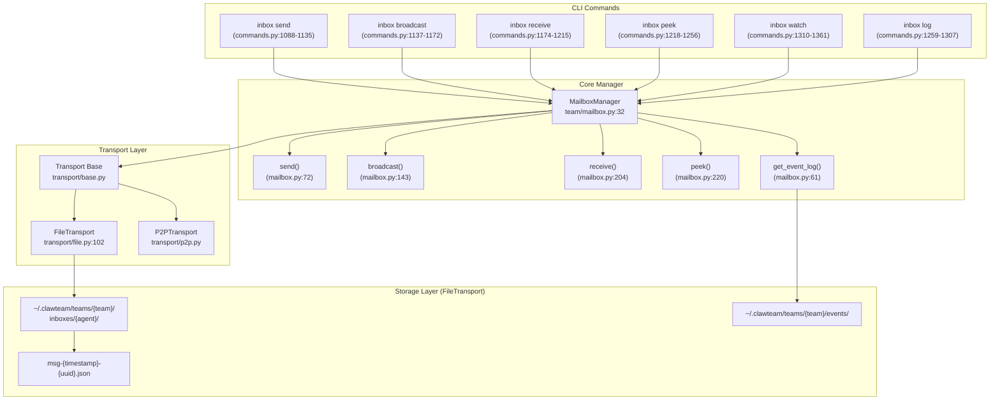
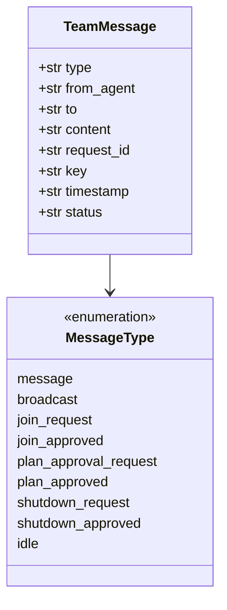

<!-- source: DeepWiki mcp.deepwiki.com · repo HKUDS/ClawTeam · page 5 Agent Communication · fetched 2026-11-09 -->

# Agent Communication

<details>
<summary>Relevant source files</summary>

The following files were used as context for generating this wiki page:

- [clawteam/cli/commands.py](clawteam/cli/commands.py)
- [clawteam/store/file.py](clawteam/store/file.py)
- [clawteam/team/mailbox.py](clawteam/team/mailbox.py)
- [clawteam/team/manager.py](clawteam/team/manager.py)
- [clawteam/transport/file.py](clawteam/transport/file.py)
- [tests/test_cli_commands.py](tests/test_cli_commands.py)
- [tests/test_mailbox.py](tests/test_mailbox.py)

</details>


The ClawTeam inbox system provides asynchronous message-passing between agents on a team. Agents send point-to-point messages, broadcast to all team members, and poll their inboxes for incoming communications. The system supports pluggable transports, defaulting to a file-based implementation persisted under `~/.clawteam/teams/{team}/inboxes/{agent}/`, enabling simple coordination without requiring a dedicated message broker.

This page covers the core inbox operations (`send`, `receive`, `broadcast`, `peek`, `watch`, `log`) and the underlying `MailboxManager` implementation. For structured message protocols (join requests, plan approvals, shutdown coordination), see [Message Types and Protocols](#5.1). For the plan approval workflow specifically, see [Plan Approval Workflow](#5.2).

---

## Inbox System Architecture



**Architecture Overview**

The inbox system consists of:

1.  **CLI Commands** ([clawteam/cli/commands.py:1081-1361]()): Typer-based commands for sending, receiving, and monitoring.
2.  **MailboxManager** ([clawteam/team/mailbox.py:32]()): High-level logic that orchestrates message creation, event logging, and transport delegation.
3.  **Transport Layer** ([clawteam/transport/base.py]()): An abstraction for physical message delivery. The `FileTransport` ([clawteam/transport/file.py:102]()) implements atomicity using temporary files and renames [clawteam/transport/file.py:143-148]().
4.  **Event Log**: A persistent record of all messages stored in the team's `events/` directory [clawteam/team/mailbox.py:45-59]().

**Sources:**
- [clawteam/cli/commands.py:1081-1361]()
- [clawteam/team/mailbox.py:32-234]()
- [clawteam/transport/file.py:102-190]()

---

## Message Structure and Types



The `TeamMessage` model ([clawteam/team/models.py]()) is the standard envelope for all communications. It includes routing metadata (`from_agent`, `to`), protocol metadata (`request_id`, `key`), and the payload (`content`).

**Common Message Types:**
*   `message`: Standard point-to-point communication.
*   `broadcast`: One-to-many communication.
*   `join_request` / `join_approved`: Team membership protocols [tests/test_cli_commands.py:188-196]().
*   `shutdown_approved`: Lifecycle termination signal [tests/test_cli_commands.py:157-160]().

**Sources:**
- [clawteam/team/models.py]()
- [clawteam/team/mailbox.py:72-115]()
- [tests/test_cli_commands.py:188-196]()

---

## Point-to-Point Messaging

### send Command

Directly delivers a message to a specific agent's inbox.

**Implementation Details:**
The `send` method [clawteam/team/mailbox.py:72-141]() creates a `TeamMessage` and passes it to the configured transport. It also logs the message to the team's event log [clawteam/team/mailbox.py:118]() and attempts to publish a wakeup signal via Redis if available [clawteam/team/mailbox.py:120-131]().

**Example Usage:**
```bash
# Send a message to the leader
clawteam inbox send my-team leader "Task completed" --type message
```

**Sources:**
- [clawteam/cli/commands.py:1088-1135]()
- [clawteam/team/mailbox.py:72-141]()
- [tests/test_mailbox.py:41-50]()

---

## Broadcast Messaging

### broadcast Command

Sends a message to every registered recipient in the team, excluding the sender.

**Implementation Details:**
`MailboxManager.broadcast()` [clawteam/team/mailbox.py:143-202]() uses the transport's `list_recipients()` method to find all active inboxes. It iterates through them, filtering out the sender [clawteam/team/mailbox.py:154](), and delivers a copy of the message to each.

**Example Usage:**
```bash
# Notify everyone of a deployment
clawteam inbox broadcast my-team "Deploying v1.1 to production"
```

**Sources:**
- [clawteam/cli/commands.py:1137-1172]()
- [clawteam/team/mailbox.py:143-202]()
- [tests/test_mailbox.py:134-148]()

---

## Reading Messages

### receive Command (Destructive)

Retrieves messages and removes them from the inbox. This is the primary way agents consume tasks and instructions.

**Implementation Details:**
The `receive` method [clawteam/team/mailbox.py:204-218]() delegates to the transport's `fetch` method with `consume=True`. In the `FileTransport`, this involves "claiming" the file by renaming it to a `.consumed` suffix and applying an advisory lock [clawteam/transport/file.py:153-190]().

**Sources:**
- [clawteam/cli/commands.py:1174-1215]()
- [clawteam/team/mailbox.py:204-218]()
- [clawteam/transport/file.py:153-190]()

### peek Command (Non-Destructive)

Inspects messages without removing them from the inbox. Useful for monitoring or the [Plan Approval Workflow](#5.2).

**Implementation Details:**
Calls `fetch` with `consume=False` [clawteam/team/mailbox.py:220-223](), allowing the messages to remain available for subsequent `receive` calls.

**Sources:**
- [clawteam/cli/commands.py:1218-1256]()
- [clawteam/team/mailbox.py:220-223]()
- [tests/test_mailbox.py:102-111]()

---

## Real-Time Monitoring

### watch Command

The `watch` command [clawteam/cli/commands.py:1310-1361]() provides a live view of an inbox. It utilizes the `InboxWatcher` (defined in `clawteam/team/watcher.py`) to poll for new messages.

**Advanced Triggering:**
The `--exec` flag allows users to run a shell command every time a new message is received [clawteam/cli/commands.py:1321](). Message details are injected into the environment of the executed command.

**Sources:**
- [clawteam/cli/commands.py:1310-1361]()

---

## Storage and Transports

ClawTeam supports different transport backends via the `Transport` base class [clawteam/transport/base.py]().

| Transport | Description | Persistence |
| :--- | :--- | :--- |
| **File** | Default. Uses local filesystem. | `~/.clawteam/teams/{team}/inboxes/` |
| **P2P** | Direct agent-to-agent communication. | Memory / Network |
| **Redis** | Uses Redis pub/sub for wakeups. | Redis |

**FileTransport Atomicity:**
To prevent partial reads, the `FileTransport` writes to a temporary file first and then performs an atomic `os.replace` [clawteam/transport/file.py:143-148]().

**Sources:**
- [clawteam/transport/file.py:102-152]()
- [clawteam/team/mailbox.py:15-29]()

---

