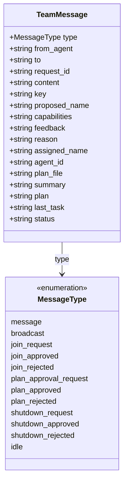
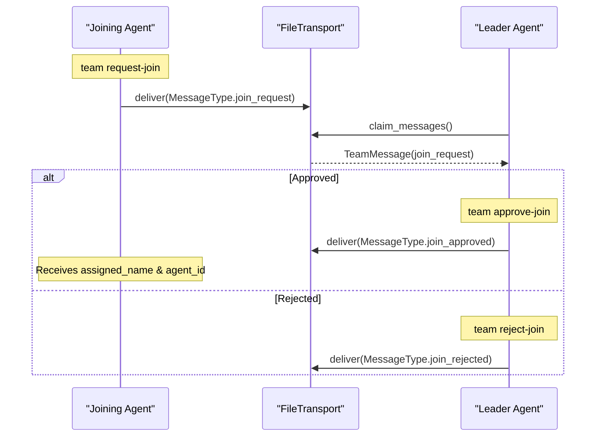
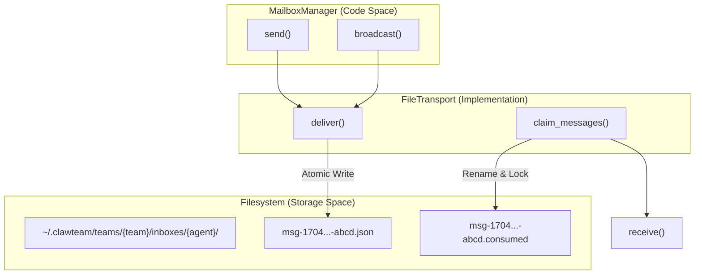

<!-- source: DeepWiki mcp.deepwiki.com · repo HKUDS/ClawTeam · page 5.1 Message Types and Protocols · fetched 2026-11-09 -->

# Message Types and Protocols

Relevant source files

The following files were used as context for generating this wiki page:

- [clawteam/store/file.py](clawteam/store/file.py)
- [clawteam/team/mailbox.py](clawteam/team/mailbox.py)
- [clawteam/team/manager.py](clawteam/team/manager.py)
- [clawteam/transport/file.py](clawteam/transport/file.py)
- [tests/test_inbox_routing.py](tests/test_inbox_routing.py)
- [tests/test_mailbox.py](tests/test_mailbox.py)

This document describes the message types and communication protocols used by ClawTeam agents for inter-agent coordination. It covers the structure of messages, the specific types available, and the request-response protocols that enable team joining, plan approval, and lifecycle management workflows.

For information about the underlying inbox system and transport mechanisms, see [Agent Communication](#5). For the plan approval workflow specifically, see [Plan Approval Workflow](#5.2).

---

## Overview

ClawTeam uses a structured messaging system where agents communicate through typed messages. The primary implementation uses a `FileTransport` where messages are stored as JSON files in per-agent inbox directories [clawteam/transport/file.py:102-107](). All messages share a common base structure defined by the `TeamMessage` model [clawteam/team/mailbox.py:96-115]().

---

## Message Structure

### Base Message Format

The `TeamMessage` class defines the schema for all inter-agent communication. When using the default `FileTransport`, messages are persisted to `~/.clawteam/teams/{team}/inboxes/{agent}/msg-{timestamp}-{uuid}.json` [clawteam/transport/file.py:105-107]().

**Key Fields in Code:**

| Field | Code Entity | Description |
|-------|-------------|-------------|
| `type` | `MessageType` | The functional category of the message [clawteam/team/models.py:13]() |
| `from_agent` | `msg.from_agent` | The logical name of the sender [clawteam/team/mailbox.py:98]() |
| `to` | `msg.to` | The logical name of the recipient [clawteam/team/mailbox.py:99]() |
| `request_id` | `msg.request_id` | A UUID used to correlate requests and responses [clawteam/team/mailbox.py:101]() |

**Sources:** [clawteam/team/models.py:13-21](), [clawteam/team/mailbox.py:72-115](), [clawteam/transport/file.py:102-107]()

---

## Message Types

### 1. General Communication

#### `message` - Point-to-Point
Standard message for agent-to-agent communication. Used for status updates and coordination.
- **Implementation**: `MailboxManager.send(..., msg_type=MessageType.message)` [clawteam/team/mailbox.py:72-77]()
- **Test Reference**: `TestSendReceive.test_send_and_receive_single` [tests/test_mailbox.py:41-49]()

#### `broadcast` - Team-Wide Announcement
Message sent to all team members except the sender.
- **Implementation**: `MailboxManager.broadcast(...)` iterates through all recipients discovered by the transport [clawteam/team/mailbox.py:143-160]().
- **Exclusion Logic**: The sender and any names in the `exclude` list are filtered out [clawteam/team/mailbox.py:153-158]().

**Sources:** [clawteam/team/mailbox.py:143-160](), [tests/test_mailbox.py:41-49]()

---

### 2. Team Joining Protocol

The team joining protocol facilitates dynamic membership management.

- **`join_request`**: Includes `proposed_name` and `capabilities` [clawteam/team/mailbox.py:80-81]().
- **`join_approved`**: Includes the final `assigned_name` and `agent_id` [clawteam/team/mailbox.py:107-108]().
- **`join_rejected`**: Includes a `reason` for the denial [clawteam/team/mailbox.py:83]().

**Sources:** [clawteam/team/mailbox.py:72-115](), [tests/test_mailbox.py:82-94]()

---

### 3. Plan Approval Protocol

Agents submit execution plans for leader oversight before performing actions.

- **`plan_approval_request`**: Contains `plan_file`, `summary`, and the raw `plan` content [clawteam/team/mailbox.py:87-89]().
- **`plan_approved`**: Confirms the `plan_id` and may include `feedback` [clawteam/team/mailbox.py:82-87]().
- **`plan_rejected`**: Denies the plan, usually requiring `feedback` for revisions [clawteam/team/mailbox.py:82-83]().

**Sources:** [clawteam/team/mailbox.py:72-115](), [clawteam/team/plan.py:11-12]()

---

### 4. Lifecycle and Status

#### `shutdown_request`
Sent to an agent to request it stop execution. Includes a `reason` [clawteam/team/mailbox.py:83]().

#### `idle`
Sent by a worker to notify the leader it has finished its current queue.
- **Metadata**: Includes `last_task` and `status` of that task [clawteam/team/mailbox.py:90-91]().
- **Routing**: In multi-user environments, `LifecycleManager` ensures the `idle` message is routed to the correctly namespaced leader inbox (e.g., `alice_leader`) [tests/test_inbox_routing.py:14-37]().

**Sources:** [clawteam/team/mailbox.py:72-115](), [tests/test_inbox_routing.py:14-37]()

---

## Transport and Delivery

The `MailboxManager` delegates the actual I/O to a `Transport` implementation [clawteam/team/mailbox.py:44]().

### FileTransport Logic
The `FileTransport` handles the filesystem-level protocol:
1. **Atomic Write**: Writes to a `.tmp` file and then uses `os.replace` for an atomic move into the inbox [clawteam/transport/file.py:143-148]().
2. **Message Claiming**: Uses file renaming (`.json` to `.consumed`) and advisory locking (`fcntl.flock` or `msvcrt.locking`) to ensure only one agent processes a message [clawteam/transport/file.py:158-173]().
3. **Dead Letter Queue**: If a message fails to be processed, it is moved to a `dead_letters` directory with a `.meta.json` file describing the error [clawteam/transport/file.py:192-224]().

**Sources:** [clawteam/transport/file.py:102-190](), [clawteam/team/mailbox.py:32-46]()

---

## Event Logging

Every message sent via `MailboxManager` is also logged to an event stream that is never consumed.
- **Storage**: `~/.clawteam/teams/{team}/events/evt-{ts}-{uid}.json` [clawteam/team/mailbox.py:45-52]().
- **Retrieval**: `MailboxManager.get_event_log(limit)` allows non-destructive history inspection [clawteam/team/mailbox.py:61-70]().

**Sources:** [clawteam/team/mailbox.py:48-70]()

---

