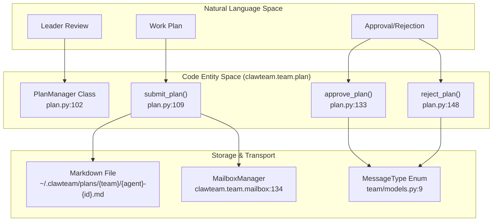
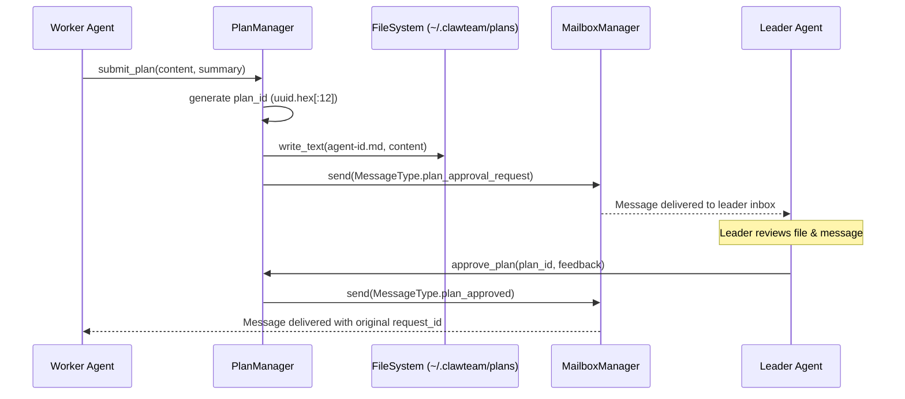

<!-- source: DeepWiki mcp.deepwiki.com · repo HKUDS/ClawTeam · page 5.2 Plan Approval Workflow · fetched 2026-11-09 -->

# Plan Approval Workflow

Relevant source files

The following files were used as context for generating this wiki page:

- [clawteam/cli/commands.py](clawteam/cli/commands.py)
- [clawteam/team/plan.py](clawteam/team/plan.py)
- [tests/test_cli_commands.py](tests/test_cli_commands.py)
- [tests/test_plan_storage.py](tests/test_plan_storage.py)

## Purpose

This document describes the plan approval workflow system in ClawTeam, which enables worker agents to submit work plans for leader oversight before proceeding with execution. This mechanism provides a structured coordination layer, allowing team leaders to review, approve, or reject proposed actions.

For information about other message types and communication patterns, see [Message Types and Protocols](5.1). For general inbox usage, see [Agent Communication](5).

## Overview

The plan approval workflow is a request-response protocol built on top of ClawTeam's inbox messaging system. Worker agents submit plans to their team leader, who reviews and responds with approval or rejection. The workflow uses specialized message types (`plan_approval_request`, `plan_approved`, `plan_rejected`) to coordinate this interaction.

**Key characteristics:**
- **Asynchronous Pattern:** Agents can continue other work while waiting for approval.
- **Leader Authority:** The protocol assumes a hierarchical structure where the leader has sole authority to approve/reject.
- **Persistent Storage:** Plans are stored as markdown files, ensuring a durable record of proposed actions.
- **Feedback Loop:** Leaders can provide textual feedback with both approvals and rejections.

**Sources:** [clawteam/team/plan.py:102-161](), [clawteam/team/models.py:9-11]()

## Architecture and Code Entities

The workflow bridges high-level agent coordination with low-level file storage and message routing.

### Entity Mapping

**Sources:** [clawteam/team/plan.py:102-161](), [clawteam/team/mailbox.py:134-136](), [clawteam/team/models.py:9-11]()

## Implementation Details

### PlanManager Logic
The `PlanManager` class handles the lifecycle of a plan. It requires a `team_name` and an instance of `MailboxManager` to function [clawteam/team/plan.py:105-107]().

1.  **Submission:** When `submit_plan` is called, it generates a unique 12-character hexadecimal `plan_id` [clawteam/team/plan.py:118](). The plan content is written to a team-scoped markdown file [clawteam/team/plan.py:119-120](). Finally, it sends a message of type `MessageType.plan_approval_request` to the leader's inbox, containing the file path and a summary [clawteam/team/plan.py:122-130]().
2.  **Approval/Rejection:** The leader uses `approve_plan` or `reject_plan`, which sends a response message back to the worker using the original `request_id` for correlation [clawteam/team/plan.py:140-161]().

### Plan Storage Layout
ClawTeam uses a structured directory format to isolate plans by team.

| Path Component | Logic | Code Reference |
| :--- | :--- | :--- |
| **Root Directory** | `~/.clawteam/plans/` | [clawteam/team/plan.py:20-21]() |
| **Team Directory** | `~/.clawteam/plans/{team_name}/` | [clawteam/team/plan.py:60-62]() |
| **File Name** | `{agent_name}-{plan_id}.md` | [clawteam/team/plan.py:30-34]() |

**Sources:** [clawteam/team/plan.py:20-62]()

## Data Flow: Submission to Decision

The following diagram illustrates the data flow between code entities during a standard plan approval cycle.

**Sources:** [clawteam/team/plan.py:109-161](), [clawteam/team/mailbox.py:134-136]()

## CLI Command Reference

The plan workflow is exposed via the `clawteam plan` command group in `clawteam/cli/commands.py`.

### plan submit
Submits a plan for review.
- **Implementation:** Calls `PlanManager.submit_plan` [clawteam/cli/commands.py:1281-1310]().
- **Input:** Accepts raw text or a file path. If a path is provided, the CLI reads the file content before submission.
- **Output:** Returns the generated `plan_id`.

### plan approve / reject
Responds to a pending plan.
- **Implementation:** Calls `PlanManager.approve_plan` or `PlanManager.reject_plan` [clawteam/cli/commands.py:1313-1356]().
- **Requirement:** The caller must be identified as the leader of the team (checked via environment variables).
- **Feedback:** An optional `--feedback` string can be attached to the response.

**Sources:** [clawteam/cli/commands.py:1281-1356]()

## Legacy Compatibility and Cleanup

ClawTeam maintains backward compatibility for plans stored in older, flat directory structures.

- **Fallback Search:** `PlanManager.get_plan` iterates through both team-scoped paths and legacy flat paths in `~/.clawteam/plans/` to find a plan file [clawteam/team/plan.py:45-57, 164-171]().
- **Cleanup:** When `TeamManager.cleanup(team_name)` is executed, it removes the team-scoped plan directory. It also parses the team's event log to identify and delete any legacy flat plan files specifically referenced by that team's messages [clawteam/team/plan.py:65-99]().

**Sources:** [clawteam/team/plan.py:45-99, 164-171](), [tests/test_plan_storage.py:70-125]()

---

