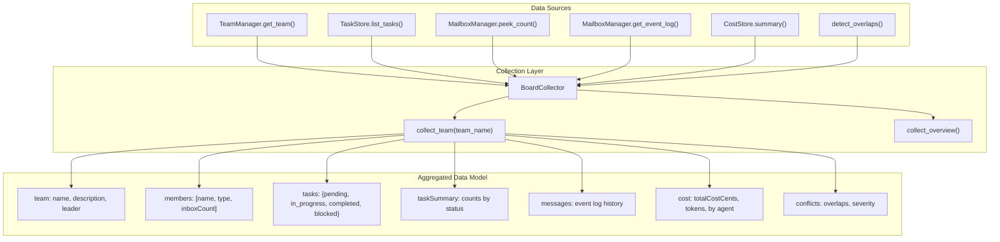
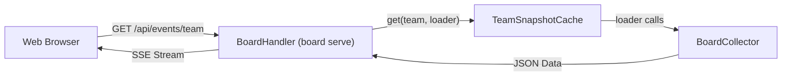

<!-- source: DeepWiki mcp.deepwiki.com · repo HKUDS/ClawTeam · page 6 Monitoring and Observability · fetched 2026-11-09 -->

# Monitoring and Observability

Relevant source files

The following files were used as context for generating this wiki page:

- [clawteam/board/collector.py](clawteam/board/collector.py)
- [clawteam/board/server.py](clawteam/board/server.py)
- [clawteam/board/static/index.html](clawteam/board/static/index.html)
- [clawteam/cli/commands.py](clawteam/cli/commands.py)
- [tests/test_board.py](tests/test_board.py)
- [tests/test_cli_commands.py](tests/test_cli_commands.py)

This page documents ClawTeam's monitoring and observability capabilities for tracking multi-agent team execution. It covers the data collection architecture, terminal-based displays, web dashboard, and tmux integration.

For details on specific board commands, see [CLI Command Reference](#10). For task tracking mechanisms, see [Task Management](#4). For cost tracking details, see [Cost Tracking](#13).

## Overview

ClawTeam provides multiple modes for observing team activity:

| Mode | Command | Use Case | Update Mechanism |
|------|---------|----------|------------------|
| Static snapshot | `board show` | Quick status check | Single execution |
| Live terminal | `board live` | Continuous monitoring | Polling with configurable interval |
| Multi-team overview | `board overview` | Cross-team summary | Single execution |
| Web dashboard | `board serve` | Remote/browser access | Server-Sent Events (SSE) |
| Tmux attach | `board attach` | Watch agent terminals | Native tmux multiplexing |
| JSON output | `--json` flag | Scripting/automation | Per-command basis |

All monitoring modes share a common data collection layer implemented in `BoardCollector`, which aggregates team configuration, task status, inbox counts, message history, cost data, and workspace conflicts into a unified data model.

**Sources:** [clawteam/cli/commands.py:1268-1380](), [clawteam/board/collector.py:12-214]()

## Data Collection Architecture

### BoardCollector Component

The `BoardCollector` class [clawteam/board/collector.py:12-214]() aggregates data from multiple storage backends into a unified structure for rendering. It queries:

- **Team configuration** via `TeamManager.get_team()` [clawteam/board/collector.py:38]()
- **Task data** via `TaskStore.list_tasks()` [clawteam/board/collector.py:43]()
- **Inbox counts** via `MailboxManager.peek_count()` [clawteam/board/collector.py:49]()
- **Message history** via `MailboxManager.get_event_log()` [clawteam/board/collector.py:121]()
- **Cost data** via `CostStore.summary()` [clawteam/board/collector.py:148]()
- **Workspace overlaps** via `detect_overlaps()` [clawteam/board/collector.py:163]()

**Diagram: BoardCollector Data Aggregation Pipeline**

The `collect_team()` method [clawteam/board/collector.py:63-214]() returns a dictionary containing the full state of a team. Tasks are serialized using `model_dump_json(by_alias=True, exclude_none=True)` [clawteam/board/collector.py:103]() to ensure compatibility with the frontend schema.

**Sources:** [clawteam/board/collector.py:63-214]()

### Multi-Team Overview Collection

The `collect_overview()` method [clawteam/board/collector.py:186-214]() provides cross-team summaries. It calls `TeamManager.discover_teams()` to enumerate all teams and then invokes `collect_team_summary()` for each [clawteam/board/collector.py:202-206](). If collection fails for a specific team, it uses fallback logic to preserve basic visibility of the "broken" team [clawteam/board/collector.py:208-213]().

**Sources:** [clawteam/board/collector.py:186-214](), [tests/test_board.py:178-228]()

## Terminal-Based Monitoring

### Board Commands

The CLI provides several commands for terminal monitoring:
- `board show`: Displays a static snapshot of the team board [clawteam/cli/commands.py:1268-1286]().
- `board overview`: Lists all discovered teams and their high-level stats [clawteam/cli/commands.py:1289-1316]().
- `board live`: Provides a continuous, auto-refreshing view of the team board [clawteam/cli/commands.py:1319-1342]().

For details, see [Terminal Boards](#6.1).

**Sources:** [clawteam/cli/commands.py:1268-1342]()

## Web Dashboard

### Server and SSE Updates

The `board serve` command [clawteam/cli/commands.py:1345-1365]() launches a lightweight HTTP server implemented in `clawteam.board.server`. This server utilizes a `BoardHandler` [clawteam/board/server.py:120-221]() to serve a high-fidelity Web UI.

- **SSE Stream**: Real-time updates are delivered via Server-Sent Events (SSE) at `/api/events/<team_name>` [clawteam/board/server.py:141-146]().
- **Caching**: To optimize performance, snapshots are cached in `TeamSnapshotCache` with a configurable TTL [clawteam/board/server.py:97-118]().
- **Proxy**: The server includes a proxy for fetching GitHub content (e.g., READMEs) for team descriptions [clawteam/board/server.py:147-162]().

**Diagram: Web Dashboard SSE Architecture**

For details, see [Web Dashboard](#6.2).

**Sources:** [clawteam/board/server.py:1-221](), [clawteam/cli/commands.py:1345-1365]()

## Tmux Integration

### Board Attach

The `board attach` command [clawteam/cli/commands.py:1368-1380]() provides a low-level observability view by attaching to the tmux session where agents are running. It uses `tmux select-layout tiled` to arrange all agent windows into a single visible grid.

For details, see [Tmux Integration](#6.3).

**Sources:** [clawteam/cli/commands.py:1368-1380]()

## JSON Output for Automation

All observability commands support the global `--json` flag [clawteam/cli/commands.py:50-52](). When enabled, the CLI bypasses human-readable rendering and outputs the raw data structure returned by the `BoardCollector` as a JSON string [clawteam/cli/commands.py:79-85]().

**Sources:** [clawteam/cli/commands.py:50-85]()

---

