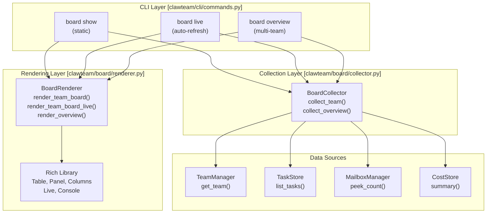
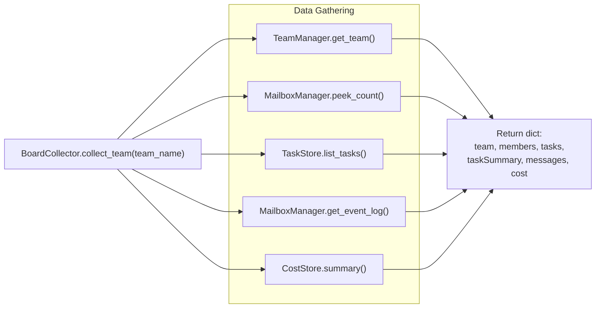
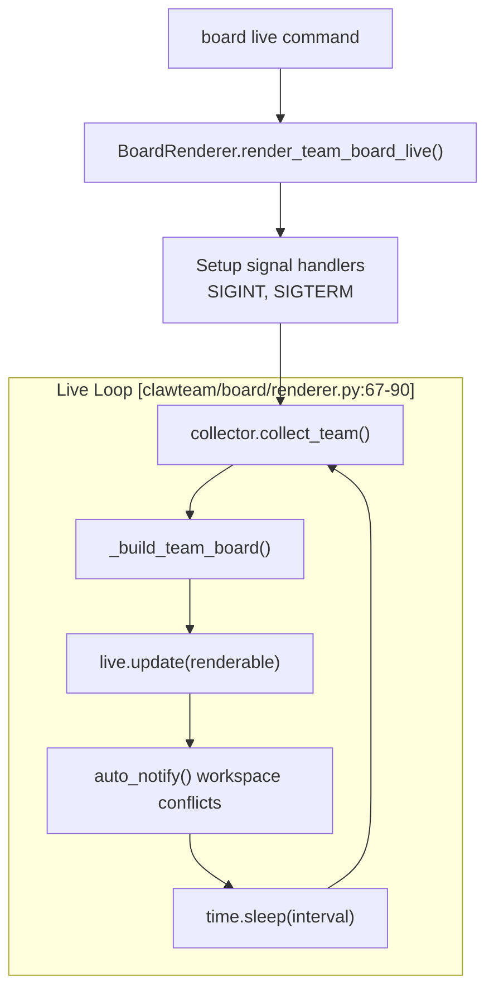

<!-- source: DeepWiki mcp.deepwiki.com · repo HKUDS/ClawTeam · page 6.1 Terminal Boards · fetched 2026-11-09 -->

# Terminal Boards

Relevant source files

The following files were used as context for generating this wiki page:

- [clawteam/board/renderer.py](clawteam/board/renderer.py)
- [clawteam/cli/commands.py](clawteam/cli/commands.py)
- [clawteam/config.py](clawteam/config.py)
- [clawteam/timefmt.py](clawteam/timefmt.py)
- [tests/test_cli_commands.py](tests/test_cli_commands.py)
- [tests/test_config.py](tests/test_config.py)
- [tests/test_timefmt.py](tests/test_timefmt.py)

## Purpose and Scope

Terminal Boards provide real-time visualization of team coordination state directly in the terminal using the Rich library for colored, formatted output. This page covers the `board show`, `board live`, and `board overview` commands that render Kanban-style task boards, member tables, and team summaries as terminal output.

For web-based visualization, see [Web Dashboard](#6.2). For live terminal multiplexing of agent processes, see [Tmux Integration](#6.3).

---

## Command Overview

Terminal boards are accessed through three CLI commands defined in `clawteam/cli/commands.py`, all part of the `board` command group:

| Command | Purpose | Output Mode |
|---------|---------|-------------|
| `board show <team>` | Static snapshot of team board | Single render |
| `board live <team>` | Auto-refreshing live board | Continuous updates |
| `board overview` | Summary of all teams | Single render |

All commands support `--json` output for programmatic consumption and shell script integration.

**Sources:** [clawteam/cli/commands.py:1730-1787]()

---

## Architecture Overview

Terminal board rendering follows a three-layer architecture:

### Component Interaction Diagram

**Data Flow:**
1. CLI commands invoke `BoardCollector` methods to aggregate data.
2. Collector queries multiple storage managers for team, task, inbox, and cost data.
3. Collector returns plain dict structures with all data normalized.
4. CLI passes data dict to `BoardRenderer` methods.
5. Renderer constructs Rich components (Tables, Panels, Columns) and displays to console.

**Sources:** [clawteam/board/collector.py:13-142](), [clawteam/board/renderer.py:16-177](), [clawteam/cli/commands.py:1734-1787]()

---

## BoardCollector: Data Aggregation

The `BoardCollector` class centralizes data fetching from all storage subsystems and normalizes it into plain dicts for rendering.

### collect_team() Method

Aggregates complete board data for a single team:

**Key Data Structures:**

| Field | Type | Description |
|-------|------|-------------|
| `team` | dict | Team metadata: name, description, leadAgentId, leaderName, createdAt, budgetCents |
| `members` | list[dict] | Per-member: name, agentId, agentType, joinedAt, inboxCount, user (optional) |
| `tasks` | dict | Tasks grouped by status: `pending`, `in_progress`, `completed`, `blocked` |
| `taskSummary` | dict | Counts per status plus `total` |
| `messages` | list[dict] | Event log messages (last 200) |
| `cost` | dict | Cost summary: totalCostCents, totalInputTokens, totalOutputTokens, byAgent |

**Implementation Details:**
- Inbox counts computed per agent using `peek_count()` to show unread message counts.
- Tasks grouped into four status buckets using [clawteam/board/collector.py:44-54]().
- Leader name resolved by matching `lead_agent_id` against member list [clawteam/board/collector.py:62-66]().
- Event log limited to 200 messages for performance [clawteam/board/collector.py:71]().
- Cost data optional; silently omitted if `CostStore` fails [clawteam/board/collector.py:79-93]().

**Sources:** [clawteam/board/collector.py:16-109]()

---

## BoardRenderer: Terminal Display

The `BoardRenderer` class uses the Rich library to construct colored, formatted terminal output.

### Team Board Layout

The team board consists of several vertically stacked sections managed by `_build_team_board()` [clawteam/board/renderer.py:99-157]():

1.  **Header Panel:** Displays team name, description, leader, member count, and cost vs budget [clawteam/board/renderer.py:109-125]().
2.  **Members Table:** Shows agent names, types, join times, and inbox counts [clawteam/board/renderer.py:127-147]().
3.  **Task Board (Kanban):** A 4-column layout for PENDING, IN PROGRESS, COMPLETED, and BLOCKED tasks [clawteam/board/renderer.py:176-215]().
4.  **Conflict Warnings:** A panel showing file overlaps if detected by `auto_notify` [clawteam/board/renderer.py:152-155](), [clawteam/board/renderer.py:159-174]().

### Live Rendering Mechanism

The `render_team_board_live()` method uses `rich.live.Live` for flicker-free terminal updates:

**Conflict Auto-Notification:**
In `board live` mode, the renderer periodically (every 5 cycles) invokes `clawteam.workspace.conflicts.auto_notify()` to check for and notify agents about workspace file overlaps [clawteam/board/renderer.py:78-88]().

**Sources:** [clawteam/board/renderer.py:51-94](), [clawteam/board/renderer.py:99-174]()

---

## Configuration and Time Formatting

Terminal boards respect user configuration for timestamps and timezones.

### Timezone Formatting
The `format_timestamp` function in `clawteam/timefmt.py` uses the `timezone` setting from `ClawTeamConfig` to render human-readable times [clawteam/timefmt.py:24-49]().

- **Priority:** `CLAWTEAM_TIMEZONE` env var > `config.json` > Default (UTC) [clawteam/config.py:113-134]().
- **Default:** If set to UTC, it returns the ISO format slice `YYYY-MM-DDTHH:MM:SS` [clawteam/timefmt.py:39-40]().

**Sources:** [clawteam/timefmt.py:24-49](), [clawteam/config.py:60](), [clawteam/config.py:113-134]()

---

## Static vs Live Execution

### Static Board (`board show`)
1.  CLI calls `collector.collect_team()` [clawteam/cli/commands.py:1745]().
2.  If `--json` is set, the raw dict is dumped [clawteam/cli/commands.py:1741-1743]().
3.  Otherwise, `renderer.render_team_board()` prints the static Rich Group [clawteam/board/renderer.py:24-26]().

### Overview Table (`board overview`)
Renders a multi-team summary table using `BoardRenderer.render_overview()` [clawteam/board/renderer.py:28-49]().
- Columns: Team, Leader, Members, Tasks, Pending Msgs.
- Fetches data via `collector.collect_overview()` [clawteam/cli/commands.py:1756]().

**Sources:** [clawteam/cli/commands.py:1734-1762](), [clawteam/board/renderer.py:24-49]()

---

