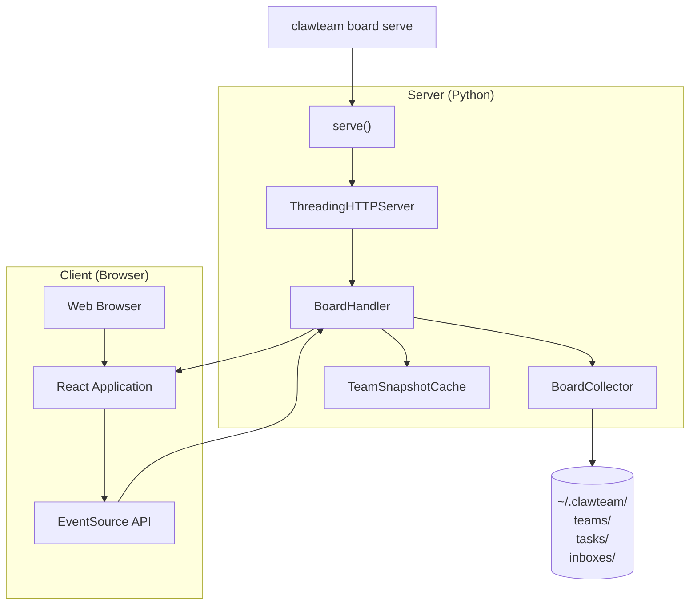
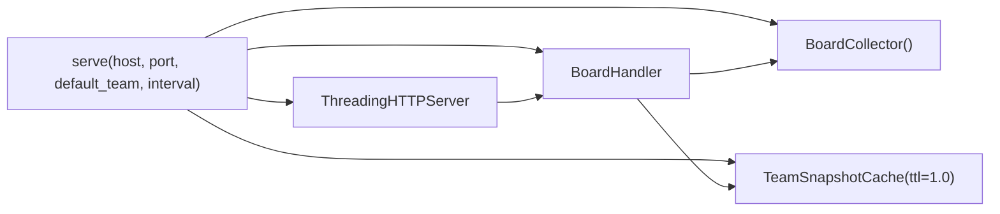
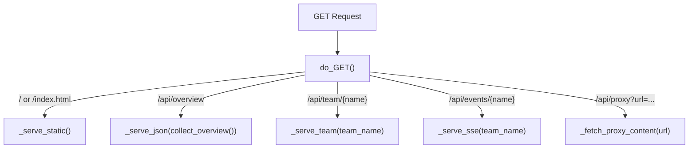

<!-- source: DeepWiki mcp.deepwiki.com · repo HKUDS/ClawTeam · page 6.2 Web Dashboard · fetched 2026-11-09 -->

# Web Dashboard

<details>
<summary>Relevant source files</summary>

The following files were used as context for generating this wiki page:

- [clawteam/board/collector.py](clawteam/board/collector.py)
- [clawteam/board/server.py](clawteam/board/server.py)
- [clawteam/board/static/index.html](clawteam/board/static/index.html)
- [tests/test_board.py](tests/test_board.py)

</details>


The Web Dashboard provides a browser-based interface for monitoring ClawTeam team status in real-time. It displays team members, tasks organized in a Kanban board, pending messages, cost summaries, and workspace conflicts through a responsive web UI with server-sent events (SSE) for live updates.

For terminal-based monitoring, see [Terminal Boards](#6.1). For direct agent terminal observation, see [Tmux Integration](#6.3).

---

## Purpose and Scope

The Web Dashboard serves as a remote-accessible alternative to terminal-based monitoring. It enables multiple users to observe team progress simultaneously through a browser, making it suitable for distributed teams, remote monitoring, and presentations. The dashboard automatically refreshes data via SSE, eliminating the need for manual polling.

**Key capabilities:**
- Browse all teams via dropdown selector with a TTL-cached overview.
- View Kanban boards with task status columns (pending, in_progress, completed, blocked).
- Monitor team member inbox message counts and identity mapping.
- Review recent message history with normalized participant labels.
- Track task completion summaries and token costs.
- Detect and visualize workspace file overlaps and conflicts.
- Proxy GitHub content (like READMEs) for team documentation.

**Sources:** [clawteam/board/server.py:1-127](), [clawteam/board/static/index.html:1-230](), [clawteam/board/collector.py:1-110]()

---

## Architecture Overview

The Web Dashboard uses a lightweight, stdlib-only HTTP server with SSE for push-based updates. The frontend is a single-page application served as a static HTML file with a premium dark theme.



**Data flow:**
1. **CLI invocation**: `clawteam board serve` starts the `ThreadingHTTPServer` [clawteam/board/server.py:270-288]().
2. **Static serving**: Browser loads `index.html` from `clawteam/board/static/` via `_serve_static` [clawteam/board/server.py:189-200]().
3. **API requests**: React app fetches team list via `/api/overview` [clawteam/board/server.py:133-134]().
4. **SSE connection**: React app opens EventSource to `/api/events/<team>` [clawteam/board/server.py:141-146]().
5. **Caching**: The server uses `TeamSnapshotCache` with a TTL to prevent redundant filesystem hits for concurrent SSE clients [clawteam/board/server.py:97-118]().
6. **Data collection**: `BoardCollector` aggregates data from `TaskStore`, `MailboxManager`, and `CostStore` [clawteam/board/collector.py:36-110]().

**Sources:** [clawteam/board/server.py:97-158](), [clawteam/board/collector.py:12-61]()

---

## Server Components

### HTTP Server Implementation

The server uses Python's standard library `http.server` module with `ThreadingHTTPServer` for concurrent connections.



**Key functions:**

| Function | Location | Purpose |
|----------|----------|---------|
| `serve()` | [clawteam/board/server.py:270-288]() | Main entry point, creates server and cache instance. |
| `BoardHandler.do_GET()` | [clawteam/board/server.py:128-165]() | Routes incoming HTTP GET requests for static files, API, and SSE. |
| `BoardHandler.do_POST()` | [clawteam/board/server.py:166-187]() | Handles task creation via the Web UI. |
| `BoardHandler._serve_sse()` | [clawteam/board/server.py:228-249]() | SSE stream for real-time updates using the snapshot cache. |
| `_fetch_proxy_content()` | [clawteam/board/server.py:73-93]() | Proxies GitHub content for the dashboard UI. |

**Sources:** [clawteam/board/server.py:73-288]()

### BoardHandler Class

The `BoardHandler` extends `BaseHTTPRequestHandler` and routes requests based on URL path:



**Class attributes:**
- `collector`: Shared `BoardCollector` instance [clawteam/board/server.py:123]().
- `team_cache`: `TeamSnapshotCache` to share data across SSE handlers [clawteam/board/server.py:126]().
- `interval`: SSE push interval in seconds (default: 2.0) [clawteam/board/server.py:125]().

**Sources:** [clawteam/board/server.py:120-165]()

---

## API Endpoints

### GET /api/overview
Returns an array of team summaries including member counts, task counts, and total pending messages [clawteam/board/collector.py:36-61]().

### GET /api/events/<team_name>
A Server-Sent Events stream. It uses `TeamSnapshotCache.get` to retrieve or generate a full team snapshot [clawteam/board/server.py:237-238](). The snapshot includes:
- **Members**: Includes `memberKey`, `inboxName`, and `inboxCount` [clawteam/board/collector.py:79-92]().
- **Tasks**: Grouped by `pending`, `in_progress`, `completed`, and `blocked` [clawteam/board/collector.py:96-104]().
- **Messages**: Recent history from the `MailboxManager` event log [clawteam/board/collector.py:121-139]().
- **Costs**: Aggregated usage from `CostStore` [clawteam/board/collector.py:146-157]().
- **Conflicts**: File overlaps detected via `detect_overlaps` [clawteam/board/collector.py:162-172]().

### POST /api/team/<name>/task
Allows the Web UI to create new tasks. It uses `TaskStore.create` to persist the task to the filesystem [clawteam/board/server.py:177-183]().

### GET /api/proxy?url=<url>
Proxies requests to GitHub to bypass CORS or fetch READMEs. It restricts targets to `_ALLOWED_PROXY_HOSTS` and prevents redirects [clawteam/board/server.py:19-30](), [clawteam/board/server.py:50-71]().

**Sources:** [clawteam/board/server.py:128-187](), [clawteam/board/collector.py:63-192]()

---

## Data Collection and Caching

### TeamSnapshotCache
To prevent the server from overwhelming the filesystem when many browser tabs are open, `TeamSnapshotCache` implements a TTL-based lock [clawteam/board/server.py:97-118]().

- `get(team_name, loader)`: Returns cached data if within `ttl_seconds`.
- If expired, it calls the `loader` (which is `collector.collect_team`) outside the lock to avoid blocking other readers [clawteam/board/server.py:110-113]().

### BoardCollector
The `BoardCollector` maps agent logical names to `memberKey` identifiers using `_member_alias_index` to ensure messages are correctly attributed in the UI [clawteam/board/collector.py:16-34]().

**Sources:** [clawteam/board/server.py:97-118](), [clawteam/board/collector.py:16-34]()

---

## Frontend Design

The frontend is a single-page application located in [clawteam/board/static/index.html](). It uses a "Glassmorphism" design with:
- **Animated Ambient Background**: Floating orbs for a modern feel [clawteam/board/static/index.html:47-76]().
- **Kanban Board**: Real-time task movement across status columns [clawteam/board/static/index.html:320-363]().
- **Connection Status**: A live indicator for the SSE stream [clawteam/board/static/index.html:160-186]().

**Sources:** [clawteam/board/static/index.html:1-363]()

---

## Usage

### Starting the Server
The server is launched via the CLI:
```bash
clawteam board serve --port 8080 --interval 2.0
```
This command invokes `clawteam.board.server.serve` [clawteam/cli/commands.py:1789-1803]().

### Configuration
| Argument | Description |
|---|---|
| `--host` | The interface to bind to (default: 127.0.0.1) |
| `--port` | The port to listen on (default: 8080) |
| `--interval` | Frequency of SSE updates in seconds (default: 2.0) |

**Sources:** [clawteam/cli/commands.py:1789-1803]()

---

