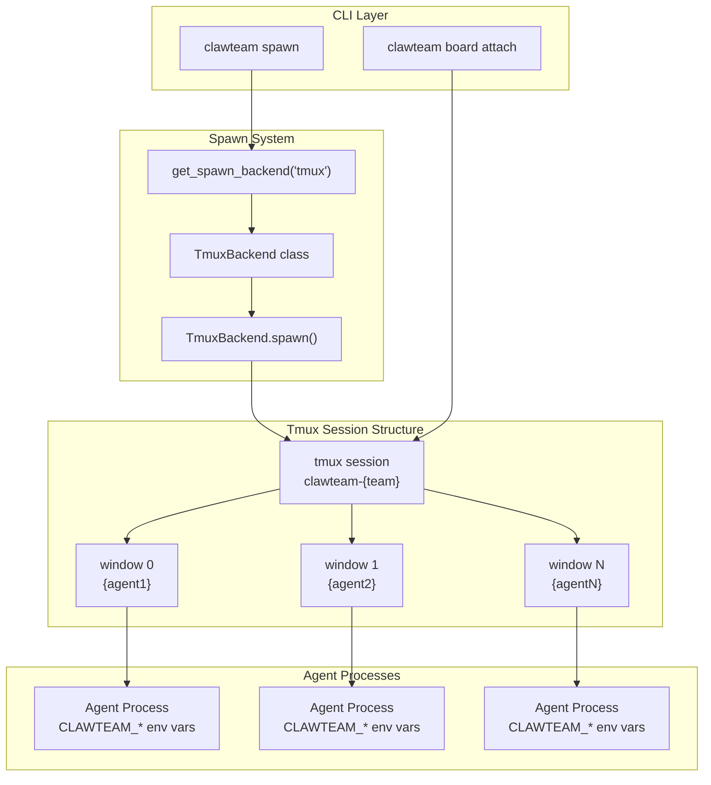
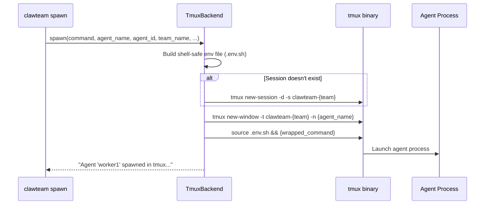
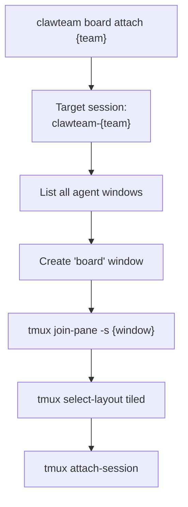

<!-- source: DeepWiki mcp.deepwiki.com · repo HKUDS/ClawTeam · page 6.3 Tmux Integration · fetched 2026-11-09 -->

# Tmux Integration

<details>
<summary>Relevant source files</summary>

The following files were used as context for generating this wiki page:

- [clawteam/cli/commands.py](clawteam/cli/commands.py)
- [clawteam/spawn/tmux_backend.py](clawteam/spawn/tmux_backend.py)
- [tests/test_cli_commands.py](tests/test_cli_commands.py)
- [tests/test_spawn_backends.py](tests/test_spawn_backends.py)

</details>


**Purpose:** This page documents ClawTeam's tmux integration, which provides terminal multiplexing for multi-agent coordination. Tmux integration enables users to spawn agents in isolated terminal sessions and observe all agents working simultaneously through a tiled view.

For information about spawning agents in general (including subprocess backend), see [Spawning Agents](#3.2). For terminal-based monitoring commands, see [Terminal Boards](#6.1). For the web-based monitoring alternative, see [Web Dashboard](#6.2).

---

## Overview

ClawTeam uses tmux as the default spawn backend to provide:

1. **Process isolation** — each agent runs in a separate tmux window [clawteam/spawn/tmux_backend.py:38-40]().
2. **Persistent sessions** — agents continue running even if the user detaches from the terminal.
3. **Live observation** — watch all agents simultaneously via `board attach` [clawteam/cli/commands.py:1806-1822]().
4. **Session management** — reattach, switch windows, or kill individual agents using standard tmux commands.

The tmux integration consists of two primary components:
- **`TmuxBackend`** — spawns agents into tmux sessions/windows with environment variables [clawteam/spawn/tmux_backend.py:35-60]().
- **`board attach`** — tiles all agent windows into a single view for monitoring [clawteam/cli/commands.py:1806-1822]().

**Sources:** [clawteam/spawn/tmux_backend.py:1-40](), [clawteam/cli/commands.py:1806-1822]()

---

## Architecture



**Key Components:**

| Component | Purpose | Implementation |
|-----------|---------|----------------|
| **TmuxBackend** | Spawns agents into tmux windows | [clawteam/spawn/tmux_backend.py:35-365]() |
| **Session naming** | `clawteam-{team_name}` | Consistent naming enables discovery [clawteam/spawn/tmux_backend.py:64-64]() |
| **Window naming** | `{agent_name}` | Each agent gets a dedicated window [clawteam/spawn/tmux_backend.py:214-214]() |
| **Environment injection** | `CLAWTEAM_*` variables | Identity passed to spawned process [clawteam/spawn/tmux_backend.py:73-79]() |
| **Shell Normalization** | Fixes `TERM=dumb` issues | Ensures interactive CLIs work in tmux [clawteam/spawn/tmux_backend.py:70-71]() |

**Sources:** [clawteam/spawn/tmux_backend.py:35-250](), [clawteam/cli/commands.py:1806-1822]()

---

## TmuxBackend Spawn Process

The `TmuxBackend.spawn()` method creates isolated agent processes. The implementation handles complex environment setup, including shell-safe variable exporting and interactive CLI normalization.

1. **Session creation/discovery** — checks if `clawteam-{team_name}` exists; creates it if not [clawteam/spawn/tmux_backend.py:173-181]().
2. **Environment setup** — filters variables for shell-safe names and writes them to a temporary `.env.sh` file to avoid command length limits [clawteam/spawn/tmux_backend.py:140-154]().
3. **Command Wrapping** — uses `build_keepalive_shell_command` to wrap the agent CLI with lifecycle hooks [clawteam/spawn/tmux_backend.py:156-163]().
4. **Nesting Prevention** — unsets `CLAUDECODE` environment variables so a leader agent can spawn worker agents of the same type without recursion detection errors [clawteam/spawn/tmux_backend.py:166-166]().



**Sources:** [clawteam/spawn/tmux_backend.py:64-250](), [tests/test_spawn_backends.py:136-200]()

---

## Board Attach Command

The `board attach` command provides a unified view of all agents. It is implemented in the CLI layer and interacts with the existing tmux session.

```bash
clawteam board attach my-team
```

**Implementation Details:**
- The command targets the session `clawteam-{team_name}` [clawteam/cli/commands.py:1806-1822]().
- It creates a temporary "board" window that links panes from all other windows in the session.
- It applies a tiled layout (usually `even-horizontal` or `tiled`) so all agents are visible at once.



**Sources:** [clawteam/cli/commands.py:1806-1822](), [clawteam/spawn/tmux_backend.py:38-40]()

---

## Environment Propagation and Safety

Tmux backend performs specific transformations to ensure the agent environment is stable:

- **Path Resolution**: Prepends the current `clawteam` binary location to `PATH` so spawned agents use the same version [clawteam/spawn/cli_env.py:25-25](), [tests/test_spawn_backends.py:136-200]().
- **Variable Filtering**: Tmux launches commands through a shell. ClawTeam filters environment keys against `[A-Za-z_][A-Za-z0-9_]*` to prevent shell crashes on platforms like WSL where host variables (e.g., `PROGRAMFILES(X86)`) contain illegal characters [clawteam/spawn/tmux_backend.py:32-32](), [clawteam/spawn/tmux_backend.py:140-140]().
- **Context Awareness**: Injects `CLAWTEAM_CONTEXT_ENABLED=1` and `CLAWTEAM_AGENT_LEADER` flags to inform the agent process of its role [clawteam/spawn/tmux_backend.py:78-83]().

**Sources:** [clawteam/spawn/tmux_backend.py:64-89](), [clawteam/spawn/tmux_backend.py:140-154](), [tests/test_spawn_backends.py:136-200]()

---

## Session Lifecycle

### Manual Management
Since agents run in standard tmux windows, users can manage them directly:

| Action | Command |
|--------|---------|
| **List Sessions** | `tmux ls` |
| **Kill Team** | `tmux kill-session -t clawteam-{team}` |
| **Kill Agent** | `tmux kill-window -t clawteam-{team}:{agent}` |
| **Detach** | `Ctrl-b` followed by `d` |

### Keepalive and Recovery
When `keepalive=True` is passed to `spawn`, the backend wraps the command in a shell loop. If the agent process crashes or finishes, the loop invokes `lifecycle should-keepalive` to determine if it should restart or exit the pane [clawteam/spawn/tmux_backend.py:156-163](), [tests/test_cli_commands.py:139-170]().

**Sources:** [clawteam/spawn/tmux_backend.py:156-163](), [clawteam/cli/commands.py:1469-1522]()

---

