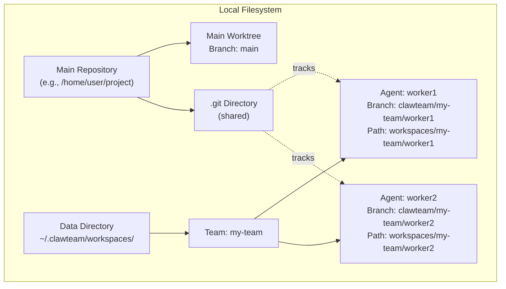
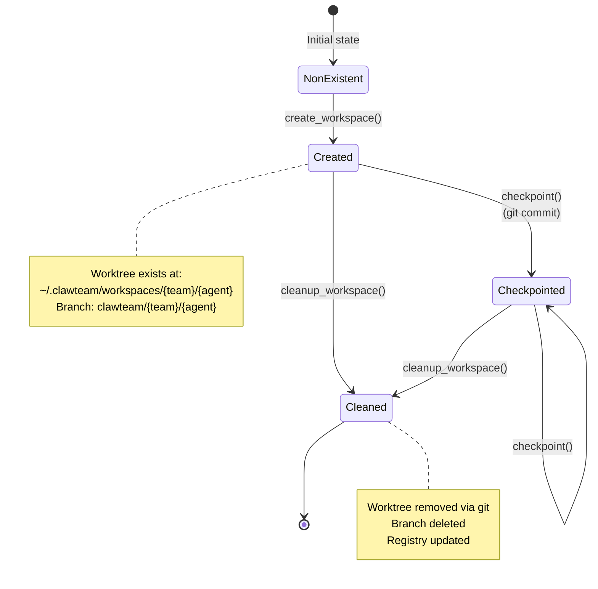
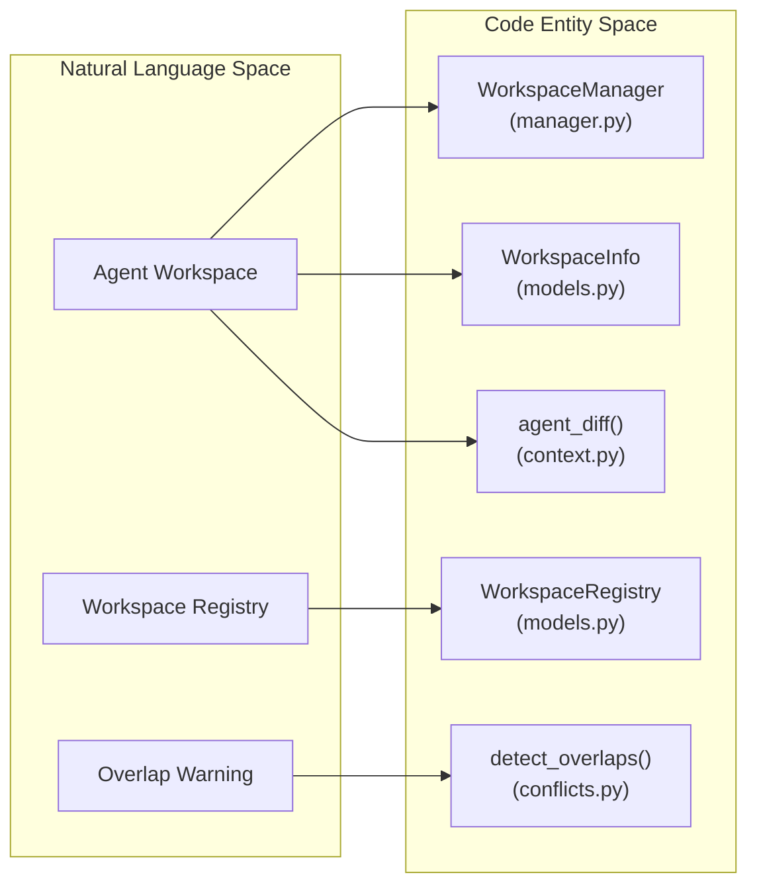

<!-- source: DeepWiki mcp.deepwiki.com · repo HKUDS/ClawTeam · page 7 Workspace Isolation · fetched 2026-11-09 -->

# Workspace Isolation

<details>
<summary>Relevant source files</summary>

The following files were used as context for generating this wiki page:

- [clawteam/board/gource.py](clawteam/board/gource.py)
- [clawteam/cli/commands.py](clawteam/cli/commands.py)
- [clawteam/workspace/conflicts.py](clawteam/workspace/conflicts.py)
- [clawteam/workspace/context.py](clawteam/workspace/context.py)
- [clawteam/workspace/manager.py](clawteam/workspace/manager.py)
- [scripts/openclaw_worker.sh](scripts/openclaw_worker.sh)
- [tests/test_cli_commands.py](tests/test_cli_commands.py)
- [tests/test_workspace_manager.py](tests/test_workspace_manager.py)

</details>


This page documents ClawTeam's workspace isolation system, which uses git worktrees to provide each agent with an isolated working directory on a dedicated branch. This prevents merge conflicts when multiple agents work in parallel on the same codebase.

For information about spawning agents with workspace isolation enabled, see [Spawning Agents](). For the spawn command reference, see [Other Commands]().

---

## Overview

**Purpose:** Workspace isolation ensures that multiple agents can work on the same git repository simultaneously without interfering with each other's changes. Each agent operates in its own git worktree—a separate checkout of the repository linked to a dedicated branch.

**Key Benefits:**
- **Conflict-free parallel work:** Agents never have uncommitted changes collide.
- **Independent branches:** Each agent's work is tracked on a separate branch.
- **Easy review:** Agent contributions are visible as distinct branches with clear diffs.
- **Selective merging:** Leader can review and merge agent work individually.

**Sources:** [clawteam/workspace/manager.py:1-16](), [clawteam/workspace/manager.py:53-55]()

---

## Git Worktree Architecture

ClawTeam leverages git's worktree feature to create multiple working directories from a single repository. Each worktree is a full checkout of the repository but lives in a separate directory and tracks a different branch.

### Directory Structure



**Sources:** [clawteam/workspace/manager.py:19-23](), [clawteam/workspace/manager.py:73-74]()

### Branch Naming Convention

All agent workspace branches follow the pattern:
`clawteam/{team_name}/{agent_name}` [clawteam/workspace/manager.py:73-73]()

This naming convention:
- Groups all agent branches by team.
- Makes it easy to identify which agent owns a branch.
- Avoids collisions with user-created branches.

**Sources:** [clawteam/workspace/manager.py:71-73](), [clawteam/workspace/context.py:45-46]()

---

## Workspace Manager

The `WorkspaceManager` class handles all worktree operations. It is responsible for creating, tracking, and cleaning up agent workspaces.

### Core Operations



**Sources:** [clawteam/workspace/manager.py:53-55](), [clawteam/workspace/manager.py:65-70](), [clawteam/workspace/manager.py:182-187](), [clawteam/workspace/manager.py:199-201]()

---

## Workspace Lifecycle

### 1. Creation

Workspaces are created via `WorkspaceManager.create_workspace`. The manager ensures that stale branches or directories from previous crashes are cleared before creating a new worktree [clawteam/workspace/manager.py:76-86]().

**OpenClaw Specific Slimming:**
If the repository contains an `openclaw.json` file, the manager performs "workspace slimming" [clawteam/workspace/manager.py:94-94](). It removes non-essential files while preserving core configuration files (`SOUL.md`, `TOOLS.md`, etc.) and symlinking heavy directories like `node_modules` or `.venv` back to the main repository to save space and time [clawteam/workspace/manager.py:95-149]().

**Sources:** [clawteam/workspace/manager.py:65-176](), [tests/test_workspace_manager.py:8-35]()

### 2. Checkpoint

Checkpoints create automatic commits of the agent's current work using `git commit -a`.

```python
# Internal implementation
def checkpoint(self, team_name, agent_name, message=None):
    info = self._find(team_name, agent_name)
    ts = datetime.now(timezone.utc).strftime("%Y%m%d-%H%M%S")
    msg = message or f"[clawteam] checkpoint: {agent_name} @ {ts}"
    return git.commit_all(Path(info.worktree_path), msg)
```

**Sources:** [clawteam/workspace/manager.py:182-193]()

### 3. Conflict Detection

ClawTeam provides advanced conflict detection between agents. The system can detect overlaps at different severities:
- **High:** Agents changed the same lines in a file [clawteam/workspace/conflicts.py:20-20]().
- **Medium:** Agents changed the same file but different lines [clawteam/workspace/conflicts.py:21-21]().
- **Low:** Agents changed files in the same directory [clawteam/workspace/conflicts.py:22-22]().

The `auto_notify` function scans for these overlaps and sends warning messages to the affected agents' inboxes [clawteam/workspace/conflicts.py:189-221]().

**Sources:** [clawteam/workspace/conflicts.py:15-45](), [clawteam/workspace/conflicts.py:83-114]()

---

## Integration with Agent Spawning

The spawn backend integrates workspace creation into the agent launch process.

### Data Flow: Workspace to Code Entity

The following diagram associates the logical workspace concepts with the internal code entities that manage them.



**Sources:** [clawteam/workspace/manager.py:53-55](), [clawteam/workspace/models.py:1-20](), [clawteam/workspace/conflicts.py:15-15](), [clawteam/workspace/context.py:58-58]()

---

## Visualization and Monitoring

ClawTeam integrates workspace activity into the `Gource` visualization system.

### Gource Integration Mapping

The `clawteam/board/gource.py` module maps git activity from isolated workspaces into a unified visualization:
- **Git Log:** Combines logs from all agent branches using `cross_branch_log()` [clawteam/board/gource.py:150-167]().
- **File Ownership:** Uses `file_owners()` to highlight files shared by multiple agents in a "shared" virtual directory [clawteam/board/gource.py:180-187]().
- **Virtual Paths:** Each agent's file operations are prefixed with their agent name to show parallel work in different branches of the visualization tree [clawteam/board/gource.py:150-158]().

**Sources:** [clawteam/board/gource.py:150-193](), [clawteam/workspace/context.py:155-158]()

---

## Error Handling and Cleanup

### Stale State Recovery
If a workspace creation is requested for an agent that already has a directory but no valid git worktree (e.g., after a hard crash), the `WorkspaceManager` attempts to remove the physical directory and the git branch before proceeding [clawteam/workspace/manager.py:78-86]().

### Cleanup Process
1. `cleanup_workspace(team_name, agent_name)` is called [clawteam/workspace/manager.py:199-200]().
2. The git worktree is removed from the filesystem.
3. The associated git branch is deleted.
4. The agent's entry is removed from the `WorkspaceRegistry` [clawteam/workspace/manager.py:168-174]().

**Sources:** [clawteam/workspace/manager.py:76-90](), [clawteam/workspace/manager.py:199-210]()

---

