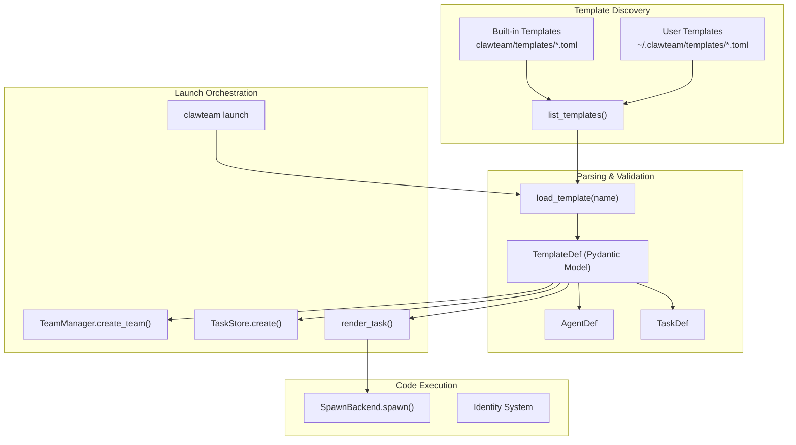
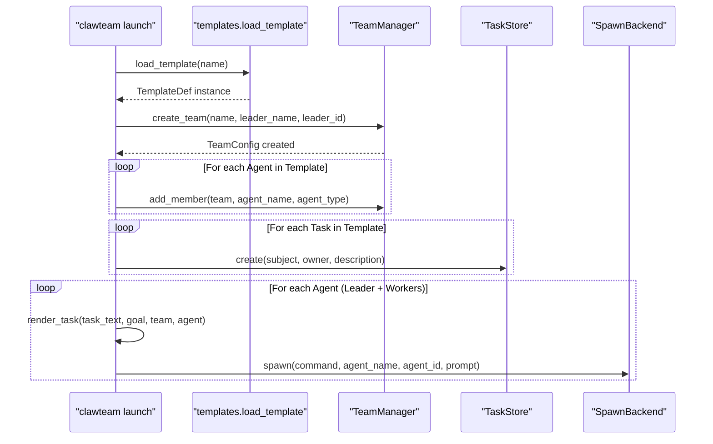

<!-- source: DeepWiki mcp.deepwiki.com · repo HKUDS/ClawTeam · page 8 Team Templates · fetched 2026-11-09 -->

# Team Templates

<details>
<summary>Relevant source files</summary>

The following files were used as context for generating this wiki page:

- [clawteam/templates/code-review.toml](clawteam/templates/code-review.toml)
- [clawteam/templates/harness-default.toml](clawteam/templates/harness-default.toml)
- [clawteam/templates/hedge-fund.toml](clawteam/templates/hedge-fund.toml)
- [clawteam/templates/research-paper.toml](clawteam/templates/research-paper.toml)
- [clawteam/templates/software-dev.toml](clawteam/templates/software-dev.toml)
- [clawteam/templates/strategy-room.toml](clawteam/templates/strategy-room.toml)
- [tests/__init__.py](tests/__init__.py)
- [tests/conftest.py](tests/conftest.py)
- [tests/test_manager.py](tests/test_manager.py)
- [tests/test_models.py](tests/test_models.py)
- [tests/test_templates.py](tests/test_templates.py)

</details>


Team Templates enable launching pre-configured multi-agent teams with a single command. Templates are TOML files that define team archetypes—specifying leader and worker roles, initial tasks, and agent prompts—which can be instantiated repeatedly with different goals and configurations.

**Purpose:** This document covers the team template system, including template format, the launch workflow, built-in templates, and creating custom templates. For spawning individual agents, see [Spawning Agents](). For general team management, see [Team Management]().

---

## Template System Architecture

The template system bridges high-level team descriptions in TOML files to the execution layer by orchestrating team creation, member registration, and agent spawning.



**Sources:** [clawteam/templates/__init__.py:10-12](), [tests/test_templates.py:5-13](), [clawteam/templates/strategy-room.toml:1-128]()

---

## Template Format

Templates are TOML files using Pydantic models for validation. The primary models are `TemplateDef`, `AgentDef`, and `TaskDef`.

### Top-Level Metadata (`TemplateDef`)

| Field | Type | Required | Default | Description |
|-------|------|----------|---------|-------------|
| `name` | string | Yes | - | Template identifier |
| `description` | string | No | `""` | Human-readable description |
| `backend` | string | No | `"tmux"` | Default spawn backend |
| `command` | array | No | `["claude"]` | Default command for agents |

### Agent Definitions (`AgentDef`)

Used for both the `[template.leader]` and `[[template.agents]]` sections.

```toml
[template.leader]
name = "tech-lead"
type = "tech-lead"
task = "Coordinate project: {goal}"

[[template.agents]]
name = "backend-dev"
type = "backend-developer"
task = "Implement APIs for {goal}"
```

| Field | Type | Required | Default | Description |
|-------|------|----------|---------|-------------|
| `name` | string | Yes | - | Agent identity name |
| `type` | string | No | `"general-purpose"` | Agent role type |
| `task` | string | No | `""` | Prompt text/instruction |
| `command` | array | No | `None` | Optional command override |

### Task Definitions (`TaskDef`)

Initial tasks created upon team launch in the `[[template.tasks]]` array.

| Field | Type | Required | Description |
|-------|------|----------|-------------|
| `subject` | string | Yes | Task title |
| `owner` | string | No | Name of agent assigned to task |
| `description`| string | No | Detailed instructions |

**Sources:** [tests/test_templates.py:47-65](), [clawteam/templates/strategy-room.toml:1-128](), [clawteam/templates/software-dev.toml:1-129]()

---

## Variable Substitution

The system uses `render_task` and a specialized `_SafeDict` to perform variable substitution in prompts. This allows templates to remain generic while being customized at runtime.

### Supported Placeholders
- `{goal}`: The high-level objective passed via `--goal`.
- `{team_name}`: The name of the team being launched.
- `{agent_name}`: The name of the specific agent receiving the prompt.

### Implementation Detail: `_SafeDict`
The `_SafeDict` implementation ensures that if a template contains placeholders not provided during launch (e.g., `{custom_var}`), the system does not crash; instead, it leaves the placeholder as-is in the text.

```python
# Internal logic used by render_task
class _SafeDict(dict):
    def __missing__(self, key):
        return "{" + key + "}"
```

**Sources:** [tests/test_templates.py:16-44](), [tests/test_templates.py:8-13]()

---

## Built-in Team Archetypes

ClawTeam provides several pre-configured templates for common multi-agent workflows.

### 1. AI Hedge Fund (`hedge-fund`)
A complex team of 7 agents performing multi-perspective investment analysis.
- **Portfolio Manager**: Leader coordinating 5 analysts and 1 risk manager.
- **Analysts**: `buffett-analyst` (Value), `growth-analyst`, `technical-analyst`, `fundamentals-analyst`, `sentiment-analyst`.
- **Risk Manager**: Consolidates signals and assesses VaR/limits.

### 2. Software Development (`software-dev`)
A full-stack engineering team using parallel workstreams.
- **Tech Lead**: Coordinates tasks and merges worktrees.
- **Workers**: `backend-dev`, `frontend-dev`, `qa-engineer`, `devops`.

### 3. Strategy Room (`strategy-room`)
A cross-functional team for planning and tradeoff analysis.
- **Strategy Lead**: Frames decisions and monitors specialists.
- **Specialists**: `systems-analyst`, `delivery-planner`, `risk-mapper`.
- **Decision Editor**: Synthesizes specialist output into a memo for the leader.

**Sources:** [clawteam/templates/hedge-fund.toml:1-164](), [clawteam/templates/software-dev.toml:1-129](), [clawteam/templates/strategy-room.toml:1-128]()

---

## Launch Execution Flow

The `launch` command orchestrates multiple subsystems to move from a TOML file to a running team of agents.



**Sources:** [tests/test_manager.py:10-30](), [tests/test_manager.py:65-85](), [tests/test_templates.py:68-90]()

---

## Custom Template Management

### Template Locations
ClawTeam searches for templates in the following order:
1. **User Directory**: `~/.clawteam/templates/` (takes priority)
2. **Built-in Directory**: Internal package directory (`clawteam/templates/`)

### Overriding Templates
A user can override a built-in template (e.g., `software-dev`) by creating a file with the same name in their `~/.clawteam/templates/` directory. The `load_template` function will prioritize the user-defined version.

### Template Commands

| Command | Description |
|---------|-------------|
| `clawteam template list` | Lists all discovered templates and their source (builtin/user). |
| `clawteam template show <name>` | Displays the full TOML content and parsed structure. |
| `clawteam launch <name> --goal "..."` | Instantiates the template. |

**Sources:** [tests/test_templates.py:156-182](), [tests/test_templates.py:184-198]()

---

