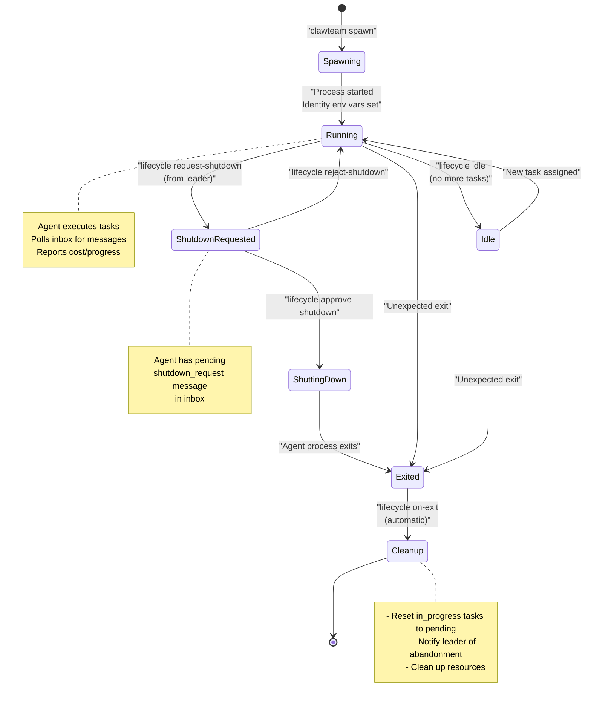
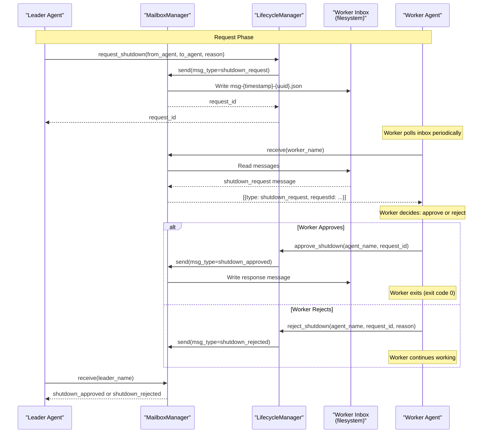
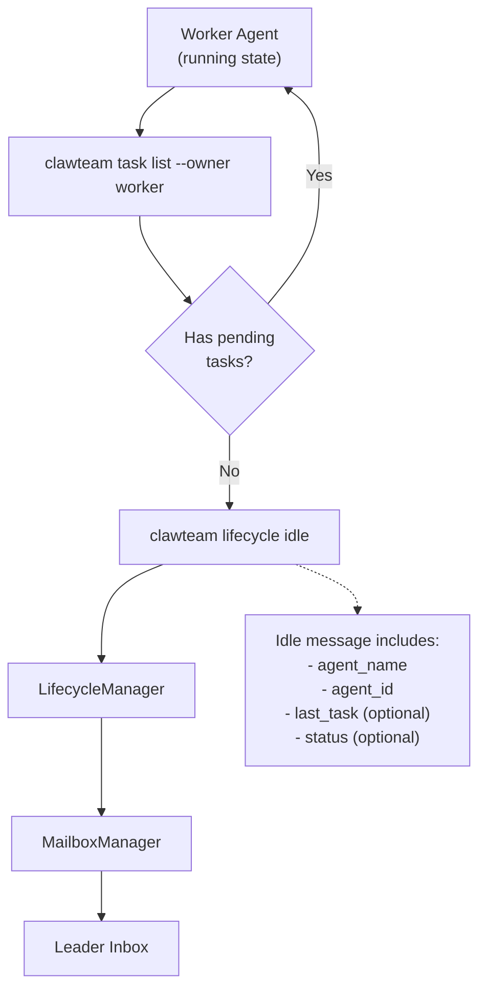
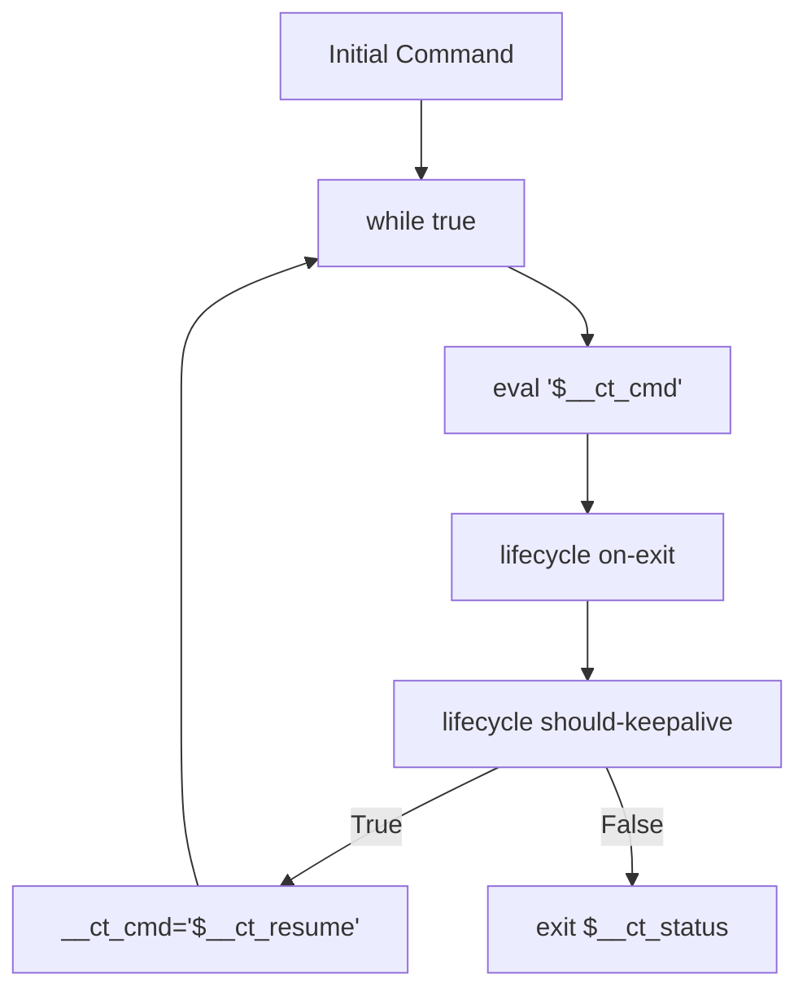
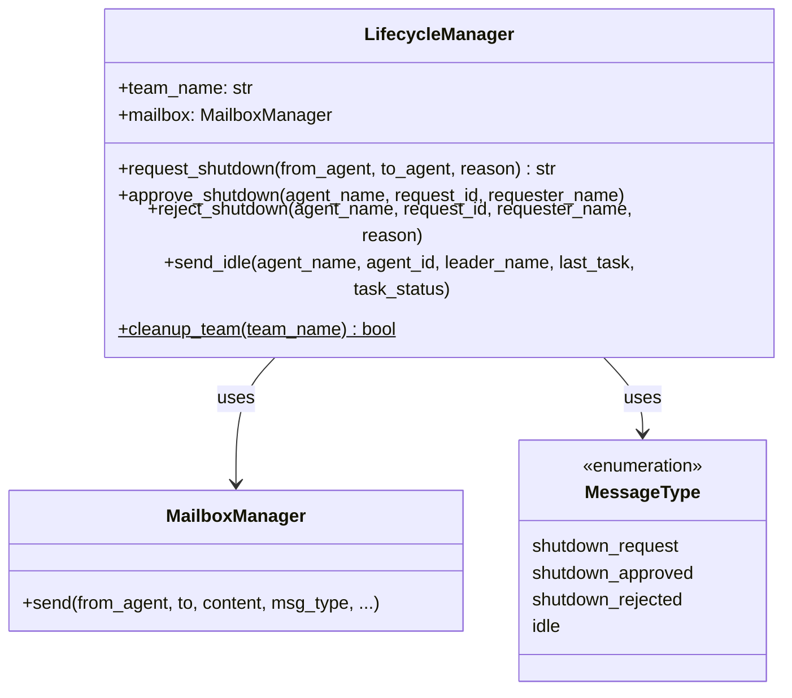

<!-- source: DeepWiki mcp.deepwiki.com · repo HKUDS/ClawTeam · page 9 Agent Lifecycle · fetched 2026-11-09 -->

# Agent Lifecycle

<details>
<summary>Relevant source files</summary>

The following files were used as context for generating this wiki page:

- [clawteam/spawn/__init__.py](clawteam/spawn/__init__.py)
- [clawteam/spawn/keepalive.py](clawteam/spawn/keepalive.py)
- [clawteam/spawn/prompt.py](clawteam/spawn/prompt.py)
- [clawteam/spawn/registry.py](clawteam/spawn/registry.py)
- [clawteam/spawn/wsh_rpc.py](clawteam/spawn/wsh_rpc.py)
- [clawteam/team/lifecycle.py](clawteam/team/lifecycle.py)
- [tests/test_costs.py](tests/test_costs.py)
- [tests/test_lifecycle.py](tests/test_lifecycle.py)
- [tests/test_prompt.py](tests/test_prompt.py)
- [tests/test_registry.py](tests/test_registry.py)
- [tests/test_wsh_backend.py](tests/test_wsh_backend.py)

</details>


This page documents the lifecycle management system for ClawTeam agents, covering the states an agent transitions through from spawning to shutdown, the coordinated shutdown protocol, idle notifications, and automatic cleanup on unexpected exit.

For information about spawning new agents and backend options, see [Spawning Agents](3.2). For task state transitions and coordination, see [Task Management](4).

---

## Lifecycle Overview

Agents in ClawTeam follow a managed lifecycle with explicit coordination points. The lifecycle system ensures graceful shutdown, prevents abandoned work, and maintains system consistency when agents exit.

### Agent Lifecycle States



**Sources:**
- [clawteam/spawn/prompt.py:84-107]()
- [clawteam/team/lifecycle.py:12-89]()

---

## Coordinated Shutdown Protocol

The shutdown protocol follows a request-approve pattern to ensure agents complete their current work gracefully before exiting.

### Shutdown Message Flow



**Sources:**
- [clawteam/team/lifecycle.py:19-63]()
- [clawteam/team/models.py:9-10]() (MessageType enum)

### Shutdown Commands

| Command | Description | Parameters | Effect |
|---------|-------------|------------|--------|
| `lifecycle request-shutdown` | Leader requests agent shutdown | `<team> <from-agent> <to-agent> [--reason]` | Sends `shutdown_request` message to target agent's inbox |
| `lifecycle approve-shutdown` | Agent approves shutdown | `<team> <request-id> <agent>` | Sends `shutdown_approved` to requester, agent should exit |
| `lifecycle reject-shutdown` | Agent rejects shutdown | `<team> <request-id> <agent> [--reason]` | Sends `shutdown_rejected` to requester, agent continues |

**Sources:**
- [clawteam/team/lifecycle.py:19-63]()

---

## Idle Notifications

Workers send `idle` messages to the leader when they have no more tasks to execute, enabling the leader to assign new work or initiate shutdown.

### Idle Notification Flow



**Sources:**
- [clawteam/team/lifecycle.py:64-89]()
- [clawteam/spawn/prompt.py:104-105]()

---

## Automatic Exit and Keepalive

When an agent process exits, ClawTeam provides mechanisms to either clean up abandoned work or automatically resume the agent if keepalive is enabled.

### Resumable Agent Keepalive

For interactive CLI agents (like `claude-code` or `codex`), ClawTeam can wrap the execution in a shell loop that automatically resumes the agent after a clean exit if there is more work to do.



**Sources:**
- [clawteam/spawn/keepalive.py:53-91]()
- [clawteam/spawn/keepalive.py:11-35]() (build_resume_command)

### Process Liveness and Registry

ClawTeam tracks spawned processes in a `spawn_registry.json` to monitor health and identify "zombie" processes (agents running longer than a threshold).

| Backend | Liveness Check Mechanism | Code Entity |
|---------|-------------------------|-------------|
| `tmux` | Check `pane_dead` flag and current command | `_tmux_pane_alive` [clawteam/spawn/registry.py:171-193]() |
| `subprocess` | Check OS PID status | `_pid_alive` [clawteam/spawn/registry.py:195-216]() |
| `wsh` | Query TideTerm JSON-RPC | `_wsh_block_alive` [clawteam/spawn/registry.py:78]() |

**Sources:**
- [clawteam/spawn/registry.py:55-80]()
- [clawteam/spawn/registry.py:93-118]() (list_zombie_agents)

---

## Lifecycle Manager Architecture

The `LifecycleManager` class encapsulates all lifecycle operations and coordinates with the mailbox system.



**Sources:**
- [clawteam/team/lifecycle.py:12-119]()
- [clawteam/team/models.py:15-32]() (MessageType)

---

## Integration with Cost Tracking

As part of the lifecycle, agents are instructed to report their token usage and costs before they go idle or exit.

```bash
# Agent reports cost at the end of a task batch
clawteam cost report my-team --input-tokens 1500 --output-tokens 800 --cost-cents 4.5
```

**Sources:**
- [clawteam/spawn/prompt.py:95]()
- [tests/test_costs.py:27-44]()

---

