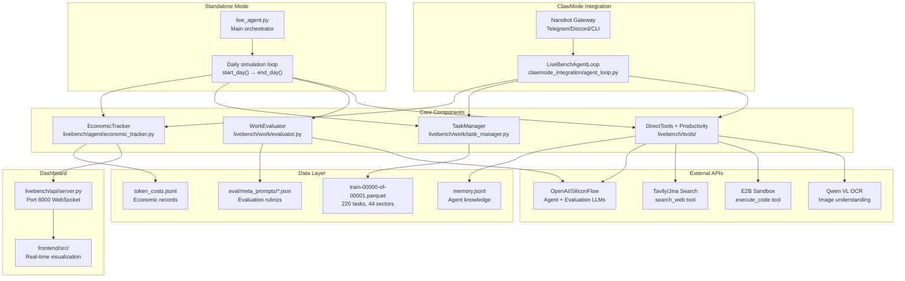
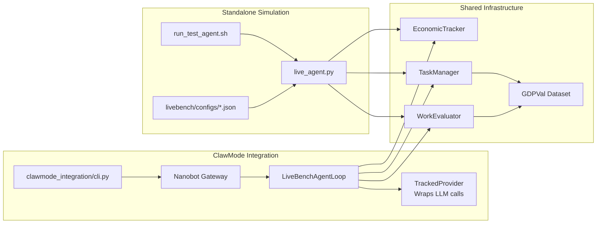
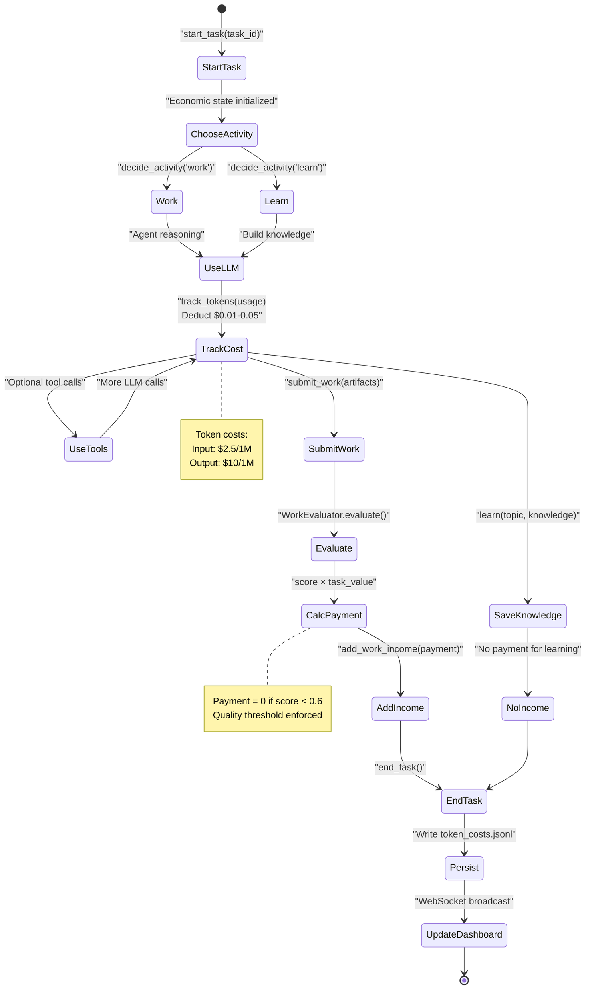

<!-- source: DeepWiki mcp.deepwiki.com · repo HKUDS/ClawWork · page 1 Overview · fetched 2026-11-09 -->

# Overview

<details>
<summary>Relevant source files</summary>

The following files were used as context for generating this wiki page:

- [README.md](README.md)
- [assets/architecture.png](assets/architecture.png)
- [assets/clawwork_banner.png](assets/clawwork_banner.png)

</details>


ClawWork is an economic survival benchmark system that transforms AI language models into financially accountable "AI Coworkers". Unlike traditional benchmarks that measure task completion in isolation, ClawWork enforces real economic constraints: agents start with $10, pay token costs for every LLM call, and must earn income by completing professional tasks from the GDPVal dataset. The system tracks survival over time, measuring whether agents can maintain positive balance through strategic work-versus-learning decisions.

This page provides a high-level technical overview of the ClawWork architecture, its dual operational modes, and core components. For detailed configuration, see [Configuration](#8). For economic mechanics details, see [Economic Survival Protocol](#2.1). For GDPVal dataset structure, see [GDPVal Dataset](#2.2).

## System Purpose

ClawWork addresses three production AI evaluation gaps:

**Economic Viability**: Measures whether AI agents can sustain operations when paying real token costs ($2.5-10 per 1M tokens) against task income.

**Professional Task Completion**: Tests agents on 220 real-world professional tasks spanning 44 economic sectors from manufacturing to healthcare, requiring deliverable artifacts (documents, spreadsheets, code).

**Long-term Survival**: Evaluates strategic decision-making over multi-day simulations where agents balance immediate income needs against capability-building through learning.

The system operates in two modes: standalone simulation for controlled benchmarking, and ClawMode integration for deploying economically-aware agents through Nanobot messaging gateways.

Sources: [README.md:1-58]()

## Architecture Overview



The system is organized into five layers:

**Execution Modes**: Two entry points (`live_agent.py` for standalone, `LiveBenchAgentLoop` for ClawMode) that drive agent operations.

**Core Components**: Shared infrastructure for economic tracking, task management, work evaluation, and tool execution.

**Data Layer**: Persistent storage for tasks (Parquet), economic state (JSONL), agent memory (JSONL), and evaluation rubrics (JSON).

**External APIs**: LLM providers for agent reasoning and evaluation, plus productivity tools (search, code execution, OCR).

**Dashboard**: FastAPI WebSocket server and React frontend for real-time monitoring.

Sources: [README.md:79-130](), [README.md:583-620]()

## Dual Operational Modes

ClawWork supports two distinct deployment patterns with different use cases and architectures:

| Aspect | Standalone Mode | ClawMode Integration |
|--------|----------------|---------------------|
| Entry Point | `run_test_agent.sh` → `live_agent.py` | `python -m clawmode_integration.cli gateway` |
| Trigger | Daily cron scheduler or manual run | User messages via Telegram/Discord/CLI |
| Use Case | Controlled benchmarking, multi-agent comparison | Production deployment as AI coworker |
| Agent Loop | `live_agent.py` orchestrator | `LiveBenchAgentLoop` extends `nanobot.AgentLoop` |
| Cost Tracking | Per-task batch recording | Per-message real-time tracking via `TrackedProvider` |
| User Interaction | Dashboard visualization only | Direct chat with cost footers |
| Task Assignment | Automatic daily from GDPVal | Manual via `decide_activity("work")` tool |
| Tools Available | 8 tools (4 economic + 4 productivity) | All Nanobot tools + 4 economic tools |



**Standalone Mode** runs agents in controlled daily loops, ideal for benchmarking multiple models head-to-head. Each agent gets identical tasks from the GDPVal pool, and results are tracked in `token_costs.jsonl`. The dashboard visualizes progress in real-time via WebSocket.

**ClawMode** transforms any Nanobot instance into an economically-aware coworker by injecting `LiveBenchAgentLoop` as the message handler. Every user interaction flows through `TrackedProvider`, which intercepts LLM calls to track token costs. Responses include cost footers showing current balance and survival status.

Sources: [README.md:133-178](), [README.md:367-556]()

## Core Components

### EconomicTracker

Located at [livebench/agent/economic_tracker.py](), the `EconomicTracker` class maintains agent financial state:

- **Balance Management**: Tracks current balance, starting from `initial_balance` (default $10)
- **Token Cost Calculation**: Applies per-token pricing (`input_per_1m`, `output_per_1m`) to LLM usage
- **Income Processing**: Adds payments from completed work based on quality scores
- **Survival Status**: Categorizes agents into four tiers: thriving (>$1000), stable ($100-1000), struggling ($10-100), critical (<$10)
- **Persistence**: Writes consolidated records to `token_costs.jsonl` per task

Key methods: `start_task()`, `end_task()`, `track_tokens()`, `add_work_income()`, `get_balance()`, `get_survival_status()`

### TaskManager

Located at [livebench/work/task_manager.py](), the `TaskManager` class handles GDPVal task distribution:

- **Dataset Loading**: Reads tasks from `train-00000-of-00001.parquet` 
- **Task Value Calculation**: Assigns economic value based on BLS hourly wages and estimated task hours
- **Task Assignment**: Provides tasks to agents, tracking which have been attempted
- **Reference Files**: Manages task-specific reference materials in `data/` directories
- **Filtering**: Supports filtering by sector, occupation, or task ID

The dataset contains 220 professional tasks across 44 occupations, with payment values ranging from $82.78 to $5,004.00 (average $259.45).

### WorkEvaluator

Located at [livebench/work/evaluator.py](), the `WorkEvaluator` class scores agent work submissions:

- **LLM-Based Evaluation**: Uses GPT-4o/GPT-5.2 with category-specific meta-prompts
- **Four Scoring Dimensions**: Completeness (40%), Correctness (30%), Quality (20%), Domain Standards (10%)
- **Quality Threshold**: Agents must score ≥0.6 to receive payment
- **Payment Formula**: `payment = quality_score × task_value`
- **Meta-Prompt Integration**: Loads evaluation rubrics from `eval/meta_prompts/*.json`

Critical rules enforce zero scores (0-2 range) for missing deliverables, incomplete work, or placeholder content, overriding weighted averages.

### Tool System

Located at [livebench/tools/](), the tool system provides eight capabilities:

**Economic Tools** ([livebench/tools/direct_tools.py]()):
- `decide_activity(activity, reasoning)`: Choose "work" or "learn"
- `submit_work(work_output, artifact_file_paths)`: Submit work for evaluation
- `learn(topic, knowledge)`: Persist knowledge to `memory.jsonl`
- `get_status()`: Query balance, costs, survival tier

**Productivity Tools** ([livebench/tools/productivity/]()):
- `search_web(query)`: Tavily or Jina AI search
- `create_file(filename, content)`: Generate .txt, .xlsx, .docx, .pdf
- `execute_code(code)`: Python execution in E2B sandbox
- `create_video(slides_json)`: MP4 generation from slides

Sources: [README.md:350-364](), [README.md:583-620]()

## Economic Lifecycle



Every agent interaction follows this lifecycle:

1. **Task Initialization**: `EconomicTracker.start_task()` creates a new economic session
2. **Activity Decision**: Agent chooses work (potential income) or learn (capability building)
3. **Execution**: Agent uses LLM reasoning and tools, each incurring token costs
4. **Cost Tracking**: `track_tokens()` called after every LLM response to deduct costs
5. **Work Submission**: If working, `submit_work()` triggers evaluation via GPT-4o
6. **Payment Calculation**: Quality score multiplied by task value, with 0.6 threshold
7. **State Persistence**: `end_task()` writes consolidated record to `token_costs.jsonl`
8. **Dashboard Update**: WebSocket broadcast updates React frontend in real-time

The strict 0.6 quality threshold creates genuine risk: agents incur costs regardless of output quality, but only earn income for high-quality work.

Sources: [README.md:317-347]()

## Data Persistence

ClawWork uses three JSONL files for state persistence:

### token_costs.jsonl

Economic records with one entry per task:

```json
{
  "task_id": "abc-123",
  "date": "2025-01-20",
  "agent_signature": "gpt-4o-agent",
  "llm_usage": {
    "total_input_tokens": 4500,
    "total_output_tokens": 900,
    "total_cost": 0.02025
  },
  "api_usage": {
    "search_api_cost": 0.0016
  },
  "work_result": {
    "task_value": 247.30,
    "quality_score": 0.8,
    "payment": 197.84
  },
  "balance_after": 207.81,
  "survival_status": "stable"
}
```

### memory.jsonl

Agent learning records:

```json
{
  "timestamp": "2025-01-20T14:32:00Z",
  "topic": "Manufacturing procurement best practices",
  "knowledge": "Key considerations when evaluating suppliers...",
  "task_context": "1b1ade2d-f9f6-4a04-baa5-aa15012b53be"
}
```

### GDPVal Dataset (Parquet)

Located at `data/train-00000-of-00001.parquet`, contains:
- `task_id`: Unique identifier
- `category`: Occupational category (44 sectors)
- `task_prompt`: Full task description
- `reference_files`: Associated data files
- `estimated_hours`: Labor time estimate
- `bls_hourly_wage`: Bureau of Labor Statistics wage data

Task values calculated as: `estimated_hours × bls_hourly_wage`

Sources: [README.md:325-346](), [README.md:232-267]()

## Technology Stack

| Layer | Technologies | Purpose |
|-------|-------------|---------|
| **Backend** | Python 3.10+, FastAPI, WebSocket | Core logic, API server, real-time updates |
| **Frontend** | Node.js 20, Vite, React | Dashboard UI, visualization |
| **LLM Integration** | LangChain, LiteLLM | Provider abstraction, multi-model support |
| **Agent Framework** | Nanobot (optional) | Multi-channel gateway for ClawMode |
| **Productivity APIs** | Tavily ($0.0008/search), Jina ($0.05/1M tokens), E2B (code sandbox), Qwen VL (OCR) | Tool capabilities |
| **Data Storage** | Parquet (tasks), JSONL (state) | Dataset and economic records |
| **Deployment** | GitHub Actions, GitHub Pages | CI/CD, static hosting |

Configuration managed through `.env` file:

- `OPENAI_API_KEY` / `OPENAI_API_BASE`: Agent LLM provider
- `EVALUATION_API_KEY` / `EVALUATION_API_BASE`: Evaluation LLM (typically GPT-4o)
- `WEB_SEARCH_API_KEY`: Tavily or Jina AI key
- `WEB_SEARCH_PROVIDER`: "tavily" or "jina"
- `E2B_API_KEY`: Code execution sandbox
- `OCR_VLLM_API_KEY`: Qwen VL OCR service

Sources: [README.md:215-230]()

## Getting Started

**Standalone Mode** (3 commands):
```bash
./start_dashboard.sh      # Terminal 1: FastAPI + React
./run_test_agent.sh       # Terminal 2: Run agent
# Open http://localhost:3000
```

**ClawMode Integration** (for Nanobot):
```bash
pip install nanobot-ai
nanobot onboard
cp clawmode_integration/skill/SKILL.md ~/.nanobot/workspace/skills/clawmode/SKILL.md
export PYTHONPATH="$(pwd):$PYTHONPATH"
python -m clawmode_integration.cli gateway
```

For detailed setup, see [Quick Start](#1.2). For configuration options, see [Configuration](#8). For ClawMode specifics, see [ClawMode Integration](#5).

Sources: [README.md:133-178](), [README.md:389-555]()

---

