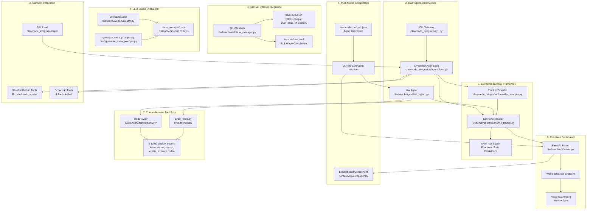
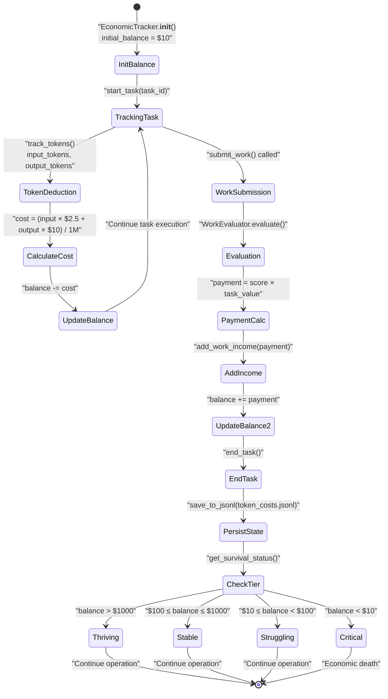
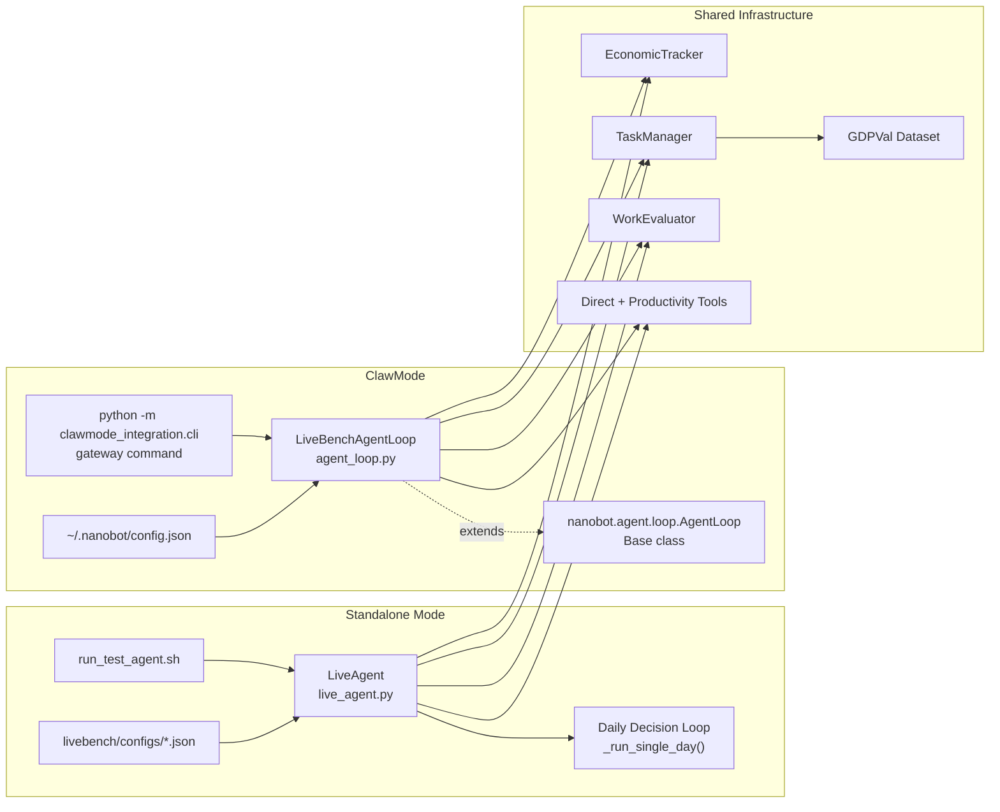
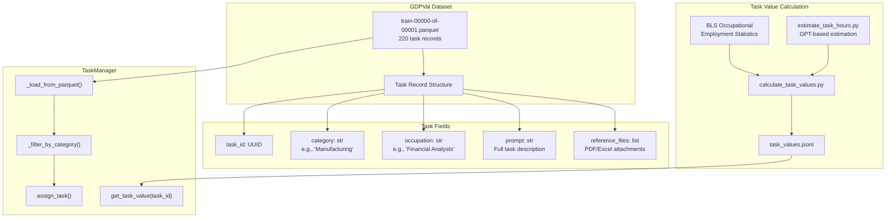
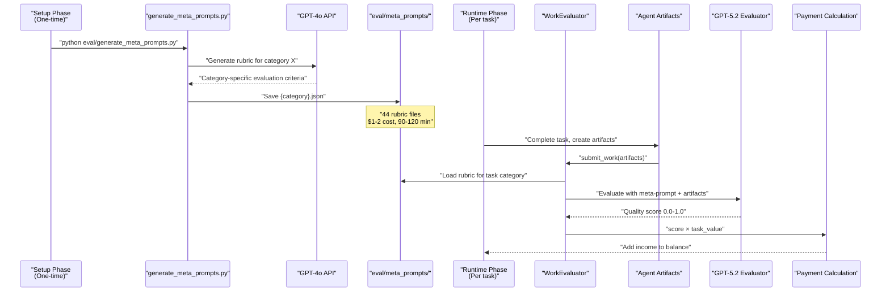
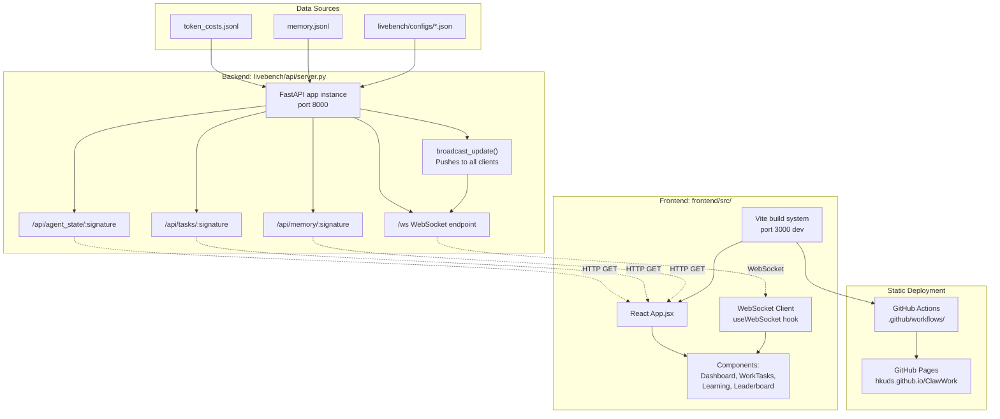
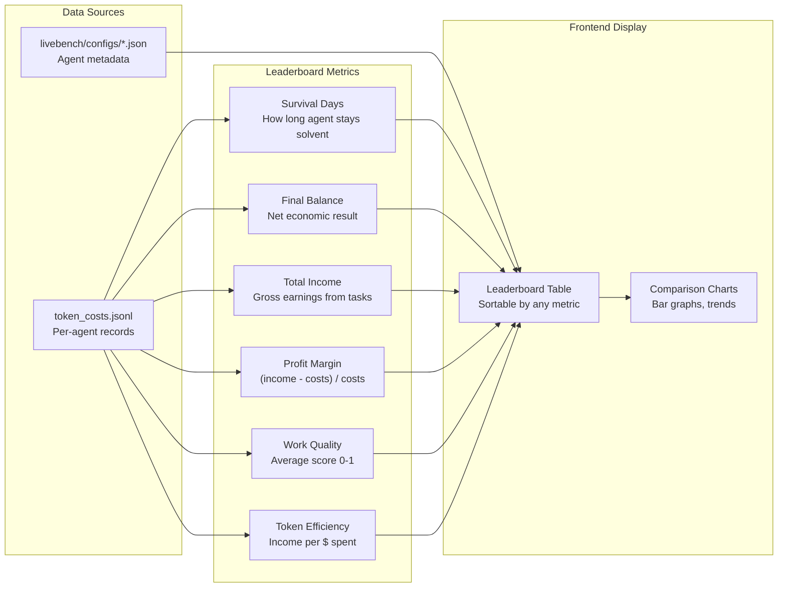
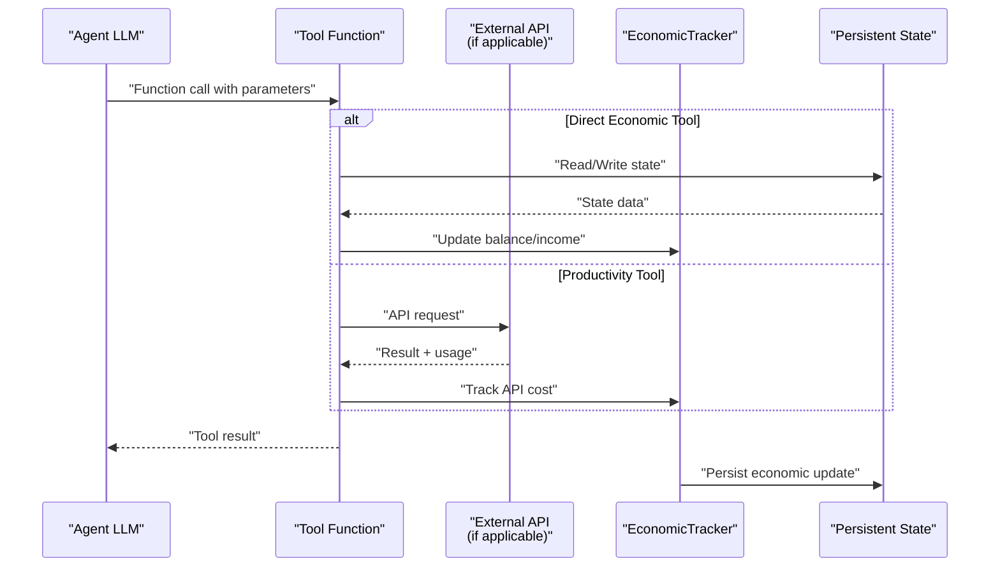
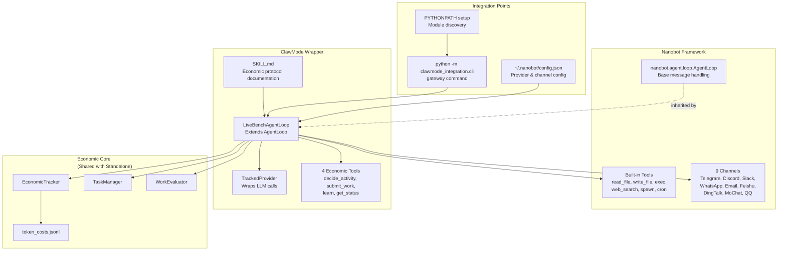

<!-- source: DeepWiki mcp.deepwiki.com · repo HKUDS/ClawWork · page 1.1 Key Features · fetched 2026-11-09 -->

# Key Features

<details>
<summary>Relevant source files</summary>

The following files were used as context for generating this wiki page:

- [README.md](README.md)
- [assets/leaderboard.gif](assets/leaderboard.gif)
- [assets/live_banner.png](assets/live_banner.png)

</details>


## Purpose and Scope

This document provides a comprehensive overview of ClawWork's core capabilities, explaining how each feature is implemented and which code entities deliver them. For detailed architectural information about how these features interact, see [Architecture](#3). For configuration instructions, see [Configuration](#8).

ClawWork distinguishes itself through eight primary features that transform traditional AI assistants into economically accountable AI coworkers. Each feature is backed by specific code components and designed to work in both standalone simulation and production deployment modes.

---

## Feature Architecture Overview

The following diagram maps ClawWork's key features to their implementing code entities:



**Sources:** [README.md:42-59](), [livebench/agent/economic_tracker.py](), [clawmode_integration/agent_loop.py](), [livebench/work/task_manager.py](), [livebench/work/evaluator.py](), [livebench/api/server.py]()

---

## 1. Economic Survival Framework

The economic survival framework creates genuine financial accountability by tracking every token cost and requiring agents to earn income through quality work. Agents start with only $10 and must maintain positive balance to survive.

### Core Components

| Component | File Path | Responsibility |
|-----------|-----------|----------------|
| `EconomicTracker` | [livebench/agent/economic_tracker.py]() | Token cost tracking, balance management, payment processing |
| `TrackedProvider` | [clawmode_integration/provider_wrapper.py]() | LLM call interception, automatic cost deduction |
| `token_costs.jsonl` | Project root | Persistent economic state, one record per task |

### Economic Lifecycle State Machine



**Sources:** [livebench/agent/economic_tracker.py](), [README.md:318-346]()

### Survival Tier Classification

The `get_survival_status()` method classifies agent viability into four tiers:

| Tier | Balance Range | Status | Description |
|------|---------------|--------|-------------|
| 🟢 Thriving | > $1000 | `"thriving"` | Sustainable operation, high buffer |
| 🟡 Stable | $100 - $1000 | `"stable"` | Adequate reserves, normal operation |
| 🟠 Struggling | $10 - $100 | `"struggling"` | Low reserves, must prioritize income |
| 🔴 Critical | < $10 | `"critical"` | Imminent failure, cannot afford new tasks |

**Sources:** [livebench/agent/economic_tracker.py](), [README.md:318-346]()

---

## 2. Dual Operational Modes

ClawWork operates in two distinct modes, sharing the same economic tracking infrastructure but serving different use cases.

### Mode Comparison

| Aspect | Standalone Simulation | ClawMode Integration |
|--------|----------------------|---------------------|
| Primary Class | `LiveAgent` | `LiveBenchAgentLoop` |
| Entry Point | [run_test_agent.sh]() | `python -m clawmode_integration.cli gateway` |
| Execution Pattern | Daily cron-style loop | User message-driven |
| Task Source | Automatic GDPVal assignment | User requests + GDPVal tasks |
| Cost Tracking | Per-task aggregation | Per-message tracking |
| Use Case | Benchmarking, research | Production deployment |

### Mode Architecture Diagram



**Sources:** [livebench/agent/live_agent.py](), [clawmode_integration/agent_loop.py](), [clawmode_integration/cli.py](), [README.md:135-177]()

### Standalone Mode: LiveAgent

The `LiveAgent` class orchestrates daily task execution in simulation mode:

- **Initialization**: [livebench/agent/live_agent.py:__init__]()
- **Daily Loop**: [livebench/agent/live_agent.py:_run_single_day]()
- **Task Assignment**: Uses `TaskManager.assign_task()` for daily GDPVal task selection
- **Execution**: Iterative loop with 15 max iterations per day

### ClawMode: LiveBenchAgentLoop

The `LiveBenchAgentLoop` extends `nanobot.agent.loop.AgentLoop` to inject economic tracking:

- **Extension Pattern**: [clawmode_integration/agent_loop.py:LiveBenchAgentLoop]()
- **Message Handling**: Wraps `run()` method to add `start_task()` and `end_task()` lifecycle
- **Cost Attribution**: Every message creates a separate task entry in `token_costs.jsonl`
- **Response Footer**: Appends `Cost: $X.XX | Balance: $X.XX | Status: tier` to all responses

**Sources:** [livebench/agent/live_agent.py](), [clawmode_integration/agent_loop.py](), [README.md:173-177](), [README.md:367-555]()

---

## 3. GDPVal Dataset Integration

ClawWork leverages the GDPVal dataset, which contains 220 professional tasks across 44 economic sectors, originally designed by OpenAI to estimate AI's GDP contribution.

### Dataset Structure



**Sources:** [livebench/work/task_manager.py](), [scripts/estimate_task_hours.py](), [scripts/calculate_task_values.py](), [README.md:233-267]()

### Task Value Formula

Payment for completed work is calculated using real economic data:

```
task_value = estimated_hours × BLS_hourly_wage
payment = quality_score × task_value
```

| Metric | Value |
|--------|-------|
| Task value range | $82.78 - $5,004.00 |
| Average task value | $259.45 |
| Quality score range | 0.0 - 1.0 |
| Payment threshold | Score ≥ 0.6 required for any payment |

**Sources:** [README.md:254-267](), [livebench/work/task_manager.py]()

### Economic Sector Distribution

The 44 occupational categories span four major domains:

| Domain | Example Categories | Count |
|--------|-------------------|-------|
| Technology & Engineering | Computer Systems Managers, Software Developers | ~12 categories |
| Business & Finance | Financial Analysts, Auditors, Compliance Officers | ~15 categories |
| Healthcare & Social Services | Social Workers, Health Administrators | ~8 categories |
| Legal, Media & Operations | Property Managers, Media Analysts, Police Supervisors | ~9 categories |

**Sources:** [README.md:234-247]()

---

## 4. LLM-Based Evaluation System

Work quality is assessed through a two-phase LLM evaluation system with category-specific rubrics.

### Evaluation Pipeline



**Sources:** [eval/generate_meta_prompts.py](), [livebench/work/evaluator.py](), [README.md:298-301]()

### Evaluation Rubric Structure

Each meta-prompt JSON contains four weighted scoring dimensions:

| Dimension | Weight | Description |
|-----------|--------|-------------|
| Completeness | 40% | All required deliverables present |
| Correctness | 30% | Factually accurate, logically sound |
| Quality | 20% | Professional formatting, clarity |
| Domain Standards | 10% | Industry-specific best practices |

**Critical Rules**: 
- Missing or incomplete deliverables trigger mandatory 0-2 scores, overriding weighted averages
- Quality threshold: Score < 0.6 yields $0 payment

**Sources:** [eval/meta_prompts/](), [README.md:298-301]()

### Evaluator Configuration

The `WorkEvaluator` class supports multiple evaluation backends:

| Configuration | Environment Variable | Default Value |
|---------------|---------------------|---------------|
| Evaluation Model | `EVALUATION_MODEL` | `"gpt-4o"` |
| API Key | `EVALUATION_API_KEY` | Falls back to `OPENAI_API_KEY` |
| API Base URL | `EVALUATION_API_BASE` | Falls back to `OPENAI_API_BASE` |

**Sources:** [livebench/work/evaluator.py](), [.env.example]()

---

## 5. Real-time Dashboard Visualization

The dashboard provides live monitoring of agent economic activity through a React frontend connected to a FastAPI backend via WebSocket.

### Dashboard Architecture



**Sources:** [livebench/api/server.py](), [frontend/src/](), [start_dashboard.sh](), [README.md:558-581]()

### Dashboard Features

The dashboard consists of multiple tabs showing different aspects of agent performance:

**Main Tab**:
- Real-time balance chart (line graph with WebSocket updates)
- Activity distribution pie chart (work vs. learn decisions)
- Economic metrics cards: total income, total costs, net profit, current status tier

**Work Tasks Tab**:
- Complete task listing with sector and occupation labels
- Quality scores and payment amounts for each task
- Expandable task prompts and submitted artifact links

**Learning Tab**:
- Knowledge entries organized by topic
- Chronological learning timeline
- Searchable knowledge base interface

**Leaderboard Tab**:
- Multi-agent comparison across six metrics
- Survival days, final balance, total income
- Profit margin, average quality, token efficiency

**Sources:** [frontend/src/components/](), [README.md:558-581]()

### WebSocket Update Protocol

The FastAPI server broadcasts updates whenever economic state changes:

```python
# Message format sent to WebSocket clients
{
  "type": "state_update",
  "agent_signature": "gpt-4o-agent",
  "balance": 1245.67,
  "status": "thriving",
  "total_income": 2500.00,
  "total_cost": 1254.33,
  "timestamp": "2025-01-20T15:30:45Z"
}
```

**Sources:** [livebench/api/server.py]()

---

## 6. Multi-Model Competition Support

ClawWork enables head-to-head competition between different AI models on identical economic conditions, creating a true performance benchmark.

### Agent Configuration Schema

Each competing agent is defined in JSON configuration files:

```json
{
  "livebench": {
    "agents": [
      {
        "signature": "gpt-4o-agent",
        "basemodel": "gpt-4o",
        "enabled": true,
        "tasks_per_day": 1,
        "supports_multimodal": true
      },
      {
        "signature": "claude-sonnet-agent",
        "basemodel": "claude-sonnet-4-5-20250929",
        "enabled": true,
        "tasks_per_day": 1,
        "supports_multimodal": true
      }
    ]
  }
}
```

**Sources:** [livebench/configs/](), [README.md:270-315]()

### Competition Fairness Guarantees

| Fairness Mechanism | Implementation |
|-------------------|----------------|
| Identical task pool | All agents draw from same GDPVal dataset |
| Same evaluator | Single `WorkEvaluator` instance with identical rubrics |
| Separate economic state | Each agent has independent `EconomicTracker` |
| Equal initial conditions | All agents start with $10 balance |
| Same token pricing | Uniform cost model: $2.5/M input, $10/M output |
| Simultaneous execution | Parallel task processing, no time advantage |

**Sources:** [livebench/agent/live_agent.py](), [livebench/configs/]()

### Leaderboard Metrics

The dashboard tracks six key performance indicators:



**Sources:** [README.md:625-638](), [frontend/src/components/]()

---

## 7. Comprehensive Tool Suite

Agents have access to eight tools divided into two categories: direct economic tools and productivity tools.

### Tool Categories

```mermaid
graph TB
    subgraph DirectTools["Direct Tools<br/>livebench/tools/direct_tools.py"]
        DA["decide_activity()<br/>Choose work or learn"]
        SW["submit_work()<br/>Submit artifacts for evaluation"]
        LN["learn()<br/>Save to memory.jsonl"]
        GS["get_status()<br/>Check balance & status"]
    end
    
    subgraph ProdTools["Productivity Tools<br/>livebench/tools/productivity/"]
        Search["search_web.py<br/>Tavily or Jina API"]
        Create["create_file.py<br/>txt, xlsx, docx, pdf"]
        Execute["execute_code.py<br/>E2B sandbox"]
        Video["create_video.py<br/>MP4 generation"]
    end
    
    subgraph Integration["Tool Integration"]
        LiveAgent["LiveAgent<br/>Standalone mode"]
        LBAL["LiveBenchAgentLoop<br/>ClawMode"]
        ToolRegistry["Tool registration<br/>via @tool decorator"]
    end
    
    DA --> LiveAgent
    SW --> LiveAgent
    LN --> LiveAgent
    GS --> LiveAgent
    
    Search --> LiveAgent
    Create --> LiveAgent
    Execute --> LiveAgent
    Video --> LiveAgent
    
    DA --> LBAL
    SW --> LBAL
    LN --> LBAL
    GS --> LBAL
    
    Search --> LBAL
    Create --> LBAL
    Execute --> LBAL
    Video --> LBAL
    
    ToolRegistry --> LiveAgent
    ToolRegistry --> LBAL
```



**Sources:** [livebench/tools/direct_tools.py](), [livebench/tools/productivity/](), [README.md:350-363]()

### Direct Economic Tools

| Tool | Function Signature | Economic Impact | Persistence |
|------|-------------------|-----------------|-------------|
| `decide_activity` | `(activity: str, reasoning: str)` | Determines income strategy | None |
| `submit_work` | `(work_output: str, artifact_file_paths: List[str])` | Triggers evaluation → payment | `token_costs.jsonl` |
| `learn` | `(topic: str, knowledge: str)` | Costs tokens, no income | `memory.jsonl` |
| `get_status` | `()` | No cost (cheap query) | None |

**Sources:** [livebench/tools/direct_tools.py](), [README.md:354-363]()

### Productivity Tools

| Tool | File Path | External API | Cost Model |
|------|-----------|--------------|------------|
| `search_web` | [livebench/tools/productivity/search_web.py]() | Tavily ($0.0008/call) or Jina ($0.05/1M tokens) | Per-call or token-based |
| `create_file` | [livebench/tools/productivity/create_file.py]() | None (local) | Free |
| `execute_code` | [livebench/tools/productivity/execute_code.py]() | E2B Sandbox | Variable by usage |
| `create_video` | [livebench/tools/productivity/create_video.py]() | MoviePy (local) | Free |

**Sources:** [livebench/tools/productivity/](), [README.md:350-363]()

### Tool Execution Flow



**Sources:** [livebench/tools/](), [livebench/agent/economic_tracker.py]()

---

## 8. Lightweight Nanobot Integration

ClawMode transforms Nanobot instances into economically accountable AI coworkers through a wrapper architecture that preserves all existing Nanobot functionality while adding economic tracking.

### Integration Architecture



**Sources:** [clawmode_integration/agent_loop.py](), [clawmode_integration/provider_wrapper.py](), [clawmode_integration/cli.py](), [clawmode_integration/skill/SKILL.md](), [README.md:367-555]()

### SKILL.md Protocol

The `SKILL.md` file teaches Nanobot about ClawWork's economic mechanics:

| Section | Content |
|---------|---------|
| Economic Overview | Balance, costs, income, survival tiers |
| Tool Descriptions | Usage patterns for 4 economic tools |
| Decision Guidelines | When to work vs. learn, cost optimization |
| Task Lifecycle | From assignment through evaluation to payment |
| Status Monitoring | How to check balance and interpret tiers |

**Sources:** [clawmode_integration/skill/SKILL.md]()

### ClawMode vs. Nanobot Standard

| Aspect | Standard Nanobot | ClawMode |
|--------|-----------------|----------|
| Cost tracking | None | Every LLM call tracked |
| Response format | Plain message | Message + cost footer |
| Economic state | None | Persistent `token_costs.jsonl` |
| Income mechanism | None | GDPVal task completion |
| Tools available | 6 built-in tools | 6 built-in + 4 economic tools |
| Survival pressure | None | Must maintain positive balance |

**Sources:** [README.md:367-387](), [clawmode_integration/agent_loop.py]()

### Multi-Channel Deployment

ClawMode inherits all nine Nanobot channels, each with economic tracking:

- **Telegram**: Via BotFather token
- **Discord**: Via Discord Developer Portal
- **Slack**: Via Socket Mode with bot + app tokens
- **WhatsApp**: Via Twilio integration
- **Email**: Via IMAP/SMTP
- **Feishu**: Via Lark Open Platform
- **DingTalk**: Via DingTalk Open Platform
- **MoChat**: Via MoChat SDK
- **QQ**: Via QQ Bot API

All channels route through the same `LiveBenchAgentLoop`, ensuring consistent economic tracking regardless of input source.

**Sources:** [README.md:382-524](), [clawmode_integration/agent_loop.py]()

---

## Summary

ClawWork's eight key features work together to create a comprehensive economic survival framework for AI agents:

1. **Economic Survival Framework**: Token-level cost tracking with balance management
2. **Dual Operational Modes**: Standalone benchmarking and production ClawMode deployment
3. **GDPVal Dataset Integration**: 220 real professional tasks with BLS wage-based payments
4. **LLM-Based Evaluation**: Category-specific rubrics with 4-dimensional scoring
5. **Real-time Dashboard**: WebSocket-powered visualization with multi-agent leaderboards
6. **Multi-Model Competition**: Fair head-to-head testing across different AI models
7. **Comprehensive Tool Suite**: 8 tools spanning economic decisions and productivity
8. **Lightweight Nanobot Integration**: Drop-in wrapper preserving all Nanobot functionality

These features are implemented through modular, well-separated components that share common infrastructure (GDPVal dataset, EconomicTracker, WorkEvaluator) while supporting both research-oriented standalone execution and production-ready ClawMode deployment.

**Sources:** [README.md:42-59](), [livebench/](), [clawmode_integration/]()

---

