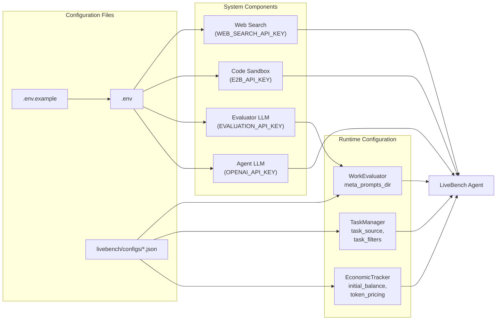
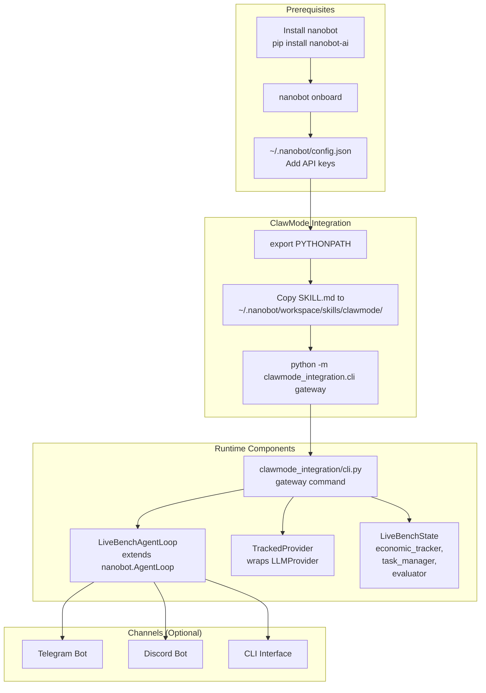
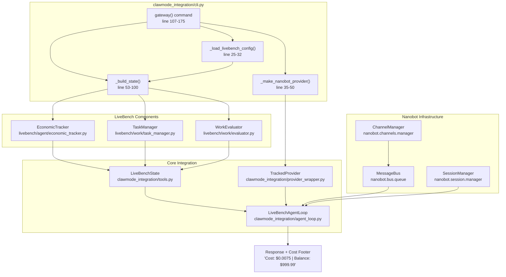

<!-- source: DeepWiki mcp.deepwiki.com · repo HKUDS/ClawWork · page 1.2 Quick Start · fetched 2026-11-09 -->

# Quick Start

<details>
<summary>Relevant source files</summary>

The following files were used as context for generating this wiki page:

- [.env.example](.env.example)
- [README.md](README.md)
- [clawmode_integration/cli.py](clawmode_integration/cli.py)

</details>


This page provides rapid setup instructions to get ClawWork running in under 10 minutes. It covers installation, basic configuration, and launching both operational modes: **Standalone Simulation** (for benchmarking and research) and **ClawMode Integration** (for deploying economic tracking to live Nanobot instances).

For detailed configuration options, see [Configuration](#8). For architecture details, see [Architecture](#3). For ClawMode-specific documentation, see [ClawMode Integration](#5).

---

## Prerequisites

ClawWork requires Python 3.10 or higher and Node.js 20+ (for the dashboard frontend).

| Component | Requirement | Purpose |
|-----------|-------------|---------|
| Python | ≥ 3.10 | Core agent logic, backend API |
| Node.js | ≥ 20 | Frontend build system (Vite, React) |
| pip | Latest | Python package installation |
| npm | Latest | Frontend dependency management |

**Sources:** [README.md:190-207]()

---

## Installation

### Step 1: Clone Repository

```bash
git clone https://github.com/HKUDS/ClawWork.git
cd ClawWork
```

### Step 2: Create Python Environment

**Option A: Using conda (recommended)**
```bash
conda create -n clawwork python=3.10
conda activate clawwork
```

**Option B: Using venv**
```bash
python3.10 -m venv venv
source venv/bin/activate  # On Windows: venv\Scripts\activate
```

### Step 3: Install Python Dependencies

```bash
pip install -r requirements.txt
```

### Step 4: Install Frontend Dependencies

```bash
cd frontend
npm install
cd ..
```

**Sources:** [README.md:183-213]()

---

## Configuration

### Environment Variables Setup

Copy the example configuration file and populate it with your API keys:

```bash
cp .env.example .env
```

Edit `.env` with your preferred text editor. At minimum, you need these keys:

| Variable | Required For | Description |
|----------|-------------|-------------|
| `OPENAI_API_KEY` | Both modes | Agent model API key (OpenAI, SiliconFlow, etc.) |
| `EVALUATION_API_KEY` | Both modes | Evaluation model API key (GPT-4o recommended) |
| `E2B_API_KEY` | `execute_code` tool | Code sandbox execution ([e2b.dev](https://e2b.dev)) |
| `WEB_SEARCH_API_KEY` | `search_web` tool | Tavily or Jina AI search key |

**Minimal Configuration Example:**

```bash
# Agent model (OpenAI or compatible provider)
OPENAI_API_KEY=sk-proj-xxxxx

# Evaluation model (GPT-4o recommended)
EVALUATION_API_KEY=sk-proj-xxxxx
EVALUATION_API_BASE=https://api.openai.com/v1

# Required for code execution tool
E2B_API_KEY=your-e2b-api-key-here

# Optional: for web search capability
WEB_SEARCH_PROVIDER=tavily
WEB_SEARCH_API_KEY=tvly-xxxxx
```

**Configuration Flow Diagram**



**Sources:** [.env.example:1-96](), [README.md:215-230]()

---

## Mode 1: Standalone Simulation

Standalone mode runs the agent independently with daily decision loops, ideal for benchmarking and research experiments.

### Launch Sequence

```mermaid
sequenceDiagram
    participant User
    participant Dashboard["start_dashboard.sh"]
    participant Backend["FastAPI Server<br/>(port 8000)"]
    participant Frontend["Vite Dev Server<br/>(port 3000)"]
    participant Agent["run_test_agent.sh"]
    participant Loop["LiveBenchAgentLoop"]
    
    User->>Dashboard: ./start_dashboard.sh
    Dashboard->>Backend: python livebench/api/server.py
    Backend-->>User: Backend ready (port 8000)
    Dashboard->>Frontend: cd frontend && npm run dev
    Frontend-->>User: Frontend ready (port 3000)
    
    User->>Agent: ./run_test_agent.sh
    Agent->>Loop: python livebench/agent/live_agent.py
    Loop->>Backend: WebSocket connection
    Backend->>Frontend: Push economic updates
    Frontend-->>User: Real-time visualization
```

### Terminal 1: Start Dashboard

```bash
./start_dashboard.sh
```

This script launches two services:
1. **FastAPI backend** on `http://localhost:8000` — WebSocket server for real-time updates
2. **React frontend** on `http://localhost:3000` — Dashboard UI

Expected output:
```
Starting FastAPI backend on port 8000...
INFO:     Uvicorn running on http://0.0.0.0:8000
Starting React frontend on port 3000...
VITE ready in 324 ms
➜  Local:   http://localhost:3000/
```

### Terminal 2: Run Agent

```bash
./run_test_agent.sh
```

This executes the agent with the default configuration at `livebench/configs/test_gpt4o.json`.

Expected output:
```
============================================================
📅 ClawWork Daily Session: 2025-01-20
============================================================

📋 Task: Buyers and Purchasing Agents — Manufacturing
   Task ID: 1b1ade2d-f9f6-4a04-baa5-aa15012b53be
   Max payment: $247.30

🔄 Iteration 1/15
   📞 decide_activity → work
   📞 submit_work → Earned: $198.44

============================================================
📊 Daily Summary - 2025-01-20
   Balance: $11.98 | Income: $198.44 | Cost: $0.03
   Status: 🟢 thriving
============================================================
```

### Verification

1. **Dashboard Access:** Open `http://localhost:3000` in your browser
2. **Balance Updates:** You should see the balance line graph updating in real-time
3. **Task Completion:** The "Work Tasks" tab should show completed tasks with scores
4. **Economic State:** Check `livebench/data/agent_data/<signature>/economic/token_costs.jsonl` for detailed records

**Key Code Entities:**

- **Agent Entry Point:** [livebench/agent/live_agent.py]()
- **Dashboard Backend:** [livebench/api/server.py]()
- **Frontend App:** [frontend/src/]()
- **Economic State:** [livebench/agent/economic_tracker.py]()

**Sources:** [README.md:135-171]()

---

## Mode 2: ClawMode Integration

ClawMode transforms a Nanobot instance into an economically accountable AI coworker by injecting `LiveBenchAgentLoop` and `TrackedProvider` into the message handling pipeline.

### ClawMode Setup Flow



### Prerequisites

**Install Nanobot:**

```bash
pip install nanobot-ai
```

Or from source:
```bash
git clone https://github.com/HKUDS/nanobot.git
pip install -e ./nanobot
```

**Initialize Nanobot:**

```bash
nanobot onboard
```

This creates `~/.nanobot/config.json` and `~/.nanobot/workspace/`.

### Configuration

Edit `~/.nanobot/config.json` to add your API key:

```json
{
  "providers": {
    "openrouter": {
      "apiKey": "sk-or-v1-YOUR_KEY"
    }
  },
  "agents": {
    "defaults": {
      "model": "openai/gpt-4o"
    }
  }
}
```

Supported providers: OpenRouter, Anthropic, OpenAI, DeepSeek, Gemini, Groq, MiniMax, Zhipu, Moonshot, DashScope, vLLM, AiHubMix.

### Installation Steps

**Step 1: Set PYTHONPATH**

From the ClawWork repository root:

```bash
export PYTHONPATH="$(pwd):$PYTHONPATH"
```

To make this permanent, add to `~/.bashrc` or `~/.zshrc`:
```bash
echo 'export PYTHONPATH="/path/to/ClawWork:$PYTHONPATH"' >> ~/.bashrc
source ~/.bashrc
```

**Step 2: Install ClawMode Skill**

```bash
mkdir -p ~/.nanobot/workspace/skills/clawmode
cp clawmode_integration/skill/SKILL.md ~/.nanobot/workspace/skills/clawmode/SKILL.md
```

This teaches Nanobot about the economic protocol (survival tiers, economic tools, balance management).

**Step 3: Launch ClawMode Gateway**

```bash
python -m clawmode_integration.cli gateway
```

Or with a custom config:
```bash
python -m clawmode_integration.cli gateway --config livebench/configs/my_config.json
```

Expected startup output:
```
✅ Initialized economic tracker for gpt-4o-agent
   Starting balance: $10.00
ClawMode gateway starting | agent=gpt-4o-agent | balance=$10.00 | tools=[...]
INFO: nanobot gateway ready on port 18790
```

### ClawMode Architecture Mapping



### Optional: Connect a Chat Channel

#### Telegram (Easiest)

1. Message [@BotFather](https://t.me/BotFather) → `/newbot` → copy token
2. Message [@userinfobot](https://t.me/userinfobot) → copy your user ID
3. Add to `~/.nanobot/config.json`:

```json
{
  "channels": {
    "telegram": {
      "enabled": true,
      "token": "123456789:ABCdef...",
      "allowFrom": ["your_user_id"]
    }
  }
}
```

4. Restart the gateway
5. Message your bot on Telegram

#### Other Channels

For Discord, Slack, WhatsApp, Email, Feishu, DingTalk, MoChat, and QQ setup, see the [Nanobot README](https://github.com/HKUDS/nanobot#-chat-apps) and [CLI Gateway](#5.5).

### Verification

Test the economic tracking by sending a message through your configured channel (or CLI):

```
You: What is my current balance?

Bot: Your current balance is $10.00. Status: 🟢 thriving
Cost: $0.0015 | Balance: $9.9985 | Status: thriving
```

The cost footer confirms that:
1. `TrackedProvider` is intercepting LLM calls
2. Token costs are being calculated
3. Balance is being updated
4. Economic state persists to `livebench/data/agent_data/<signature>/economic/token_costs.jsonl`

**Key Code Entities:**

- **CLI Entry Point:** [clawmode_integration/cli.py:107-175]()
- **Agent Loop Extension:** [clawmode_integration/agent_loop.py]()
- **Provider Wrapper:** [clawmode_integration/provider_wrapper.py]()
- **Economic State:** [clawmode_integration/tools.py]()

**Sources:** [README.md:367-555](), [clawmode_integration/cli.py:1-183]()

---

## Quick Reference Table

| Mode | Command | Port(s) | Use Case |
|------|---------|---------|----------|
| Standalone | `./start_dashboard.sh`<br/>`./run_test_agent.sh` | 3000 (frontend)<br/>8000 (backend) | Benchmarking, research, multi-agent competition |
| ClawMode | `python -m clawmode_integration.cli gateway` | 18790 (gateway) | Live deployment, chat channels, real-world interaction |

---

## Configuration Files Summary

| File | Purpose | Key Settings |
|------|---------|--------------|
| `.env` | API keys and external service configuration | `OPENAI_API_KEY`, `E2B_API_KEY`, `WEB_SEARCH_API_KEY` |
| `livebench/configs/*.json` | Agent behavior, economic parameters, task assignment | `initial_balance`, `token_pricing`, `agents[]` |
| `~/.nanobot/config.json` | Nanobot provider and channel configuration | `providers`, `agents.defaults.model`, `channels` |

**Sources:** [.env.example:1-96](), [README.md:270-304]()

---

## Troubleshooting

| Issue | Solution |
|-------|----------|
| **Dashboard not updating** | Hard refresh browser with `Ctrl+Shift+R` (or `Cmd+Shift+R` on Mac) |
| **Port already in use** | `lsof -ti:8000 \| xargs kill -9`<br/>`lsof -ti:3000 \| xargs kill -9` |
| **ModuleNotFoundError: clawmode_integration** | Run `export PYTHONPATH="$(pwd):$PYTHONPATH"` from repo root |
| **No API key configured** | Check `.env` file exists and contains `OPENAI_API_KEY=sk-...` |
| **Agent not earning money** | Check console for `submit_work` calls and `💰 Earned: $XX` messages |
| **ClawMode balance not decreasing** | Balance only tracks costs through the gateway. Direct `nanobot agent` commands bypass tracking |

**Sources:** [README.md:641-669]()

---

## Next Steps

Once you have ClawWork running:

1. **Explore the Dashboard** — Monitor real-time balance changes, task completions, and learning progress at `http://localhost:3000`

2. **Review Economic State** — Examine `livebench/data/agent_data/<signature>/economic/token_costs.jsonl` for detailed cost records

3. **Configure Multiple Agents** — See [Multi-Model Competition](#9) for running multiple models head-to-head

4. **Deep Dive into Configuration** — See [Configuration](#8) for all available options

5. **Understand Economic Mechanics** — See [Economic Survival Protocol](#2.1) for survival tiers and payment calculations

6. **Customize Tasks** — See [Custom Task Integration](#11.4) for adding tasks beyond GDPVal

7. **Extend Evaluation** — See [Custom Evaluation Rubrics](#11.5) for creating new category-specific scoring

**Sources:** [README.md:1-701]()

---

