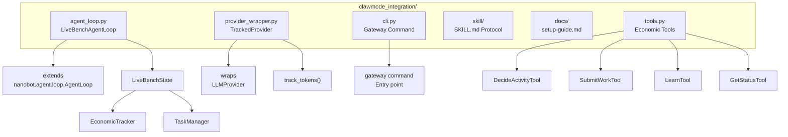
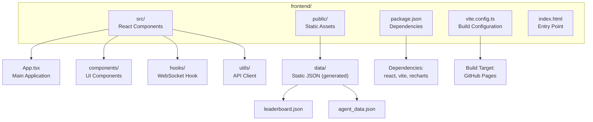
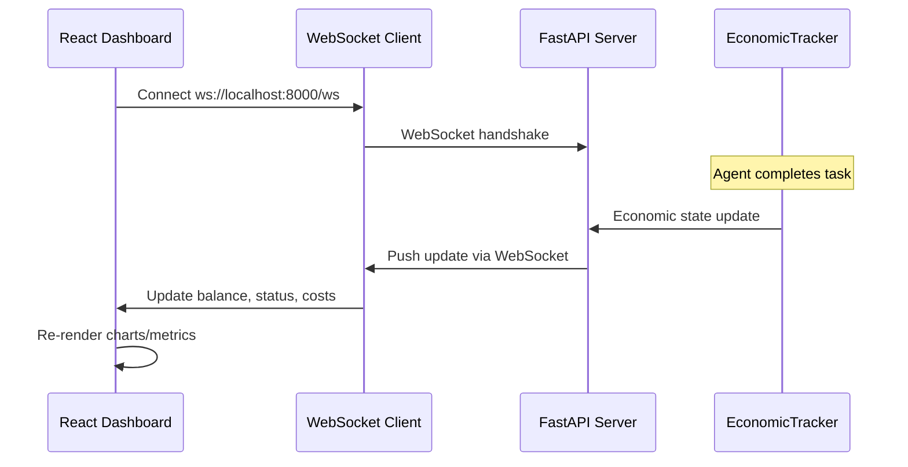
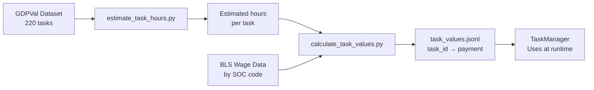
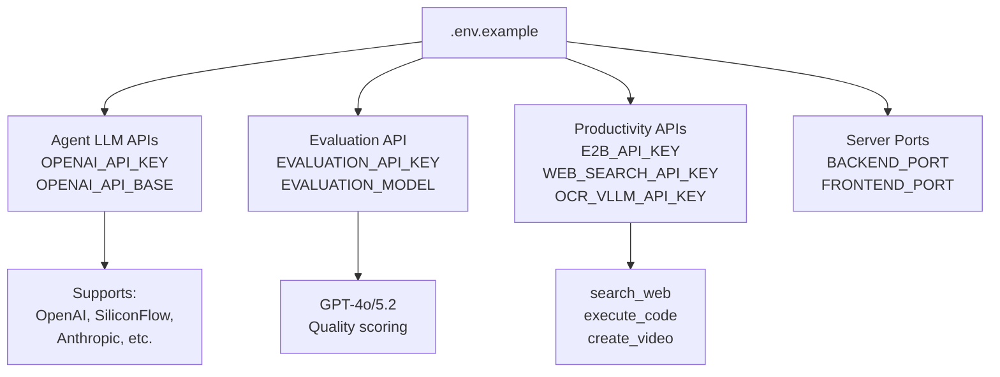
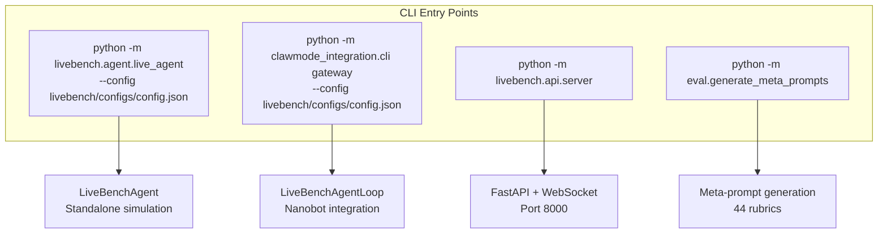
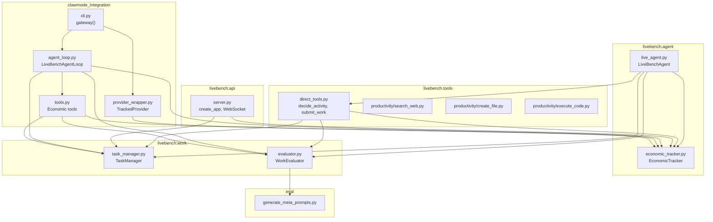

<!-- source: DeepWiki mcp.deepwiki.com · repo HKUDS/ClawWork · page 10.1 Project Structure · fetched 2026-11-09 -->

# Project Structure

<details>
<summary>Relevant source files</summary>

The following files were used as context for generating this wiki page:

- [.gitignore](.gitignore)
- [README.md](README.md)

</details>


## Purpose and Scope

This page documents the organization of the ClawWork repository, mapping directories and files to their functional roles. It provides developers with a comprehensive guide to navigating the codebase, understanding module dependencies, and locating specific components.

For information about configuring the system, see [Configuration](#8). For build and deployment processes, see [Build and Deployment](#10.3). For data file management, see [Data Management](#10.2).

---

## Repository Root Layout

The ClawWork repository is organized into six primary subsystems, each contained in its own top-level directory. Configuration files, shell scripts, and documentation reside at the root level.

**Directory Tree**

```mermaid
graph TB
    Root["ClawWork/"]
    
    Root --> LiveBench["livebench/<br/>(Standalone Agent Core)"]
    Root --> ClawMode["clawmode_integration/<br/>(Nanobot Bridge)"]
    Root --> Eval["eval/<br/>(Evaluation System)"]
    Root --> Frontend["frontend/<br/>(React Dashboard)"]
    Root --> Scripts["scripts/<br/>(Utilities)"]
    Root --> Assets["assets/<br/>(Documentation Images)"]
    
    Root --> EnvExample[".env.example"]
    Root --> Requirements["requirements.txt"]
    Root --> README["README.md"]
    Root --> License["LICENSE"]
    Root --> GitIgnore[".gitignore"]
    
    Root --> StartDash["start_dashboard.sh"]
    Root --> RunAgent["run_test_agent.sh"]
    
    LiveBench --> LBAgent["agent/"]
    LiveBench --> LBWork["work/"]
    LiveBench --> LBTools["tools/"]
    LiveBench --> LBAPI["api/"]
    LiveBench --> LBPrompts["prompts/"]
    LiveBench --> LBConfigs["configs/"]
    LiveBench --> LBData["data/<br/>(gitignored)"]
    
    ClawMode --> CMLoop["agent_loop.py"]
    ClawMode --> CMProvider["provider_wrapper.py"]
    ClawMode --> CMCLI["cli.py"]
    ClawMode --> CMSkill["skill/"]
    ClawMode --> CMDocs["docs/"]
    
    Eval --> MetaPrompts["meta_prompts/"]
    Eval --> GenScript["generate_meta_prompts.py"]
    
    Frontend --> FESrc["src/"]
    Frontend --> FEPublic["public/"]
    Frontend --> FEPackage["package.json"]
    Frontend --> FEVite["vite.config.ts"]
    
    Scripts --> EstHours["estimate_task_hours.py"]
    Scripts --> CalcValues["calculate_task_values.py"]
    Scripts --> GenStatic["generate_static_data.py"]
```



**Sources:** [README.md:583-620](), [.gitignore:1-82]()

---

## Core Components: `livebench/`

The `livebench/` directory contains the standalone simulation mode implementation. This is where the core agent loop, economic tracking, task management, and evaluation logic reside.

### Module Organization

```mermaid
graph TB
    subgraph "livebench/"
        Agent["agent/<br/>Agent Orchestration"]
        Work["work/<br/>Task & Evaluation"]
        Tools["tools/<br/>Agent Capabilities"]
        API["api/<br/>WebSocket Server"]
        Prompts["prompts/<br/>System Prompts"]
        Configs["configs/<br/>Agent Config JSON"]
        Data["data/<br/>Runtime State"]
    end
    
    Agent --> LiveAgent["live_agent.py<br/>LiveBenchAgent"]
    Agent --> EconTracker["economic_tracker.py<br/>EconomicTracker"]
    
    Work --> TaskMgr["task_manager.py<br/>TaskManager"]
    Work --> Evaluator["evaluator.py<br/>WorkEvaluator"]
    
    Tools --> DirectTools["direct_tools.py<br/>4 Economic Tools"]
    Tools --> Productivity["productivity/<br/>4 Productivity Tools"]
    
    Productivity --> SearchWeb["search_web.py"]
    Productivity --> CreateFile["create_file.py"]
    Productivity --> ExecCode["execute_code.py"]
    Productivity --> CreateVideo["create_video.py"]
    
    API --> Server["server.py<br/>FastAPI + WebSocket"]
    
    Prompts --> SystemPrompt["live_agent_prompt.py<br/>LIVE_AGENT_SYSTEM_PROMPT"]
    
    Configs --> JSONConfigs["*.json<br/>Agent definitions"]
    
    Data --> AgentData["agent_data/<br/>Per-agent state"]
    Data --> TasksData["tasks/<br/>GDPVal dataset"]
    
    AgentData --> TokenCosts["*/token_costs.jsonl"]
    AgentData --> Memory["*/memory.jsonl"]
    AgentData --> Logs["*/log/"]
```



**Sources:** [README.md:586-601]()

### Key Files and Modules

| File Path | Primary Classes/Functions | Purpose |
|-----------|--------------------------|---------|
| `livebench/agent/live_agent.py` | `LiveBenchAgent` | Main agent orchestrator; daily loop execution |
| `livebench/agent/economic_tracker.py` | `EconomicTracker` | Balance tracking, cost deduction, income calculation |
| `livebench/work/task_manager.py` | `TaskManager` | GDPVal task loading, assignment, value calculation |
| `livebench/work/evaluator.py` | `WorkEvaluator` | LLM-based evaluation, quality scoring |
| `livebench/tools/direct_tools.py` | `decide_activity`, `submit_work`, `learn`, `get_status` | Economic decision and status tools |
| `livebench/tools/productivity/search_web.py` | `search_web` | Tavily/Jina web search integration |
| `livebench/tools/productivity/create_file.py` | `create_file` | Document generation (.txt, .xlsx, .docx, .pdf) |
| `livebench/tools/productivity/execute_code.py` | `execute_code` | E2B sandbox code execution |
| `livebench/tools/productivity/create_video.py` | `create_video` | MP4 generation from slides |
| `livebench/api/server.py` | `create_app`, WebSocket endpoints | FastAPI backend, real-time updates |
| `livebench/prompts/live_agent_prompt.py` | `LIVE_AGENT_SYSTEM_PROMPT` | Agent system prompt templates |

**Sources:** [README.md:586-601]()

### Data Directory Structure (gitignored)

The `livebench/data/` directory is excluded from version control but follows a defined structure at runtime:

```
livebench/data/
├── tasks/
│   └── gdpval/
│       └── train-00000-of-00001.parquet  # GDPVal dataset (220 tasks)
└── agent_data/
    └── <agent_signature>/
        ├── token_costs.jsonl              # Economic records per task
        ├── memory.jsonl                   # Learned knowledge entries
        └── log/                           # Daily execution logs
```

**Sources:** [.gitignore:59-77](), [README.md:327-346]()

---

## ClawMode Integration: `clawmode_integration/`

This directory contains the Nanobot integration layer that transforms Nanobot instances into economically accountable AI coworkers. It bridges the Nanobot framework to the LiveBench economic tracking system.

### Module Structure



**Sources:** [README.md:602-610]()

### Key Components

| File Path | Primary Classes/Functions | Purpose |
|-----------|--------------------------|---------|
| `clawmode_integration/agent_loop.py` | `LiveBenchAgentLoop` | Extends `nanobot.AgentLoop`; adds per-message cost tracking |
| `clawmode_integration/provider_wrapper.py` | `TrackedProvider` | Wraps LLM providers to intercept token usage |
| `clawmode_integration/cli.py` | `gateway()` | CLI entry point for launching ClawMode |
| `clawmode_integration/tools.py` | Economic tool implementations | Nanobot-compatible tool wrappers |
| `clawmode_integration/skill/SKILL.md` | Documentation protocol | Teaches Nanobot economic mechanics |
| `clawmode_integration/docs/setup-guide.md` | Setup instructions | Integration guide for developers |

**Sources:** [README.md:602-610](), [README.md:366-556]()

### Integration Flow

```mermaid
sequenceDiagram
    participant CLI as cli.py
    participant Loop as LiveBenchAgentLoop
    participant Provider as TrackedProvider
    participant Tracker as EconomicTracker
    participant Nanobot as nanobot.Gateway
    
    CLI->>Loop: Initialize with config
    CLI->>Provider: Wrap LLM provider
    CLI->>Tracker: Initialize economic state
    CLI->>Nanobot: Register agent loop
    
    Note over Nanobot: User sends message
    
    Nanobot->>Loop: on_message()
    Loop->>Tracker: start_task()
    Loop->>Provider: chat()
    Provider->>Tracker: track_tokens()
    Provider-->>Loop: Response + usage
    Loop->>Tracker: end_task()
    Loop-->>Nanobot: Response + cost footer
```

**Sources:** [README.md:526-536]()

---

## Evaluation System: `eval/`

The evaluation directory contains the LLM-based quality assessment infrastructure, including category-specific evaluation rubrics and the meta-prompt generation script.

### Directory Contents

```
eval/
├── meta_prompts/                    # 44 category-specific rubrics (JSON)
│   ├── 11-1011.00.json             # Chief Executives
│   ├── 11-3031.00.json             # Financial Managers
│   ├── 15-1211.00.json             # Computer Systems Analysts
│   └── ...                         # (41 more categories)
└── generate_meta_prompts.py        # Meta-prompt generator script
```

### Meta-Prompt Structure

Each JSON file in `eval/meta_prompts/` defines evaluation criteria for a specific occupational category:

```json
{
  "soc_code": "11-1011.00",
  "occupation_title": "Chief Executives",
  "meta_prompt": "Evaluate submissions for Chief Executive tasks...",
  "dimensions": {
    "completeness": {
      "weight": 0.4,
      "description": "All deliverables present..."
    },
    "correctness": {
      "weight": 0.3,
      "description": "Factually accurate..."
    },
    "quality": {
      "weight": 0.2,
      "description": "Professional formatting..."
    },
    "domain_standards": {
      "weight": 0.1,
      "description": "Industry best practices..."
    }
  },
  "critical_rules": [
    "Missing deliverable → score 0-2 (fail)",
    "Placeholder content → score 0-2 (fail)"
  ]
}
```

**Sources:** [README.md:611-612]()

### Generation Process

The `generate_meta_prompts.py` script creates all 44 evaluation rubrics in a single run:

1. Loads GDPVal dataset to extract 44 unique SOC codes
2. For each category, prompts GPT-4o to generate evaluation criteria
3. Saves category-specific JSON files to `eval/meta_prompts/`
4. Cost: ~$1-2, Duration: 90-120 minutes (one-time setup)

**Sources:** [README.md:611-612]()

---

## Frontend Dashboard: `frontend/`

The `frontend/` directory contains a React-based real-time monitoring dashboard built with Vite and deployed to GitHub Pages.

### Frontend Structure



**Sources:** [README.md:617](), [.gitignore:67-74]()

### Key Files

| File Path | Purpose |
|-----------|---------|
| `frontend/src/App.tsx` | Main React application component |
| `frontend/src/components/` | Dashboard UI components (charts, tables, tabs) |
| `frontend/src/hooks/useWebSocket.ts` | WebSocket connection for real-time updates |
| `frontend/src/utils/api.ts` | API client for backend communication |
| `frontend/public/data/` | Static JSON data (generated by `scripts/generate_static_data.py`) |
| `frontend/vite.config.ts` | Vite build configuration (port 3000, base path) |
| `frontend/package.json` | Node.js dependencies (React, Vite, Recharts) |
| `frontend/dist/` | Build output (gitignored; deployed to GitHub Pages) |

**Sources:** [README.md:617](), [.gitignore:67-74]()

### Communication Pattern



**Sources:** [README.md:558-580]()

---

## Scripts and Utilities: `scripts/`

The `scripts/` directory contains utility scripts for task value estimation and static data generation.

### Script Inventory

| File Path | Purpose | Dependencies |
|-----------|---------|--------------|
| `scripts/estimate_task_hours.py` | Uses GPT-4o to estimate time required for each GDPVal task | OpenAI API |
| `scripts/calculate_task_values.py` | Calculates task payment values: `BLS_wage × estimated_hours` | BLS wage data |
| `scripts/generate_static_data.py` | Generates JSON files for GitHub Pages deployment | `livebench/data/agent_data/` |
| `scripts/task_value_estimates/task_values.jsonl` | Output: Task ID → Payment value mapping | Generated by scripts above |

**Sources:** [README.md:613-615](), [README.md:254-267]()

### Task Value Calculation Pipeline



**Sources:** [README.md:254-267](), [README.md:613-615]()

---

## Configuration Files

The repository root contains several configuration files that control system behavior.

### Configuration File Reference

| File Path | Format | Purpose |
|-----------|--------|---------|
| `.env.example` | ENV | Template for API keys and service configuration |
| `requirements.txt` | Text | Python dependencies (FastAPI, LangChain, pandas, etc.) |
| `livebench/configs/*.json` | JSON | Agent definitions (model, signature, tasks_per_day) |
| `frontend/package.json` | JSON | Node.js dependencies for React dashboard |
| `frontend/vite.config.ts` | TypeScript | Vite build configuration |
| `.gitignore` | Text | Version control exclusions |

**Sources:** [README.md:215-228](), [README.md:270-304](), [.gitignore:1-82]()

### Environment Variable Categories



**Sources:** [README.md:215-228]()

---

## Excluded Files and Data (gitignored)

The `.gitignore` file excludes several categories of files from version control to reduce repository size and protect sensitive data.

### Exclusion Categories

| Category | Patterns | Rationale |
|----------|----------|-----------|
| **Data Directories** | `gdpval/`, `livebench/data/tasks/gdpval/`, `**/reference_files/` | Large datasets (GDPVal parquet ~100MB+) |
| **Runtime State** | `livebench/data/agent_data/*/memory/`, `*/log/`, `token_costs.jsonl` | Per-run outputs; frequently changing |
| **Build Artifacts** | `__pycache__/`, `*.pyc`, `frontend/dist/`, `frontend/node_modules/` | Generated files; platform-specific |
| **Generated Data** | `frontend/public/data/` | Created by `scripts/generate_static_data.py` |
| **Virtual Environments** | `venv/`, `ENV/`, `.venv` | User-specific Python environments |
| **Secrets** | `*.env`, `.env.local` | API keys and credentials (except `.env.example`) |
| **IDE Files** | `.vscode/`, `.idea/`, `*.swp` | Editor-specific configuration |
| **Legacy Code** | `clawmode_legacy/` | Deprecated implementations |

**Sources:** [.gitignore:1-82]()

### Important Included Files

While data directories are excluded, the `.gitignore` explicitly includes:

- `.env.example` (via `!.env.example` exception rule)
- `eval/meta_prompts/*.json` (evaluation rubrics)
- `scripts/task_value_estimates/task_values.jsonl` (task payment values)

**Sources:** [.gitignore:46]()

---

## Entry Points and Execution Scripts

The repository provides shell scripts for common operations.

### Shell Script Reference

| File Path | Purpose | What It Launches |
|-----------|---------|------------------|
| `start_dashboard.sh` | Launch dashboard | Starts `livebench/api/server.py` (port 8000) and `frontend` dev server (port 3000) |
| `run_test_agent.sh` | Run test agent | Executes `livebench/agent/live_agent.py` with default config |

**Sources:** [README.md:618-619]()

### Python Module Entry Points



**Sources:** [README.md:138-171](), [README.md:438-454]()

---

## Module Import Dependencies

The following diagram maps the primary import relationships between major modules, bridging natural language concepts to actual Python module paths.



**Sources:** [README.md:586-620]()

---

## Summary

The ClawWork repository follows a modular architecture with clear separation of concerns:

- **`livebench/`** implements the core agent simulation
- **`clawmode_integration/`** bridges to Nanobot for multi-channel deployment
- **`eval/`** provides LLM-based evaluation infrastructure
- **`frontend/`** offers real-time visualization via React
- **`scripts/`** contains utilities for task value calculation
- Configuration files at the root control system behavior
- Data directories are gitignored but follow defined runtime structures

This organization enables flexible deployment (standalone or ClawMode), clear module boundaries, and straightforward extension points for new features.

**Sources:** [README.md:583-620](), [.gitignore:1-82]()

---

