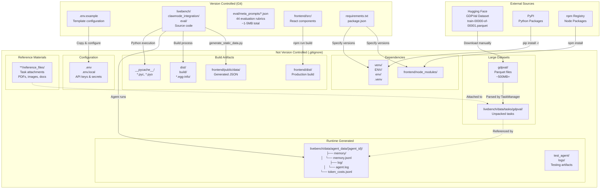
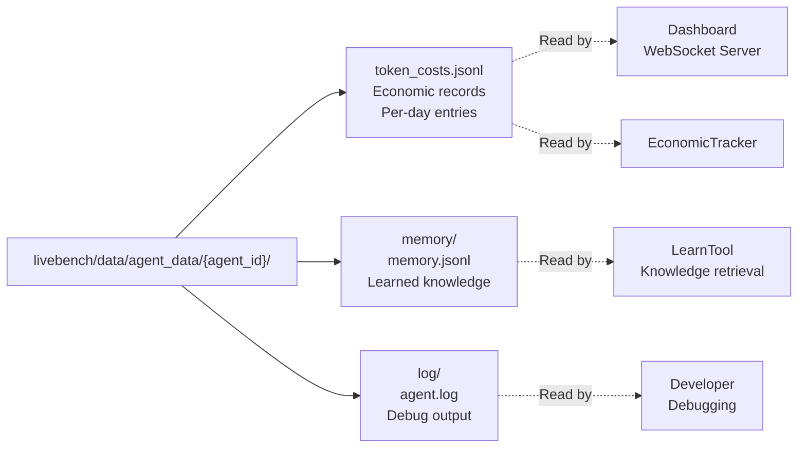
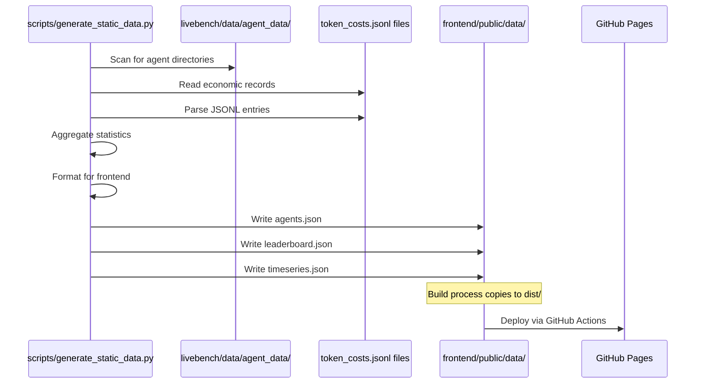
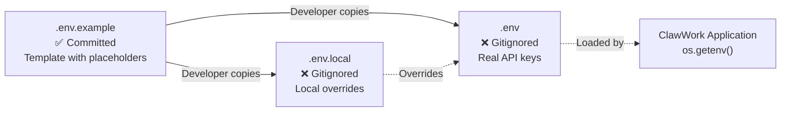
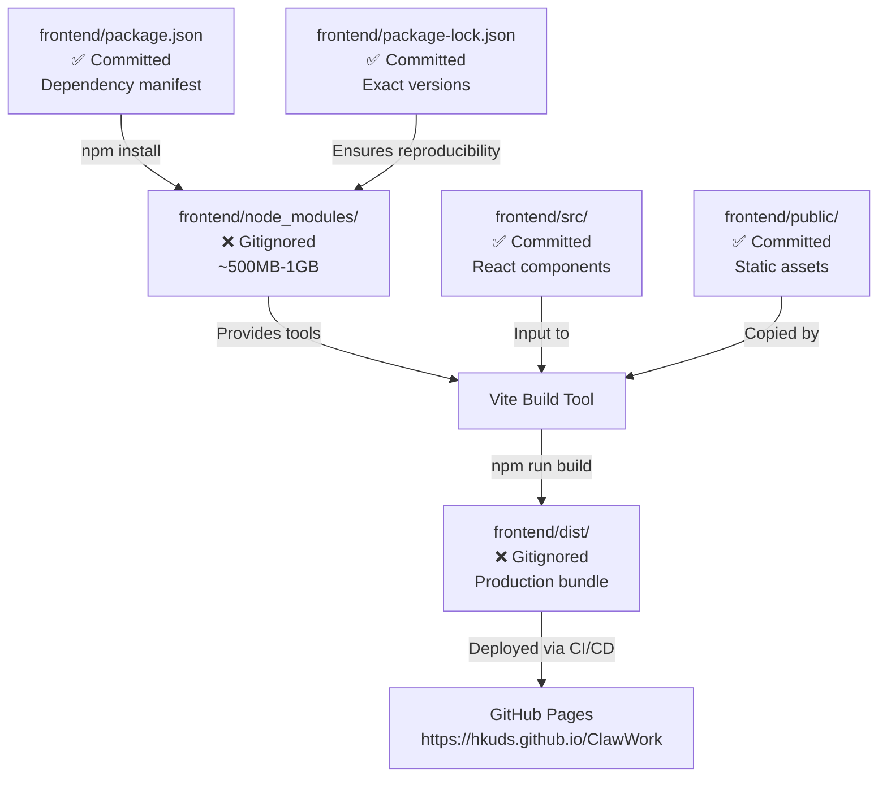

<!-- source: DeepWiki mcp.deepwiki.com · repo HKUDS/ClawWork · page 10.2 Data Management · fetched 2026-11-09 -->

# Data Management

<details>
<summary>Relevant source files</summary>

The following files were used as context for generating this wiki page:

- [.gitignore](.gitignore)

</details>


This page documents the data management strategy for ClawWork, including gitignored directories, generated files, virtual environments, and the rationale for excluding large datasets from version control. It serves as a guide for developers working with the repository to understand where data is stored, what should be committed, and how to handle large files.

For information about the actual data structures persisted at runtime (e.g., `token_costs.jsonl`, `memory.jsonl`), see [Economic State Persistence](#11.3). For configuration of data sources and API keys, see [Environment Variables](#8.1).

---

## Data Categories Overview

ClawWork manages several distinct categories of data, each with different persistence, size, and version control requirements.

### Data Classification

| Category | Storage Location | Size | Version Controlled | Rationale |
|----------|-----------------|------|-------------------|-----------|
| **GDPVal Dataset** | `gdpval/`, `livebench/data/tasks/gdpval/` | ~500MB+ | ❌ No | Large parquet files, obtained via external download |
| **Runtime State** | `livebench/data/agent_data/*/` | ~1-100MB | ❌ No | Generated during execution, agent-specific |
| **Generated Static Data** | `frontend/public/data/` | ~100KB-1MB | ❌ No | Built by `scripts/generate_static_data.py` |
| **Evaluation Rubrics** | `eval/meta_prompts/*.json` | ~1-5MB | ✅ Yes | One-time generated, stable, needed for evaluation |
| **Virtual Environments** | `venv/`, `env/`, `.venv` | ~500MB-2GB | ❌ No | Python dependencies, recreatable via `requirements.txt` |
| **Node Modules** | `frontend/node_modules/` | ~500MB-1GB | ❌ No | Frontend dependencies, recreatable via `package.json` |
| **Build Artifacts** | `__pycache__/`, `dist/`, `build/` | ~10-100MB | ❌ No | Compiled Python bytecode and build outputs |
| **Environment Config** | `.env`, `.env.local` | <1KB | ❌ No | Contains API keys and secrets |
| **Reference Files** | `**/reference_files/` | Variable | ❌ No | Task-specific attachments, can be large |
| **Test Outputs** | `test_agent/`, `logs/` | Variable | ❌ No | Testing artifacts and log files |

**Sources:** [.gitignore:1-82]()

---

## Repository Data Structure

The following diagram shows the actual directory structure and how data flows through the system:



**Sources:** [.gitignore:1-82]()

---

## GDPVal Dataset Management

The GDPVal dataset is the core task source for ClawWork, containing 220 professional tasks across 44 economic sectors. Due to its size (~500MB+), it is excluded from version control.

### Storage Locations

| Path | Purpose | Format |
|------|---------|--------|
| `gdpval/` | Original downloaded dataset | Parquet files |
| `livebench/data/tasks/gdpval/` | Processed task definitions | JSON + reference files |

### Obtaining the Dataset

The dataset is not included in the repository. To use ClawWork, you must:

1. Download from Hugging Face or official source
2. Place parquet file in `gdpval/` directory
3. Run task initialization script (if provided) to populate `livebench/data/tasks/gdpval/`

### Gitignore Configuration

```
# Large data directories
gdpval/
livebench/data/tasks/gdpval/
explore_gdpval.py
```

**Sources:** [.gitignore:11-14]()

**Rationale:** The dataset is:
- Too large for Git LFS (500MB+ exceeds most free tier limits)
- Unchanging once published (static reference data)
- Easily obtainable from external source
- Would slow down repository cloning significantly

---

## Runtime Generated Data

During agent execution, several files are generated to track state, logs, and economic records. These are agent-specific and should not be committed.

### Agent Data Directory Structure



**Sources:** [.gitignore:59-63]()

### Gitignore Configuration

```
# Agent data (can be large)
livebench/data/agent_data/*/memory/
livebench/data/agent_data/*/log/
```

**Rationale:**
- **Size:** Memory and log files grow unbounded over time
- **Agent-specific:** Each agent instance generates unique data
- **Reproducibility:** Can be regenerated by re-running agents
- **Privacy:** May contain API responses with sensitive content

### Test and Development Data

```
# Test outputs
test_agent/
livebench/data/tasks/gdpval
logs/
```

**Sources:** [.gitignore:75-78]()

These directories contain outputs from development testing and should be cleaned periodically.

---

## Generated Static Data for Deployment

The frontend dashboard requires static JSON files for GitHub Pages deployment. These are generated by `scripts/generate_static_data.py` and should not be committed to the main branch.

### Generation Process



**Sources:** [.gitignore:70-71]()

### Gitignore Configuration

```
# Generated static data for GitHub Pages (scripts/generate_static_data.py)
frontend/public/data/
```

**Rationale:**
- Generated from runtime data on each deployment
- Deployment-specific (contains absolute paths or timestamps)
- CI/CD pipeline regenerates on each push
- Committing would create unnecessary merge conflicts

---

## Python Artifacts

Python generates several types of bytecode and build artifacts during development and execution.

### Gitignore Configuration

```
# Python
__pycache__/
*.py[cod]
*$py.class
*.so
.Python
build/
develop-eggs/
dist/
downloads/
eggs/
.eggs/
lib/
lib64/
parts/
sdist/
var/
wheels/
*.egg-info/
.installed.cfg
*.egg
```

**Sources:** [.gitignore:15-35]()

### Artifact Types

| Pattern | Description | Generated By |
|---------|-------------|--------------|
| `__pycache__/` | Compiled bytecode cache | Python interpreter |
| `*.pyc`, `*.pyo` | Bytecode files | Python compiler |
| `*.so` | Shared libraries | C extensions |
| `dist/`, `build/` | Package distributions | `setup.py`, `poetry build` |
| `*.egg-info/` | Package metadata | `pip install -e .` |

**Rationale:**
- Platform-specific (bytecode format varies by Python version)
- Automatically regenerated on import
- Contains no source information not in `.py` files
- Can cause conflicts when switching Python versions

---

## Virtual Environments

Python virtual environments contain isolated dependency installations. These are large, platform-specific, and fully reproducible from `requirements.txt`.

### Gitignore Configuration

```
# Virtual environments
venv/
ENV/
env/
.venv
```

**Sources:** [.gitignore:37-41]()

### Standard Patterns

ClawWork supports multiple virtual environment naming conventions:
- `venv/` - Python's built-in `venv` module
- `env/` - Common alternative name
- `.venv` - Hidden directory convention
- `ENV/` - Uppercase variant

### Recreating Environments

```bash
# Create virtual environment
python -m venv venv

# Activate (Linux/macOS)
source venv/bin/activate

# Activate (Windows)
venv\Scripts\activate

# Install dependencies
pip install -r requirements.txt
```

**Rationale:**
- **Size:** 500MB-2GB of Python packages
- **Platform-specific:** Native extensions compiled for specific OS/architecture
- **Reproducible:** Fully defined by `requirements.txt`
- **Local:** Each developer may use different virtual environment locations

---

## Environment Configuration

Environment variables containing API keys and secrets are excluded from version control, with `.env.example` provided as a template.

### Gitignore Configuration

```
# Environment variables
.env
.env.local
!.env.example
```

**Sources:** [.gitignore:43-46]()

### Configuration Pattern



**Sources:** [.gitignore:43-46]()

### Security Implications

| File | Contains Secrets | Risk if Exposed | Version Controlled |
|------|-----------------|-----------------|-------------------|
| `.env.example` | No (placeholders) | None | ✅ Yes |
| `.env` | Yes (API keys) | High | ❌ No |
| `.env.local` | Yes (API keys) | High | ❌ No |

**Rationale:**
- **Security:** API keys must never be committed to version control
- **Flexibility:** Each deployment environment has different credentials
- **Documentation:** `.env.example` documents required variables without exposing secrets

---

## Frontend Dependencies and Build Artifacts

The React frontend generates substantial Node.js dependencies and build outputs.

### Gitignore Configuration

```
# frontend dependencies
frontend/node_modules/

# Frontend build output
frontend/dist/
```

**Sources:** [.gitignore:67-74]()

### Artifact Lifecycle



**Sources:** [.gitignore:67-74]()

### Size Comparison

| Directory | Typical Size | Recreate Command |
|-----------|--------------|------------------|
| `frontend/node_modules/` | 500MB-1GB | `npm install` |
| `frontend/dist/` | 5-20MB | `npm run build` |
| `frontend/src/` | <1MB | (source code) |

**Rationale:**
- **Node modules:** Extremely large, fully defined by `package.json` + `package-lock.json`
- **Build output:** Generated artifact, rebuilt on each deployment via GitHub Actions
- **Repository size:** Excluding these saves >500MB per clone

---

## Reference Files

Tasks in the GDPVal dataset may include reference materials (PDFs, images, spreadsheets) that agents use to complete work. These files are stored alongside task definitions.

### Gitignore Configuration

```
# Reference files (can be very large)
**/reference_files/
```

**Sources:** [.gitignore:65-66]()

### Storage Pattern

```
livebench/data/tasks/gdpval/
├── task_001.json
├── task_001/
│   └── reference_files/
│       ├── financial_report.pdf
│       ├── dataset.xlsx
│       └── template.docx
├── task_002.json
└── task_002/
    └── reference_files/
        └── sample_code.py
```

**Rationale:**
- **Size:** PDF reports, datasets, images can be 10MB+ each
- **Binary:** Not suitable for Git text diffing
- **Reproducible:** Can be re-downloaded with the GDPVal dataset
- **Task-specific:** Not needed for agents working on different tasks

---

## IDE and OS Files

Development environment artifacts are excluded to prevent cross-platform conflicts.

### Gitignore Configuration

```
# IDE
.vscode/
.idea/
*.swp
*.swo
*~

# OS
.DS_Store
Thumbs.db
```

**Sources:** [.gitignore:48-57]()

### File Types

| Pattern | Source | Purpose |
|---------|--------|---------|
| `.vscode/` | Visual Studio Code | Editor settings, launch configurations |
| `.idea/` | PyCharm/IntelliJ | IDE project files |
| `*.swp`, `*.swo` | Vim | Temporary swap files |
| `*~` | Various editors | Backup files |
| `.DS_Store` | macOS Finder | Folder view settings |
| `Thumbs.db` | Windows Explorer | Thumbnail cache |

**Rationale:**
- **Developer-specific:** Each developer uses different IDE configurations
- **Cross-platform conflicts:** macOS-specific files cause noise on Linux/Windows
- **No functional impact:** These files don't affect code execution

---

## Legacy and Temporary Files

Certain directories contain deprecated code or are used for temporary development artifacts.

### Gitignore Configuration

```
PROJECT.md
SETUP.md
dev/
docs/
tests/
e2b-templates/
clawmode_legacy
CLAUDE.md
```

**Sources:** [.gitignore:1-10]()

### Legacy Code

```
# Legacy code
clawmode_legacy/
```

**Sources:** [.gitignore:80-82]()

The `clawmode_legacy/` directory contains earlier implementations of ClawMode integration that have been superseded by the current architecture. This code is retained for reference but excluded from version control to avoid confusion.

---

## Development Best Practices

### Before Committing

**Check gitignore compliance:**
```bash
git status
git ls-files --others --ignored --exclude-standard
```

The second command shows files that are ignored. Verify no sensitive data (API keys, large datasets) appears in staged changes.

### Data Directory Hygiene

**Periodic cleanup:**
```bash
# Remove Python cache
find . -type d -name "__pycache__" -exec rm -rf {} +
find . -type f -name "*.pyc" -delete

# Remove test artifacts
rm -rf test_agent/ logs/

# Clean frontend builds
cd frontend && npm run clean && cd ..
```

### Adding New Data Categories

When introducing new data types:

1. **Assess size and sensitivity**
   - Large files (>1MB): Add to `.gitignore`
   - Contains secrets: Add to `.gitignore`
   - Build artifacts: Add to `.gitignore`

2. **Update `.gitignore`**
   - Add appropriate patterns
   - Add comment explaining rationale

3. **Document in this page**
   - Add to data classification table
   - Explain generation process
   - Provide cleanup instructions

### Virtual Environment Management

**Recommended workflow:**
```bash
# Create environment
python -m venv .venv

# Never commit .venv
echo ".venv" >> .gitignore  # (already included)

# Export dependencies
pip freeze > requirements.txt  # Commit this

# Teammates recreate
pip install -r requirements.txt
```

---

## Summary Table: What to Commit

| Category | Example | Commit? | Rationale |
|----------|---------|---------|-----------|
| Source code | `*.py`, `*.ts`, `*.tsx` | ✅ Yes | Core application logic |
| Configuration templates | `.env.example` | ✅ Yes | Documents required variables |
| Dependency manifests | `requirements.txt`, `package.json` | ✅ Yes | Defines reproducible builds |
| Evaluation rubrics | `eval/meta_prompts/*.json` | ✅ Yes | Stable, generated once, needed for runs |
| Documentation | `README.md`, `*.md` | ✅ Yes | Explains system usage |
| Small static assets | `frontend/public/*.svg` | ✅ Yes | Required for UI, <100KB |
| | | | |
| Large datasets | `gdpval/*.parquet` | ❌ No | 500MB+, download externally |
| Runtime data | `token_costs.jsonl` | ❌ No | Agent-specific, regenerated |
| Generated static data | `frontend/public/data/*.json` | ❌ No | Built by CI/CD |
| Build artifacts | `dist/`, `__pycache__/` | ❌ No | Compiler outputs |
| Dependencies | `node_modules/`, `venv/` | ❌ No | Recreate from manifests |
| Environment config | `.env`, `.env.local` | ❌ No | Contains secrets |
| Reference files | `**/reference_files/` | ❌ No | Large, binary, task-specific |
| IDE settings | `.vscode/`, `.idea/` | ❌ No | Developer-specific |

**Sources:** [.gitignore:1-82]()

---

