<!-- source: DeepWiki mcp.deepwiki.com · repo HKUDS/ClawWork · page 10.3 Build and Deployment · fetched 2026-11-09 -->

# Build and Deployment

Relevant source files

The following files were used as context for generating this wiki page:

- [.github/workflows/deploy.yml](.github/workflows/deploy.yml)
- [.gitignore](.gitignore)

This document covers the build processes and deployment strategies for ClawWork's two main components: the Python backend (LiveBench system) and the React frontend (Dashboard). For configuration details, see [Configuration](#8). For project structure and repository organization, see [Project Structure](#10.1).

## Build System Overview

ClawWork consists of two distinct build targets with different toolchains. The Python backend requires no compilation but needs dependency installation and data preparation. The React frontend uses a Node.js build pipeline with Vite bundling for production deployment.

### Build System Architecture

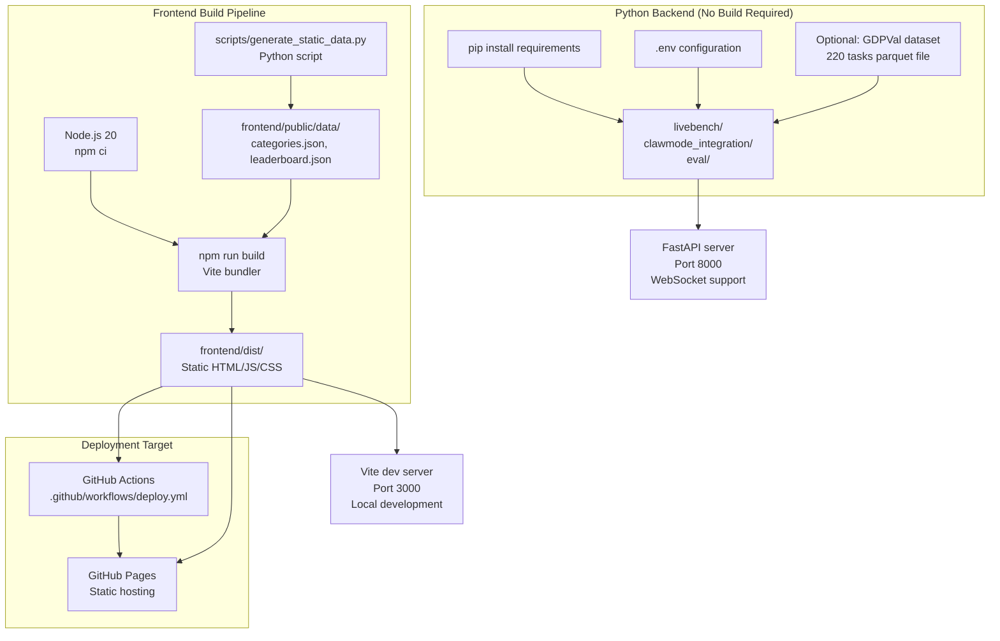

**Sources:** [.github/workflows/deploy.yml:1-67](), [.gitignore:1-82]()

The Python backend is interpreted and requires only dependency installation. The frontend follows a standard Node.js build process: install dependencies, generate static data, run Vite build, and deploy artifacts.

## Python Backend Setup

The Python backend has no traditional build step but requires environment setup and dependency installation.

### Installation Process

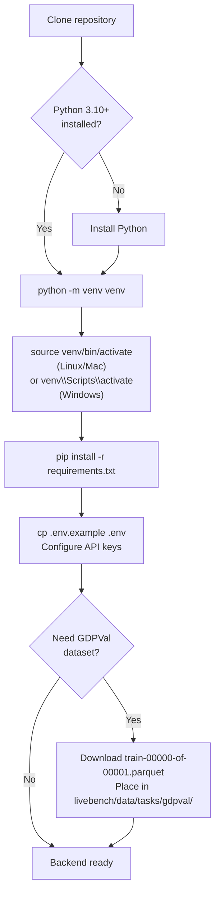

**Sources:** [.gitignore:37-41](), [.gitignore:11-14]()

The virtual environment is excluded from git via [.gitignore:37-41](). The GDPVal dataset parquet file is large and also gitignored at [.gitignore:11-14]().

### Backend Runtime Requirements

| Component | Purpose | Installation |
|-----------|---------|--------------|
| Python 3.10+ | Core interpreter | System package manager |
| pip packages | Dependencies (FastAPI, LiteLLM, etc.) | `pip install -r requirements.txt` |
| .env file | API keys and configuration | Copy from `.env.example` |
| GDPVal dataset | Task data (optional for ClawMode) | Manual download, place in `livebench/data/tasks/gdpval/` |

**Sources:** [.gitignore:37-46]()

No compilation or bundling is performed for the Python code. The backend runs directly from source via `python` command.

## Frontend Build Process

The React frontend uses Node.js 20 with Vite as the build tool. The build process transforms TypeScript/React source into optimized static assets.

### Frontend Build Pipeline

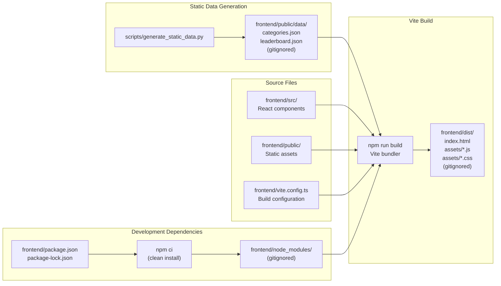

**Sources:** [.github/workflows/deploy.yml:42-48](), [.gitignore:67-74]()

The `frontend/node_modules/`, `frontend/public/data/`, and `frontend/dist/` directories are all excluded from git tracking as they contain generated artifacts.

### Build Commands

| Command | Purpose | Output |
|---------|---------|--------|
| `npm ci` | Clean dependency installation | `frontend/node_modules/` |
| `python scripts/generate_static_data.py` | Generate static JSON data | `frontend/public/data/*.json` |
| `npm run build` | Production build with Vite | `frontend/dist/` |
| `npm run dev` | Development server (no build) | Runs on port 3000 |

**Sources:** [.github/workflows/deploy.yml:39-50]()

The build command uses environment variable `VITE_STATIC_DATA=true` to enable static data mode for GitHub Pages deployment at [.github/workflows/deploy.yml:50]().

## Static Data Generation

The frontend dashboard can operate in two modes: WebSocket mode (live updates from backend) or static mode (pre-generated JSON for GitHub Pages). The static data generation script produces JSON files that replace WebSocket data.

### Static Data Generation Process

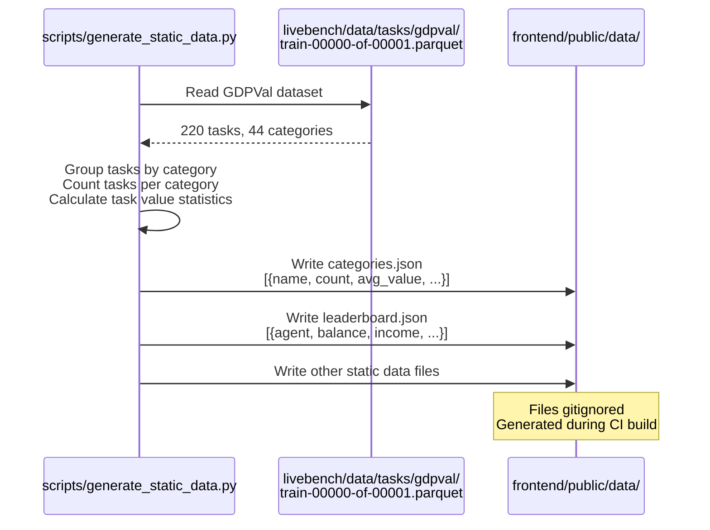

**Sources:** [.github/workflows/deploy.yml:39-40](), [.gitignore:70-71]()

The script runs at [.github/workflows/deploy.yml:39-40]() before the frontend build. Generated files are placed in `frontend/public/data/` which is gitignored at [.gitignore:70-71]().

### Static Data Files

| File | Content | Purpose |
|------|---------|---------|
| `categories.json` | 44 category summaries with task counts and value statistics | Category overview in dashboard |
| `leaderboard.json` | Agent performance metrics (balance, income, survival days) | Leaderboard display |
| Additional files | Task distributions, economic trends | Dashboard visualizations |

**Sources:** [.gitignore:70-71]()

These files enable the dashboard to function without a running backend server when deployed to GitHub Pages.

## GitHub Actions CI/CD Pipeline

The repository uses GitHub Actions for automated deployment. The workflow is triggered on pushes to `main` branch that modify `frontend/**` files, or manually via workflow dispatch.

### Deployment Workflow Structure

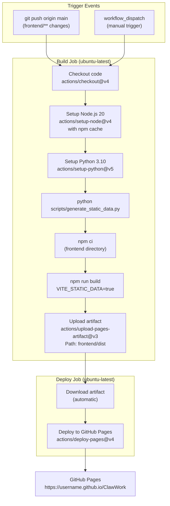

**Sources:** [.github/workflows/deploy.yml:1-67]()

The workflow defines two jobs: `build` (compiles frontend) and `deploy` (publishes to GitHub Pages). The jobs run sequentially with the deploy job depending on successful completion of the build job.

### Workflow Configuration Details

The workflow file [.github/workflows/deploy.yml:1-67]() contains the following key configurations:

| Section | Configuration | Purpose |
|---------|--------------|---------|
| Triggers | `push.branches: [main]`, `push.paths: [frontend/**]` | Deploy only on frontend changes |
| Permissions | `contents: read`, `pages: write`, `id-token: write` | GitHub Pages deployment access |
| Concurrency | `group: pages`, `cancel-in-progress: false` | Prevent concurrent deployments |
| Node.js | `node-version: '20'`, `cache: 'npm'` | Use Node 20 with npm caching |
| Python | `python-version: '3.10'` | Python for static data generation |
| Build Env | `VITE_STATIC_DATA: 'true'` | Enable static data mode |

**Sources:** [.github/workflows/deploy.yml:3-50]()

The Node.js setup includes npm cache configuration at [.github/workflows/deploy.yml:30-32]() to speed up subsequent builds by caching `frontend/package-lock.json` dependencies.

### Build Job Steps

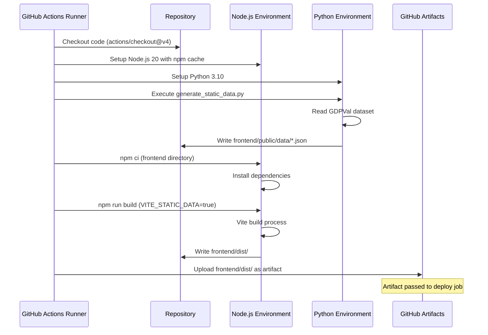

**Sources:** [.github/workflows/deploy.yml:23-55]()

Each step runs in sequence. The working directory for npm commands is set to `./frontend` at [.github/workflows/deploy.yml:43]() and [.github/workflows/deploy.yml:47]().

## GitHub Pages Deployment

After the build job completes, the deploy job publishes the static site to GitHub Pages. This job requires special permissions and uses GitHub's official deployment action.

### Deploy Job Configuration

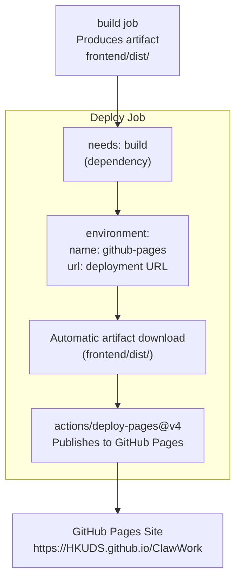

**Sources:** [.github/workflows/deploy.yml:57-66]()

The deploy job has minimal configuration. GitHub Actions automatically downloads the artifact uploaded by the build job. The `actions/deploy-pages@v4` action handles all deployment logic at [.github/workflows/deploy.yml:65-66]().

### Deployment Permissions

The workflow requires specific permissions defined at [.github/workflows/deploy.yml:11-14]():

| Permission | Level | Purpose |
|------------|-------|---------|
| `contents` | read | Read repository files |
| `pages` | write | Publish to GitHub Pages |
| `id-token` | write | Authenticate deployment |

**Sources:** [.github/workflows/deploy.yml:11-14]()

These permissions are granted at the workflow level and apply to all jobs.

### Concurrency Control

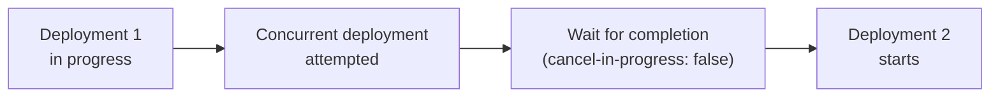

**Sources:** [.github/workflows/deploy.yml:16-18]()

The concurrency group `pages` at [.github/workflows/deploy.yml:17]() ensures only one deployment runs at a time. With `cancel-in-progress: false`, queued deployments wait rather than cancel the running deployment.

## Local Development vs Production

The system supports two deployment modes with different build requirements.

### Deployment Mode Comparison

| Aspect | Local Development | Production (GitHub Pages) |
|--------|------------------|---------------------------|
| Backend | FastAPI server on port 8000 | No backend (static only) |
| Frontend | Vite dev server on port 3000 | Static files served by GitHub Pages |
| Data updates | Real-time via WebSocket | Pre-generated static JSON |
| Build required | No (hot reload) | Yes (`npm run build`) |
| Python needed | Yes (backend + data generation) | No (after build) |
| Environment vars | Required for APIs | Not needed (static data) |

**Sources:** [.github/workflows/deploy.yml:50]()

The `VITE_STATIC_DATA` environment variable at [.github/workflows/deploy.yml:50]() switches the frontend between WebSocket mode and static data mode.

### Local Development Workflow

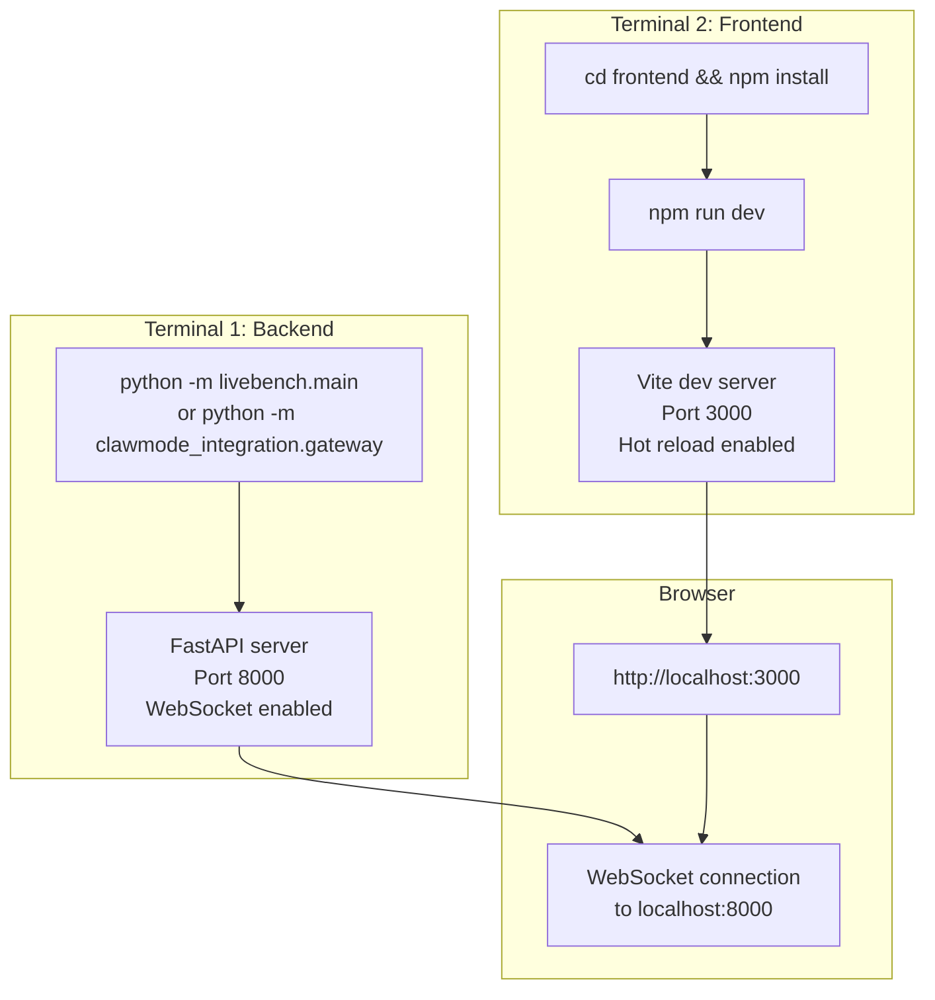

No build step is required for local development. The Vite dev server provides hot module replacement for rapid iteration.

### Production Build Workflow

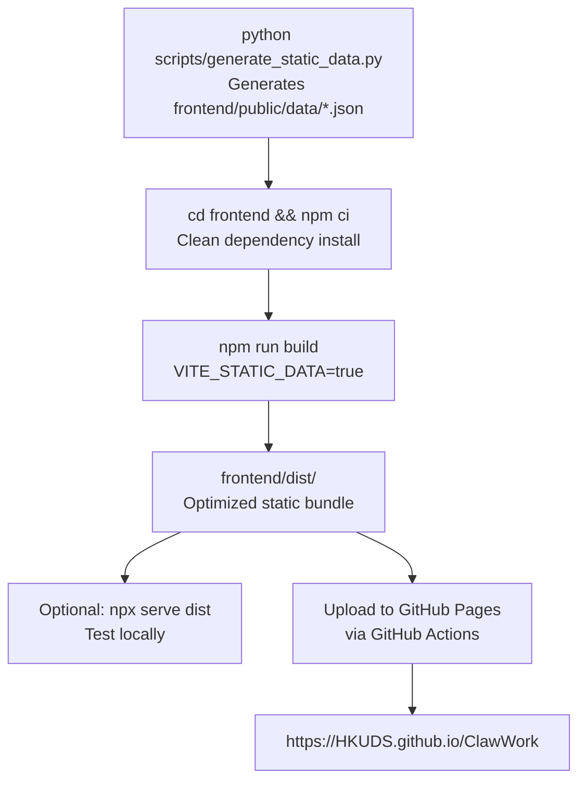

**Sources:** [.github/workflows/deploy.yml:39-48]()

The production build is fully self-contained. No backend server is needed to serve the static site.

## Build Artifacts and Cleanup

The build process generates multiple artifacts that are excluded from version control.

### Generated Artifacts

```mermaid
graph TB
    subgraph "Python Generated (Runtime)"
        Pycache["__pycache__/<br/>Compiled bytecode"]
        VenvDir["venv/<br/>Virtual environment"]
        TokenCosts["livebench/data/agent_data/*/token_costs.jsonl<br/>Economic records"]
        Memory["livebench/data/agent_data/*/memory.jsonl<br/>Agent knowledge"]
        Logs["livebench/data/agent_data/*/log/<br/>Agent logs"]
    end
    
    subgraph "Frontend Generated (Build)"
        NodeMods["frontend/node_modules/<br/>Dependencies (300MB+)"]
        StaticData["frontend/public/data/<br/>categories.json, leaderboard.json"]
        DistDir["frontend/dist/<br/>Production bundle"]
    end
    
    subgraph "Large Data (Optional)"
        GDPValDir["livebench/data/tasks/gdpval/<br/>train-00000-of-00001.parquet"]
        RefFiles["**/reference_files/<br/>Task-specific reference files"]
    end
    
    GitIgnore[".gitignore"] --> Pycache
    GitIgnore --> VenvDir
    GitIgnore --> TokenCosts
    GitIgnore --> Memory
    GitIgnore --> Logs
    GitIgnore --> NodeMods
    GitIgnore --> StaticData
    GitIgnore --> DistDir
    GitIgnore --> GDPValDir
    GitIgnore --> RefFiles
```

**Sources:** [.gitignore:1-82]()

All generated artifacts are excluded via [.gitignore:1-82]() to keep the repository clean. The categories:

- **Python bytecode**: `__pycache__/` at [.gitignore:16]()
- **Virtual environments**: `venv/`, `ENV/`, `env/`, `.venv` at [.gitignore:37-41]()
- **Agent data**: `livebench/data/agent_data/*/memory/`, `*/log/` at [.gitignore:59-63]()
- **Frontend dependencies**: `frontend/node_modules/` at [.gitignore:68]()
- **Static data**: `frontend/public/data/` at [.gitignore:70-71]()
- **Build output**: `frontend/dist/` at [.gitignore:73-74]()
- **Large datasets**: `livebench/data/tasks/gdpval/` at [.gitignore:13]()
- **Reference files**: `**/reference_files/` at [.gitignore:66]()

### Cleanup Commands

| Command | Purpose | Safe? |
|---------|---------|-------|
| `rm -rf __pycache__/` | Remove Python bytecode | Yes, regenerated on run |
| `rm -rf venv/` | Remove virtual environment | Yes, reinstall with `python -m venv venv` |
| `rm -rf frontend/node_modules/` | Remove dependencies | Yes, reinstall with `npm ci` |
| `rm -rf frontend/dist/` | Remove build output | Yes, rebuild with `npm run build` |
| `rm -rf frontend/public/data/` | Remove generated data | Yes, regenerate with `generate_static_data.py` |
| `rm livebench/data/agent_data/*/token_costs.jsonl` | Clear economic state | **No**, loses agent progress |
| `rm livebench/data/agent_data/*/memory.jsonl` | Clear learned knowledge | **No**, loses agent knowledge |

**Sources:** [.gitignore:16-82]()

Agent state files (`token_costs.jsonl`, `memory.jsonl`) should not be deleted unless intentionally resetting an agent.

## Troubleshooting Build Issues

Common build failures and their resolutions:

### Python Backend Issues

| Issue | Symptoms | Solution |
|-------|----------|----------|
| Missing dependencies | `ModuleNotFoundError` | Run `pip install -r requirements.txt` |
| Wrong Python version | Compatibility errors | Ensure Python 3.10+ with `python --version` |
| Missing .env file | API errors | Copy `.env.example` to `.env` and configure |
| Missing GDPVal dataset | Task loading errors | Download parquet file to `livebench/data/tasks/gdpval/` |

### Frontend Build Issues

| Issue | Symptoms | Solution |
|-------|----------|----------|
| Node version mismatch | Build errors | Use Node.js 20 (check with `node --version`) |
| Missing dependencies | Module not found errors | Run `npm ci` in frontend directory |
| Missing static data | Empty dashboard | Run `python scripts/generate_static_data.py` |
| Port conflicts | Server won't start | Kill process on port 3000 or 8000 |
| Stale cache | Unexpected behavior | Delete `frontend/node_modules/` and `npm ci` |

### GitHub Actions Issues

| Issue | Symptoms | Solution |
|-------|----------|----------|
| Workflow not triggering | No deployment after push | Ensure changes are in `frontend/**` directory |
| Build failing | Red X in Actions tab | Check workflow logs for specific error |
| Deploy permissions error | 403 or auth errors | Verify repository has Pages enabled in settings |
| Artifact too large | Upload fails | Reduce bundle size or exclude unnecessary files |

**Sources:** [.github/workflows/deploy.yml:1-67](), [.gitignore:1-82]()

For workflow failures, examine the detailed logs in the GitHub Actions tab. The build job logs show Python and Node.js execution, while deploy job logs show GitHub Pages publishing status.

---

