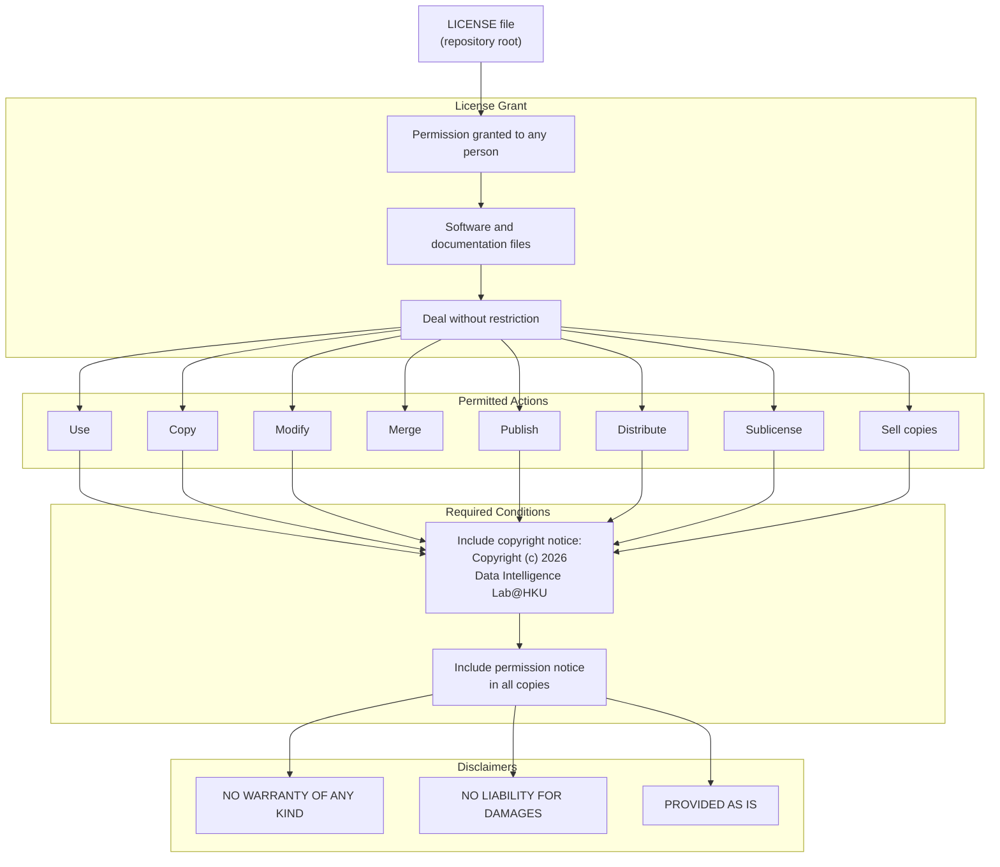
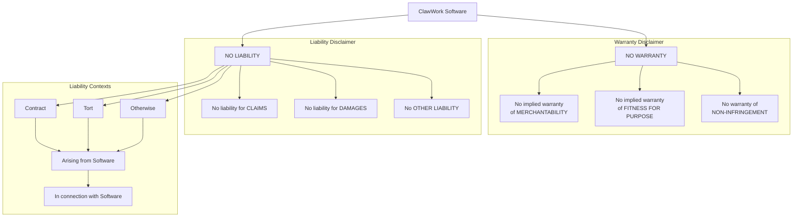
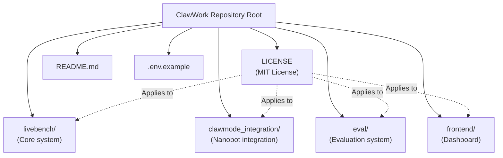

<!-- source: DeepWiki mcp.deepwiki.com · repo HKUDS/ClawWork · page 10.4 License · fetched 2026-11-09 -->

# License

<details>
<summary>Relevant source files</summary>

The following files were used as context for generating this wiki page:

- [LICENSE](LICENSE)

</details>


## Purpose and Scope

This page documents the licensing terms for the ClawWork repository. It presents the MIT License under which ClawWork is distributed, explains the permissions granted to users, and identifies the copyright holder. For information about project structure and file organization, see [Project Structure](#10.1). For information about deployment processes, see [Build and Deployment](#10.3).

---

## License Overview

ClawWork is released under the **MIT License**, one of the most permissive open-source licenses. The copyright is held by **✨Data Intelligence Lab@HKU✨** (The University of Hong Kong).

**License Identifier**: MIT License  
**Copyright Year**: 2026  
**Copyright Holder**: ✨Data Intelligence Lab@HKU✨

Sources: [LICENSE:1-3]()

---

## Full License Text

The complete license text is located in the repository root:

```
MIT License

Copyright (c) 2026 ✨Data Intelligence Lab@HKU✨

Permission is hereby granted, free of charge, to any person obtaining a copy
of this software and associated documentation files (the "Software"), to deal
in the Software without restriction, including without limitation the rights
to use, copy, modify, merge, publish, distribute, sublicense, and/or sell
copies of the Software, and to permit persons to whom the Software is
furnished to do so, subject to the following conditions:

The above copyright notice and this permission notice shall be included in all
copies or substantial portions of the Software.

THE SOFTWARE IS PROVIDED "AS IS", WITHOUT WARRANTY OF ANY KIND, EXPRESS OR
IMPLIED, INCLUDING BUT NOT LIMITED TO THE WARRANTIES OF MERCHANTABILITY,
FITNESS FOR A PARTICULAR PURPOSE AND NONINFRINGEMENT. IN NO EVENT SHALL THE
AUTHORS OR COPYRIGHT HOLDERS BE LIABLE FOR ANY CLAIM, DAMAGES OR OTHER
LIABILITY, WHETHER IN AN ACTION OF CONTRACT, TORT OR OTHERWISE, ARISING FROM,
OUT OF OR IN CONNECTION WITH THE SOFTWARE OR THE USE OR OTHER DEALINGS IN THE
SOFTWARE.
```

Sources: [LICENSE:1-21]()

---

## License Structure

The following diagram shows the key components of the MIT License and their relationships:

**Diagram: MIT License Structure**



Sources: [LICENSE:1-21]()

---

## Permissions Granted

The MIT License grants extensive permissions to anyone who obtains a copy of ClawWork. The following table summarizes the permitted actions:

| Permission | Description | Restrictions |
|------------|-------------|--------------|
| **Use** | Run the software for any purpose | Must include license notice |
| **Copy** | Make copies of the software | Must include license notice |
| **Modify** | Change or extend the software | Must include license notice |
| **Merge** | Combine with other software | Must include license notice |
| **Publish** | Share publicly | Must include license notice |
| **Distribute** | Give copies to others | Must include license notice |
| **Sublicense** | License derivative works under different terms | Must include original license notice |
| **Sell** | Sell copies of the software | Must include license notice |

**Key Points**:
- All permissions are granted **free of charge**
- Permissions apply to both the original software and modified versions
- No restrictions on commercial use
- No patent grant or protection (unlike Apache 2.0)

Sources: [LICENSE:5-10]()

---

## Required Conditions

The MIT License imposes minimal conditions on usage. Users must comply with the following requirements:

### Copyright Notice Requirement

The copyright notice must be included in all copies or substantial portions of the software:

```
Copyright (c) 2026 ✨Data Intelligence Lab@HKU✨
```

**Location**: [LICENSE:3]()

### Permission Notice Requirement

The full permission statement (lines 5-10 of the LICENSE file) must be included alongside the copyright notice in all copies or substantial portions.

**Practical Implementation**:
- Include the full LICENSE file in distributions
- Retain the LICENSE file in derivative works
- Include license attribution in documentation
- Reference the license in software metadata (e.g., `package.json`, `pyproject.toml`)

Sources: [LICENSE:10-13]()

---

## Disclaimers and Limitations

The MIT License includes important disclaimers that protect the copyright holder from liability:

**Diagram: Warranty and Liability Structure**



### Warranty Disclaimer

The software is provided **"AS IS"** with **NO WARRANTY OF ANY KIND**, including:

- **No Express Warranty**: No guarantees about performance or suitability
- **No Implied Warranty of MERCHANTABILITY**: No guarantee the software will work correctly
- **No Implied Warranty of FITNESS FOR A PARTICULAR PURPOSE**: No guarantee it will meet specific needs
- **No Warranty of NON-INFRINGEMENT**: No guarantee it won't infringe third-party rights

**Location**: [LICENSE:15-17]()

### Liability Disclaimer

The copyright holders and contributors are **NOT LIABLE** for:

- **Claims**: Any legal claims arising from the software
- **Damages**: Any damages (direct, indirect, special, incidental, consequential)
- **Other Liability**: Any other form of liability

This applies whether the liability arises from:
- **Contract**: Contractual relationships
- **Tort**: Civil wrongs (negligence, etc.)
- **Otherwise**: Any other legal theory

**Location**: [LICENSE:17-20]()

Sources: [LICENSE:15-21]()

---

## Copyright Holder Information

The copyright for ClawWork is held by:

**Organization**: ✨Data Intelligence Lab@HKU✨  
**Affiliation**: The University of Hong Kong (HKU)  
**Copyright Year**: 2026

The decorative sparkle emojis (✨) are part of the official copyright holder name as specified in the LICENSE file.

Sources: [LICENSE:3]()

---

## Usage in Different Contexts

The following table shows how the MIT License applies to different usage scenarios:

| Scenario | Permitted? | Requirements | Notes |
|----------|-----------|--------------|-------|
| **Use ClawWork for research** | ✅ Yes | Include LICENSE file | No restrictions on research use |
| **Modify ClawWork code** | ✅ Yes | Include LICENSE file | Can create derivative works freely |
| **Deploy ClawWork internally** | ✅ Yes | Include LICENSE file | Private deployment allowed |
| **Deploy ClawWork as SaaS** | ✅ Yes | Include LICENSE file | Commercial use permitted |
| **Bundle ClawWork in product** | ✅ Yes | Include LICENSE file | Distribution permitted |
| **Sell ClawWork copies** | ✅ Yes | Include LICENSE file | Commercial sale permitted |
| **Relicense derivatives** | ✅ Yes | Include original LICENSE | Can sublicense under different terms |
| **Create proprietary derivatives** | ✅ Yes | Include original LICENSE | Can close source derivative works |
| **Remove copyright notice** | ❌ No | N/A | Violates license conditions |
| **Claim warranty or sue** | ❌ No | N/A | Liability is disclaimed |

---

## License File Location in Repository

The LICENSE file is located at the repository root:

**Diagram: License File in Repository Structure**



**File Path**: [LICENSE:1-21]()

The LICENSE file applies to all components of the repository, including:
- Core ClawWork system in `livebench/`
- ClawMode integration in `clawmode_integration/`
- Evaluation system in `eval/`
- Dashboard frontend in `frontend/`
- Scripts in `scripts/`
- Documentation and configuration files

Sources: [LICENSE:1-21]()

---

## Comparison with Other Licenses

The following table compares the MIT License with other common open-source licenses:

| Feature | MIT | Apache 2.0 | GPL v3 | BSD 3-Clause |
|---------|-----|------------|--------|--------------|
| **Permissive** | ✅ Yes | ✅ Yes | ❌ No (copyleft) | ✅ Yes |
| **Patent Grant** | ❌ No | ✅ Yes | ✅ Yes | ❌ No |
| **Copyleft** | ❌ No | ❌ No | ✅ Yes | ❌ No |
| **Commercial Use** | ✅ Yes | ✅ Yes | ✅ Yes | ✅ Yes |
| **Proprietary Derivatives** | ✅ Yes | ✅ Yes | ❌ No | ✅ Yes |
| **License Length** | ~20 lines | ~200 lines | ~600 lines | ~25 lines |
| **Attribution Required** | ✅ Yes | ✅ Yes | ✅ Yes | ✅ Yes |

**Why MIT for ClawWork**:
- **Simplicity**: Short, easy to understand license
- **Permissiveness**: Maximum flexibility for users
- **Compatibility**: Compatible with most other licenses
- **Industry Standard**: Widely accepted and understood

---

## Frequently Asked Questions

### Can I use ClawWork in a commercial product?

**Yes**. The MIT License explicitly permits commercial use, including selling copies or incorporating ClawWork into commercial products. You must include the copyright notice and permission notice.

Sources: [LICENSE:5-10]()

### Do I need to open-source my modifications?

**No**. Unlike GPL, the MIT License does not require you to open-source derivative works. You can create proprietary modifications as long as you include the original license notice.

Sources: [LICENSE:5-10]()

### Can I remove the copyright notice?

**No**. The only mandatory condition of the MIT License is that the copyright notice and permission notice must be included in all copies or substantial portions of the software.

Sources: [LICENSE:10-13]()

### Does the license grant patent rights?

**No**. Unlike Apache 2.0, the MIT License does not include an explicit patent grant. Users should be aware of potential patent issues independently.

Sources: [LICENSE:1-21]()

### What does "AS IS" mean?

The software is provided in its current state with no guarantees. The copyright holders make no promises about functionality, correctness, or fitness for any purpose.

Sources: [LICENSE:15-17]()

### Am I liable if ClawWork causes damage?

**No**. The license disclaims all liability. The copyright holders are not responsible for any damages arising from the use of ClawWork.

Sources: [LICENSE:17-21]()

---

## Summary

| Aspect | Details |
|--------|---------|
| **License Type** | MIT License (permissive) |
| **Copyright Holder** | ✨Data Intelligence Lab@HKU✨ |
| **Copyright Year** | 2026 |
| **File Location** | [LICENSE:1-21]() |
| **Key Permission** | Use, modify, distribute, sell freely |
| **Key Condition** | Include copyright and license notice |
| **Key Disclaimer** | No warranty, no liability |
| **Commercial Use** | Permitted |
| **Proprietary Derivatives** | Permitted |

Sources: [LICENSE:1-21]()

---

