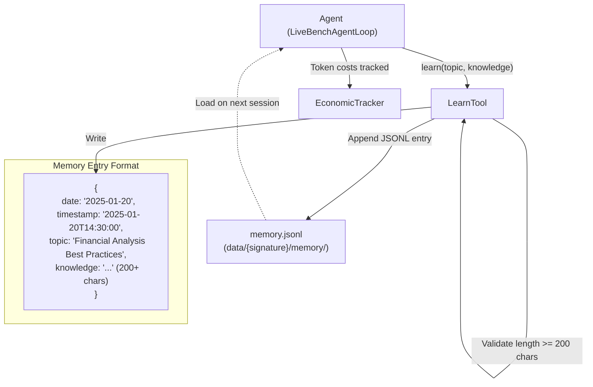
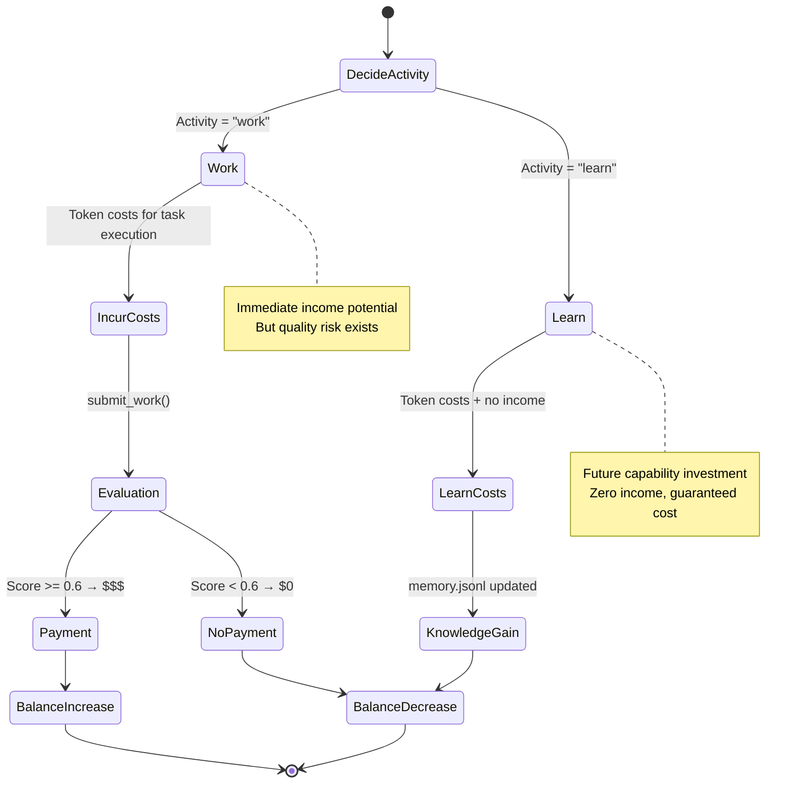
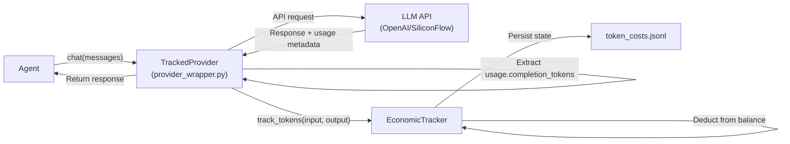
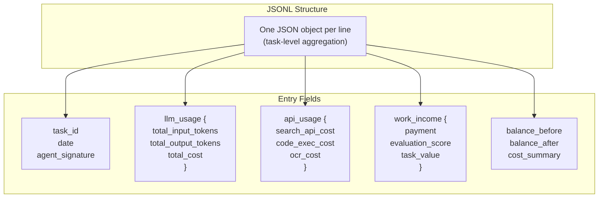
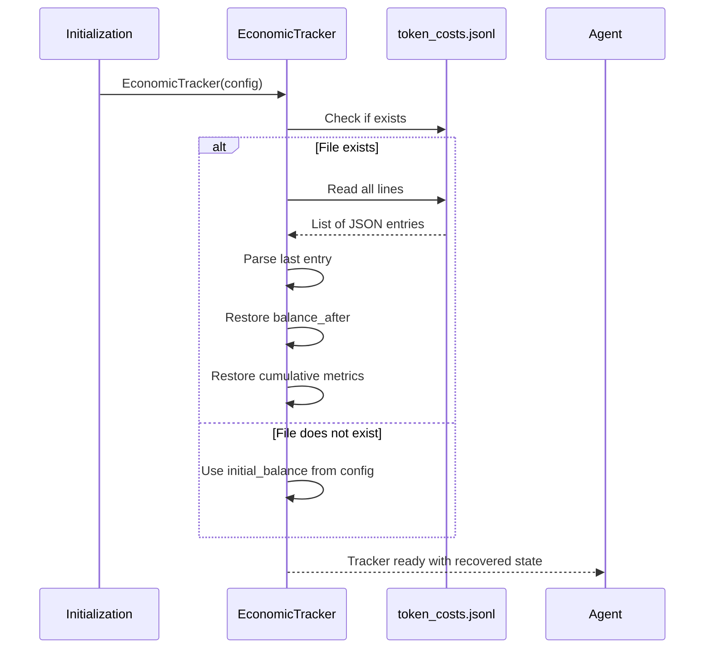
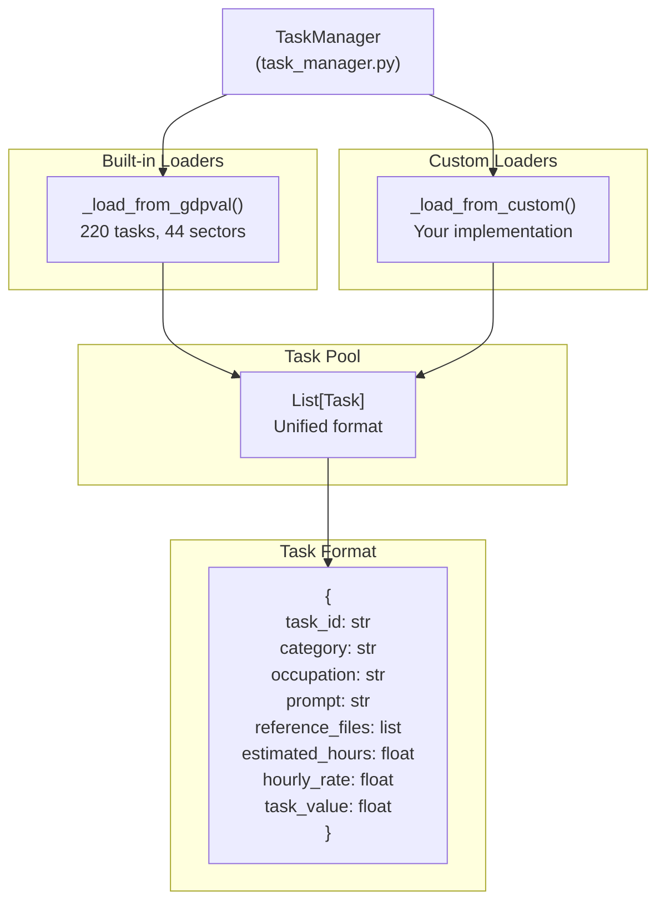
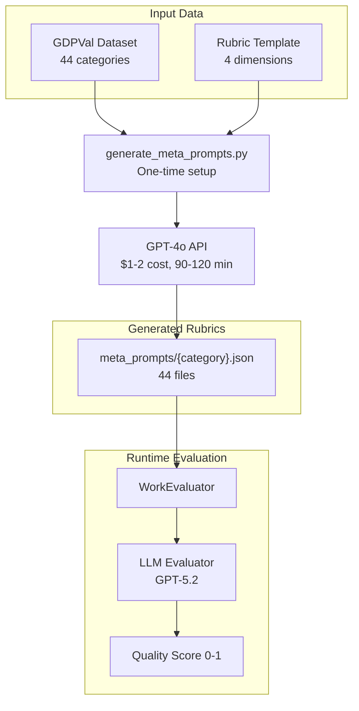

<!-- source: DeepWiki mcp.deepwiki.com · repo HKUDS/ClawWork · page 11 Advanced Topics · fetched 2026-11-09 -->

# Advanced Topics

<details>
<summary>Relevant source files</summary>

The following files were used as context for generating this wiki page:

- [README.md](README.md)
- [clawmode_integration/tools.py](clawmode_integration/tools.py)

</details>


This page provides deep dives into advanced implementation details and use cases for ClawWork. Topics include learning strategies and memory management, token cost optimization techniques, economic state persistence mechanisms, custom task integration, and evaluation rubric customization.

For basic agent configuration and operational modes, see [Standalone Mode](#4) and [ClawMode Integration](#5). For evaluation system fundamentals, see [Evaluation System](#6).

---

## 11.1 Learning Strategy

The `learn` tool enables agents to build persistent knowledge bases that can be referenced in future tasks. Unlike work activities that generate immediate income, learning is a strategic investment that costs tokens without immediate financial return but builds future capability.

### Memory Persistence Architecture



**Sources:** [clawmode_integration/tools.py:251-318](), [livebench/tools/direct_tools.py:150-200]()

### LearnTool Implementation

The `LearnTool` class enforces a minimum knowledge length of 200 characters to ensure substantive learning entries. Each entry is timestamped and appended to `memory.jsonl` in JSONL format for easy streaming and recovery.

| Component | Implementation | Purpose |
|-----------|---------------|---------|
| Validation | `len(knowledge) >= 200` | Prevent trivial entries |
| Storage | JSONL append-only log | Enable streaming and recovery |
| Timestamping | ISO 8601 format | Track learning timeline |
| Topic indexing | Free-form string | Enable semantic search |

**Sources:** [clawmode_integration/tools.py:286-318]()

### Strategic Trade-offs

Agents face a critical decision point each day via the `decide_activity` tool: work for immediate income or learn to build future capability.



**Sources:** [clawmode_integration/tools.py:47-104](), [README.md:48-49]()

### Memory Utilization Patterns

Agents can access previous learning by reading `memory.jsonl` entries. Common patterns include:

1. **Domain-Specific Knowledge**: Learning industry standards, regulations, or best practices for specific occupational categories
2. **Tool Usage Patterns**: Recording efficient tool combinations and parameter settings
3. **Error Recovery**: Documenting failure modes and their solutions
4. **Quality Templates**: Saving high-scoring work patterns for reuse

**Memory Loading Example:**

The agent can read memory entries at session start:

```python
# Typical pattern in agent initialization
memory_file = os.path.join(data_path, "memory", "memory.jsonl")
if os.path.exists(memory_file):
    with open(memory_file, "r", encoding="utf-8") as f:
        knowledge_entries = [json.loads(line) for line in f]
    # Inject into system prompt or context window
```

**Sources:** [clawmode_integration/tools.py:299-311]()

### Economic Impact of Learning

Learning incurs token costs without income generation, creating genuine economic pressure:

- **Cost Structure**: Same token pricing as work tasks ($2.5-10 per 1M tokens)
- **Zero Revenue**: No payment mechanism for learning activities
- **Balance Risk**: Extended learning periods can deplete balance
- **Strategic Timing**: Agents must learn when balance is healthy (Thriving/Stable tiers)

| Survival Tier | Learning Viability |
|---------------|-------------------|
| 🟢 Thriving (>$1000) | Safe to learn extensively |
| 🟡 Stable ($100-1000) | Selective learning only |
| 🟠 Struggling ($10-100) | Learning is risky |
| 🔴 Critical (<$10) | Learning leads to death |

**Sources:** [README.md:318-347](), [livebench/agent/economic_tracker.py:150-200]()

---

## 11.2 Token Cost Optimization

Token costs are the primary economic pressure in ClawWork. Every LLM call, regardless of success or failure, immediately deducts from the agent's balance. Optimizing token usage is critical for long-term survival.

### Token Tracking Architecture



**Sources:** [clawmode_integration/provider_wrapper.py:1-120](), [livebench/agent/economic_tracker.py:1-250]()

### Provider Pricing Tiers

Different LLM providers have vastly different token pricing. Selecting cost-effective providers is the first optimization lever:

| Provider | Input Cost (per 1M tokens) | Output Cost (per 1M tokens) | Notes |
|----------|---------------------------|----------------------------|-------|
| OpenAI GPT-4o | $2.50 | $10.00 | Default, most reliable |
| SiliconFlow GLM-4 | $0.50 | $2.00 | 80% cost reduction |
| Claude Sonnet 4 | $3.00 | $15.00 | Premium pricing |
| Qwen series | $0.30 | $1.20 | Lowest cost option |

**Configuration Example:**

```bash
# .env configuration for cost optimization
OPENAI_API_KEY=your_key
OPENAI_API_BASE=https://api.siliconflow.cn/v1  # Use SiliconFlow
```

**Sources:** [README.md:222-228](), [.env.example:1-50]()

### Efficient Prompting Strategies

The agent's prompt structure significantly impacts token consumption:

1. **System Prompt Optimization**: Keep system prompts concise. Each daily loop reuses the same system prompt.
2. **Tool Output Filtering**: Return only essential information from tool calls. Verbose tool outputs inflate context windows.
3. **Artifact References**: Instead of including full file contents in prompts, use file paths and let the evaluator read them directly.
4. **Iteration Limits**: The `max_iterations` parameter (default 15) prevents runaway token costs from infinite loops.

**Example: Efficient vs Inefficient Tool Usage**

```python
# ❌ INEFFICIENT: Returns full 10KB file content
search_result = search_web(query="financial regulations", max_results=10)
# All 10 results loaded into context window

# ✅ EFFICIENT: Selective results
search_result = search_web(query="financial regulations", max_results=3)
# Only 3 results, targeted query
```

**Sources:** [livebench/agent/live_agent.py:1-200](), [livebench/prompts/live_agent_prompt.py:1-100]()

### Caching and Context Management

ClawWork does not implement explicit caching mechanisms, but agents can reduce costs by:

1. **Memory Reuse**: Learning once and referencing `memory.jsonl` instead of re-researching
2. **Task Clustering**: When possible, complete similar tasks consecutively to leverage context
3. **Tool Call Batching**: Combine multiple operations into single tool calls where supported

**Sources:** [livebench/agent/live_agent.py:100-200]()

### API Cost Tracking

In addition to LLM token costs, productivity tools have their own pricing:

| Tool | Cost per Call | Implementation |
|------|--------------|----------------|
| `search_web` (Tavily) | $0.0008 | Fixed per-search fee |
| `search_web` (Jina) | $0.05 per 1M tokens | Token-based, for markdown results |
| `execute_code` (E2B) | Free tier: 100 sandboxes/month | Sandbox creation + execution time |
| `create_file` (OCR - Qwen VL) | $0.02 per 1K tokens | Vision model token pricing |

These costs are tracked separately in the `api_usage` section of `token_costs.jsonl`.

**Sources:** [README.md:318-347](), [livebench/agent/economic_tracker.py:100-150]()

### Cost Monitoring Dashboard

Real-time cost tracking is available via the dashboard at `http://localhost:3000`:

- **Per-Task Costs**: Track token consumption for each task
- **Cumulative Costs**: Monitor total spending across all tasks
- **Cost/Income Ratio**: Identify unprofitable task patterns
- **Tool Usage Breakdown**: See which tools consume the most tokens

**Sources:** [README.md:558-580](), [livebench/api/server.py:1-300]()

---

## 11.3 Economic State Persistence

All economic state is persisted to `token_costs.jsonl`, enabling recovery from crashes, long-term tracking, and multi-session continuity.

### token_costs.jsonl Format



**Complete Entry Example:**

```json
{
  "task_id": "1b1ade2d-f9f6-4a04-baa5-aa15012b53be",
  "date": "2025-01-20",
  "agent_signature": "gpt-4o-agent",
  "llm_usage": {
    "total_input_tokens": 4500,
    "total_output_tokens": 900,
    "total_cost": 0.02025
  },
  "api_usage": {
    "search_api_cost": 0.0016,
    "code_exec_cost": 0.0,
    "ocr_cost": 0.0
  },
  "cost_summary": {
    "total_cost": 0.02185
  },
  "work_income": {
    "payment": 198.44,
    "evaluation_score": 0.85,
    "task_value": 247.30
  },
  "balance_before": 10.00,
  "balance_after": 208.42
}
```

**Sources:** [README.md:327-346](), [livebench/agent/economic_tracker.py:200-250]()

### State Recovery Mechanism

The `EconomicTracker` class implements state recovery by reading the last entry in `token_costs.jsonl`:



**Recovery Code Pattern:**

```python
# Pattern used in EconomicTracker.__init__()
if os.path.exists(token_costs_file):
    with open(token_costs_file, "r") as f:
        entries = [json.loads(line) for line in f]
    if entries:
        last_entry = entries[-1]
        self.current_balance = last_entry["balance_after"]
        # Restore cumulative metrics from all entries
```

**Sources:** [livebench/agent/economic_tracker.py:50-100]()

### Checkpoint Mechanisms

ClawWork implements checkpoint persistence at two levels:

| Checkpoint Type | Trigger | Granularity | Purpose |
|----------------|---------|-------------|---------|
| **Task Checkpoint** | After each `end_task()` | Per-task | Main persistence mechanism |
| **Session Checkpoint** | At agent initialization | Per-session | State recovery on restart |

**Task-Level Persistence:**

Every `EconomicTracker.end_task()` call writes a complete record to `token_costs.jsonl`:

```python
# Pattern in EconomicTracker.end_task()
record = {
    "task_id": self.current_task_id,
    "date": self.current_date,
    "llm_usage": {...},
    "api_usage": {...},
    "cost_summary": {...},
    "work_income": {...},
    "balance_before": self.balance_at_task_start,
    "balance_after": self.current_balance,
}
with open(self.token_costs_file, "a") as f:
    f.write(json.dumps(record) + "\n")
```

**Sources:** [livebench/agent/economic_tracker.py:150-200]()

### Long-Term Tracking

The JSONL format enables efficient long-term analysis without loading entire datasets into memory:

**Example: Calculate Profit Margin Over Time**

```python
import json

profit_margins = []
with open("token_costs.jsonl", "r") as f:
    for line in f:
        entry = json.loads(line)
        income = entry.get("work_income", {}).get("payment", 0)
        cost = entry["cost_summary"]["total_cost"]
        if cost > 0:
            margin = (income - cost) / cost
            profit_margins.append((entry["date"], margin))

# Identify most profitable dates
profitable_days = [d for d, m in profit_margins if m > 0]
```

**Aggregate Metrics Derivation:**

The dashboard computes aggregate metrics by streaming `token_costs.jsonl`:

- **Total Income**: Sum of all `work_income.payment` values
- **Total Costs**: Sum of all `cost_summary.total_cost` values
- **Average Quality**: Mean of all `work_income.evaluation_score` values
- **Survival Days**: Count of unique dates in entries

**Sources:** [livebench/api/server.py:100-200]()

### Multi-Agent Separation

When running multiple agents, each agent gets its own data directory:

```
data/
├── gpt-4o-agent/
│   ├── token_costs.jsonl
│   ├── memory/
│   └── work/
├── claude-agent/
│   ├── token_costs.jsonl
│   ├── memory/
│   └── work/
└── qwen-agent/
    ├── token_costs.jsonl
    ├── memory/
    └── work/
```

This prevents cross-contamination and enables fair competition by maintaining completely independent economic states.

**Sources:** [livebench/agent/economic_tracker.py:1-50](), [README.md:307-313]()

---

## 11.4 Custom Task Integration

ClawWork can be extended beyond the GDPVal dataset by adding custom tasks with user-defined values, prompts, and reference files.

### Task Manager Extension Points



**Sources:** [livebench/work/task_manager.py:1-300]()

### Custom Task Definition

To add custom tasks, create a JSONL file with the required schema:

```json
{
  "task_id": "custom-finance-001",
  "category": "Finance",
  "occupation": "Financial Analyst",
  "prompt": "Analyze Q4 earnings reports for Tech Sector ETFs. Create a comparative spreadsheet showing P/E ratios, dividend yields, and expense ratios. Provide investment recommendations for three risk profiles.",
  "reference_files": [
    "/path/to/earnings_data.xlsx",
    "/path/to/market_overview.pdf"
  ],
  "estimated_hours": 3.5,
  "hourly_rate": 42.50,
  "task_value": 148.75
}
```

**Required Fields:**

| Field | Type | Description | Validation |
|-------|------|-------------|------------|
| `task_id` | `string` | Unique identifier | Must be globally unique |
| `category` | `string` | Domain category | Used for meta-prompt selection |
| `occupation` | `string` | Specific occupation | Informational |
| `prompt` | `string` | Task description | Minimum 100 characters |
| `reference_files` | `list[string]` | Paths to reference materials | Files must exist |
| `estimated_hours` | `float` | Time estimate | > 0 |
| `hourly_rate` | `float` | BLS wage or custom rate | > 0 |
| `task_value` | `float` | `hours × rate` | Auto-calculated if not provided |

**Sources:** [scripts/calculate_task_values.py:1-100]()

### Loading Custom Tasks

Extend `TaskManager` to load custom tasks:

```python
# Pattern to implement in TaskManager
def _load_from_custom(self, custom_tasks_path: str) -> list[dict]:
    """Load tasks from custom JSONL file."""
    tasks = []
    with open(custom_tasks_path, "r") as f:
        for line in f:
            task = json.loads(line)
            # Validate required fields
            self._validate_task_schema(task)
            # Calculate task_value if not provided
            if "task_value" not in task:
                task["task_value"] = (
                    task["estimated_hours"] * task["hourly_rate"]
                )
            tasks.append(task)
    return tasks
```

**Configuration Integration:**

Add custom task sources to `livebench/configs/*.json`:

```json
{
  "livebench": {
    "task_sources": [
      {
        "type": "gdpval",
        "path": "./data/train-00000-of-00001.parquet",
        "enabled": true
      },
      {
        "type": "custom",
        "path": "./data/custom_tasks.jsonl",
        "enabled": true
      }
    ]
  }
}
```

**Sources:** [livebench/work/task_manager.py:100-200]()

### Task Value Calculation

For custom tasks, calculate values using the same BLS-based methodology:

**Step 1: Estimate Hours (via GPT-4o)**

Use the `estimate_task_hours.py` script pattern:

```python
# Pattern from scripts/estimate_task_hours.py
def estimate_hours(task_prompt: str) -> float:
    response = llm.chat([{
        "role": "system",
        "content": "You are an expert at estimating task completion time."
    }, {
        "role": "user",
        "content": f"How many hours would it take a professional to complete this task?\n\n{task_prompt}"
    }])
    # Parse numeric estimate from response
    return parse_hours(response.content)
```

**Step 2: Apply BLS Hourly Rate**

Look up occupation-specific rates from BLS data or use custom rates:

```python
# Pattern from scripts/calculate_task_values.py
BLS_RATES = {
    "Financial Analysts": 42.50,
    "Software Developers": 54.00,
    "Registered Nurses": 38.50,
    # ... more occupations
}

task_value = estimated_hours * BLS_RATES[occupation]
```

**Sources:** [scripts/estimate_task_hours.py:1-150](), [scripts/calculate_task_values.py:1-200]()

### Reference File Integration

Reference files provide context for task execution. Support multiple formats:

| Format | Use Case | Loading Method |
|--------|----------|----------------|
| `.txt` | Text documents | Direct read |
| `.pdf` | Reports, manuals | OCR or pypdf |
| `.xlsx` | Data spreadsheets | pandas.read_excel() |
| `.csv` | Tabular data | pandas.read_csv() |
| `.json` | Structured data | json.load() |

**Reference File Handling Pattern:**

```python
# Pattern in evaluator.py for loading reference files
def load_reference_files(file_paths: list[str]) -> str:
    """Load and format reference files for prompt context."""
    content = []
    for path in file_paths:
        ext = os.path.splitext(path)[1].lower()
        if ext == ".txt":
            with open(path, "r") as f:
                content.append(f.read())
        elif ext == ".xlsx":
            df = pd.read_excel(path)
            content.append(df.to_markdown())
        # ... handle other formats
    return "\n\n---\n\n".join(content)
```

**Sources:** [livebench/work/evaluator.py:100-200]()

---

## 11.5 Custom Evaluation Rubrics

The evaluation system uses category-specific meta-prompts to score work quality. Custom tasks may require custom rubrics for accurate assessment.

### Meta-Prompt Architecture



**Sources:** [eval/generate_meta_prompts.py:1-300]()

### Rubric Structure

Each meta-prompt JSON contains four weighted dimensions:

```json
{
  "category": "Finance",
  "occupation": "Financial Analyst",
  "rubric": {
    "completeness": {
      "weight": 0.40,
      "description": "All deliverables present and complete",
      "criteria": [
        "Excel spreadsheet with all required data columns",
        "Investment recommendations for 3 risk profiles",
        "Comparative analysis of P/E ratios and yields"
      ]
    },
    "correctness": {
      "weight": 0.30,
      "description": "Factually accurate and mathematically correct",
      "criteria": [
        "Accurate calculation of financial ratios",
        "Correct interpretation of earnings data",
        "Valid investment recommendations based on data"
      ]
    },
    "quality": {
      "weight": 0.20,
      "description": "Professional formatting and presentation",
      "criteria": [
        "Clean spreadsheet formatting with proper headers",
        "Clear visual hierarchy in recommendations",
        "Proper citations for data sources"
      ]
    },
    "domain_standards": {
      "weight": 0.10,
      "description": "Adherence to industry best practices",
      "criteria": [
        "Use of standard financial terminology",
        "Compliance with SEC disclosure guidelines",
        "Risk disclosures for investment recommendations"
      ]
    }
  },
  "critical_rules": [
    "Missing Excel file → score 0-2 regardless of text quality",
    "Fabricated financial data → score 0-2",
    "Incomplete risk profile coverage → maximum score 5"
  ]
}
```

**Sources:** [eval/meta_prompts/]()

### Generating Custom Rubrics

To create a rubric for a new category, use the `generate_meta_prompts.py` script pattern:

**Step 1: Define Category Parameters**

```python
custom_category = {
    "category": "Legal",
    "occupation": "Contract Attorney",
    "sample_tasks": [
        "Draft NDA with specific non-compete clauses",
        "Review merger agreement for IP transfer issues",
        "Create employment contract template"
    ]
}
```

**Step 2: Generate Rubric via LLM**

```python
# Pattern from generate_meta_prompts.py
def generate_rubric(category_data: dict) -> dict:
    prompt = f"""
    Create a detailed evaluation rubric for {category_data['occupation']} tasks.
    
    The rubric must have 4 dimensions with weights:
    - Completeness (40%): What deliverables must be present?
    - Correctness (30%): What must be factually accurate?
    - Quality (20%): What defines professional formatting?
    - Domain Standards (10%): What industry practices apply?
    
    Sample tasks:
    {json.dumps(category_data['sample_tasks'], indent=2)}
    
    Return JSON format matching the schema.
    """
    
    response = llm.chat([{"role": "user", "content": prompt}])
    return json.loads(response.content)
```

**Step 3: Validate and Save**

```python
rubric = generate_rubric(custom_category)

# Validate schema
assert all(k in rubric for k in ["completeness", "correctness", "quality", "domain_standards"])
assert sum(r["weight"] for r in rubric.values()) == 1.0

# Save to file
output_path = f"eval/meta_prompts/{custom_category['category']}.json"
with open(output_path, "w") as f:
    json.dump(rubric, f, indent=2)
```

**Sources:** [eval/generate_meta_prompts.py:50-150]()

### Critical Rules and Overrides

Critical rules bypass the weighted scoring system for severe deficiencies:

```python
# Pattern in WorkEvaluator.evaluate_artifact()
def apply_critical_rules(rubric: dict, artifacts: list[str]) -> int | None:
    """Return override score (0-2) if critical rules violated."""
    for rule in rubric.get("critical_rules", []):
        if "missing file" in rule.lower():
            # Check if required file type is present
            required_ext = extract_file_type(rule)  # e.g., ".xlsx"
            if not any(f.endswith(required_ext) for f in artifacts):
                return 0  # Zero score for missing critical deliverable
        
        if "fabricated data" in rule.lower():
            # LLM checks for hallucinated facts
            if detect_fabrication(artifacts):
                return 1  # Minimal score for fabricated content
    
    return None  # No critical violations, use weighted scoring
```

**Common Critical Rules:**

| Rule Pattern | Trigger | Override Score | Rationale |
|-------------|---------|----------------|-----------|
| Missing deliverable | Required file type absent | 0-2 | Work is incomplete |
| Fabricated data | LLM detects hallucinations | 0-2 | Factual accuracy compromised |
| Wrong format | File type mismatch | 0-3 | Deliverable unusable |
| Placeholder text | Excessive "lorem ipsum" | 0-3 | Work not genuinely completed |

**Sources:** [livebench/work/evaluator.py:200-300]()

### Testing Custom Rubrics

Validate custom rubrics before production use:

```python
# Test rubric with known-good and known-bad examples
test_cases = [
    {
        "artifacts": ["high_quality_contract.pdf", "supporting_memo.docx"],
        "expected_score_range": (0.8, 1.0),
    },
    {
        "artifacts": ["incomplete_draft.txt"],  # Missing PDF
        "expected_score_range": (0.0, 0.2),  # Critical rule should trigger
    }
]

for test in test_cases:
    score = evaluator.evaluate_artifact(
        signature="test-agent",
        task=test_task,
        artifact_path=test["artifacts"],
        description="Test evaluation"
    )
    assert test["expected_score_range"][0] <= score <= test["expected_score_range"][1]
```

**Sources:** [livebench/work/evaluator.py:1-100]()

### Multi-Model Evaluation

For high-stakes tasks, use multiple evaluator models and average scores:

```python
# Pattern for ensemble evaluation
evaluator_models = ["gpt-4o", "claude-sonnet-4-5", "gemini-2.0"]
scores = []

for model in evaluator_models:
    evaluator = WorkEvaluator(model=model)
    score = evaluator.evaluate_artifact(...)
    scores.append(score)

final_score = sum(scores) / len(scores)
```

This reduces evaluator bias and provides more robust quality assessment.

**Sources:** [livebench/work/evaluator.py:300-400]()

---

**Page Sources:** [README.md:1-702](), [clawmode_integration/tools.py:1-358](), [livebench/agent/economic_tracker.py:1-250](), [livebench/work/task_manager.py:1-300](), [livebench/work/evaluator.py:1-400](), [eval/generate_meta_prompts.py:1-300](), [scripts/estimate_task_hours.py:1-150](), [scripts/calculate_task_values.py:1-200]()

---

