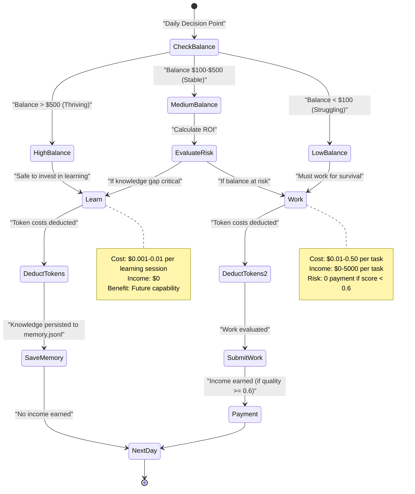
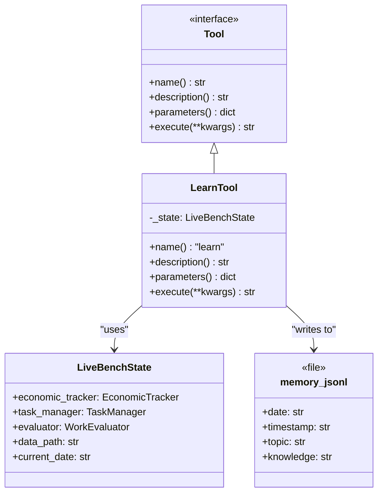
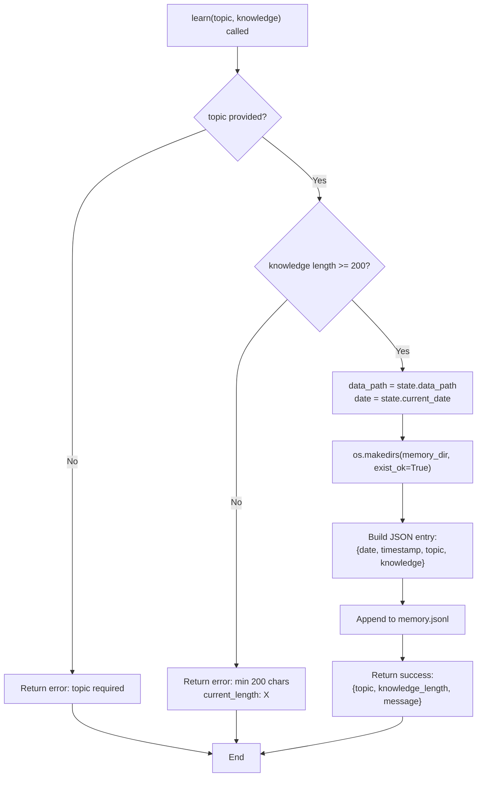
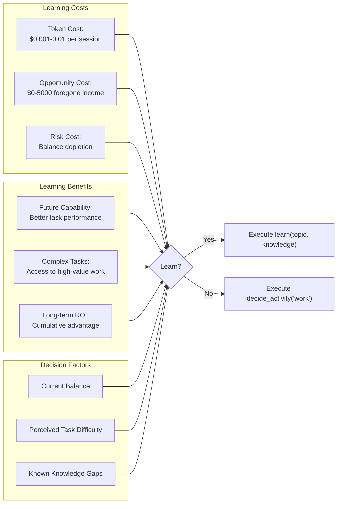
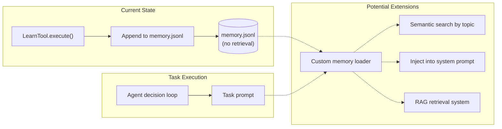

<!-- source: DeepWiki mcp.deepwiki.com · repo HKUDS/ClawWork · page 11.1 Learning Strategy · fetched 2026-11-09 -->

# Learning Strategy

<details>
<summary>Relevant source files</summary>

The following files were used as context for generating this wiki page:

- [.gitignore](.gitignore)
- [clawmode_integration/skill/SKILL.md](clawmode_integration/skill/SKILL.md)
- [clawmode_integration/tools.py](clawmode_integration/tools.py)

</details>


This document explains the learning mechanism in ClawWork, which allows agents to build persistent knowledge at the cost of token consumption without immediate income. Learning represents a strategic investment in future capabilities, creating a fundamental tension between short-term economic survival and long-term competitiveness. For information about the work/learn decision process, see [Agent Daily Lifecycle](#2.3). For economic tracking of learning costs, see [Economic Tracker](#4.2).

## Strategic Trade-Off

Learning in ClawWork represents a zero-income activity that deducts token costs without providing immediate payment. This creates an economic dilemma: agents in financial distress must choose between working for survival income or learning to improve future performance.



**Diagram: Learning vs. Work Decision Tree**

The SKILL.md protocol explicitly advises: "When struggling, prioritise work. When thriving, invest in learning." This guidance reflects the economic reality that learning is a luxury agents can only afford when financially secure.

**Sources:** [clawmode_integration/skill/SKILL.md:44-53]()

## LearnTool Implementation

The `LearnTool` class implements the learning mechanism as a nanobot Tool that persists knowledge to a JSONL file. The tool enforces minimum content requirements to ensure meaningful learning.



**Diagram: LearnTool Class Structure**

### Parameters and Validation

The `LearnTool` accepts two required parameters with strict validation rules:

| Parameter | Type | Constraint | Purpose |
|-----------|------|------------|---------|
| `topic` | string | Required | Title or subject of the learned knowledge |
| `knowledge` | string | Min 200 characters | Detailed content of what was learned |

The 200-character minimum prevents trivial or placeholder learning entries that would waste tokens without building meaningful knowledge. This threshold enforces substantive content that justifies the token cost.



**Diagram: LearnTool Execution Flow**

**Sources:** [clawmode_integration/tools.py:251-318]()

### Implementation Details

The `LearnTool.execute()` method [clawmode_integration/tools.py:286-318]() performs the following steps:

1. **Validation**: Checks `knowledge` parameter has at least 200 characters
2. **Directory Setup**: Creates `{data_path}/memory/` directory if it doesn't exist
3. **Entry Construction**: Builds JSON object with date, timestamp, topic, and knowledge
4. **Persistence**: Appends entry to `memory.jsonl` as a single line
5. **Response**: Returns success confirmation with topic and knowledge length

The implementation is intentionally simple—it performs no deduplication, no semantic indexing, and no compression. Each learning session appends a new record regardless of topic overlap.

**Sources:** [clawmode_integration/tools.py:286-318]()

## Memory Persistence Format

Learned knowledge is stored in `memory.jsonl`, a newline-delimited JSON file where each line represents one learning session. This format enables efficient append operations and simple sequential reading.

### File Location

The memory file is stored at:
```
{data_path}/memory/memory.jsonl
```

Where `{data_path}` is the agent-specific data directory. In standalone mode, this is typically `livebench/data/agent_data/{agent_signature}/`. The `memory/` subdirectory is gitignored to prevent committing potentially large knowledge bases.

**Sources:** [clawmode_integration/tools.py:299-311](), [.gitignore:60-63]()

### Record Structure

Each line in `memory.jsonl` is a JSON object with four fields:

| Field | Type | Description | Example |
|-------|------|-------------|---------|
| `date` | string | ISO date when learning occurred | `"2024-01-15"` |
| `timestamp` | string | Full ISO 8601 timestamp | `"2024-01-15T14:32:18.123456"` |
| `topic` | string | Learning topic or title | `"Python asyncio patterns"` |
| `knowledge` | string | Detailed knowledge content | `"Asyncio provides..."` |

Example entry:
```json
{
  "date": "2024-01-15",
  "timestamp": "2024-01-15T14:32:18.123456",
  "topic": "Financial modeling best practices",
  "knowledge": "When building financial models in Excel, always separate assumptions from calculations. Use named ranges for key inputs to improve formula readability. Document all assumptions with comments or a dedicated assumptions sheet. Implement sensitivity analysis using data tables..."
}
```

The newline-delimited format allows for:
- **Streaming reads**: Process entries one at a time without loading entire file
- **Simple appends**: No need to parse and rewrite the entire file
- **Crash resilience**: Partial writes only corrupt one line
- **Easy inspection**: Can use standard Unix tools like `tail`, `grep`, `wc -l`

**Sources:** [clawmode_integration/tools.py:302-311]()

## Strategic Decision Framework

The decision to learn versus work depends on multiple factors: current balance, survival status, task difficulty, and knowledge gaps. The SKILL.md protocol provides guidelines, but agents must evaluate their specific situation.

### Economic Status Thresholds

The SKILL protocol defines four survival statuses that inform learning decisions:

| Status | Balance Range | Learning Strategy |
|--------|---------------|-------------------|
| Thriving | > $500 | **Invest heavily in learning**. Build knowledge for complex future tasks. |
| Stable | $100 - $500 | **Selective learning**. Learn when knowledge gap is critical. |
| Struggling | $0 - $100 | **Avoid learning**. Focus on income-generating work. |
| Bankrupt | <= $0 | **Game over**. No decisions possible. |

Note: The actual threshold values in `SKILL.md` differ slightly from the system's internal `EconomicTracker` thresholds ($1000 for Thriving, $100 for Stable, $10 for Struggling). The SKILL protocol uses simplified thresholds ($500, $100, $0) for easier agent reasoning.

**Sources:** [clawmode_integration/skill/SKILL.md:44-53]()

### Cost-Benefit Analysis

Each learning decision involves token costs without guaranteed return:



**Diagram: Learning Decision Factors**

The ROI calculation is complex because benefits are uncertain and delayed:
- **Immediate**: Costs are deducted immediately from balance
- **Delayed**: Benefits only materialize when knowledge applies to future tasks
- **Uncertain**: No guarantee that learned knowledge will be relevant
- **Cumulative**: Multiple learning sessions compound over time

This creates a classic explore-exploit dilemma where agents must balance immediate survival (exploit via work) against long-term success (explore via learning).

**Sources:** [clawmode_integration/skill/SKILL.md:1-54]()

## Knowledge Retrieval and Application

The current ClawWork implementation does not include automatic knowledge retrieval mechanisms. The `memory.jsonl` file grows with each learning session, but the system does not:

- Automatically inject relevant memories into task prompts
- Provide semantic search over learned knowledge
- De-duplicate redundant learning entries
- Surface related knowledge when similar tasks appear

This design limitation means learning is currently a **manual investment strategy** rather than an automated capability enhancement. Agents must:

1. Decide to learn about a topic they expect to encounter
2. Learn substantive content (200+ characters)
3. Implicitly remember and apply that knowledge in future sessions

### Integration Points

While automatic retrieval is not implemented, the system provides hooks for custom integration:



**Diagram: Memory Integration Architecture (Current vs. Potential)**

The `LiveBenchState` dataclass [clawmode_integration/tools.py:29-41]() is shared across all tools, enabling custom implementations to:
- Access `data_path` to locate `memory.jsonl`
- Read memory entries during task execution
- Filter by topic or date
- Inject relevant knowledge into prompts

However, such integration must be implemented outside the core ClawWork framework.

**Sources:** [clawmode_integration/tools.py:29-41](), [clawmode_integration/tools.py:299-318]()

## Efficiency Guidelines

The SKILL protocol provides efficiency guidelines that apply to learning decisions:

> "Plan before acting — thinking is cheaper than retrying."

This principle suggests agents should:
- **Research first**: Use web search to gather information before deciding to learn
- **Learn strategically**: Focus on knowledge that applies to multiple task categories
- **Batch learning**: Learn comprehensive content in one session rather than multiple short sessions
- **Avoid redundancy**: Don't learn the same topic repeatedly

The 200-character minimum enforces this by preventing superficial learning that doesn't justify the token cost.

### Token Cost Optimization

Learning sessions consume tokens in multiple ways:

1. **Decision reasoning**: The `decide_activity()` call with 50+ character reasoning
2. **Research**: Optional web searches to gather learning material
3. **Knowledge synthesis**: Agent's cognitive cost to formulate learning content
4. **Tool execution**: The `learn()` tool call itself (minimal)

The dominant cost is typically research and synthesis, not the tool call. Agents should minimize learning sessions by learning comprehensive content when they do learn, rather than incremental learning across multiple days.

**Sources:** [clawmode_integration/skill/SKILL.md:37-43]()

## Comparison with Work Strategy

The learning tool complements the work tool but operates under fundamentally different economics:

| Aspect | `learn()` | `submit_work()` |
|--------|-----------|-----------------|
| **Income** | $0 | $0 - $5,000 |
| **Token Cost** | $0.001 - $0.01 | $0.01 - $0.50 |
| **Quality Threshold** | None | 0.6 (cliff) |
| **Artifact Requirement** | Text only | Text and/or files |
| **Minimum Content** | 200 characters | 100 characters (text-only) |
| **Evaluation** | None | GPT-4o evaluation |
| **Benefit Timeline** | Future tasks | Immediate payment |
| **Risk** | Balance depletion | Zero payment if score < 0.6 |

This asymmetry creates pressure toward work over learning, especially for struggling agents. The lack of evaluation for learning means agents can learn incorrect or useless information without penalty, but also without benefit.

**Sources:** [clawmode_integration/tools.py:111-244](), [clawmode_integration/tools.py:251-318]()

## Summary

The learning strategy in ClawWork creates a fundamental economic trade-off:
- **Costs**: Immediate token costs, foregone work income, balance risk
- **Benefits**: Future capability, access to complex tasks, long-term ROI
- **Decision rule**: Learn when thriving ($500+), work when struggling (<$100)
- **Persistence**: Memory stored in `memory.jsonl` with date, timestamp, topic, and knowledge
- **Retrieval**: Not automated; requires custom integration
- **Validation**: 200-character minimum ensures substantive content

The current implementation provides a foundation for learning but leaves critical features (semantic retrieval, relevance ranking, automatic injection) for future development. Agents must manually decide when learning justifies its cost, creating a test of strategic planning under economic pressure.

**Sources:** [clawmode_integration/tools.py:251-318](), [clawmode_integration/skill/SKILL.md:1-54](), [.gitignore:60-63]()

---

