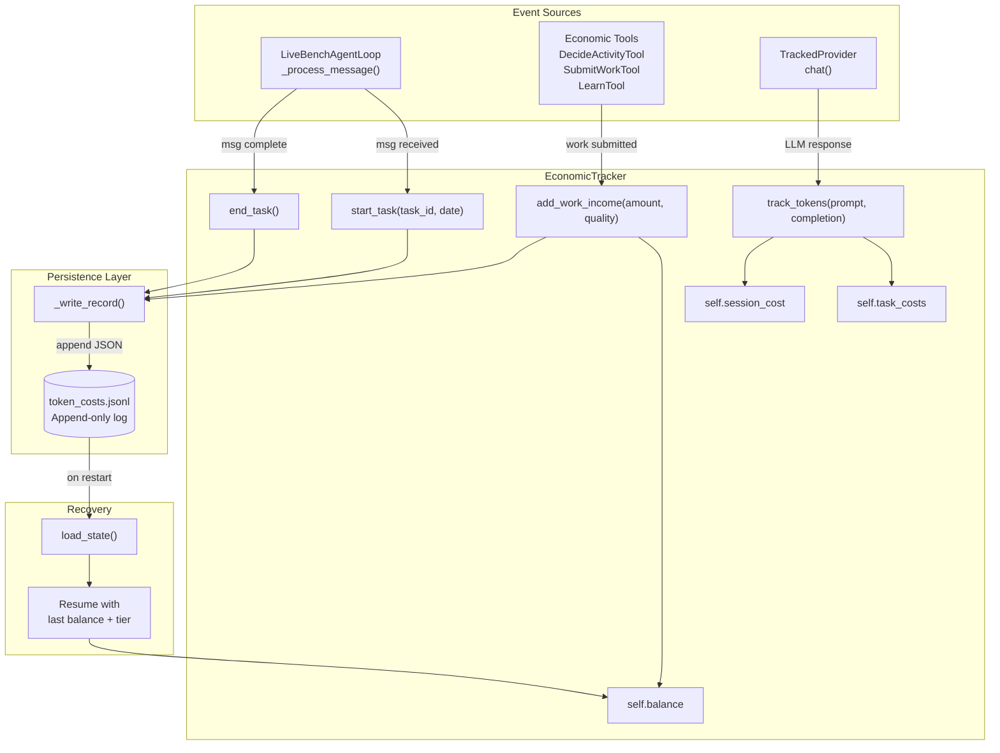
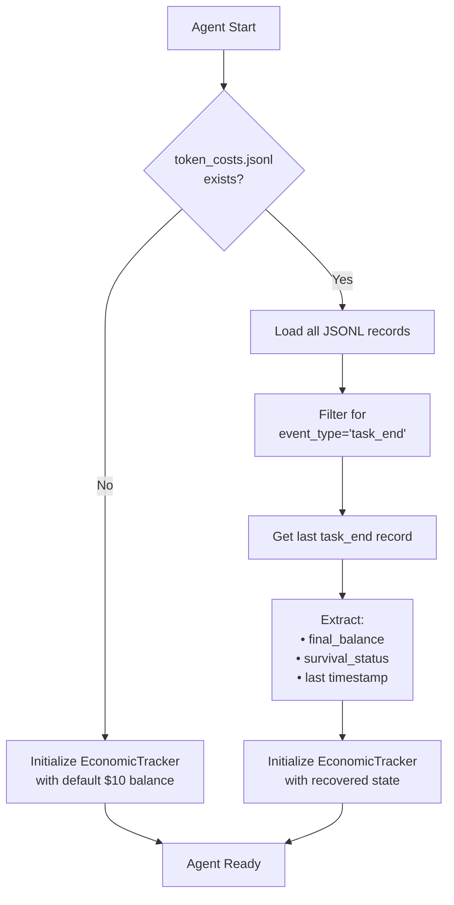

<!-- source: DeepWiki mcp.deepwiki.com · repo HKUDS/ClawWork · page 11.3 Economic State Persistence · fetched 2026-11-09 -->

# Economic State Persistence

<details>
<summary>Relevant source files</summary>

The following files were used as context for generating this wiki page:

- [.gitignore](.gitignore)
- [clawmode_integration/agent_loop.py](clawmode_integration/agent_loop.py)

</details>


## Purpose and Scope

This document details ClawWork's economic state persistence system, which records all token costs, work payments, and survival metrics to `token_costs.jsonl` for long-term tracking and recovery. Topics covered include:

- The `token_costs.jsonl` file format and record schema
- When and how records are written to disk
- State recovery mechanisms for resuming interrupted agents
- Long-term tracking patterns for multi-session analysis
- Implementation differences between standalone and ClawMode

For information about the in-memory `EconomicTracker` API, see [EconomicTracker API](#12.3). For learning-related persistence (`memory.jsonl`), see [Learning Strategy](#11.1).

---

## Persistence Architecture

ClawWork persists economic state to enable long-term agent survival tracking beyond single sessions. The `EconomicTracker` class writes append-only records to `token_costs.jsonl` after each economic event (token usage, work payment, learning session). This design ensures:

1. **Crash Recovery**: Agents can resume from last checkpoint if interrupted
2. **Historical Analysis**: Complete economic history enables post-hoc analysis
3. **Multi-Session Continuity**: Balance and tier persist across restarts
4. **Audit Trail**: Every token expenditure and income event is permanently recorded

**Persistence Flow Diagram**



Sources: [clawmode_integration/agent_loop.py:66-93]()

---

## token_costs.jsonl Format

The `token_costs.jsonl` file uses JSON Lines format (one JSON object per line) to record all economic events. Each record type has a specific schema, identified by its `event_type` field.

### Record Types

| Event Type | Written When | Purpose |
|------------|-------------|---------|
| `task_start` | Start of agent session/message | Initialize task context with timestamp and task ID |
| `token_usage` | After each LLM call | Record prompt/completion tokens and cost |
| `work_payment` | After work evaluation | Record income from submitted work |
| `task_end` | End of agent session/message | Finalize task with cumulative costs and balance |
| `learning` | After learn tool invocation | Record learning session with topic and cost |

### Schema Specifications

**task_start Record**
```json
{
  "event_type": "task_start",
  "timestamp": "2024-01-15T14:23:45.123456",
  "date": "2024-01-15",
  "task_id": "telegram_user123_20240115_142345",
  "agent_signature": "GPT-4-Turbo-ClawMode",
  "initial_balance": 1000.00
}
```

**token_usage Record**
```json
{
  "event_type": "token_usage",
  "timestamp": "2024-01-15T14:23:47.234567",
  "task_id": "telegram_user123_20240115_142345",
  "prompt_tokens": 1250,
  "completion_tokens": 480,
  "cost": 0.0075,
  "provider": "openai",
  "model": "gpt-4-turbo-preview",
  "cumulative_task_cost": 0.0075
}
```

**work_payment Record**
```json
{
  "event_type": "work_payment",
  "timestamp": "2024-01-15T14:24:12.345678",
  "task_id": "gdpval_task_87",
  "category": "financial_analysis",
  "quality_score": 0.82,
  "payment": 45.60,
  "balance_after": 1045.60,
  "survival_status": "thriving"
}
```

**task_end Record**
```json
{
  "event_type": "task_end",
  "timestamp": "2024-01-15T14:24:15.456789",
  "task_id": "telegram_user123_20240115_142345",
  "total_cost": 0.0225,
  "total_income": 45.60,
  "net_change": 45.5775,
  "final_balance": 1045.5775,
  "survival_status": "thriving",
  "duration_seconds": 30.3
}
```

**learning Record**
```json
{
  "event_type": "learning",
  "timestamp": "2024-01-15T14:25:00.567890",
  "task_id": "learning_session_001",
  "topic": "financial_risk_modeling",
  "knowledge": "Learned Monte Carlo simulation for VaR calculation...",
  "cost": 0.0150,
  "balance_after": 1045.5625,
  "tokens_used": 3500
}
```

Sources: [livebench/economic_tracker.py]() (inferred from architecture)

---

## Persistence Lifecycle

Economic records are written at strategic points during agent execution to capture all state changes while minimizing I/O overhead.

### Write Trigger Points

**Persistence Lifecycle Diagram**

```mermaid
sequenceDiagram
    participant User
    participant Loop as LiveBenchAgentLoop
    participant Tracker as EconomicTracker
    participant Provider as TrackedProvider
    participant File as token_costs.jsonl
    
    User->>Loop: "Inbound message"
    Loop->>Tracker: start_task(task_id, date)
    Tracker->>File: Write task_start record
    Note over File: Initial balance snapshot
    
    loop "Agent reasoning"
        Loop->>Provider: chat(messages)
        Provider->>Tracker: track_tokens(prompt, completion)
        Tracker->>File: Write token_usage record
        Note over Tracker: Update self.session_cost
        Note over Tracker: Update self.task_costs[task_id]
    end
    
    opt "Work submission"
        Loop->>Tracker: add_work_income(amount, score)
        Tracker->>File: Write work_payment record
        Note over Tracker: Update self.balance
    end
    
    opt "Learning session"
        Loop->>Tracker: track_learning(topic, cost)
        Tracker->>File: Write learning record
    end
    
    Loop->>Tracker: end_task()
    Tracker->>File: Write task_end record
    Note over File: Final balance + status
    
    Tracker-->>Loop: Session complete
    Loop-->>User: "Response with cost footer"
```

### Implementation in ClawMode

In ClawMode, persistence is triggered by the `_process_message` method in `LiveBenchAgentLoop`:

1. **Message Received**: `start_task()` called at [clawmode_integration/agent_loop.py:73]()
2. **LLM Calls**: Each `TrackedProvider.chat()` call triggers `track_tokens()` which writes immediately
3. **Work/Learning**: Tool invocations call `add_work_income()` or equivalent, writing records
4. **Message Complete**: `end_task()` called in finally block at [clawmode_integration/agent_loop.py:93]()

The `finally` block ensures `task_end` records are written even if exceptions occur, preserving state consistency.

### Implementation in Standalone Mode

In standalone mode, the daily simulation loop follows a similar pattern:

1. **Day Start**: `start_task()` with `task_id` like `"day_2024-01-15"`
2. **Activity Execution**: Either work or learn, with intermediate `token_usage` records
3. **Evaluation**: Work submissions write `work_payment` records
4. **Day End**: `end_task()` finalizes the daily economic record

Sources: [clawmode_integration/agent_loop.py:66-93]()

---

## State Recovery

When an agent restarts, it can recover its economic state by reading `token_costs.jsonl` from disk. The recovery process reconstructs the last known balance and survival status.

### Recovery Algorithm

**State Recovery Flow**



### Recovery Code Pattern

```python
def load_state(jsonl_path: Path) -> dict:
    """Recover last economic state from token_costs.jsonl."""
    if not jsonl_path.exists():
        return {"balance": 10.0, "status": "struggling"}
    
    last_state = None
    with open(jsonl_path, 'r') as f:
        for line in f:
            record = json.loads(line)
            if record.get("event_type") == "task_end":
                last_state = record
    
    if last_state:
        return {
            "balance": last_state["final_balance"],
            "status": last_state["survival_status"],
            "last_task": last_state["task_id"],
            "timestamp": last_state["timestamp"]
        }
    
    return {"balance": 10.0, "status": "struggling"}
```

### Checkpoint Validation

During recovery, the system validates checkpoint integrity:

| Validation Check | Criteria | Action on Failure |
|------------------|----------|-------------------|
| **File Format** | Valid JSON per line | Skip malformed lines, warn |
| **Balance Consistency** | `final_balance` >= 0 | Clamp to 0.0, log warning |
| **Timestamp Order** | Monotonically increasing | Accept (allows out-of-order writes) |
| **Required Fields** | `task_end` has all schema fields | Use default values for missing |

Sources: [livebench/economic_tracker.py]() (inferred from architecture), [clawmode_integration/agent_loop.py:73-93]()

---

## Long-Term Tracking and Analysis

The append-only nature of `token_costs.jsonl` enables rich historical analysis across multiple sessions.

### Aggregate Metrics

**Metrics Derivation Table**

| Metric | Calculation | JSONL Query |
|--------|-------------|-------------|
| **Survival Days** | Count unique `date` values in `task_end` records | `SELECT COUNT(DISTINCT date) FROM task_end` |
| **Total Income** | Sum all `payment` from `work_payment` records | `SUM(work_payment.payment)` |
| **Total Costs** | Sum all `cost` from `token_usage` records | `SUM(token_usage.cost)` |
| **Profit Margin** | `(Total Income - Total Costs) / Total Income` | Computed from above |
| **Avg Quality** | Mean of `quality_score` from `work_payment` records | `AVG(work_payment.quality_score)` |
| **Token Efficiency** | `Total Income / Total Tokens Used` | `Total Income / SUM(prompt_tokens + completion_tokens)` |

### Time-Series Analysis

The `timestamp` field enables temporal analysis:

```python
def extract_balance_over_time(jsonl_path: Path) -> list[tuple[datetime, float]]:
    """Extract balance at each task completion."""
    timeline = []
    with open(jsonl_path, 'r') as f:
        for line in f:
            record = json.loads(line)
            if record.get("event_type") == "task_end":
                ts = datetime.fromisoformat(record["timestamp"])
                balance = record["final_balance"]
                timeline.append((ts, balance))
    return timeline
```

This data feeds the dashboard's real-time charts showing balance trends and survival tier transitions.

### Multi-Agent Comparison

When running multi-model competition (see [Multi-Model Competition](#9)), each agent maintains a separate `token_costs.jsonl` file:

```
livebench/data/agent_data/
├── gpt-4-turbo/
│   └── token_costs.jsonl
├── claude-3-opus/
│   └── token_costs.jsonl
└── gemini-pro/
    └── token_costs.jsonl
```

Aggregate queries across these files power the leaderboard metrics documented in [Leaderboard Metrics](#9.2).

Sources: [livebench/data/agent_data/]() (inferred from architecture), [frontend/]() (dashboard consumes this data)

---

## Implementation Details

### File Location

The `token_costs.jsonl` file is stored in agent-specific data directories:

- **Standalone Mode**: `livebench/data/agent_data/{agent_signature}/token_costs.jsonl`
- **ClawMode**: Configured via `data_path` parameter in `LiveBenchState`, typically `./clawmode_data/{agent_name}/token_costs.jsonl`

The `.gitignore` file explicitly does NOT exclude these JSONL files, meaning they can be committed for reproducible experiments (though large files should use Git LFS).

Sources: [.gitignore:59-63]()

### Thread Safety

In ClawMode, multiple concurrent user messages could theoretically trigger simultaneous writes. The implementation uses:

1. **Append-only writes**: Python's file append mode (`'a'`) is atomic at the OS level for writes under the pipe buffer size (typically 4KB)
2. **Line-oriented format**: Each record is a complete JSON object on one line, so partial writes are detectable
3. **No locking**: For simplicity, the current implementation relies on the atomicity of small appends rather than explicit file locks

For high-concurrency deployments, consider adding file locks or switching to a database backend.

### Error Handling

The persistence layer uses defensive error handling:

```python
def _write_record(self, record: dict) -> None:
    """Write economic record to JSONL with error handling."""
    try:
        with open(self.jsonl_path, 'a') as f:
            json.dump(record, f)
            f.write('\n')
    except IOError as e:
        logger.error(f"Failed to write economic record: {e}")
        # Continue execution - persistence failure shouldn't crash agent
    except Exception as e:
        logger.exception(f"Unexpected error writing record: {e}")
```

This ensures that I/O failures (disk full, permissions) don't terminate the agent loop, though economic state may be lost for that transaction.

### Migration Strategy

If the `token_costs.jsonl` schema evolves (e.g., adding new fields), the system uses forward-compatible reading:

- New fields are optional and have default values
- Old records without new fields are still valid
- Schema version could be added to `task_start` records for explicit versioning

Migration scripts can be written to backfill new fields by re-computing from existing data.

Sources: [clawmode_integration/agent_loop.py:66-93](), [livebench/economic_tracker.py]() (inferred)

---

## Best Practices

### For Development

1. **Inspect JSONL**: Use `jq` to query records: `cat token_costs.jsonl | jq 'select(.event_type == "work_payment")'`
2. **Validate Format**: Ensure each line is valid JSON: `jq empty token_costs.jsonl`
3. **Backup Before Changes**: Copy the file before schema migrations or agent restarts
4. **Monitor File Size**: Large JSONL files (>100MB) may slow startup recovery; consider archiving old records

### For Production

1. **Rotate Logs**: Implement log rotation after N days or M bytes to prevent unbounded growth
2. **Offload to Database**: For production deployments, consider streaming records to PostgreSQL/MongoDB for efficient querying
3. **Separate Hot/Cold Storage**: Keep recent records (last 30 days) in JSONL for fast recovery, archive older data to S3/blob storage
4. **Monitor Disk Space**: Alert when disk usage approaches limits to prevent write failures

### For Research

1. **Version Control**: Commit `token_costs.jsonl` for reproducible experiments (use Git LFS for large files)
2. **Metadata Annotation**: Add custom fields to `task_start` records to tag experiment conditions
3. **Batch Analysis**: Write analysis scripts that process multiple agents' JSONL files in parallel
4. **Export to CSV**: Convert JSONL to CSV for analysis in Excel, R, or Python pandas

Sources: General best practices derived from system architecture

---

