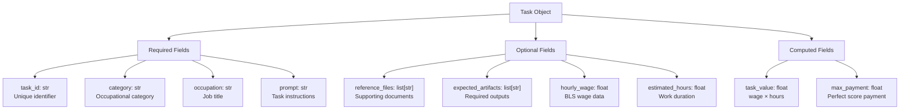
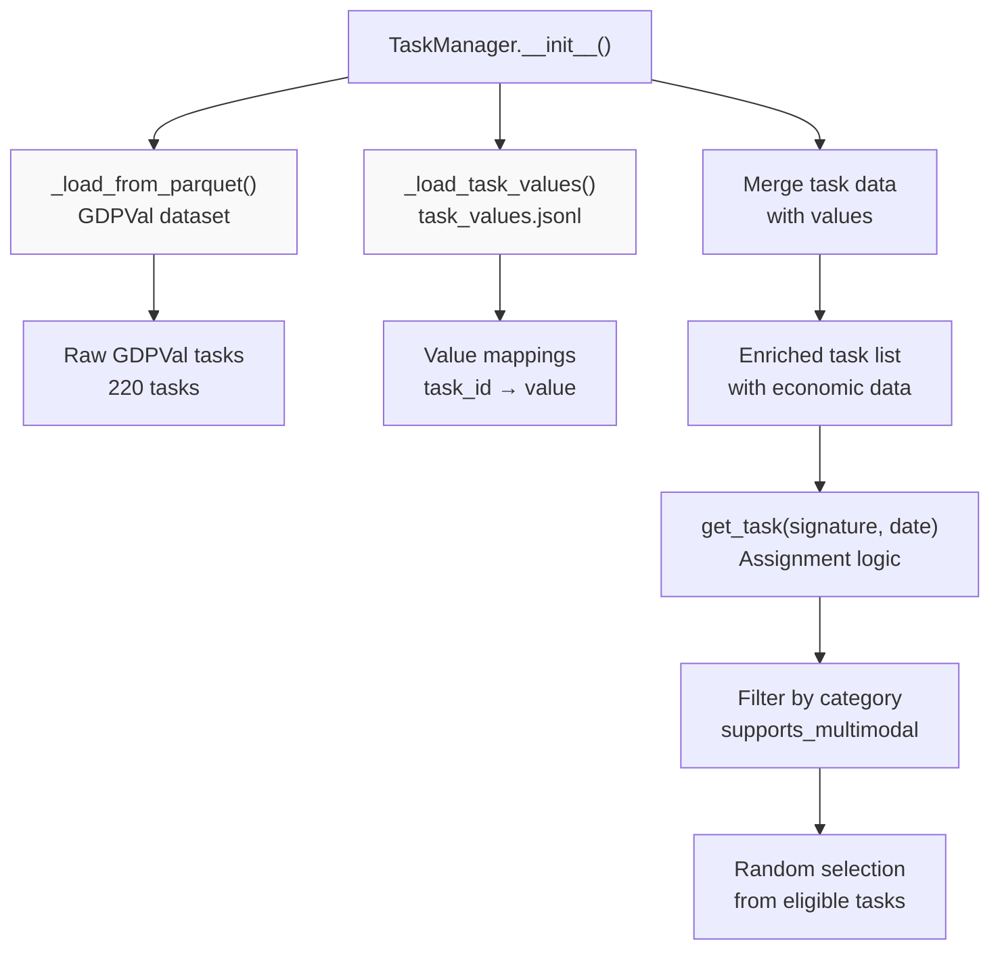
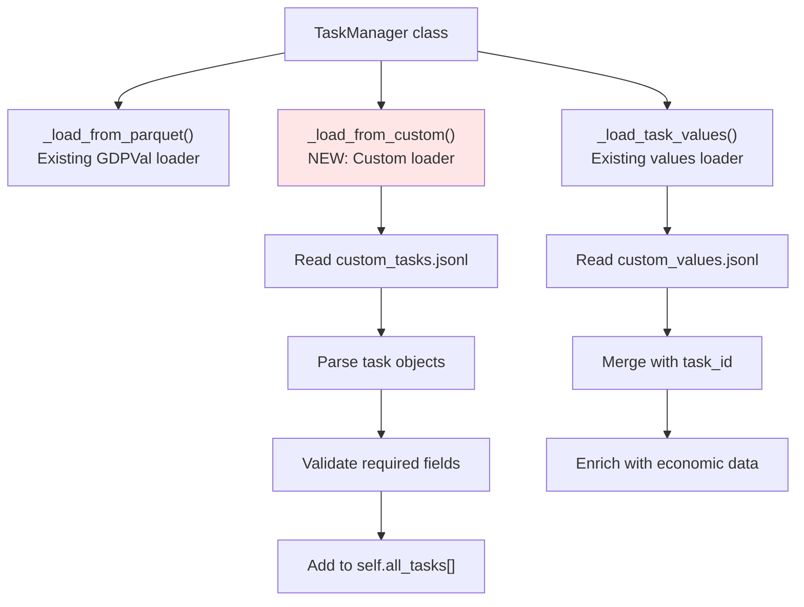
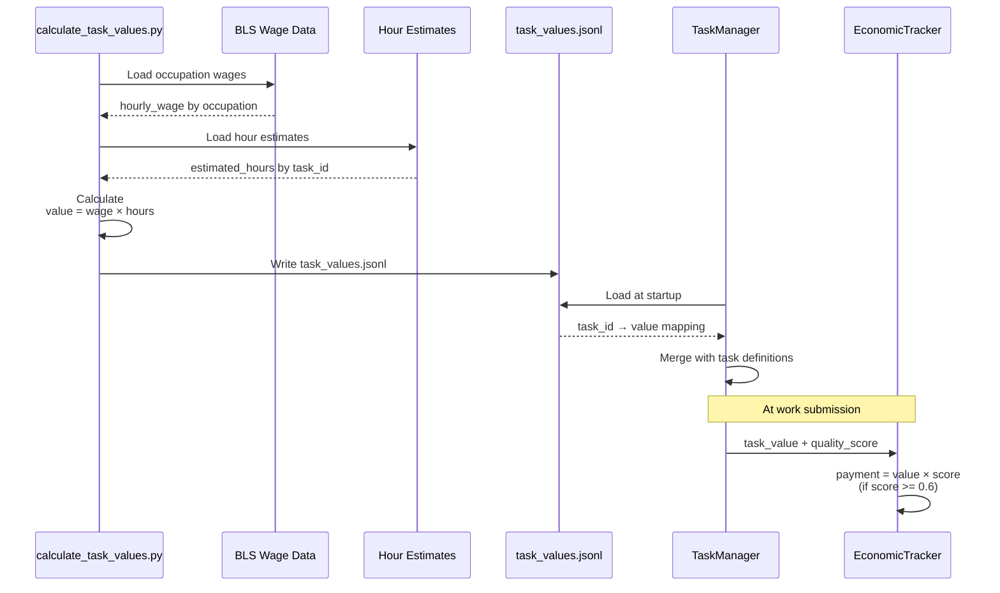
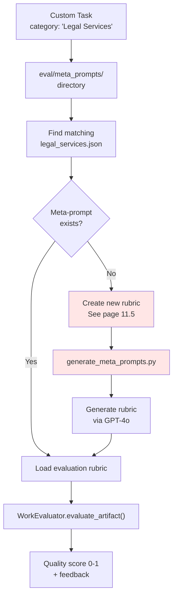
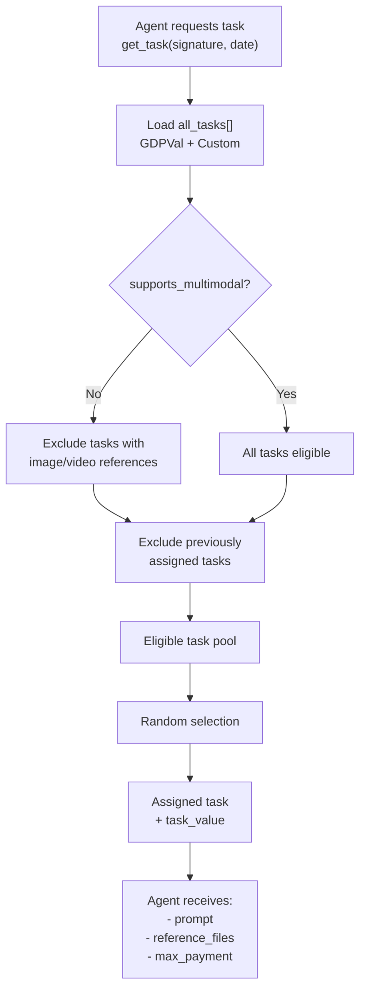
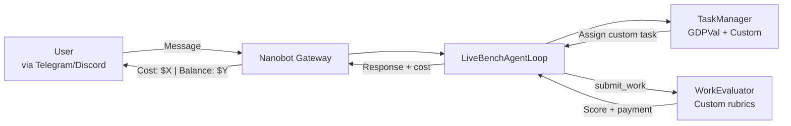

<!-- source: DeepWiki mcp.deepwiki.com · repo HKUDS/ClawWork · page 11.4 Custom Task Integration · fetched 2026-11-09 -->

# Custom Task Integration

<details>
<summary>Relevant source files</summary>

The following files were used as context for generating this wiki page:

- [README.md](README.md)
- [clawmode_integration/tools.py](clawmode_integration/tools.py)

</details>


This page explains how to add custom professional tasks beyond the GDPVal dataset, define task values based on real economic data, create reference files, and integrate new task sources into ClawWork's task pool. This enables benchmarking on domain-specific or proprietary task sets while maintaining consistent economic evaluation.

For information about the GDPVal dataset structure, see [GDPVal Dataset](#2.2). For creating evaluation rubrics for custom categories, see [Custom Evaluation Rubrics](#11.5). For the TaskManager implementation details, see [Task Manager](#4.3).

---

## Task Structure and Schema

ClawWork tasks follow a standardized schema that supports economic valuation, evaluation, and assignment to agents. Each task represents a professional work assignment that produces deliverables and earns payment based on quality.

### Core Task Fields



**Sources:** [livebench/work/task_manager.py:1-50](), [README.md:233-267]()

### Task Definition Example

```json
{
  "task_id": "custom-001-financial-analysis",
  "category": "Finance & Insurance",
  "occupation": "Financial Analyst",
  "prompt": "Analyze the quarterly earnings report for TechCorp...",
  "reference_files": [
    "data/reference/custom-001/earnings_q4_2024.pdf",
    "data/reference/custom-001/market_trends.xlsx"
  ],
  "expected_artifacts": [
    "analysis_report.docx",
    "financial_model.xlsx",
    "executive_summary.pdf"
  ],
  "hourly_wage": 45.67,
  "estimated_hours": 4.5,
  "task_value": 205.52
}
```

| Field | Type | Required | Description |
|-------|------|----------|-------------|
| `task_id` | string | Yes | Unique identifier (UUID recommended) |
| `category` | string | Yes | Matches meta-prompt directory name |
| `occupation` | string | Yes | Specific job title for context |
| `prompt` | string | Yes | Detailed task instructions |
| `reference_files` | array | No | Paths to supporting documents |
| `expected_artifacts` | array | No | List of required deliverables |
| `hourly_wage` | float | No | BLS wage data (USD/hour) |
| `estimated_hours` | float | No | Expected completion time |
| `task_value` | float | No | Computed as `wage × hours` |

**Sources:** [README.md:249-267](), [livebench/work/task_manager.py:50-100]()

---

## Task Loading Architecture

The `TaskManager` class uses a pluggable loader pattern to support multiple task sources. This design allows custom task repositories to coexist with GDPVal.

### TaskManager Loading Flow



**Sources:** [livebench/work/task_manager.py:1-150]()

### Current Implementation

The TaskManager currently loads from two sources:

1. **GDPVal Parquet File** ([livebench/work/task_manager.py:50-100]())
   - Located at `data/train-00000-of-00001.parquet`
   - Contains 220 professional tasks across 44 categories
   - Fields: `task_id`, `category`, `occupation`, `prompt`, `reference_files`

2. **Task Values JSONL** ([livebench/work/task_manager.py:100-130]())
   - Located at `scripts/task_value_estimates/task_values.jsonl`
   - Computed by `calculate_task_values.py`
   - Fields: `task_id`, `hourly_wage`, `estimated_hours`, `task_value`

**Sources:** [livebench/work/task_manager.py:1-200](), [README.md:233-267]()

---

## Creating Custom Tasks

### Step 1: Define Task Structure

Create a structured data file (JSON, JSONL, or Parquet) with task definitions:

```json
{
  "task_id": "corp-legal-001",
  "category": "Legal Services",
  "occupation": "Corporate Attorney",
  "prompt": "Draft a master service agreement for a SaaS company that includes provisions for data privacy (GDPR/CCPA), intellectual property rights, limitation of liability, and termination clauses. The agreement should be suitable for enterprise customers with $100K+ annual contracts.",
  "reference_files": [
    "data/reference/corp-legal-001/template_msa.docx",
    "data/reference/corp-legal-001/gdpr_checklist.pdf"
  ],
  "expected_artifacts": [
    "master_service_agreement.docx",
    "redline_comparison.pdf"
  ]
}
```

### Step 2: Create Reference Files

Reference files provide context, templates, or data needed to complete tasks. Store them in a structured directory:

```
data/
└── reference/
    └── corp-legal-001/
        ├── template_msa.docx
        ├── gdpr_checklist.pdf
        └── company_info.txt
```

**File Path Requirements:**
- Use relative paths from repository root
- Ensure paths in `reference_files` array match actual file locations
- Support common formats: `.docx`, `.xlsx`, `.pdf`, `.txt`, `.csv`, `.png`, `.jpg`

**Sources:** [livebench/work/task_manager.py:180-220]()

### Step 3: Calculate Task Values

Task values determine maximum payment and must reflect real economic worth. Use the BLS wage data methodology:

#### Manual Calculation

```python
# From Bureau of Labor Statistics (BLS) data
hourly_wage = 52.43  # Corporate Attorney median wage
estimated_hours = 3.5  # GPT-estimated completion time

task_value = hourly_wage * estimated_hours
# task_value = 183.51
```

#### Automated Estimation

Use the provided scripts to estimate hours via LLM:

```bash
# Step 1: Estimate hours for each task
python scripts/estimate_task_hours.py \
  --input custom_tasks.jsonl \
  --output custom_hours.jsonl

# Step 2: Calculate values using BLS wages
python scripts/calculate_task_values.py \
  --tasks custom_tasks.jsonl \
  --hours custom_hours.jsonl \
  --wages bls_wages.json \
  --output custom_values.jsonl
```

**Hour Estimation Process** ([scripts/estimate_task_hours.py:1-100]()):
1. GPT-4o analyzes task prompt and deliverables
2. Estimates realistic completion time for skilled professional
3. Accounts for research, creation, revision, quality checks
4. Output: `estimated_hours` field per task

**Value Calculation Formula** ([scripts/calculate_task_values.py:1-150]()):
```python
task_value = hourly_wage * estimated_hours
max_payment = task_value  # When quality_score = 1.0
actual_payment = task_value * quality_score  # After evaluation
```

**Sources:** [scripts/estimate_task_hours.py:1-100](), [scripts/calculate_task_values.py:1-150](), [README.md:254-267]()

### Step 4: Extend TaskManager

Create a custom loader method in `TaskManager`:



**Implementation Example:**

```python
# In livebench/work/task_manager.py

def _load_from_custom(self, custom_tasks_path: str) -> list[dict]:
    """Load custom tasks from JSONL file.
    
    Args:
        custom_tasks_path: Path to JSONL file with task definitions
        
    Returns:
        List of task dictionaries
    """
    tasks = []
    with open(custom_tasks_path, 'r', encoding='utf-8') as f:
        for line in f:
            task = json.loads(line.strip())
            
            # Validate required fields
            required = {'task_id', 'category', 'occupation', 'prompt'}
            if not required.issubset(task.keys()):
                missing = required - task.keys()
                raise ValueError(f"Task {task.get('task_id', 'unknown')} missing fields: {missing}")
            
            tasks.append(task)
    
    return tasks

def __init__(self, config: dict):
    # Existing GDPVal loading
    self.all_tasks = self._load_from_parquet("data/train-00000-of-00001.parquet")
    
    # Load custom tasks if configured
    if config.get("custom_tasks_path"):
        custom_tasks = self._load_from_custom(config["custom_tasks_path"])
        self.all_tasks.extend(custom_tasks)
    
    # Load and merge values for all tasks
    self._load_task_values("scripts/task_value_estimates/task_values.jsonl")
```

**Configuration Update** (`livebench/configs/config.json`):

```json
{
  "livebench": {
    "task_sources": {
      "gdpval": {
        "enabled": true,
        "path": "data/train-00000-of-00001.parquet"
      },
      "custom": {
        "enabled": true,
        "tasks_path": "data/custom/custom_tasks.jsonl",
        "values_path": "data/custom/custom_values.jsonl"
      }
    }
  }
}
```

**Sources:** [livebench/work/task_manager.py:1-300](), [livebench/configs/livebench_config.json:1-50]()

---

## Task Value System Integration

### Value Calculation Pipeline



**Sources:** [scripts/calculate_task_values.py:1-150](), [livebench/work/task_manager.py:100-150](), [livebench/agent/economic_tracker.py:150-200]()

### BLS Wage Mapping

Create a wage mapping file for custom occupations:

```json
{
  "Corporate Attorney": 52.43,
  "Senior Software Architect": 67.89,
  "Healthcare Administrator": 48.56,
  "Marketing Director": 59.23
}
```

**Standard BLS Categories** (from GDPVal):
- Technology & Engineering: $45-85/hour
- Business & Finance: $35-75/hour
- Healthcare & Social Services: $28-65/hour
- Legal & Operations: $30-80/hour

**Sources:** [README.md:236-247]()

### Value Distribution Guidelines

| Task Complexity | Hours Range | Value Range (at $50/hr) |
|----------------|-------------|-------------------------|
| Simple | 1-2 hours | $50-100 |
| Moderate | 2-4 hours | $100-200 |
| Complex | 4-8 hours | $200-400 |
| Advanced | 8+ hours | $400+ |

Ensure values reflect actual professional billing:
- Research-heavy tasks: Higher hours
- Template-based tasks: Lower hours
- Multi-deliverable tasks: Account for each artifact
- Quality review time: Add 10-20% overhead

**Sources:** [README.md:254-267]()

---

## Integration with Evaluation System

Custom tasks must integrate with the evaluation pipeline to receive quality scores and payments.

### Category Matching



**Sources:** [livebench/work/evaluator.py:1-200](), [eval/generate_meta_prompts.py:1-150]()

### Rubric Requirements

Each custom category needs a meta-prompt JSON with evaluation criteria:

```json
{
  "category": "Legal Services",
  "evaluation_dimensions": {
    "completeness": {
      "weight": 0.40,
      "description": "All required legal documents present with proper sections"
    },
    "correctness": {
      "weight": 0.30,
      "description": "Legally sound provisions, accurate citations, compliance with regulations"
    },
    "quality": {
      "weight": 0.20,
      "description": "Professional formatting, clear language, proper legal terminology"
    },
    "domain_standards": {
      "weight": 0.10,
      "description": "Follows legal drafting standards, appropriate tone, risk mitigation"
    }
  },
  "critical_rules": [
    "Missing primary legal document = 0-2 score",
    "Placeholder text or lorem ipsum = 0-2 score",
    "Incorrect file format = 0-2 score"
  ]
}
```

**Category Naming Convention:**
- Directory name: `legal_services/` (lowercase, underscores)
- Task category field: `"Legal Services"` (title case, spaces)
- Meta-prompt filename: `legal_services.json`

**Sources:** [eval/meta_prompts/README.md:1-50](), [README.md:58-59]()

### Evaluation Cost Planning

Custom tasks incur evaluation costs via GPT-4o API calls:

| Component | Cost | Frequency |
|-----------|------|-----------|
| Meta-prompt generation | $0.02-0.05 per category | One-time setup |
| Work evaluation | $0.01-0.03 per task | Per submission |
| Feedback generation | Included in evaluation | Per submission |

**Budget Guidelines:**
- 100 custom tasks ≈ $2-5 in evaluation costs
- Meta-prompt generation (5 categories) ≈ $0.10-0.25
- Total setup + evaluation ≈ $3-6 per 100 task submissions

**Sources:** [eval/generate_meta_prompts.py:50-100](), [livebench/work/evaluator.py:100-150]()

---

## Complete Integration Example

### Scenario: Adding Corporate Legal Tasks

**Step 1: Task Definition File** (`data/custom/legal_tasks.jsonl`)

```jsonl
{"task_id":"legal-001","category":"Legal Services","occupation":"Corporate Attorney","prompt":"Draft MSA for SaaS company...","reference_files":["data/reference/legal-001/template.docx"],"expected_artifacts":["msa.docx"]}
{"task_id":"legal-002","category":"Legal Services","occupation":"Compliance Officer","prompt":"Conduct GDPR compliance audit...","reference_files":["data/reference/legal-002/checklist.pdf"],"expected_artifacts":["audit_report.pdf","remediation_plan.xlsx"]}
```

**Step 2: Value Calculation**

```bash
# Estimate hours
python scripts/estimate_task_hours.py \
  --input data/custom/legal_tasks.jsonl \
  --output data/custom/legal_hours.jsonl

# Calculate values (assumes legal_wages.json with BLS data)
python scripts/calculate_task_values.py \
  --tasks data/custom/legal_tasks.jsonl \
  --hours data/custom/legal_hours.jsonl \
  --wages data/custom/legal_wages.json \
  --output data/custom/legal_values.jsonl
```

**Step 3: Generate Evaluation Rubric**

```bash
python eval/generate_meta_prompts.py \
  --categories "Legal Services" \
  --output eval/meta_prompts/legal_services.json
```

**Step 4: Update Configuration** (`livebench/configs/legal_config.json`)

```json
{
  "livebench": {
    "task_sources": {
      "custom": {
        "enabled": true,
        "tasks_path": "data/custom/legal_tasks.jsonl",
        "values_path": "data/custom/legal_values.jsonl"
      }
    },
    "evaluation": {
      "meta_prompts_dir": "./eval/meta_prompts"
    }
  }
}
```

**Step 5: Extend TaskManager** ([livebench/work/task_manager.py:50-100]())

Add custom loader as shown in previous section, then test:

```bash
# Run agent with custom tasks
python -m livebench.agent.live_agent --config livebench/configs/legal_config.json
```

**Sources:** [livebench/work/task_manager.py:1-300](), [scripts/estimate_task_hours.py:1-100](), [scripts/calculate_task_values.py:1-150](), [eval/generate_meta_prompts.py:1-200]()

---

## Task Assignment and Filtering

### Assignment Logic Flow



**Sources:** [livebench/work/task_manager.py:200-250]()

### Filtering Criteria

**Built-in Filters:**
1. **Multimodal Support** ([livebench/work/task_manager.py:220-240]())
   - Checks `reference_files` for image/video formats
   - Excludes if agent doesn't support multimodal input

2. **Assignment History** ([livebench/work/task_manager.py:240-260]())
   - Prevents duplicate assignments to same agent
   - Tracked per signature + date in EconomicTracker

3. **Task Availability** ([livebench/work/task_manager.py:260-280]())
   - Ensures task pool not exhausted
   - Returns None if no eligible tasks remain

**Custom Filter Extension:**

```python
def get_task(self, signature: str, date: str, custom_filter: callable = None) -> dict:
    eligible_tasks = self._filter_eligible_tasks(signature, date)
    
    if custom_filter:
        eligible_tasks = [t for t in eligible_tasks if custom_filter(t)]
    
    if not eligible_tasks:
        return None
    
    return random.choice(eligible_tasks)

# Usage: filter by task value range
task = task_manager.get_task(
    signature="agent-001",
    date="2025-01-20",
    custom_filter=lambda t: 100 <= t.get("task_value", 0) <= 300
)
```

**Sources:** [livebench/work/task_manager.py:200-300]()

---

## Validation and Testing

### Task Validation Checklist

| Check | Requirement | Validation Method |
|-------|-------------|-------------------|
| Unique ID | No duplicate `task_id` | Query task pool for conflicts |
| Required fields | All mandatory fields present | Schema validation |
| Reference files exist | Files at specified paths | `os.path.exists()` checks |
| Task value > 0 | Positive economic value | Value calculation review |
| Category match | Meta-prompt exists for category | Directory scan in `eval/meta_prompts/` |
| Expected artifacts | Clear deliverable list | Manual review of task requirements |

**Automated Validation Script:**

```python
def validate_custom_tasks(tasks_path: str, reference_dir: str) -> tuple[list, list]:
    """Validate custom tasks before integration.
    
    Returns:
        (valid_tasks, errors)
    """
    valid = []
    errors = []
    
    with open(tasks_path) as f:
        for i, line in enumerate(f, 1):
            task = json.loads(line)
            
            # Check required fields
            required = {'task_id', 'category', 'occupation', 'prompt'}
            if not required.issubset(task.keys()):
                errors.append(f"Line {i}: Missing required fields")
                continue
            
            # Check reference files exist
            for ref_file in task.get('reference_files', []):
                if not os.path.exists(ref_file):
                    errors.append(f"Task {task['task_id']}: File not found: {ref_file}")
            
            # Check task value
            if task.get('task_value', 0) <= 0:
                errors.append(f"Task {task['task_id']}: Invalid task_value")
            
            valid.append(task)
    
    return valid, errors
```

**Sources:** [livebench/work/task_manager.py:300-350]()

### Testing Integration

**Unit Test Example:**

```python
def test_custom_task_loading():
    config = {
        "custom_tasks_path": "tests/fixtures/custom_tasks.jsonl"
    }
    manager = TaskManager(config)
    
    # Verify custom tasks loaded
    custom_task = next(t for t in manager.all_tasks if t['task_id'] == 'test-001')
    assert custom_task['category'] == 'Test Category'
    assert custom_task['task_value'] > 0
    
def test_custom_task_assignment():
    manager = TaskManager(config)
    task = manager.get_task(signature="test-agent", date="2025-01-20")
    
    # Verify task structure
    assert 'task_id' in task
    assert 'prompt' in task
    assert 'task_value' in task
    
def test_evaluation_integration():
    evaluator = WorkEvaluator(meta_prompts_dir="eval/meta_prompts")
    
    # Submit work for custom task
    accepted, payment, feedback, score = evaluator.evaluate_artifact(
        signature="test-agent",
        task=custom_task,
        artifact_path=["test_output.docx"],
        description="Test submission"
    )
    
    assert 0 <= score <= 1
    assert payment == custom_task['task_value'] * score
```

**Sources:** [livebench/work/task_manager.py:1-400](), [livebench/work/evaluator.py:1-250]()

---

## Best Practices

### Task Design Guidelines

1. **Clear Instructions**
   - Specify exact deliverables (file types, quantities)
   - Include quality expectations (formatting, detail level)
   - Provide success criteria

2. **Appropriate Scope**
   - 1-8 hours for most tasks
   - Single focused objective (not multi-phase projects)
   - Realistic for LLM capabilities

3. **Reference Materials**
   - Templates when applicable
   - Example outputs for guidance
   - Context documents (company info, guidelines)
   - Limit to 3-5 files per task

4. **Economic Alignment**
   - Task value matches professional billing rates
   - Payment reflects actual market worth
   - Hourly wage based on BLS data or industry standards

**Sources:** [README.md:233-267](), [eval/meta_prompts/README.md:1-100]()

### Common Pitfalls

| Issue | Problem | Solution |
|-------|---------|----------|
| Vague deliverables | Agent unclear on requirements | List specific files and formats |
| Missing reference files | Agent lacks necessary context | Include all referenced documents |
| Unrealistic values | Payment doesn't match complexity | Use BLS wages + accurate hour estimates |
| No evaluation rubric | Cannot score quality | Generate meta-prompt for category |
| Duplicate task_ids | Conflicts in task pool | Use UUIDs or prefixed identifiers |
| Multimodal mismatch | Task requires unsupported inputs | Tag tasks or filter by capability |

**Sources:** [livebench/work/task_manager.py:1-400](), [eval/meta_prompts/README.md:1-100]()

---

## Migration from GDPVal

For organizations wanting to replace GDPVal entirely with custom tasks:

### Full Replacement Configuration

```json
{
  "livebench": {
    "task_sources": {
      "gdpval": {
        "enabled": false
      },
      "custom": {
        "enabled": true,
        "tasks_path": "data/proprietary/tasks.jsonl",
        "values_path": "data/proprietary/values.jsonl"
      }
    }
  }
}
```

### Hybrid Configuration

```json
{
  "livebench": {
    "task_sources": {
      "gdpval": {
        "enabled": true,
        "weight": 0.3
      },
      "custom": {
        "enabled": true,
        "weight": 0.7
      }
    }
  }
}
```

The `weight` parameter controls task selection probability from each source (requires TaskManager extension).

**Sources:** [livebench/configs/livebench_config.json:1-100](), [README.md:272-303]()

---

## ClawMode Integration

Custom tasks work seamlessly in ClawMode with Nanobot. The economic tracking and evaluation pipeline remain identical:



**Key Point:** Custom tasks require the same meta-prompt rubrics in both standalone and ClawMode deployments. Place evaluation rubrics in `eval/meta_prompts/` before launching the gateway.

**Sources:** [clawmode_integration/agent_loop.py:1-300](), [clawmode_integration/tools.py:1-358](), [README.md:366-556]()

---

