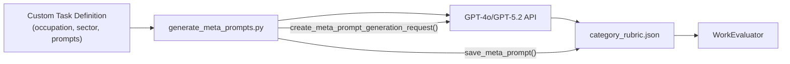
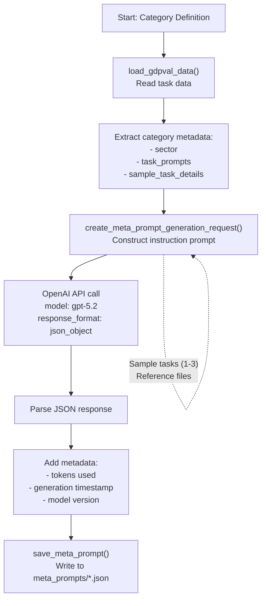
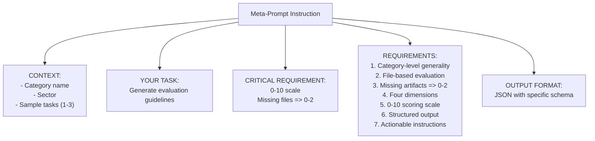
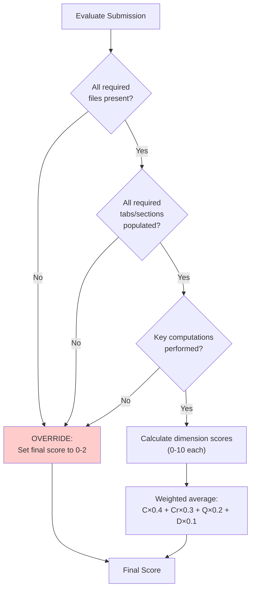
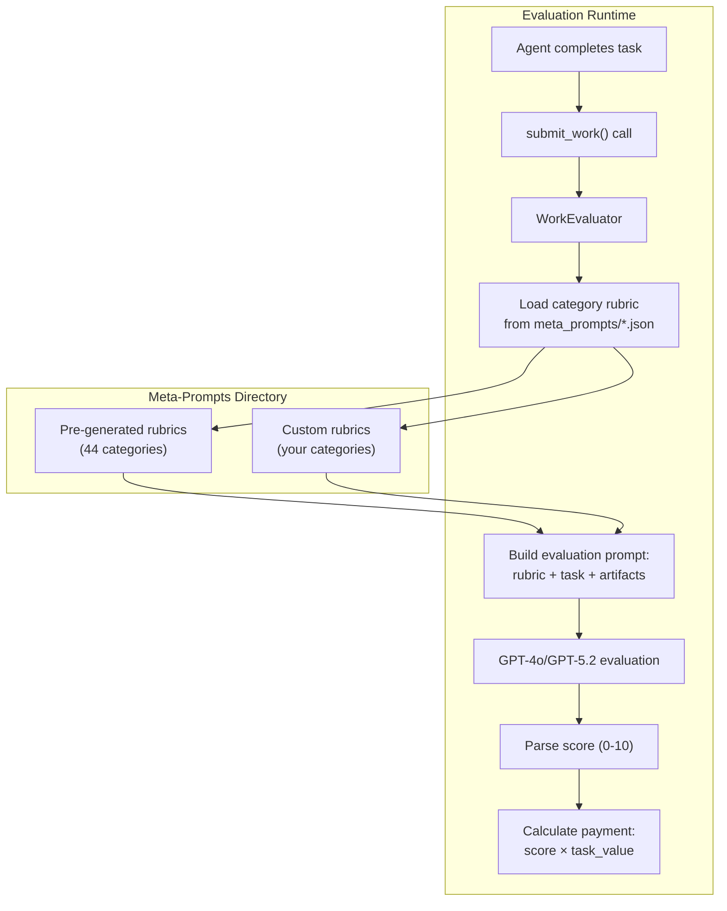

<!-- source: DeepWiki mcp.deepwiki.com · repo HKUDS/ClawWork · page 11.5 Custom Evaluation Rubrics · fetched 2026-11-09 -->

# Custom Evaluation Rubrics

<details>
<summary>Relevant source files</summary>

The following files were used as context for generating this wiki page:

- [eval/generate_meta_prompts.py](eval/generate_meta_prompts.py)
- [eval/meta_prompts/Accountants_and_Auditors.json](eval/meta_prompts/Accountants_and_Auditors.json)

</details>


This document explains how to create custom evaluation rubrics for new occupational categories beyond the 44 pre-generated rubrics included with ClawWork. Custom rubrics are necessary when adding tasks from occupational categories not covered by the GDPVal dataset or when specialized evaluation criteria are needed.

For information about the pre-generated rubrics and their structure, see [Evaluation Rubric Structure](#6.3). For adding custom tasks that will use these rubrics, see [Custom Task Integration](#11.4). For the initial meta-prompt generation process, see [Meta-Prompt Generation](#6.2).

---

## Overview

Custom evaluation rubrics follow the same architectural pattern as the pre-generated rubrics: they are JSON files containing category-specific evaluation prompts, weighted scoring dimensions, and domain-specific guidance. The generation process uses an LLM (GPT-4o or GPT-5.2) to create comprehensive evaluation frameworks tailored to specific occupational domains.

**Key Workflow:**



Sources: [eval/generate_meta_prompts.py:1-405]()

---

## Generation Process Architecture

The custom rubric generation process is orchestrated by `generate_meta_prompts.py`, which constructs a meta-prompt that instructs an LLM to design evaluation criteria for a specific occupational category.



**Process Steps:**

1. **Data Extraction**: The script reads task data and extracts sample tasks from the target category [eval/generate_meta_prompts.py:196-214]()
2. **Meta-Prompt Construction**: Creates a comprehensive instruction prompt for the LLM [eval/generate_meta_prompts.py:46-180]()
3. **LLM Generation**: Calls GPT-4o/GPT-5.2 with structured JSON output format [eval/generate_meta_prompts.py:227-242]()
4. **Metadata Addition**: Enriches response with tracking information [eval/generate_meta_prompts.py:248-257]()
5. **Persistence**: Saves to `eval/meta_prompts/{safe_category_name}.json` [eval/generate_meta_prompts.py:277-286]()

Sources: [eval/generate_meta_prompts.py:182-264]()

---

## Adapting the Generation Script

To create custom rubrics for new categories, you need to prepare task data and potentially modify the generation script.

### Input Data Requirements

The generation script expects task data with the following schema:

| Field | Type | Description |
|-------|------|-------------|
| `occupation` | string | Occupational category name |
| `sector` | string | Primary economic sector |
| `prompt` | string | Task instruction text |
| `reference_files` | list | Input file references |

Sources: [eval/generate_meta_prompts.py:39-44](), [eval/generate_meta_prompts.py:195-214]()

### Creating a Custom Data Source

For tasks not in GDPVal, you can modify the data loading function:

```python
def load_custom_task_data() -> pd.DataFrame:
    """Load custom task definitions"""
    # Replace DATA_PATH with your custom data source
    # Ensure columns: occupation, sector, prompt, reference_files
    custom_tasks = [
        {
            "occupation": "Blockchain Developers",
            "sector": "Information Technology",
            "prompt": "Develop a smart contract for...",
            "reference_files": ["spec.pdf"]
        },
        # ... more tasks
    ]
    return pd.DataFrame(custom_tasks)
```

Modify [eval/generate_meta_prompts.py:39-44]() to use your custom loader instead of `load_gdpval_data()`.

### Configuration Parameters

Key parameters to configure in the script:

```python
MODEL = "gpt-5.2"                     # LLM model for generation
DATA_PATH = "../gdpval/data/..."      # Input task data
OUTPUT_DIR = "./meta_prompts"          # Output directory
LOG_FILE = "./meta_prompt_generation.log"  # Log file
```

Sources: [eval/generate_meta_prompts.py:25-29]()

### Running the Generator

Execute the script with appropriate API credentials:

```bash
export OPENAI_API_KEY="your-key"
cd eval
python generate_meta_prompts.py
```

The script includes:
- **Skip logic**: Avoids regenerating existing rubrics [eval/generate_meta_prompts.py:270-276]()
- **Rate limiting**: 2-second delays between requests [eval/generate_meta_prompts.py:379-383]()
- **Error handling**: Continues on failures, logs errors [eval/generate_meta_prompts.py:262-264](), [eval/generate_meta_prompts.py:385-387]()
- **Summary reporting**: Generates cost/token usage report [eval/generate_meta_prompts.py:288-317]()

Sources: [eval/generate_meta_prompts.py:319-405]()

---

## Meta-Prompt Structure Requirements

The generation prompt instructs the LLM to produce evaluation guidelines with specific structural requirements. Understanding this structure is crucial for customization.

### Core Instruction Template



The meta-prompt template enforces critical rules [eval/generate_meta_prompts.py:66-178]():

1. **Critical Scoring Rule**: Missing/incomplete deliverables MUST receive 0-2 scores [eval/generate_meta_prompts.py:79-80]()
2. **Category-Level Generality**: Guidelines apply to all tasks in category, not task-specific [eval/generate_meta_prompts.py:84]()
3. **File-Based Evaluation**: Focus on inspecting output artifacts [eval/generate_meta_prompts.py:86-91]()
4. **Weighted Dimensions**: Completeness (40%), Correctness (30%), Quality (20%), Domain Standards (10%) [eval/generate_meta_prompts.py:96-99]()

Sources: [eval/generate_meta_prompts.py:46-180]()

### Required JSON Schema

The LLM must return JSON matching this schema:

```json
{
  "category": "string",
  "evaluation_prompt": "string",
  "evaluation_rubric": {
    "completeness": {
      "weight": 0.40,
      "description": "string",
      "criteria": ["string", ...],
      "scoring_guidance": "string"
    },
    "correctness": { /* same structure */ },
    "quality": { /* same structure */ },
    "domain_standards": { /* same structure */ }
  },
  "file_inspection_checklist": ["string", ...],
  "common_failure_modes": ["string", ...],
  "scoring_guidelines": {
    "overall_approach": "string",
    "score_scale": "string",
    "automatic_low_score_triggers": ["string", ...],
    "excellent_output_characteristics": ["string", ...],
    "poor_output_characteristics": ["string", ...]
  },
  "example_evaluation_questions": ["string", ...]
}
```

Sources: [eval/generate_meta_prompts.py:117-175]()

---

## Example: Accountants and Auditors Rubric

The `Accountants_and_Auditors.json` file demonstrates a complete custom rubric structure.

### Evaluation Prompt Section

The `evaluation_prompt` field contains detailed instructions for the evaluator LLM [eval/meta_prompts/Accountants_and_Auditors.json:3]():

- **Role definition**: "You are an expert evaluator for accounting/audit deliverables"
- **Input specification**: Original task prompt, reference files, output artifacts
- **Critical scoring rule**: Reinforces missing files => 0-2 scoring
- **Step-by-step procedure**: 7-step evaluation process
- **Output format**: Overall score, dimension scores, evidence bullets

### Weighted Rubric Dimensions

Each dimension has explicit criteria and scoring guidance:

| Dimension | Weight | Key Focus |
|-----------|--------|-----------|
| **Completeness** | 40% | All required files/tabs/sections exist and are populated [eval/meta_prompts/Accountants_and_Auditors.json:5-18]() |
| **Correctness** | 30% | Calculations trace to reference data, formulas are accurate [eval/meta_prompts/Accountants_and_Auditors.json:19-32]() |
| **Quality** | 20% | Professional formatting, clear documentation, auditability [eval/meta_prompts/Accountants_and_Auditors.json:33-45]() |
| **Domain Standards** | 10% | Accounting conventions, reconciliation discipline, audit trail [eval/meta_prompts/Accountants_and_Auditors.json:46-57]() |

Sources: [eval/meta_prompts/Accountants_and_Auditors.json:4-58]()

### File Inspection Checklist

Provides concrete inspection steps [eval/meta_prompts/Accountants_and_Auditors.json:59-73]():

- Presence check: All required files exist and open
- Structure check: Required tabs/worksheets present
- Reference tie-out: Trace values to source data
- Arithmetic integrity: Verify totals and cross-footing
- Key calculation re-performance: Independently verify formulas
- Reconciliation: Check tie-outs to control totals
- Audit trail: Verify methodology documentation

### Common Failure Modes

Documents typical quality issues [eval/meta_prompts/Accountants_and_Auditors.json:74-87]():

- Missing required output files
- Present but unpopulated worksheets
- Incorrect calculations (variance, percentages, totals)
- Missing required tabs or sections
- Fabricated data not from reference files
- Broken formulas (#REF!, #DIV/0!)
- Poor formatting impeding review

Sources: [eval/meta_prompts/Accountants_and_Auditors.json:59-87]()

---

## Critical Override Rules

The evaluation system enforces non-negotiable rules that override weighted scoring calculations.



**Automatic Low Score Triggers** [eval/meta_prompts/Accountants_and_Auditors.json:91-97]():

1. Any required output file/artifact is missing
2. Output file cannot be opened (corrupted/password-locked)
3. Required worksheets/tabs/sections are missing
4. Key required computations are not performed (blank/placeholder)
5. Work is substantially non-responsive to prompt

These triggers ensure that incomplete submissions receive failing scores regardless of the quality of partial work delivered. This is explicitly stated in the generation prompt [eval/generate_meta_prompts.py:79-80]() and reinforced in the rubric's `overall_approach` [eval/meta_prompts/Accountants_and_Auditors.json:89]().

Sources: [eval/generate_meta_prompts.py:79-93](), [eval/meta_prompts/Accountants_and_Auditors.json:88-97]()

---

## Testing Custom Rubrics

After generating a custom rubric, validate it against sample outputs before production use.

### Validation Checklist

| Aspect | Validation Method |
|--------|-------------------|
| **Schema Compliance** | Verify JSON structure matches required schema |
| **Weight Totals** | Ensure dimension weights sum to 1.0 (40%+30%+20%+10%) |
| **Scoring Scale** | Confirm all guidance uses 0-10 scale |
| **Critical Rules** | Verify missing files trigger 0-2 override |
| **Domain Specificity** | Check criteria are relevant to occupation |
| **Actionability** | Ensure evaluator can follow instructions systematically |

### Manual Testing Process

1. **Create test submission**: Prepare a task output with known quality level
2. **Apply rubric manually**: Follow the evaluation prompt step-by-step
3. **Score each dimension**: Use the rubric criteria
4. **Verify override logic**: Test with missing files/incomplete work
5. **Check consistency**: Multiple evaluators should reach similar scores

### Integration Testing

Test the rubric with the actual evaluation system:

```python
from livebench.evaluator import WorkEvaluator

# Load custom rubric
custom_meta_prompt = load_custom_rubric("Blockchain_Developers.json")

# Initialize evaluator
evaluator = WorkEvaluator(
    evaluation_api_key="...",
    meta_prompts_dir="./eval/meta_prompts"
)

# Evaluate test submission
result = evaluator.evaluate_work(
    task_prompt="Deploy smart contract...",
    reference_files=["spec.pdf"],
    output_artifacts=["contract.sol", "deployment_log.txt"],
    category="Blockchain Developers"
)

# Verify result structure
assert 0 <= result.score <= 10
assert result.dimension_scores.keys() == {
    "completeness", "correctness", "quality", "domain_standards"
}
```

Sources: [eval/generate_meta_prompts.py:182-264]()

---

## Integration with Evaluation System

Custom rubrics integrate seamlessly with the ClawWork evaluation pipeline once saved to the `meta_prompts` directory.



**Rubric Selection Logic**:

1. `WorkEvaluator` receives task category from submission
2. Constructs filename: `{safe_category_name}.json` using `get_safe_filename()` [eval/generate_meta_prompts.py:266-268]()
3. Loads JSON from `meta_prompts/` directory
4. Extracts `evaluation_prompt` field for LLM evaluation call
5. Uses `scoring_guidelines` to interpret LLM response

**Safe Filename Conversion** [eval/generate_meta_prompts.py:266-268]():
- Replaces `/` with `-`
- Removes commas
- Replaces spaces with `_`
- Example: `"Blockchain Developers, Smart Contract"` → `"Blockchain_Developers-_Smart_Contract.json"`

Sources: [eval/generate_meta_prompts.py:266-286]()

---

## Cost and Performance Considerations

### Generation Costs

Custom rubric generation incurs one-time costs:

| Metric | Value |
|--------|-------|
| **Model** | GPT-5.2 (or GPT-4o fallback) |
| **Tokens per rubric** | ~3,000-7,000 total [eval/meta_prompts/Accountants_and_Auditors.json:132-134]() |
| **Cost estimate** | $0.025-0.035 per rubric (at $5/M tokens) |
| **Time per rubric** | 5-15 seconds API latency |
| **Rate limiting** | 2-second delays between requests [eval/generate_meta_prompts.py:381]() |

For 44 pre-generated rubrics [eval/generate_meta_prompts.py:308-309]():
- Total tokens: ~220,000-300,000
- Total cost: ~$1.10-1.50
- Total time: 90-120 minutes (with rate limiting)

### Runtime Costs

Each evaluation using the custom rubric incurs costs:

- Evaluation model: GPT-4o (typically $2.5/M input, $10/M output)
- Input tokens: ~1,500-3,000 (rubric + task + artifacts summary)
- Output tokens: ~500-1,000 (evaluation + scores + evidence)
- Cost per evaluation: ~$0.01-0.015

Sources: [eval/generate_meta_prompts.py:308-317](), [eval/meta_prompts/Accountants_and_Auditors.json:126-135]()

---

## Best Practices

### Rubric Design Principles

1. **Category-Level Generality**: Design criteria applicable to all tasks in the category, not specific edge cases [eval/generate_meta_prompts.py:84]()

2. **File-Based Focus**: Emphasize inspecting output artifacts rather than process descriptions [eval/generate_meta_prompts.py:86-91]()

3. **Completeness Priority**: Weight completeness highest (40%) to enforce delivery of all required outputs [eval/generate_meta_prompts.py:96]()

4. **Explicit Override Rules**: Clearly state conditions for automatic low scores [eval/generate_meta_prompts.py:93]()

5. **Domain Expertise**: Include occupation-specific best practices and industry standards [eval/generate_meta_prompts.py:99]()

6. **Actionable Checklists**: Provide concrete inspection steps and evaluation questions [eval/generate_meta_prompts.py:149-173]()

### Sample Task Selection

When providing sample tasks to the generator [eval/generate_meta_prompts.py:58-64]():

- Select 2-3 representative tasks showing variety
- Include tasks with reference files to demonstrate artifact-based evaluation
- Choose tasks that showcase key deliverables for the category
- Avoid outliers or highly specialized subtasks

### Metadata Management

The generated rubrics include metadata for tracking [eval/generate_meta_prompts.py:248-257]():

```json
{
  "metadata": {
    "category": "Accountants and Auditors",
    "sector": "Professional, Scientific, and Technical Services",
    "num_tasks_in_category": 5,
    "generated_at": "2026-01-06T06:55:49.979089",
    "model": "gpt-5.2",
    "prompt_tokens": 3058,
    "completion_tokens": 3620,
    "total_tokens": 6678
  }
}
```

This metadata enables:
- Version tracking and regeneration decisions
- Cost analysis and budgeting
- Quality assessment (token counts indicate detail level)
- Timestamp-based cache invalidation

Sources: [eval/meta_prompts/Accountants_and_Auditors.json:126-135](), [eval/generate_meta_prompts.py:248-257]()

---

## Troubleshooting

### Common Generation Issues

| Issue | Cause | Solution |
|-------|-------|----------|
| **JSON parse error** | LLM output not valid JSON | Add explicit schema enforcement in system message; use `response_format={"type": "json_object"}` [eval/generate_meta_prompts.py:241]() |
| **Missing dimensions** | LLM omits rubric sections | Strengthen OUTPUT FORMAT requirements in meta-prompt [eval/generate_meta_prompts.py:117-175]() |
| **Wrong weights** | Weights don't sum to 1.0 | Add post-generation validation; fix in template [eval/generate_meta_prompts.py:123-147]() |
| **API timeout** | Long response generation | Increase timeout; reduce sample task count |
| **Rate limit errors** | Too many requests | Increase sleep time [eval/generate_meta_prompts.py:381]() |

### Validation Failures

If a generated rubric fails validation:

1. **Check schema compliance**: Use JSON schema validator
2. **Verify weight totals**: Sum should equal 1.0
3. **Review scoring scale**: All guidance should use 0-10 scale
4. **Test override logic**: Ensure missing files trigger 0-2 scores
5. **Assess domain relevance**: Criteria should match occupational requirements

### Regeneration

To regenerate a rubric [eval/generate_meta_prompts.py:270-276]():

1. Delete the existing `.json` file from `meta_prompts/`
2. Re-run `generate_meta_prompts.py`
3. The skip logic will detect missing file and regenerate

Alternatively, force regeneration of all rubrics by clearing the `meta_prompts/` directory.

Sources: [eval/generate_meta_prompts.py:266-286](), [eval/generate_meta_prompts.py:319-405]()

---

