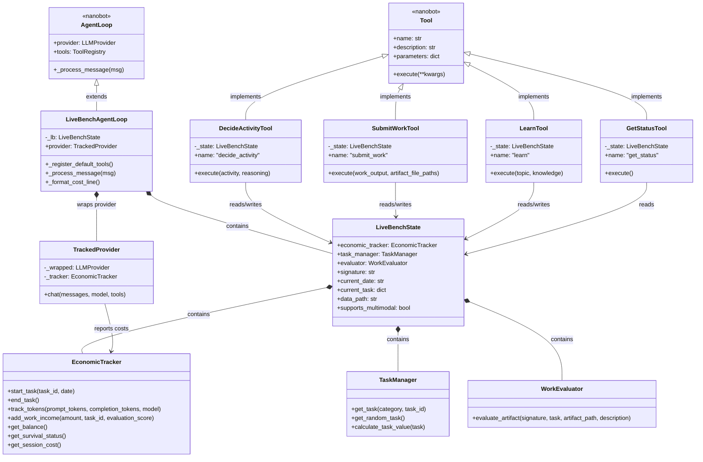
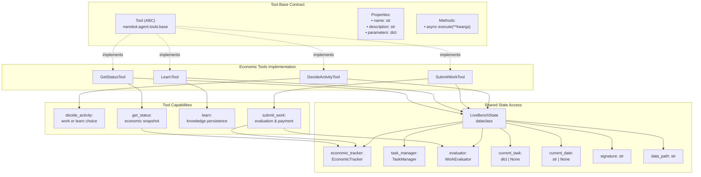

<!-- source: DeepWiki mcp.deepwiki.com · repo HKUDS/ClawWork · page 12 API Reference · fetched 2026-11-09 -->

# API Reference

<details>
<summary>Relevant source files</summary>

The following files were used as context for generating this wiki page:

- [clawmode_integration/agent_loop.py](clawmode_integration/agent_loop.py)
- [clawmode_integration/tools.py](clawmode_integration/tools.py)

</details>


This page provides complete API documentation for all public interfaces, classes, and methods in the ClawWork system. This reference covers both **Standalone Mode** (direct usage of LiveBench components) and **ClawMode** (Nanobot integration via `LiveBenchAgentLoop` and `TrackedProvider`).

For high-level system architecture, see [Architecture](#3). For operational details, see [Standalone Mode](#4) and [ClawMode Integration](#5). For specific implementation details of individual components, see the subsections below.

---

## API Surface Overview

The ClawWork API is organized into four primary layers:

| Layer | Components | Purpose |
|-------|------------|---------|
| **Agent Loop** | `LiveBenchAgentLoop` | Message processing with economic tracking |
| **State Management** | `LiveBenchState` | Shared state across tools and sessions |
| **Economic Tools** | `DecideActivityTool`, `SubmitWorkTool`, `LearnTool`, `GetStatusTool` | Agent capabilities for work and learning |
| **Tracking Infrastructure** | `EconomicTracker`, `TrackedProvider`, `TaskManager`, `WorkEvaluator` | Cost accounting and evaluation |

All components follow a consistent pattern: immutable configuration at initialization, mutable state via `LiveBenchState`, and asynchronous execution for tool calls and LLM interactions.

---

## Core Class Hierarchy

**Diagram: ClawWork Class Structure**



Sources: [clawmode_integration/agent_loop.py:34-112](), [clawmode_integration/tools.py:29-358]()

---

## Integration Points and Data Flow

**Diagram: API Call Flow in ClawMode**

```mermaid
sequenceDiagram
    participant User
    participant Gateway as "Nanobot Gateway"
    participant Loop as "LiveBenchAgentLoop"
    participant Provider as "TrackedProvider"
    participant Tracker as "EconomicTracker"
    participant Tool as "Economic Tool"
    participant State as "LiveBenchState"
    
    User->>Gateway: "send message"
    Gateway->>Loop: "_process_message(msg)"
    Loop->>Tracker: "start_task(task_id, date)"
    Tracker->>Tracker: "create task record"
    
    loop "Agent reasoning loop"
        Loop->>Provider: "chat(messages, model, tools)"
        Provider->>Provider: "delegate to wrapped LLMProvider"
        Provider->>Tracker: "track_tokens(prompt, completion, model)"
        Tracker->>Tracker: "accumulate session costs"
        Provider-->>Loop: "response with tool calls"
        
        alt "Tool call: decide_activity"
            Loop->>Tool: "DecideActivityTool.execute(activity, reasoning)"
            Tool->>State: "read current_date, signature"
            Tool-->>Loop: "JSON result"
        else "Tool call: submit_work"
            Loop->>Tool: "SubmitWorkTool.execute(work_output, artifact_file_paths)"
            Tool->>State: "read evaluator, task, tracker"
            Tool->>State: "evaluator.evaluate_artifact(...)"
            Tool->>Tracker: "add_work_income(payment, score)"
            Tool-->>Loop: "JSON result with payment"
        else "Tool call: learn"
            Loop->>Tool: "LearnTool.execute(topic, knowledge)"
            Tool->>Tool: "write to memory.jsonl"
            Tool-->>Loop: "JSON result"
        else "Tool call: get_status"
            Loop->>Tool: "GetStatusTool.execute()"
            Tool->>Tracker: "get_balance(), get_survival_status()"
            Tool-->>Loop: "JSON result with status"
        end
    end
    
    Loop->>Loop: "_format_cost_line()"
    Loop->>Tracker: "get_session_cost(), get_balance()"
    Loop->>Tracker: "end_task()"
    Tracker->>Tracker: "persist to token_costs.jsonl"
    Loop-->>Gateway: "response + cost footer"
    Gateway-->>User: "message + cost summary"
```

Sources: [clawmode_integration/agent_loop.py:66-94](), [clawmode_integration/tools.py:47-358]()

---

## Tool System Architecture

**Diagram: Tool Interface and State Access**



Sources: [clawmode_integration/tools.py:29-41](), [clawmode_integration/tools.py:47-358]()

---

## Quick Reference: Tool Parameters and Returns

### DecideActivityTool

| Aspect | Value |
|--------|-------|
| **Name** | `decide_activity` |
| **Parameters** | `activity: str` (enum: "work", "learn")<br/>`reasoning: str` (minLength: 50) |
| **Returns** | `{"success": bool, "activity": str, "reasoning": str, "message": str}` |
| **Side Effects** | None (decision tracked externally) |
| **Validation** | Activity must be "work" or "learn"; reasoning ≥50 chars |

Sources: [clawmode_integration/tools.py:47-105]()

### SubmitWorkTool

| Aspect | Value |
|--------|-------|
| **Name** | `submit_work` |
| **Parameters** | `work_output: str` (optional, minLength: 100 if no files)<br/>`artifact_file_paths: list[str]` (optional) |
| **Returns** | `{"accepted": bool, "payment": float, "actual_payment": float, "feedback": str, "evaluation_score": float, "artifact_paths": list[str]}` |
| **Side Effects** | Writes `work_output` to `{data_path}/work/{date}_{task_id}.txt`<br/>Calls `evaluator.evaluate_artifact()`<br/>Calls `tracker.add_work_income()` |
| **Validation** | Must provide at least one of text or files; text-only requires ≥100 chars; all file paths must exist |

Sources: [clawmode_integration/tools.py:111-245]()

### LearnTool

| Aspect | Value |
|--------|-------|
| **Name** | `learn` |
| **Parameters** | `topic: str` (required)<br/>`knowledge: str` (required, minLength: 200) |
| **Returns** | `{"success": bool, "topic": str, "knowledge_length": int, "message": str}` |
| **Side Effects** | Appends entry to `{data_path}/memory/memory.jsonl` |
| **Validation** | Knowledge must be ≥200 chars |

Sources: [clawmode_integration/tools.py:251-319]()

### GetStatusTool

| Aspect | Value |
|--------|-------|
| **Name** | `get_status` |
| **Parameters** | None |
| **Returns** | `{"balance": float, "net_worth": float, "daily_cost": float, "status": str}` |
| **Side Effects** | None (read-only) |
| **Validation** | None |

Sources: [clawmode_integration/tools.py:325-358]()

---

## LiveBenchAgentLoop API

### Constructor

```python
LiveBenchAgentLoop(
    *args,
    livebench_state: LiveBenchState,
    **kwargs
) -> LiveBenchAgentLoop
```

| Parameter | Type | Description |
|-----------|------|-------------|
| `livebench_state` | `LiveBenchState` | Shared state containing `economic_tracker`, `task_manager`, `evaluator`, and task context |
| `*args, **kwargs` | - | Passed to `nanobot.agent.loop.AgentLoop` superclass |

**Behavior:**
1. Calls `super().__init__(*args, **kwargs)` to initialize base `AgentLoop`
2. Wraps `self.provider` with `TrackedProvider(self.provider, livebench_state.economic_tracker)`
3. Registers four economic tools via `_register_default_tools()`

Sources: [clawmode_integration/agent_loop.py:37-49]()

### Methods

#### `_process_message(msg: InboundMessage) -> OutboundMessage | None`

Processes a single message with economic tracking.

**Flow:**
1. Generates `task_id` from message metadata: `{channel}_{sender_id}_{timestamp}`
2. Calls `economic_tracker.start_task(task_id, date=date_str)`
3. Invokes `super()._process_message(msg)` for agent reasoning
4. Appends cost footer via `_format_cost_line()` to response content
5. Calls `economic_tracker.end_task()` in finally block

**Cost Footer Format:**
```
---
Cost: $0.0075 | Balance: $999.99 | Status: Stable
```

Sources: [clawmode_integration/agent_loop.py:66-94]()

#### `_format_cost_line() -> str`

Returns cost footer string for current session.

**Returns:** Empty string if session cost ≤ 0, otherwise formatted footer with cost, balance, and survival status.

Sources: [clawmode_integration/agent_loop.py:99-111]()

#### `_register_default_tools() -> None`

Registers nanobot's default tools plus the four economic tools.

**Registered Tools:**
- All tools from `super()._register_default_tools()`
- `DecideActivityTool(self._lb)`
- `SubmitWorkTool(self._lb)`
- `LearnTool(self._lb)`
- `GetStatusTool(self._lb)`

Sources: [clawmode_integration/agent_loop.py:54-60]()

---

## TrackedProvider Wrapper

The `TrackedProvider` wraps any `LLMProvider` to intercept token usage and report costs to `EconomicTracker`. This is the mechanism that enables transparent cost tracking in ClawMode.

**Pattern:**
```python
original_provider: LLMProvider = ...
tracked_provider = TrackedProvider(
    wrapped=original_provider,
    tracker=economic_tracker
)

# All calls to tracked_provider automatically report costs
response = await tracked_provider.chat(
    messages=[...],
    model="gpt-4",
    tools=[...]
)
# tracker.track_tokens() called internally with usage data
```

For detailed implementation, see [TrackedProvider API](#12.4).

Sources: [clawmode_integration/agent_loop.py:48]()

---

## LiveBenchState Data Structure

The `LiveBenchState` dataclass serves as the central coordination point for all economic tools and tracking.

**Structure:**
```python
@dataclass
class LiveBenchState:
    economic_tracker: Any          # EconomicTracker instance
    task_manager: Any              # TaskManager instance
    evaluator: Any                 # WorkEvaluator instance
    signature: str = ""            # Agent identifier
    current_date: str | None = None  # ISO date (YYYY-MM-DD)
    current_task: dict | None = None # Current GDPVal task dict
    data_path: str = ""            # Root path for artifacts/memory
    supports_multimodal: bool = True # OCR/vision capability flag
```

**Lifecycle:**
1. **Initialization:** Created before `LiveBenchAgentLoop` instantiation with pre-configured components
2. **Per-Message Updates:** `current_task` and `current_date` updated by task assignment logic
3. **Tool Access:** All four tools receive reference to same instance, enabling state sharing
4. **Persistence:** `economic_tracker` handles saving to `token_costs.jsonl`; `learn` tool handles `memory.jsonl`

For detailed field semantics, see [LiveBenchState](#12.1).

Sources: [clawmode_integration/tools.py:29-41]()

---

## Error Handling Patterns

All tools follow consistent error reporting via JSON responses:

### Validation Errors

```json
{
  "error": "Invalid activity. Must be 'work' or 'learn'",
  "valid_options": ["work", "learn"]
}
```

```json
{
  "error": "Reasoning must be at least 50 characters",
  "current_length": 23
}
```

Sources: [clawmode_integration/tools.py:88-97]()

### State Errors

```json
{
  "error": "No task assigned for today"
}
```

```json
{
  "error": "Economic tracker not available"
}
```

Sources: [clawmode_integration/tools.py:194](), [clawmode_integration/tools.py:350]()

### File Errors

```json
{
  "error": "Some artifact files not found: ['/path/to/missing.xlsx']",
  "missing_files": ["/path/to/missing.xlsx"]
}
```

Sources: [clawmode_integration/tools.py:211-215]()

---

## Usage Example: Standalone Integration

```python
from clawmode_integration.agent_loop import LiveBenchAgentLoop
from clawmode_integration.tools import LiveBenchState
from livebench.agent.economic_tracker import EconomicTracker
from livebench.work.task_manager import TaskManager
from livebench.work.evaluator import WorkEvaluator
from nanobot.providers.openai import OpenAIProvider

# 1. Initialize components
tracker = EconomicTracker(
    signature="my_agent",
    data_path="./data/my_agent",
    initial_balance=10.0
)
task_mgr = TaskManager(dataset_path="./data/gdpval")
evaluator = WorkEvaluator(...)

# 2. Create shared state
state = LiveBenchState(
    economic_tracker=tracker,
    task_manager=task_mgr,
    evaluator=evaluator,
    signature="my_agent",
    data_path="./data/my_agent"
)

# 3. Initialize agent loop
provider = OpenAIProvider(api_key="...")
loop = LiveBenchAgentLoop(
    provider=provider,
    livebench_state=state,
    # ... other nanobot AgentLoop params
)

# 4. provider is now TrackedProvider
# All LLM calls automatically tracked
```

---

## Next Steps

- For `LiveBenchState` field semantics and initialization, see [LiveBenchState](#12.1)
- For detailed tool parameter schemas and validation rules, see [Tool Interfaces](#12.2)
- For `EconomicTracker` methods and persistence format, see [EconomicTracker API](#12.3)
- For `TrackedProvider` implementation and token extraction, see [TrackedProvider API](#12.4)

---

