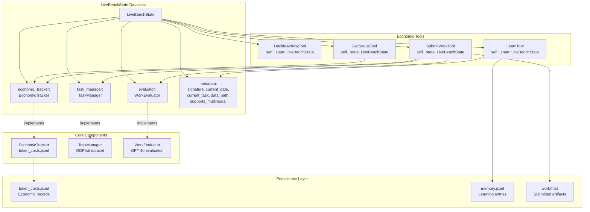
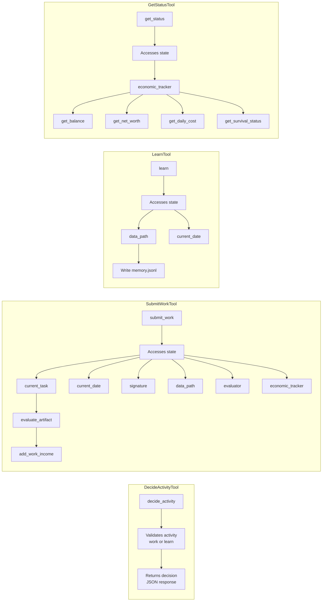
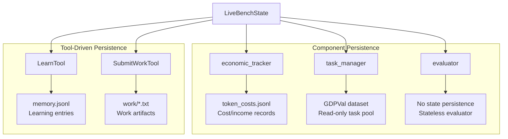

<!-- source: DeepWiki mcp.deepwiki.com · repo HKUDS/ClawWork · page 12.1 LiveBenchState · fetched 2026-11-09 -->

# LiveBenchState

<details>
<summary>Relevant source files</summary>

The following files were used as context for generating this wiki page:

- [clawmode_integration/__init__.py](clawmode_integration/__init__.py)
- [clawmode_integration/tools.py](clawmode_integration/tools.py)

</details>


## Purpose and Scope

`LiveBenchState` is a dataclass that serves as the central state management object for ClawMode integration. It encapsulates all mutable state shared across LiveBench economic tools within a single Nanobot session, replacing the `_global_state` dict pattern used in standalone mode. This page documents the structure, lifecycle, and usage of `LiveBenchState` in the context of ClawMode's economic tracking system.

For information about the tools that consume this state, see [Economic Tools](#5.4). For details on how this state integrates with the agent loop, see [LiveBenchAgentLoop Extension](#5.2).

**Sources:** [clawmode_integration/tools.py:29-41](), [clawmode_integration/__init__.py:10]()

---

## Dataclass Structure

`LiveBenchState` is defined as a Python dataclass that consolidates references to core LiveBench components and session-specific metadata.

### Class Definition

```python
@dataclass
class LiveBenchState:
    """Mutable state shared across all LiveBench tools within a session."""
    
    economic_tracker: Any  # livebench.agent.economic_tracker.EconomicTracker
    task_manager: Any      # livebench.agent.task_manager.TaskManager
    evaluator: Any         # livebench.work.evaluator.WorkEvaluator
    signature: str = ""
    current_date: str | None = None
    current_task: dict | None = None
    data_path: str = ""
    supports_multimodal: bool = True
```

**Sources:** [clawmode_integration/tools.py:29-41]()

### Attributes Reference

| Attribute | Type | Default | Description |
|-----------|------|---------|-------------|
| `economic_tracker` | `EconomicTracker` | Required | Tracks token costs, manages balance, processes payments. See [EconomicTracker API](#12.3) |
| `task_manager` | `TaskManager` | Required | Manages GDPVal task assignment and filtering. See [Task Manager](#4.3) |
| `evaluator` | `WorkEvaluator` | Required | Evaluates work submissions and calculates payment. See [Work Evaluator](#4.4) |
| `signature` | `str` | `""` | Unique agent identifier used for evaluation and persistence |
| `current_date` | `str \| None` | `None` | Current simulation date in ISO format (e.g., `"2024-01-15"`) |
| `current_task` | `dict \| None` | `None` | Currently assigned GDPVal task dictionary with `task_id`, `prompt`, `category`, `value` |
| `data_path` | `str` | `""` | Base directory path for persisting work artifacts, memory, and cost records |
| `supports_multimodal` | `bool` | `True` | Flag indicating whether the agent model supports multimodal inputs (images, files) |

**Sources:** [clawmode_integration/tools.py:29-41]()

---

## State Architecture

The following diagram shows how `LiveBenchState` connects the four economic tools to the core LiveBench infrastructure components.



**Sources:** [clawmode_integration/tools.py:29-41](), [clawmode_integration/tools.py:47-105](), [clawmode_integration/tools.py:111-244](), [clawmode_integration/tools.py:251-318](), [clawmode_integration/tools.py:325-357]()

---

## State Lifecycle

`LiveBenchState` instances are created and managed by `LiveBenchAgentLoop` during initialization. The state persists for the lifetime of the agent session and is shared across all tool invocations.

### Initialization Pattern

```mermaid
sequenceDiagram
    participant Loop as LiveBenchAgentLoop
    participant State as LiveBenchState
    participant Tools as Economic Tools
    participant Tracker as EconomicTracker
    
    Note over Loop: Agent initialization
    Loop->>Tracker: Create EconomicTracker(data_path, signature)
    Loop->>State: Create LiveBenchState(economic_tracker, task_manager, evaluator)
    
    Note over State: Set session metadata
    State->>State: current_date = today()
    State->>State: signature = agent_id
    State->>State: data_path = base_path
    
    Note over Loop: Tool registration
    Loop->>Tools: DecideActivityTool(state)
    Loop->>Tools: SubmitWorkTool(state)
    Loop->>Tools: LearnTool(state)
    Loop->>Tools: GetStatusTool(state)
    
    Note over Tools: Tools hold reference to state
    Tools->>Tools: self._state = state
```

**Sources:** [clawmode_integration/tools.py:50](), [clawmode_integration/tools.py:114](), [clawmode_integration/tools.py:254](), [clawmode_integration/tools.py:328]()

### State Mutation Pattern

The state is mutated during tool execution to update session context:

| Mutation Point | Modified Attribute | Modifier | Purpose |
|----------------|-------------------|----------|---------|
| Task assignment | `current_task` | `DecideActivityTool` | Set the active task for the day when "work" is chosen |
| Work submission | `current_task` | `SubmitWorkTool` | Clear task after successful submission |
| Date progression | `current_date` | `LiveBenchAgentLoop` | Advance to next simulation day |
| Cost tracking | `economic_tracker` internal state | `TrackedProvider` | Update balance and cost records |

**Sources:** [clawmode_integration/tools.py:83-104](), [clawmode_integration/tools.py:153-244]()

---

## Tool Integration

Each of the four economic tools receives `LiveBenchState` in its constructor and accesses specific attributes during execution.

### Tool State Access Patterns



**Sources:** [clawmode_integration/tools.py:83-104](), [clawmode_integration/tools.py:153-244](), [clawmode_integration/tools.py:286-318](), [clawmode_integration/tools.py:347-357]()

### Detailed Tool State Usage

#### DecideActivityTool

Does not directly access state attributes. Validates user choice and returns decision.

**Sources:** [clawmode_integration/tools.py:83-104]()

#### SubmitWorkTool

Most state-intensive tool, accessing all major components:

```python
evaluator = self._state.evaluator
task = self._state.current_task
date = self._state.current_date
signature = self._state.signature
tracker = self._state.economic_tracker
data_path = self._state.data_path
```

**Workflow:**
1. Validates `current_task` exists (line 193-194)
2. Saves text output to `{data_path}/work/{date}_{task_id}.txt` (lines 200-206)
3. Verifies artifact file paths exist (lines 209-216)
4. Calls `evaluator.evaluate_artifact()` with task and artifacts (lines 219-224)
5. Records income via `tracker.add_work_income()` (lines 227-231)

**Sources:** [clawmode_integration/tools.py:186-231]()

#### LearnTool

Accesses state for persistence metadata:

```python
data_path = self._state.data_path
date = self._state.current_date
```

Creates learning entry with timestamp and writes to `{data_path}/memory/memory.jsonl` (lines 296-311).

**Sources:** [clawmode_integration/tools.py:296-311]()

#### GetStatusTool

Queries economic tracker for current status:

```python
tracker = self._state.economic_tracker
```

Returns JSON with `balance`, `net_worth`, `daily_cost`, and `status` tier (lines 348-357).

**Sources:** [clawmode_integration/tools.py:348-357]()

---

## Relationship to Standalone Mode

In standalone LiveBench mode, agent state is managed via a global `_global_state` dictionary. ClawMode replaces this pattern with the explicit `LiveBenchState` dataclass for better type safety and encapsulation.

### Comparison Table

| Aspect | Standalone Mode | ClawMode (LiveBenchState) |
|--------|----------------|---------------------------|
| State storage | Global `_global_state` dict | `LiveBenchState` dataclass instance |
| State sharing | Direct dict access | Passed to tool constructors |
| Type safety | No type hints (dict keys) | Typed attributes with type annotations |
| Lifecycle | Module-level global | Session-scoped instance |
| Mutability | Dict mutations | Dataclass attribute assignments |
| Initialization | Implicit via dict assignment | Explicit in `LiveBenchAgentLoop.__init__` |

**Sources:** [clawmode_integration/tools.py:25-41]()

---

## State Persistence

`LiveBenchState` itself is not directly serialized. Instead, its components handle their own persistence:

### Persistence Responsibilities



**Persistence Locations:**

| Component | File Path | Format | Content |
|-----------|-----------|--------|---------|
| `economic_tracker` | `{data_path}/token_costs.jsonl` | JSONL | Token usage, costs, income, balance per session |
| `LearnTool` | `{data_path}/memory/memory.jsonl` | JSONL | Learning entries with date, topic, knowledge |
| `SubmitWorkTool` | `{data_path}/work/{date}_{task_id}.txt` | Text | Work output and artifact paths |

**Sources:** [clawmode_integration/tools.py:200-206](), [clawmode_integration/tools.py:296-311]()

---

## Usage Example

The following pseudocode illustrates typical `LiveBenchState` initialization and usage in `LiveBenchAgentLoop`:

```python
# In LiveBenchAgentLoop.__init__
self.state = LiveBenchState(
    economic_tracker=EconomicTracker(
        data_path="./data/agents/gpt4",
        signature="gpt4_agent"
    ),
    task_manager=TaskManager(dataset_path="./data/gdpval.parquet"),
    evaluator=WorkEvaluator(evaluation_model="gpt-4o"),
    signature="gpt4_agent",
    current_date="2024-01-15",
    data_path="./data/agents/gpt4",
    supports_multimodal=True
)

# Register tools with shared state
self.tools = [
    DecideActivityTool(state=self.state),
    SubmitWorkTool(state=self.state),
    LearnTool(state=self.state),
    GetStatusTool(state=self.state),
]

# During execution, tools access state
# Example: SubmitWorkTool.execute()
task = self._state.current_task
evaluator = self._state.evaluator
tracker = self._state.economic_tracker
# ... perform evaluation and update tracker
```

**Sources:** [clawmode_integration/tools.py:50](), [clawmode_integration/tools.py:114](), [clawmode_integration/tools.py:254](), [clawmode_integration/tools.py:328](), [clawmode_integration/tools.py:186-191]()

---

## Design Rationale

### Why Dataclass Over Dict?

The migration from `_global_state` dict to `LiveBenchState` dataclass provides several benefits:

1. **Type Safety**: IDEs and type checkers can validate attribute access and catch typos at development time
2. **Explicit Dependencies**: Tool constructors explicitly declare their dependency on state, improving testability
3. **Documentation**: Dataclass fields serve as self-documenting structure with type hints and docstrings
4. **Encapsulation**: State is scoped to agent sessions rather than module-level globals
5. **Immutability Control**: Dataclasses support frozen and field-level mutability controls

### Mutable vs Immutable Design

`LiveBenchState` is intentionally mutable because:
- `current_task` changes when tasks are assigned or completed
- `current_date` advances during multi-day simulations
- `economic_tracker` maintains internal balance state that updates with each token expenditure

The mutable design avoids the overhead of creating new state objects on every change while maintaining a single source of truth shared by all tools.

**Sources:** [clawmode_integration/tools.py:25-41]()

---

## Related Components

- **[LiveBenchAgentLoop Extension](#5.2)**: Creates and manages `LiveBenchState` instances
- **[Economic Tools](#5.4)**: Consume `LiveBenchState` to implement economic functionality
- **[TrackedProvider Wrapper](#5.3)**: Updates `economic_tracker` within `LiveBenchState`
- **[EconomicTracker API](#12.3)**: Core state management for balance and costs

**Sources:** [clawmode_integration/__init__.py:1-26]()

---

