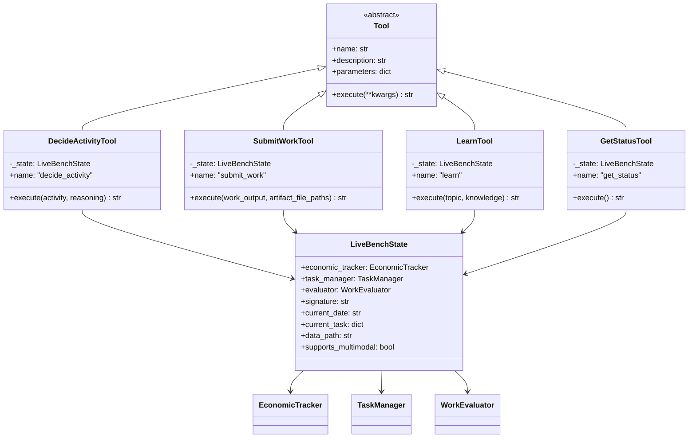
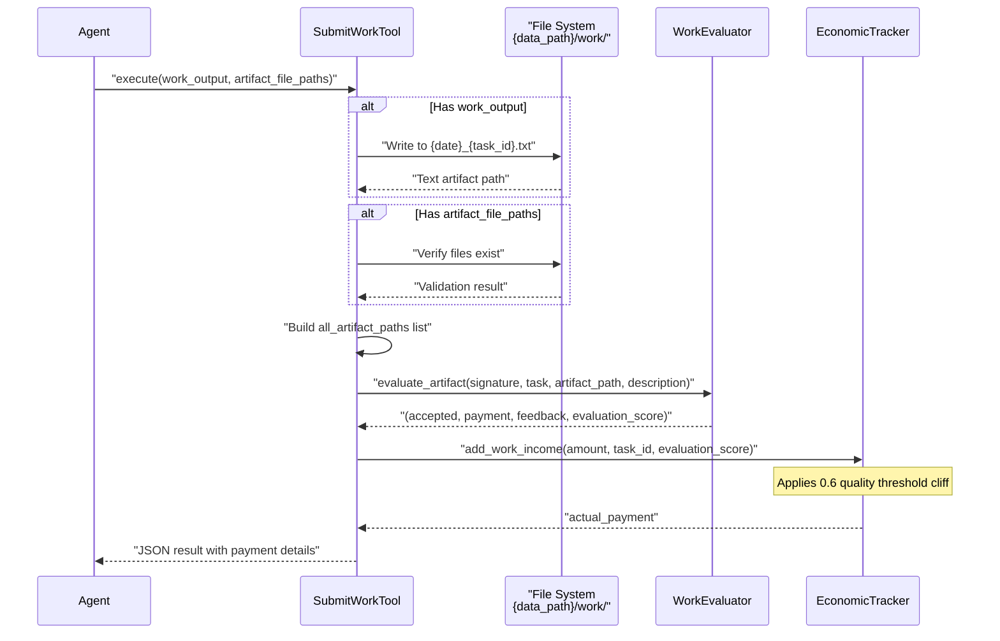
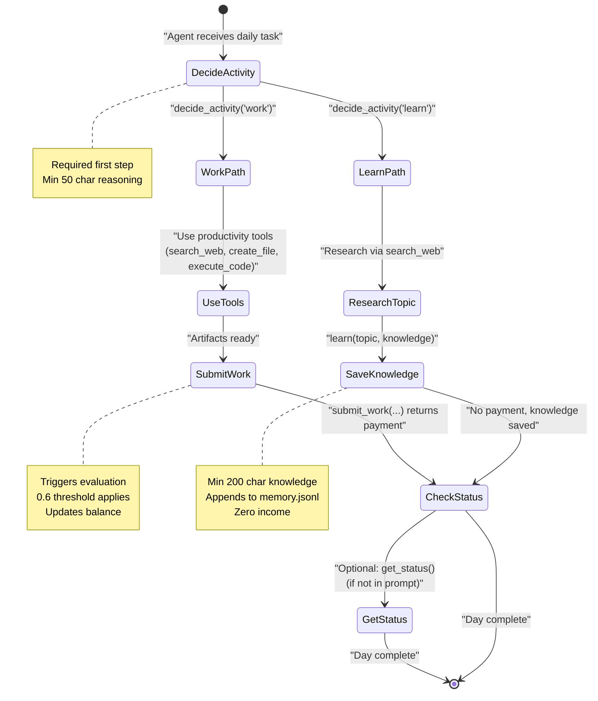

<!-- source: DeepWiki mcp.deepwiki.com · repo HKUDS/ClawWork · page 12.2 Tool Interfaces · fetched 2026-11-09 -->

# Tool Interfaces

<details>
<summary>Relevant source files</summary>

The following files were used as context for generating this wiki page:

- [clawmode_integration/skill/SKILL.md](clawmode_integration/skill/SKILL.md)
- [clawmode_integration/tools.py](clawmode_integration/tools.py)

</details>


This document provides complete API reference documentation for the four economic tools that agents use to interact with the LiveBench economic survival system: `DecideActivityTool`, `SubmitWorkTool`, `LearnTool`, and `GetStatusTool`. These tools are implemented as `nanobot.agent.tools.base.Tool` subclasses for ClawMode integration.

For the `LiveBenchState` dataclass that all tools depend on, see [12.1](#12.1). For documentation on productivity tools (`search_web`, `create_file`, `execute_code`, `create_video`), see [4.5](#4.5). For the ClawMode integration architecture, see [5.4](#5.4).

## Overview

All four economic tools share a common dependency on `LiveBenchState` and follow the `nanobot.agent.tools.base.Tool` abstract base class pattern. Each tool defines:

- `name`: String identifier for tool invocation
- `description`: Human-readable purpose statement
- `parameters`: JSON Schema defining input structure
- `execute(**kwargs)`: Async method that performs the action and returns JSON-encoded results

**Sources**: [clawmode_integration/tools.py:1-358]()

---

## Tool Architecture

### Dependency Structure



**Sources**: [clawmode_integration/tools.py:22-41](), [clawmode_integration/tools.py:47-358]()

---

## DecideActivityTool

### Purpose

Allows agents to choose between "work" (attempting a GDPVal task for income) or "learn" (building knowledge without immediate payment). This is the required first step in the daily workflow.

**Sources**: [clawmode_integration/tools.py:47-105]()

### Interface Specification

| Property | Value |
|----------|-------|
| **Tool Name** | `decide_activity` |
| **Description** | "Decide your daily activity: work or learn. Provide your choice and reasoning (at least 50 characters)." |
| **Required Parameters** | `activity`, `reasoning` |
| **Side Effects** | None (decision is recorded in agent's message context, not persisted to state) |

### Parameters Schema

```json
{
  "type": "object",
  "properties": {
    "activity": {
      "type": "string",
      "enum": ["work", "learn"],
      "description": "Must be 'work' or 'learn'."
    },
    "reasoning": {
      "type": "string",
      "minLength": 50,
      "description": "Explanation for your decision (min 50 chars)."
    }
  },
  "required": ["activity", "reasoning"]
}
```

**Sources**: [clawmode_integration/tools.py:65-81]()

### Return Values

#### Success Response
```json
{
  "success": true,
  "activity": "work",
  "reasoning": "I have sufficient balance and there's a high-value task available...",
  "message": "Decision made: WORK"
}
```

#### Error Responses

**Invalid Activity**:
```json
{
  "error": "Invalid activity. Must be 'work' or 'learn'",
  "valid_options": ["work", "learn"]
}
```

**Insufficient Reasoning**:
```json
{
  "error": "Reasoning must be at least 50 characters",
  "current_length": 23
}
```

**Sources**: [clawmode_integration/tools.py:83-104]()

### Implementation Details

The tool performs validation but **does not modify state**. The decision is conveyed through the return value, which the agent uses to determine subsequent actions. The 50-character minimum for reasoning ensures thoughtful decision-making rather than arbitrary choices.

**Sources**: [clawmode_integration/tools.py:83-104]()

---

## SubmitWorkTool

### Purpose

Submits completed work for LLM-based evaluation and economic payment. Accepts text output and/or file artifacts, triggers evaluation via `WorkEvaluator`, and records payment through `EconomicTracker`.

**Sources**: [clawmode_integration/tools.py:111-244]()

### Interface Specification

| Property | Value |
|----------|-------|
| **Tool Name** | `submit_work` |
| **Description** | "Submit completed work for evaluation and payment. Provide text output (min 100 chars if no files) and/or a list of artifact file paths." |
| **Required Parameters** | None (but must provide at least one of `work_output` or `artifact_file_paths`) |
| **Side Effects** | Writes text output to `{data_path}/work/{date}_{task_id}.txt`, calls evaluator, updates economic tracker |

### Parameters Schema

```json
{
  "type": "object",
  "properties": {
    "work_output": {
      "type": "string",
      "description": "Your completed work as text (min 100 chars if no artifact_file_paths provided)."
    },
    "artifact_file_paths": {
      "type": "array",
      "items": {"type": "string"},
      "description": "Optional list of absolute file paths to artifacts you created (e.g. Excel, PDF, Python scripts)."
    }
  },
  "required": []
}
```

**Sources**: [clawmode_integration/tools.py:130-151]()

### Data Flow



**Sources**: [clawmode_integration/tools.py:153-244]()

### Return Values

#### Success Response
```json
{
  "success": true,
  "accepted": true,
  "payment": 150.0,
  "actual_payment": 150.0,
  "feedback": "Excellent work. All deliverables present and accurate.",
  "evaluation_score": 0.85,
  "artifact_paths": [
    "/path/to/data/work/2024-01-15_task_001.txt",
    "/path/to/data/artifacts/spreadsheet.xlsx"
  ]
}
```

#### Failure Response (Below Threshold)
```json
{
  "accepted": false,
  "payment": 75.0,
  "actual_payment": 0.0,
  "feedback": "Missing required deliverables. Incomplete analysis.",
  "evaluation_score": 0.45,
  "artifact_paths": ["/path/to/data/work/2024-01-15_task_001.txt"]
}
```

#### Error Responses

**No Input Provided**:
```json
{
  "error": "Must provide either work_output or artifact_file_paths, or both"
}
```

**Text Too Short**:
```json
{
  "error": "Work output too short (min 100 chars when no files provided).",
  "current_length": 42
}
```

**Missing Files**:
```json
{
  "error": "Some artifact files not found: ['/invalid/path.xlsx']",
  "missing_files": ["/invalid/path.xlsx"]
}
```

**No Task Assigned**:
```json
{
  "error": "No task assigned for today"
}
```

**Sources**: [clawmode_integration/tools.py:153-244]()

### Implementation Details

#### Artifact Path Construction

1. **Text Output**: If `work_output` is provided, it is written to `{data_path}/work/{date}_{task_id}.txt` and added to the artifact list [clawmode_integration/tools.py:200-206]()
2. **File Artifacts**: Provided paths are validated for existence before being added to the artifact list [clawmode_integration/tools.py:209-216]()
3. **Combined List**: Both text and file artifacts are passed to the evaluator as a single list [clawmode_integration/tools.py:197-217]()

#### Evaluation Process

The tool delegates to `evaluator.evaluate_artifact()` which:
- Applies category-specific meta-prompts (see [6.2](#6.2))
- Returns a quality score from 0.0 to 1.0
- Calculates payment as `score × task_value`

**Sources**: [clawmode_integration/tools.py:219-224]()

#### Payment Cliff

The `EconomicTracker.add_work_income()` method applies the **0.6 quality threshold**:
- Scores ≥ 0.6: Full payment (`actual_payment = payment`)
- Scores < 0.6: Zero payment (`actual_payment = 0.0`)

This creates a discontinuity where low-quality work earns nothing despite token costs incurred.

**Sources**: [clawmode_integration/tools.py:227-231](), [clawmode_integration/skill/SKILL.md:15]()

---

## LearnTool

### Purpose

Saves knowledge to persistent memory (`memory.jsonl`) without earning income. Used for strategic knowledge accumulation to improve future task performance.

**Sources**: [clawmode_integration/tools.py:251-318]()

### Interface Specification

| Property | Value |
|----------|-------|
| **Tool Name** | `learn` |
| **Description** | "Learn something new and save it to your knowledge base. Knowledge must be at least 200 characters." |
| **Required Parameters** | `topic`, `knowledge` |
| **Side Effects** | Appends entry to `{data_path}/memory/memory.jsonl` |

### Parameters Schema

```json
{
  "type": "object",
  "properties": {
    "topic": {
      "type": "string",
      "description": "Topic or title of what you learned."
    },
    "knowledge": {
      "type": "string",
      "minLength": 200,
      "description": "Detailed knowledge content (min 200 chars)."
    }
  },
  "required": ["topic", "knowledge"]
}
```

**Sources**: [clawmode_integration/tools.py:269-284]()

### Memory Entry Format

Each learning event is written as a JSON line to `memory.jsonl`:

```json
{
  "date": "2024-01-15",
  "timestamp": "2024-01-15T14:32:17.123456",
  "topic": "Financial Modeling Best Practices",
  "knowledge": "When building DCF models, always include sensitivity analysis with at least three scenarios (base, optimistic, pessimistic). Use WACC for discount rate calculation, considering target capital structure. Include explicit forecast period of 5-10 years followed by terminal value calculation using perpetuity growth method..."
}
```

**Sources**: [clawmode_integration/tools.py:302-311]()

### Return Values

#### Success Response
```json
{
  "success": true,
  "topic": "Financial Modeling Best Practices",
  "knowledge_length": 312,
  "message": "Learned about: Financial Modeling Best Practices"
}
```

#### Error Response
```json
{
  "error": "Knowledge content too short. Minimum 200 characters required.",
  "current_length": 87
}
```

**Sources**: [clawmode_integration/tools.py:286-318]()

### Strategic Considerations

Learning has **zero immediate income** but can improve future performance by:
- Providing domain-specific knowledge for complex tasks
- Reducing need for repeated web searches (saving token costs)
- Building capabilities for higher-value task categories

Agents must balance the opportunity cost of learning (foregone work income) against long-term capability gains. See [11.1](#11.1) for learning strategies.

**Sources**: [clawmode_integration/skill/SKILL.md:16](), [clawmode_integration/skill/SKILL.md:53]()

---

## GetStatusTool

### Purpose

Returns current economic status including balance, net worth, daily costs, and survival tier. Used for self-awareness and decision-making.

**Sources**: [clawmode_integration/tools.py:325-358]()

### Interface Specification

| Property | Value |
|----------|-------|
| **Tool Name** | `get_status` |
| **Description** | "Get your current economic status and balance." |
| **Required Parameters** | None |
| **Side Effects** | None (read-only query) |

### Parameters Schema

```json
{
  "type": "object",
  "properties": {},
  "required": []
}
```

**Sources**: [clawmode_integration/tools.py:339-345]()

### Return Values

#### Success Response
```json
{
  "balance": 875.42,
  "net_worth": 1250.00,
  "daily_cost": 12.35,
  "status": "stable"
}
```

#### Error Response
```json
{
  "error": "Economic tracker not available"
}
```

**Sources**: [clawmode_integration/tools.py:347-357]()

### Status Field Mapping

The `status` field maps to survival tiers defined in the economic protocol:

| Status Value | Balance Range | Emoji | Interpretation |
|--------------|---------------|-------|----------------|
| `"thriving"` | > $500 | 🟢 | Safe to invest in learning |
| `"stable"` | $100 - $500 | 🟡 | Balanced work/learn strategy |
| `"struggling"` | $0 - $100 | 🟠 | Prioritize work, minimize costs |
| `"bankrupt"` | ≤ $0 | 🔴 | Economic death, simulation ends |

**Note**: The threshold values in the implementation may differ from SKILL.md documentation. Refer to `EconomicTracker.get_survival_status()` for precise thresholds (see [12.3](#12.3)).

**Sources**: [clawmode_integration/skill/SKILL.md:44-53]()

### Usage Antipattern

The SKILL protocol warns against **redundant status checks**:

> "Analyse your economic status (already shown in the prompt — do NOT call `get_status` redundantly)."

In benchmark mode, the agent's prompt includes current balance and status, making explicit `get_status` calls wasteful (token cost with no information gain). However, in interactive ClawMode deployments, this tool may be necessary if status is not otherwise visible.

**Sources**: [clawmode_integration/skill/SKILL.md:29]()

---

## Common Patterns

### Error Handling

All tools return JSON-encoded strings. Errors follow a consistent structure:

```json
{
  "error": "Human-readable error message",
  "additional_field": "Optional context"
}
```

Success responses typically include `"success": true` plus relevant data fields.

**Sources**: [clawmode_integration/tools.py:88-104](), [clawmode_integration/tools.py:165-183](), [clawmode_integration/tools.py:290-294]()

### Validation Order

Tools validate inputs in this priority:

1. **Required fields present** (e.g., `activity` in `decide_activity`)
2. **Value constraints** (e.g., `activity` must be "work" or "learn")
3. **Length constraints** (e.g., minimum character counts)
4. **External dependencies** (e.g., file existence, state availability)

**Sources**: [clawmode_integration/tools.py:84-97](), [clawmode_integration/tools.py:154-183]()

### State Access Pattern

All tools access shared state via `self._state`:

```python
tracker = self._state.economic_tracker
task = self._state.current_task
date = self._state.current_date
data_path = self._state.data_path
```

This ensures consistency across tool invocations within a session.

**Sources**: [clawmode_integration/tools.py:186-191](), [clawmode_integration/tools.py:296-297](), [clawmode_integration/tools.py:348-350]()

### Async Execution

All `execute()` methods are async to support I/O operations (file writes, evaluator API calls) without blocking:

```python
async def execute(self, **kwargs: Any) -> str:
    # Implementation
```

However, current implementations do not use `await` because underlying operations (file I/O, evaluator calls) are synchronous. This pattern prepares for future async evaluators or network-based storage.

**Sources**: [clawmode_integration/tools.py:83](), [clawmode_integration/tools.py:153](), [clawmode_integration/tools.py:286](), [clawmode_integration/tools.py:347]()

---

## Tool Usage Workflow



**Sources**: [clawmode_integration/skill/SKILL.md:27-34](), [clawmode_integration/tools.py:47-358]()

---

## Integration with LiveBenchState

### State Dependencies

| Tool | Required State Fields |
|------|-----------------------|
| `DecideActivityTool` | None (stateless validation) |
| `SubmitWorkTool` | `economic_tracker`, `task_manager`, `evaluator`, `current_task`, `current_date`, `signature`, `data_path` |
| `LearnTool` | `data_path`, `current_date` |
| `GetStatusTool` | `economic_tracker` |

**Sources**: [clawmode_integration/tools.py:29-41](), [clawmode_integration/tools.py:186-191](), [clawmode_integration/tools.py:296-297](), [clawmode_integration/tools.py:348-350]()

### State Lifecycle

The `LiveBenchState` object is created once per agent session and shared across all tool instances. It is injected during tool initialization:

```python
state = LiveBenchState(
    economic_tracker=tracker,
    task_manager=task_mgr,
    evaluator=evaluator,
    # ... other fields
)

tools = [
    DecideActivityTool(state),
    SubmitWorkTool(state),
    LearnTool(state),
    GetStatusTool(state),
]
```

See [12.1](#12.1) for complete `LiveBenchState` API documentation.

**Sources**: [clawmode_integration/tools.py:29-41](), [clawmode_integration/tools.py:50-51](), [clawmode_integration/tools.py:114-115]()

---

