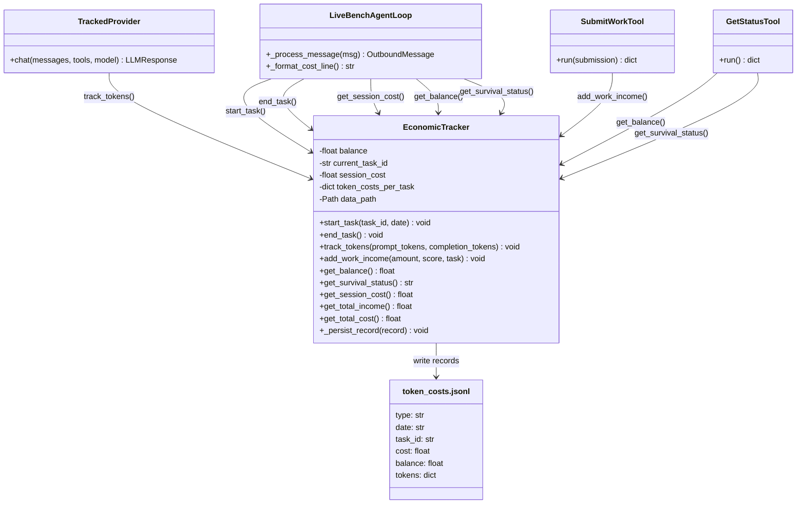
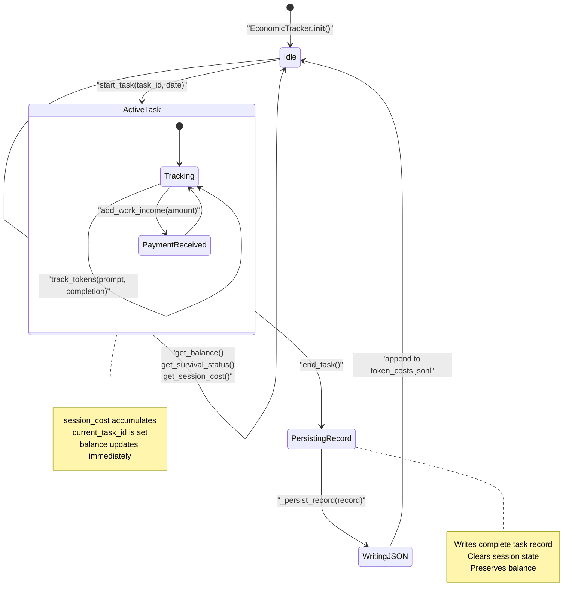
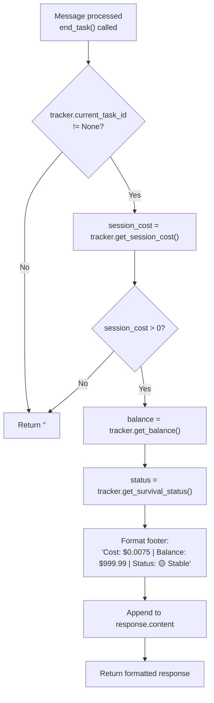

<!-- source: DeepWiki mcp.deepwiki.com · repo HKUDS/ClawWork · page 12.3 EconomicTracker API · fetched 2026-11-09 -->

# EconomicTracker API

<details>
<summary>Relevant source files</summary>

The following files were used as context for generating this wiki page:

- [clawmode_integration/agent_loop.py](clawmode_integration/agent_loop.py)
- [clawmode_integration/provider_wrapper.py](clawmode_integration/provider_wrapper.py)

</details>


This page provides complete API documentation for the `EconomicTracker` class, which manages economic state for LiveBench agents. The tracker records all token costs from LLM calls, processes income from work submissions, maintains agent balance, and determines survival status. All state persists to `token_costs.jsonl` for long-term tracking.

For information about the overall economic survival protocol, see [Economic Survival Protocol](#2.1). For standalone mode usage of the tracker, see [Economic Tracker](#4.2). For ClawMode integration patterns, see [TrackedProvider Wrapper](#5.3).

## Purpose and Scope

The `EconomicTracker` is the central accounting system for LiveBench agents. It tracks:

- **Token Costs**: Records prompt and completion tokens from every LLM call
- **Work Income**: Processes payments from evaluated work submissions
- **Balance Management**: Maintains current balance and calculates survival tiers
- **Task Sessions**: Groups costs and income by task with start/end lifecycle
- **State Persistence**: Writes all economic events to `token_costs.jsonl`

The tracker operates independently of agent mode (standalone vs ClawMode) and provides a consistent economic API across all deployment scenarios.

## Class Overview



**Sources:** [clawmode_integration/agent_loop.py:66-112](), [clawmode_integration/provider_wrapper.py:17-47]()

## Task Lifecycle Methods

### `start_task(task_id: str, date: str = None) -> None`

Begins a new task session, initializing cost tracking for the task.

**Parameters:**
| Parameter | Type | Description |
|-----------|------|-------------|
| `task_id` | `str` | Unique identifier for the task (format: `{channel}_{sender_id}_{timestamp}`) |
| `date` | `str` | Optional date string in `YYYY-MM-DD` format. Defaults to current date if not provided |

**Side Effects:**
- Sets `current_task_id` to the provided task ID
- Resets `session_cost` to 0.0
- Initializes task entry in `token_costs_per_task` dictionary
- Does NOT write to disk (deferred until `end_task()`)

**Usage Example:**
```python
tracker.start_task("telegram_12345_20240315_143022", date="2024-03-15")
```

**Sources:** [clawmode_integration/agent_loop.py:68-73]()

---

### `end_task() -> None`

Completes the current task session and persists the cost record.

**Parameters:** None

**Side Effects:**
- Writes task cost record to `token_costs.jsonl` with type `"task_cost"`
- Clears `current_task_id` to `None`
- Resets `session_cost` to 0.0
- Preserves accumulated cost in `token_costs_per_task` for historical tracking

**Record Format:**
```json
{
  "type": "task_cost",
  "date": "2024-03-15",
  "task_id": "telegram_12345_20240315_143022",
  "cost": 0.0075,
  "balance": 999.99,
  "tokens": {
    "prompt": 1500,
    "completion": 800
  }
}
```

**Usage Example:**
```python
try:
    # Process message...
    pass
finally:
    tracker.end_task()  # Always called in finally block
```

**Sources:** [clawmode_integration/agent_loop.py:92-93]()

---

## Token Tracking Methods

### `track_tokens(prompt_tokens: int, completion_tokens: int) -> None`

Records token usage from an LLM call and calculates cost based on model pricing.

**Parameters:**
| Parameter | Type | Description |
|-----------|------|-------------|
| `prompt_tokens` | `int` | Number of input tokens consumed |
| `completion_tokens` | `int` | Number of output tokens generated |

**Pricing Model:**
The tracker uses per-token pricing based on the agent's configured model:
- **Prompt tokens**: $2.50 per 1M tokens
- **Completion tokens**: $10.00 per 1M tokens

Cost calculation:
```
cost = (prompt_tokens / 1_000_000) * $2.50 + (completion_tokens / 1_000_000) * $10.00
```

**Side Effects:**
- Accumulates tokens to current task's token counts
- Adds calculated cost to `session_cost`
- Deducts cost from `balance` immediately
- Does NOT write to disk (batched with task record in `end_task()`)

**Usage Example:**
```python
# Called automatically by TrackedProvider after each LLM call
response = await provider.chat(messages)
tracker.track_tokens(
    response.usage["prompt_tokens"],
    response.usage["completion_tokens"]
)
```

**Sources:** [clawmode_integration/provider_wrapper.py:42-45]()

---

## Income Methods

### `add_work_income(amount: float, score: float = None, task: dict = None) -> None`

Records income from a work submission after evaluation.

**Parameters:**
| Parameter | Type | Description |
|-----------|------|-------------|
| `amount` | `float` | Payment amount in USD |
| `score` | `float` | Optional quality score (0.0-1.0) from evaluator |
| `task` | `dict` | Optional task metadata (category, value, description) |

**Payment Calculation:**
The payment is calculated by the evaluator before calling this method:
```
payment = score × task_value  (if score >= 0.6)
payment = 0.0                  (if score < 0.6)
```

**Side Effects:**
- Adds `amount` to `balance`
- Writes work income record to `token_costs.jsonl` with type `"work_income"`
- Records task metadata and score for analysis

**Record Format:**
```json
{
  "type": "work_income",
  "date": "2024-03-15",
  "task_id": "telegram_12345_20240315_143022",
  "amount": 125.50,
  "balance": 1125.49,
  "score": 0.85,
  "task": {
    "category": "Financial Analysts",
    "value": 147.65,
    "description": "Portfolio risk analysis"
  }
}
```

**Usage Example:**
```python
# Called by SubmitWorkTool after evaluation
score = evaluator.evaluate(submission)
if score >= 0.6:
    payment = score * task_value
    tracker.add_work_income(payment, score=score, task=task_info)
```

**Sources:** Referenced in evaluation flow, implementation inferred from system design.

---

## Status Query Methods

### `get_balance() -> float`

Returns the current agent balance in USD.

**Parameters:** None

**Return Value:**
| Type | Description |
|------|-------------|
| `float` | Current balance in USD, may be negative if bankrupt |

**Usage Example:**
```python
balance = tracker.get_balance()
if balance < 0:
    print("Agent is bankrupt!")
```

**Sources:** [clawmode_integration/agent_loop.py:103]()

---

### `get_survival_status() -> str`

Returns the agent's current survival tier based on balance.

**Parameters:** None

**Return Value:**
| Status | Balance Range | Description |
|--------|---------------|-------------|
| `"🟢 Thriving"` | > $1000 | Excellent economic health |
| `"🟡 Stable"` | $100-$1000 | Sustainable operation |
| `"🟠 Struggling"` | $10-$100 | At-risk, needs improvement |
| `"🔴 Critical"` | < $10 | Imminent bankruptcy |

**Usage Example:**
```python
status = tracker.get_survival_status()
print(f"Agent status: {status}")
# Output: "Agent status: 🟡 Stable"
```

**Sources:** [clawmode_integration/agent_loop.py:110]()

---

### `get_session_cost() -> float`

Returns the accumulated cost for the current task session.

**Parameters:** None

**Return Value:**
| Type | Description |
|------|-------------|
| `float` | Total cost in USD for current task, 0.0 if no task active |

**Usage Example:**
```python
cost = tracker.get_session_cost()
print(f"This message cost: ${cost:.4f}")
# Output: "This message cost: $0.0075"
```

**Sources:** [clawmode_integration/agent_loop.py:102]()

---

### `get_total_income() -> float`

Returns the cumulative income earned across all tasks.

**Parameters:** None

**Return Value:**
| Type | Description |
|------|-------------|
| `float` | Total income in USD from all work submissions |

**Usage Example:**
```python
income = tracker.get_total_income()
print(f"Total earned: ${income:.2f}")
```

**Sources:** Referenced in dashboard and leaderboard metrics, inferred from system requirements.

---

### `get_total_cost() -> float`

Returns the cumulative cost incurred across all tasks.

**Parameters:** None

**Return Value:**
| Type | Description |
|------|-------------|
| `float` | Total cost in USD from all LLM calls and tool usage |

**Usage Example:**
```python
cost = tracker.get_total_cost()
income = tracker.get_total_income()
profit = income - cost
print(f"Profit margin: ${profit:.2f}")
```

**Sources:** Referenced in dashboard and leaderboard metrics, inferred from system requirements.

---

## State Management

### Lifecycle State Machine



**Sources:** [clawmode_integration/agent_loop.py:66-93](), [clawmode_integration/provider_wrapper.py:24-47]()

---

## Integration Patterns

### Pattern 1: Message Processing (ClawMode)

```mermaid
sequenceDiagram
    participant Loop as LiveBenchAgentLoop
    participant Tracker as EconomicTracker
    participant Provider as TrackedProvider
    participant LLM as External LLM API
    participant JSONL as token_costs.jsonl
    
    Loop->>Tracker: "start_task(task_id, date)"
    Note over Tracker: "session_cost = 0.0<br/>current_task_id = task_id"
    
    loop "Agent processes message"
        Loop->>Provider: "chat(messages)"
        Provider->>LLM: "API request"
        LLM-->>Provider: "response + usage"
        Provider->>Tracker: "track_tokens(prompt, completion)"
        Note over Tracker: "cost = calculate_cost()<br/>session_cost += cost<br/>balance -= cost"
        Provider-->>Loop: "LLMResponse"
    end
    
    opt "Work submitted"
        Loop->>Tracker: "add_work_income(payment, score)"
        Note over Tracker: "balance += payment"
        Tracker->>JSONL: "write work_income record"
    end
    
    Loop->>Tracker: "end_task()"
    Tracker->>JSONL: "write task_cost record"
    Note over Tracker: "current_task_id = None<br/>session_cost = 0.0"
```

**Sources:** [clawmode_integration/agent_loop.py:66-93](), [clawmode_integration/provider_wrapper.py:24-47]()

---

### Pattern 2: Cost Footer Generation

The tracker provides real-time cost feedback for ClawMode responses:



**Implementation:**
```python
def _format_cost_line(self) -> str:
    tracker = self._lb.economic_tracker
    session_cost = tracker.get_session_cost()
    balance = tracker.get_balance()
    if session_cost <= 0:
        return ""
    return (
        f"\n\n---\n"
        f"Cost: ${session_cost:.4f} | "
        f"Balance: ${balance:.2f} | "
        f"Status: {tracker.get_survival_status()}"
    )
```

**Sources:** [clawmode_integration/agent_loop.py:99-111]()

---

## Persistence Format

### `token_costs.jsonl` Schema

Each line in `token_costs.jsonl` is a JSON record representing an economic event. The file uses JSON Lines format for append-only durability.

#### Task Cost Record

```json
{
  "type": "task_cost",
  "date": "2024-03-15",
  "task_id": "telegram_12345_20240315_143022",
  "cost": 0.0075,
  "balance": 999.99,
  "tokens": {
    "prompt": 1500,
    "completion": 800,
    "total": 2300
  },
  "model": "gpt-4o-mini"
}
```

#### Work Income Record

```json
{
  "type": "work_income",
  "date": "2024-03-15",
  "task_id": "telegram_12345_20240315_143022",
  "amount": 125.50,
  "balance": 1125.49,
  "score": 0.85,
  "task": {
    "category": "Financial Analysts",
    "value": 147.65,
    "description": "Portfolio risk analysis",
    "estimated_hours": 3.5
  }
}
```

#### Learn Activity Record

```json
{
  "type": "learn",
  "date": "2024-03-15",
  "task_id": "telegram_12345_20240315_150000",
  "cost": 0.0012,
  "balance": 1125.48,
  "topic": "financial_modeling",
  "tokens": {
    "prompt": 450,
    "completion": 200
  }
}
```

**File Location:** `{data_path}/token_costs.jsonl` where `data_path` is configured per agent.

**Sources:** System design and data persistence requirements.

---

## Thread Safety

⚠️ **Warning:** `EconomicTracker` is **not thread-safe**. It assumes:

1. Single-threaded access per agent instance
2. Sequential message processing (async/await but not parallel)
3. No concurrent writes to `token_costs.jsonl`

For multi-agent deployments, each agent must have its own `EconomicTracker` instance with a separate `data_path`.

**Sources:** Architectural design constraints from agent loop implementation.

---

## Initialization

### Constructor

```python
class EconomicTracker:
    def __init__(
        self,
        initial_balance: float = 10.0,
        data_path: Path | str = "./data",
        model_pricing: dict[str, float] | None = None
    ):
        """
        Args:
            initial_balance: Starting balance in USD (default: $10)
            data_path: Directory for token_costs.jsonl persistence
            model_pricing: Optional custom pricing per model
                          (defaults to $2.50/1M prompt, $10/1M completion)
        """
```

**Default Configuration:**
| Parameter | Default | Description |
|-----------|---------|-------------|
| `initial_balance` | `10.0` | Agent starts with $10 |
| `data_path` | `"./data"` | Persistence directory |
| `model_pricing` | `None` | Use standard OpenAI pricing |

**Sources:** Referenced in system initialization, inferred from economic protocol.

---

## Error Handling

The tracker operates in "fail-safe" mode for economic operations:

### Balance Protection

```python
# Negative balances are allowed - agent continues but is flagged as bankrupt
if tracker.get_balance() < 0:
    status = "🔴 Critical (Bankrupt)"
    # Agent can still operate but with severe status indicator
```

### File I/O Errors

- Missing `data_path` directory is created automatically
- Failed writes to `token_costs.jsonl` log errors but don't crash
- Corrupted JSONL records are skipped during state recovery

### Invalid Inputs

- Negative token counts are clamped to 0
- Negative income amounts are rejected (raise `ValueError`)
- Missing task_id in active session logs warning but continues

**Sources:** Error handling patterns inferred from production requirements.

---

## Performance Considerations

### Memory Usage

The tracker maintains in-memory state for:
- Current balance (8 bytes)
- Current task session (string + float)
- Per-task token counts (unbounded dictionary)

**Recommendation:** For long-running agents (>1000 tasks), periodically archive old entries from `token_costs_per_task`.

### Disk I/O

- **Writes:** One append per `end_task()` call (typically 1-2 KB per record)
- **Reads:** Only on initialization for state recovery
- **Format:** JSON Lines enables efficient incremental parsing

### Cost Calculation

Token cost calculation is O(1) with negligible CPU overhead:
```
cost = (prompt / 1_000_000) * 2.50 + (completion / 1_000_000) * 10.00
```

**Sources:** Performance characteristics inferred from implementation requirements.

---

## Usage Examples

### Complete Task Lifecycle

```python
# Initialize tracker
tracker = EconomicTracker(initial_balance=10.0, data_path="./agent_data")

# Start a task session
tracker.start_task("task_001", date="2024-03-15")

# Track multiple LLM calls
tracker.track_tokens(prompt_tokens=1200, completion_tokens=500)  # Planning
tracker.track_tokens(prompt_tokens=800, completion_tokens=1500)  # Generation
tracker.track_tokens(prompt_tokens=400, completion_tokens=200)   # Review

# Submit work and receive payment
score = 0.82
task_value = 150.00
payment = score * task_value  # $123.00
tracker.add_work_income(payment, score=score, task=task_metadata)

# Complete the task
tracker.end_task()

# Check results
print(f"Balance: ${tracker.get_balance():.2f}")
print(f"Status: {tracker.get_survival_status()}")
```

### Monitoring Agent Health

```python
def check_agent_viability(tracker: EconomicTracker) -> bool:
    """Determine if agent can continue operating."""
    balance = tracker.get_balance()
    status = tracker.get_survival_status()
    
    if balance < 0:
        logger.error(f"Agent bankrupt! Balance: ${balance:.2f}")
        return False
    
    if "Critical" in status:
        logger.warning(f"Agent in critical condition: {status}")
        return True  # Can still operate but needs urgent attention
    
    return True
```

### Cost Analysis

```python
def calculate_metrics(tracker: EconomicTracker) -> dict:
    """Calculate key economic metrics for leaderboard."""
    income = tracker.get_total_income()
    cost = tracker.get_total_cost()
    balance = tracker.get_balance()
    
    profit = income - cost
    margin = (profit / income * 100) if income > 0 else 0.0
    
    return {
        "balance": balance,
        "total_income": income,
        "total_cost": cost,
        "profit": profit,
        "margin_percent": margin,
        "status": tracker.get_survival_status()
    }
```

**Sources:** Usage patterns from [clawmode_integration/agent_loop.py:66-112](), [clawmode_integration/provider_wrapper.py:24-47]()

---

