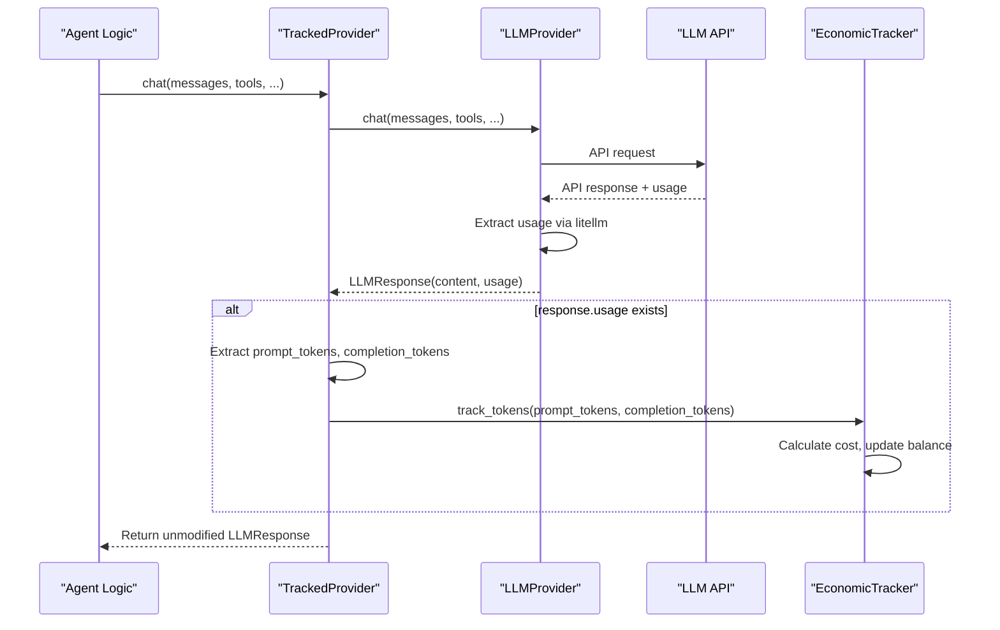
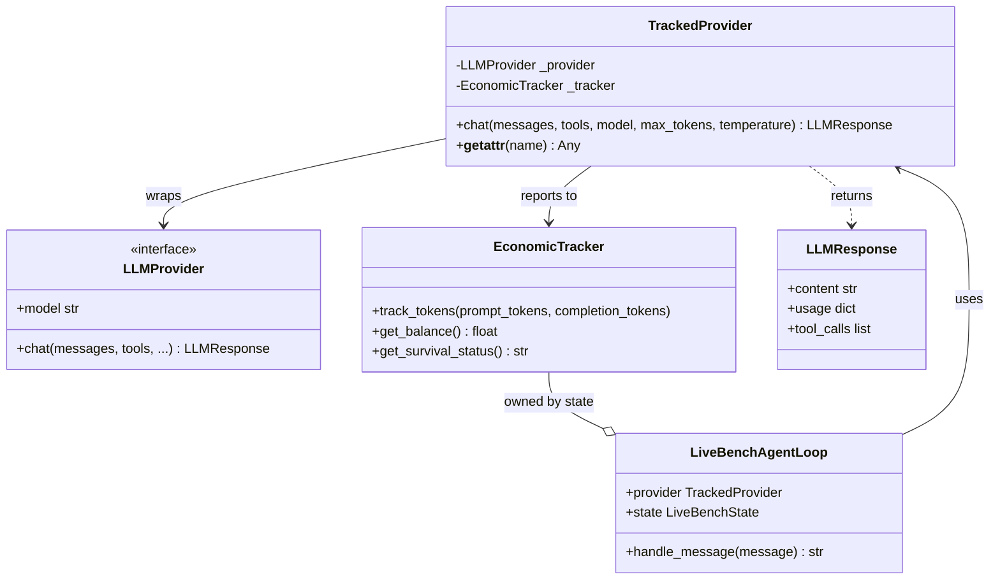

<!-- source: DeepWiki mcp.deepwiki.com · repo HKUDS/ClawWork · page 12.4 TrackedProvider API · fetched 2026-11-09 -->

# TrackedProvider API

<details>
<summary>Relevant source files</summary>

The following files were used as context for generating this wiki page:

- [clawmode_integration/provider_wrapper.py](clawmode_integration/provider_wrapper.py)

</details>


This page documents the `TrackedProvider` class, a transparent wrapper that intercepts LLM provider calls to track token usage in real-time. `TrackedProvider` bridges nanobot's `LLMProvider` interface with LiveBench's `EconomicTracker`, enabling accurate per-message cost accounting in ClawMode deployments.

For higher-level ClawMode architecture, see [ClawMode Overview](#5.1). For the economic tracking implementation, see [EconomicTracker API](#12.3).

---

## Purpose and Design

`TrackedProvider` solves a critical requirement in ClawMode: capturing accurate token usage from every LLM call without modifying nanobot's core agent logic. The wrapper sits between the agent and the underlying LLM provider, transparently intercepting `chat()` calls to extract token counts from `LLMResponse.usage` and forward them to `EconomicTracker`.

This design improves upon LiveBench's original token estimation (`len(text) // 4`) by leveraging nanobot's integration with litellm, which provides exact `prompt_tokens` and `completion_tokens` from provider APIs.

**Sources:** [clawmode_integration/provider_wrapper.py:1-8]()

---

## Class Definition

```python
class TrackedProvider:
    """Transparent wrapper that tracks token costs via EconomicTracker."""
```

`TrackedProvider` is defined in `clawmode_integration/provider_wrapper.py` and implements a proxy pattern for `LLMProvider` instances. The class maintains references to both the underlying provider and the economic tracker, forwarding method calls while injecting cost tracking logic.

**Sources:** [clawmode_integration/provider_wrapper.py:17-22]()

---

## Constructor

```python
def __init__(self, provider: LLMProvider, tracker: Any) -> None:
    self._provider = provider
    self._tracker = tracker  # EconomicTracker
```

### Parameters

| Parameter | Type | Description |
|-----------|------|-------------|
| `provider` | `LLMProvider` | The underlying nanobot LLM provider to wrap (e.g., OpenAIProvider, ClaudeProvider) |
| `tracker` | `Any` (typed as `EconomicTracker`) | The economic tracker instance that receives token usage data |

The constructor stores references without validation, enabling lazy initialization patterns where the tracker may be configured after provider creation.

**Sources:** [clawmode_integration/provider_wrapper.py:20-22]()

---

## Primary Method: `chat()`

### Interface

```python
async def chat(
    self,
    messages: list[dict[str, Any]],
    tools: list[dict[str, Any]] | None = None,
    model: str | None = None,
    max_tokens: int = 4096,
    temperature: float = 0.7,
) -> LLMResponse:
```

The `chat()` method is the core interception point. It forwards all parameters to the wrapped provider's `chat()` method, then extracts token usage from the response before returning.

### Parameters

| Parameter | Type | Default | Description |
|-----------|------|---------|-------------|
| `messages` | `list[dict[str, Any]]` | Required | Conversation history in OpenAI message format |
| `tools` | `list[dict[str, Any]] \| None` | `None` | Tool definitions for function calling |
| `model` | `str \| None` | `None` | Model override (falls back to provider default) |
| `max_tokens` | `int` | `4096` | Maximum completion tokens |
| `temperature` | `float` | `0.7` | Sampling temperature |

### Return Value

Returns the unmodified `LLMResponse` from the underlying provider, containing:
- `content`: Response text or tool calls
- `usage`: Dictionary with `prompt_tokens` and `completion_tokens`
- Additional provider-specific metadata

### Implementation Flow



**Diagram: Token Tracking Flow in TrackedProvider.chat()**

The method performs these steps:

1. **Forward Request**: Delegates to `self._provider.chat()` with all parameters [clawmode_integration/provider_wrapper.py:32-38]()
2. **Check Usage**: Verifies both `response.usage` and `self._tracker` exist [clawmode_integration/provider_wrapper.py:41]()
3. **Extract Tokens**: Retrieves `prompt_tokens` and `completion_tokens` with defaults of 0 [clawmode_integration/provider_wrapper.py:42-45]()
4. **Track Costs**: Calls `tracker.track_tokens()` to update economic state [clawmode_integration/provider_wrapper.py:42-45]()
5. **Return Response**: Returns the original `LLMResponse` unchanged [clawmode_integration/provider_wrapper.py:47]()

**Sources:** [clawmode_integration/provider_wrapper.py:24-47]()

---

## Transparent Delegation

### `__getattr__` Implementation

```python
def __getattr__(self, name: str) -> Any:
    return getattr(self._provider, name)
```

The `__getattr__` magic method implements transparent delegation of all non-overridden attributes and methods to the wrapped provider. This ensures `TrackedProvider` acts as a drop-in replacement for `LLMProvider` without explicitly implementing every interface method.

### Forwarded Attributes

Common attributes accessed via delegation:
- `model`: Default model name
- `api_key`: Provider credentials
- `base_url`: API endpoint
- Any provider-specific configuration

**Sources:** [clawmode_integration/provider_wrapper.py:49-51]()

---

## Integration Architecture



**Diagram: Class Relationships in ClawMode Token Tracking**

The diagram shows how `TrackedProvider` mediates between nanobot's provider infrastructure and LiveBench's economic tracking:

1. **Wrapping**: `TrackedProvider._provider` holds the actual `LLMProvider` instance
2. **Reporting**: `TrackedProvider._tracker` references the `EconomicTracker` from `LiveBenchState`
3. **Integration**: `LiveBenchAgentLoop` constructs `TrackedProvider` during initialization
4. **Data Flow**: Token counts flow from `LLMResponse.usage` to `EconomicTracker.track_tokens()`

**Sources:** [clawmode_integration/provider_wrapper.py:17-51]()

---

## Token Usage Extraction

### Usage Dictionary Structure

The `response.usage` dictionary follows litellm's standardized format:

```python
{
    "prompt_tokens": 1234,        # Input tokens
    "completion_tokens": 567,     # Output tokens
    "total_tokens": 1801          # Sum (not used by TrackedProvider)
}
```

### Safe Extraction

`TrackedProvider` uses `.get()` with default values to handle missing keys:

```python
response.usage.get("prompt_tokens", 0)
response.usage.get("completion_tokens", 0)
```

This prevents exceptions if:
- Provider omits usage data
- Response is from a mock/test provider
- API temporarily fails to return usage

**Sources:** [clawmode_integration/provider_wrapper.py:41-45]()

---

## Comparison with Original Token Estimation

### LiveBench Standalone Approach

In standalone mode, LiveBench estimates tokens using a simple heuristic:

```python
# Approximate token count (4 characters ≈ 1 token)
token_count = len(text) // 4
```

This works for basic cost estimation but lacks accuracy across:
- Different tokenization schemes (GPT-3.5 vs GPT-4 vs Claude)
- Non-English text
- Special tokens and control sequences

### ClawMode Accurate Tracking

`TrackedProvider` leverages litellm's provider-specific token counters:

```python
# Exact counts from API response
prompt_tokens = response.usage.get("prompt_tokens", 0)
completion_tokens = response.usage.get("completion_tokens", 0)
```

This provides:
- **Provider-specific accuracy**: Each API returns its own token counts
- **Prompt/completion separation**: Enables differential pricing (many providers charge different rates)
- **Zero estimation error**: Matches actual billing

**Sources:** [clawmode_integration/provider_wrapper.py:1-8](), [clawmode_integration/provider_wrapper.py:41-45]()

---

## Usage Example

### Initialization in LiveBenchAgentLoop

```python
# Pseudocode showing TrackedProvider construction
from nanobot.providers import OpenAIProvider
from clawmode_integration.provider_wrapper import TrackedProvider
from livebench.economic_tracker import EconomicTracker

# Create base provider
base_provider = OpenAIProvider(
    api_key=os.getenv("OPENAI_API_KEY"),
    model="gpt-4o-mini"
)

# Create economic tracker
tracker = EconomicTracker(
    data_path="data/agent_economics.json",
    initial_balance=10.0
)

# Wrap provider with tracking
tracked_provider = TrackedProvider(
    provider=base_provider,
    tracker=tracker
)

# Use in agent loop
agent = LiveBenchAgentLoop(
    provider=tracked_provider,
    state=LiveBenchState(economic_tracker=tracker, ...)
)
```

### Runtime Behavior

```python
# Agent makes LLM call through TrackedProvider
response = await tracked_provider.chat(
    messages=[
        {"role": "system", "content": "You are a helpful assistant."},
        {"role": "user", "content": "What is 2+2?"}
    ],
    model="gpt-4o-mini",
    max_tokens=100
)

# TrackedProvider automatically:
# 1. Forwards call to OpenAIProvider.chat()
# 2. Receives response with usage: {"prompt_tokens": 23, "completion_tokens": 15}
# 3. Calls tracker.track_tokens(23, 15)
# 4. Returns response to agent

print(response.content)  # "2+2 equals 4."
print(tracker.get_balance())  # 9.9996 (initial 10.0 minus token costs)
```

**Sources:** [clawmode_integration/provider_wrapper.py:20-47]()

---

## Error Handling

### Graceful Degradation

`TrackedProvider` handles missing or invalid usage data gracefully:

| Scenario | Behavior |
|----------|----------|
| `response.usage` is `None` | Skips tracking (no exception) |
| `self._tracker` is `None` | Skips tracking (no exception) |
| Missing `prompt_tokens` key | Uses 0 as default |
| Missing `completion_tokens` key | Uses 0 as default |
| Provider exception | Propagates exception (no wrapping) |

The implementation at [clawmode_integration/provider_wrapper.py:41-45]() uses defensive checks:

```python
if response.usage and self._tracker:
    self._tracker.track_tokens(
        response.usage.get("prompt_tokens", 0),
        response.usage.get("completion_tokens", 0),
    )
```

This ensures:
- No crashes from malformed responses
- Compatible with test/mock providers
- Fails safe when tracker isn't configured

**Sources:** [clawmode_integration/provider_wrapper.py:41-45]()

---

## Thread Safety

`TrackedProvider` itself is stateless (stores only references), making it inherently thread-safe for read operations. However:

- **Provider thread safety**: Depends on the wrapped `LLMProvider` implementation
- **Tracker thread safety**: `EconomicTracker.track_tokens()` must handle concurrent calls if multiple agents share one tracker
- **Async safety**: The `async def chat()` signature is compatible with asyncio but doesn't enforce serialization

For multi-agent deployments, use separate `TrackedProvider` instances with separate `EconomicTracker` instances to avoid race conditions.

**Sources:** [clawmode_integration/provider_wrapper.py:17-51]()

---

## Performance Characteristics

### Overhead Analysis

`TrackedProvider` adds minimal overhead to LLM calls:

1. **Token extraction**: Two dictionary lookups (`O(1)`)
2. **Tracker call**: `track_tokens()` performs simple arithmetic and list append
3. **No serialization**: Response object returned without copying

Total overhead: **< 1ms per call**, negligible compared to typical LLM latency (500-5000ms).

### Memory Footprint

- **Per instance**: 2 object references (16 bytes on 64-bit systems)
- **Per call**: No additional allocations (response object reused)

**Sources:** [clawmode_integration/provider_wrapper.py:24-47]()

---

## Type Annotations

### Type Compatibility

```python
# TrackedProvider is compatible with any function expecting LLMProvider
def use_provider(provider: LLMProvider) -> None:
    await provider.chat([{"role": "user", "content": "Hello"}])

# Works without modification
tracked = TrackedProvider(OpenAIProvider(), tracker)
use_provider(tracked)  # Type checkers accept this
```

The `__getattr__` delegation enables duck typing, though static type checkers may require explicit protocol definitions or type: ignore comments.

### Current Limitations

- `tracker` parameter typed as `Any` instead of `EconomicTracker` to avoid circular imports
- No explicit `LLMProvider` inheritance (relies on structural subtyping)

**Sources:** [clawmode_integration/provider_wrapper.py:20-22]()

---

## Related Components

### Dependencies

| Component | Relationship | Purpose |
|-----------|--------------|---------|
| `nanobot.providers.base.LLMProvider` | Wraps | Provides base LLM interface |
| `nanobot.providers.base.LLMResponse` | Returns | Contains usage data |
| `EconomicTracker` | Calls | Receives token counts |
| `LiveBenchAgentLoop` | Used by | Primary consumer |

### See Also

- [LiveBenchAgentLoop Extension](#5.2) - Shows how `TrackedProvider` integrates into the agent loop
- [EconomicTracker API](#12.3) - Documents the `track_tokens()` method implementation
- [ClawMode Overview](#5.1) - Architecture context for token tracking requirements

**Sources:** [clawmode_integration/provider_wrapper.py:1-51]()