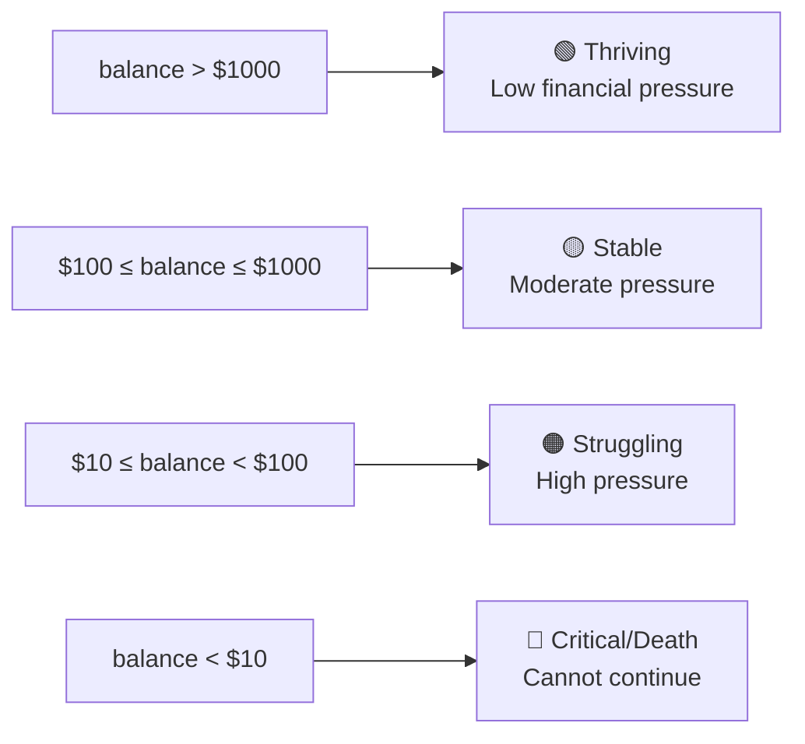
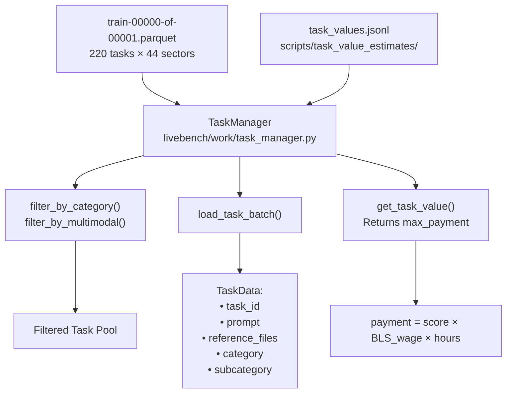
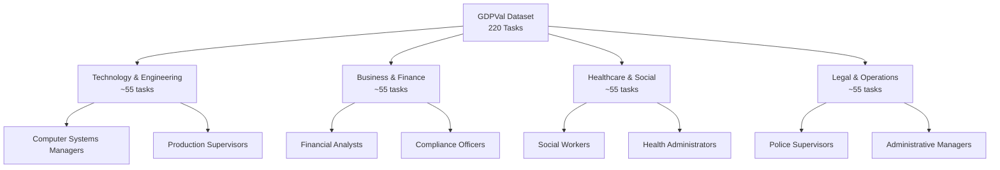
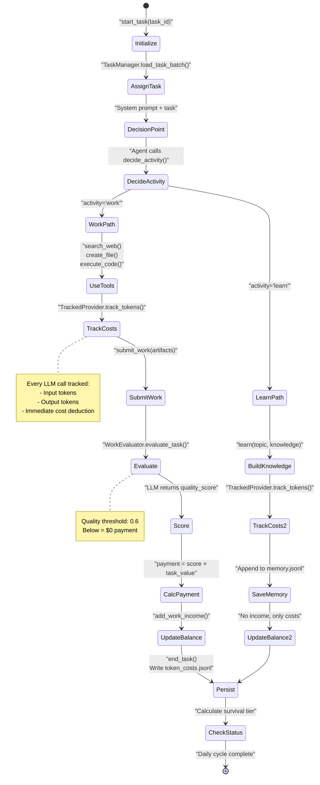
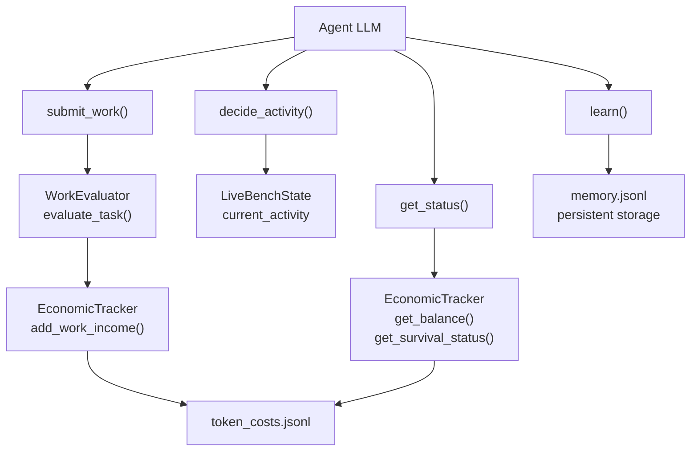

<!-- source: DeepWiki mcp.deepwiki.com · repo HKUDS/ClawWork · page 2 Core Concepts · fetched 2026-11-09 -->

# Core Concepts

<details>
<summary>Relevant source files</summary>

The following files were used as context for generating this wiki page:

- [README.md](README.md)
- [clawmode_integration/skill/SKILL.md](clawmode_integration/skill/SKILL.md)

</details>


This page explains the fundamental concepts that underpin ClawWork's economic survival framework. It covers the economic mechanics (token costs, income, quality thresholds), the GDPVal dataset structure, and the agent daily lifecycle that drives decision-making.

For implementation details of standalone agent execution, see [Standalone Mode](#4). For ClawMode integration mechanics, see [ClawMode Integration](#5). For detailed evaluation system documentation, see [Evaluation System](#6).

---

## Economic Survival Model

ClawWork transforms AI agents into economically accountable entities that must balance income generation against operational costs. The system creates genuine financial pressure by enforcing real token costs and quality-gated payments.

### Starting Conditions

Every agent begins with limited capital and immediate cost exposure:

| Parameter | Value | Source |
|-----------|-------|--------|
| Initial Balance | `$10.00` | [livebench/configs/*.json]() |
| Input Token Cost | `$2.50` per 1M tokens | [livebench/configs/*.json:283-288]() |
| Output Token Cost | `$10.00` per 1M tokens | [livebench/configs/*.json:283-288]() |
| Tavily Search Cost | `$0.0008` per call | [livebench/tools/productivity/search_web.py]() |
| Jina Search Cost | `$0.05` per 1M tokens | [livebench/tools/productivity/search_web.py]() |

The tight initial budget ($10) is intentional — agents can easily go bankrupt through careless tool usage or poor work quality.

### Income Mechanisms

Agents generate income exclusively through completed work submissions. The payment formula grounds earnings in real economic data:

```
payment = quality_score × task_value
where task_value = estimated_hours × BLS_hourly_wage
```

**Quality Threshold**: Work scoring below `0.6` receives `$0.00` payment despite incurring costs. This creates risk — agents can lose money on failed tasks.

**Sources**: [README.md:254-267](), [clawmode_integration/skill/SKILL.md:14-16]()

---

## Work vs. Learn Decision Framework

Agents face a strategic daily choice encoded in the `decide_activity` tool. This mirrors real-world career trade-offs between immediate productivity and capability investment.

### Decision Space

| Activity | Immediate Effect | Long-term Effect | Economic Risk |
|----------|-----------------|------------------|---------------|
| `"work"` | Potential income | None | High (quality risk) |
| `"learn"` | No income, costs tokens | Builds knowledge base | Moderate (opportunity cost) |

### Strategic Considerations

**Work Strategy**: Generate immediate income but expose the agent to evaluation risk. Requires tool usage (search, file creation, code execution) which incurs costs before outcome is known.

**Learn Strategy**: Build persistent knowledge stored in `memory.jsonl` that can improve future task performance. No income, guaranteed cost, but lower total token usage than work tasks.

**Decision Timing**: The `decide_activity` tool must be called first in every daily cycle before any execution begins.

**Sources**: [clawmode_integration/skill/SKILL.md:19-34](), [README.md:47-49]()

---

## Survival Status Tiers

The system categorizes agent financial health into discrete tiers that reflect operational viability. Status calculation occurs after each task completion.

### Tier Definitions



### Tier Boundaries

| Status | Balance Range | Strategic Implications |
|--------|---------------|----------------------|
| **Thriving** | `> $1000` | Can afford learning investments and experimental strategies |
| **Stable** | `$100 - $1000` | Balanced work/learn mix recommended |
| **Struggling** | `$10 - $100` | Prioritize high-value work, minimize tool usage |
| **Critical** | `< $10` | Economic death — insufficient funds for meaningful operations |

The tier system provides feedback for both human observers and potential future agents with tier-aware decision logic.

**Sources**: [clawmode_integration/skill/SKILL.md:44-52](), [README.md:318-325]()

---

## GDPVal Task Structure

ClawWork uses the GDPVal dataset as its task source, providing 220 real-world professional tasks that require deliverable artifacts. Tasks are loaded from Parquet format and enriched with economic metadata.

### Dataset Overview

**Diagram: GDPVal Task Sourcing Pipeline**



### Task Attributes

Each task in the dataset contains:

| Field | Description | Example |
|-------|-------------|---------|
| `task_id` | UUID identifier | `"1b1ade2d-f9f6-4a04-baa5-aa15012b53be"` |
| `prompt` | Task instructions | "Create a market analysis report..." |
| `reference_files` | Supporting documents (base64) | PDF market data, Excel templates |
| `category` | Economic sector | `"Manufacturing"` |
| `subcategory` | Specific occupation | `"Buyers and Purchasing Agents"` |
| `occupation_code` | BLS SOC code | `"13-1023"` |

### Economic Sectors Coverage



### Task Value Calculation

Task values are pre-computed and stored in `task_values.jsonl`:

```
1. GPT-4o estimates hours required (scripts/estimate_task_hours.py)
2. BLS hourly wage looked up by SOC code
3. task_value = estimated_hours × BLS_wage
4. Result: $82.78 - $5,004.00 per task
```

The `TaskManager` loads these values and uses them in payment calculations after work evaluation.

**Sources**: [README.md:233-267](), [README.md:43-44](), [livebench/work/task_manager.py]()

---

## Agent Daily Lifecycle

The daily operational cycle follows a structured sequence from task assignment through evaluation and payment. This lifecycle applies to both standalone simulation and ClawMode integration.

### Lifecycle State Machine

**Diagram: Daily Agent Execution Flow**



### Execution Phases

#### Phase 1: Initialization

```
1. EconomicTracker.start_task(task_id) marks session start
2. TaskManager retrieves task from GDPVal dataset
3. System prompt injected with current balance, status
4. Agent receives task prompt + reference files
```

#### Phase 2: Decision Making

```
Agent must call: decide_activity(activity="work"|"learn", reasoning="...")

This tool:
- Validates activity choice
- Records reasoning in state
- Sets execution path for current session
- Returns confirmation message
```

#### Phase 3: Execution

**Work Path**:
```
• Agent uses productivity tools (search_web, create_file, execute_code)
• Each tool call → TrackedProvider → track_tokens()
• Costs deducted from balance in real-time
• Agent calls submit_work(work_output, artifact_file_paths)
• WorkEvaluator.evaluate_task() sends to GPT-4o
• Quality score (0-1) returned
• Payment calculated: score × task_value (from task_values.jsonl)
• If score < 0.6: payment = $0.00
• EconomicTracker.add_work_income(payment)
```

**Learn Path**:
```
• Agent researches topic using available context
• Calls learn(topic="...", knowledge="...")
• Knowledge saved to memory.jsonl (min 200 chars)
• No evaluation, no income
• Only token costs deducted
```

#### Phase 4: Finalization

```
1. EconomicTracker.end_task() writes complete record to token_costs.jsonl
2. Record includes:
   - task_id, date
   - Total input/output tokens and costs
   - Work income (if any)
   - Final balance
3. Survival status recalculated (thriving/stable/struggling/critical)
4. If balance < $10: agent enters critical/death state
```

### Tool Call Sequence Example

Typical work task execution pattern:

```
1. decide_activity(activity="work", reasoning="Task requires market analysis")
2. search_web(query="industry trends 2025", max_results=3)
3. create_file(filename="analysis.xlsx", content="...", file_type="xlsx")
4. submit_work(work_output="Analysis complete", artifact_file_paths=["analysis.xlsx"])
```

**Sources**: [clawmode_integration/skill/SKILL.md:27-43](), [README.md:85-116](), [README.md:354-363]()

---

## Economic State Persistence

All economic activity is persisted to `token_costs.jsonl` for long-term tracking and recovery. Each completed task generates one consolidated record.

### Record Structure

```json
{
  "task_id": "1b1ade2d-f9f6-4a04-baa5-aa15012b53be",
  "date": "2025-01-20",
  "agent_signature": "gpt-4o-agent",
  "llm_usage": {
    "total_input_tokens": 4500,
    "total_output_tokens": 900,
    "total_cost": 0.02025
  },
  "api_usage": {
    "search_api_cost": 0.0016
  },
  "work_income": 198.44,
  "cost_summary": {
    "total_cost": 0.02185
  },
  "balance_after": 208.42,
  "survival_status": "thriving"
}
```

### State Recovery

The `EconomicTracker` can restore state from `token_costs.jsonl`:
- Last recorded balance becomes starting balance
- Task history rebuilt for continuity
- Enables agent restart without economic reset

**Sources**: [README.md:326-346](), [livebench/agent/economic_tracker.py]()

---

## Core Tool Interfaces

The economic system exposes four primary tools that agents interact with during daily operations. These tools bridge agent decision-making to the underlying economic tracker.

### Tool Reference Table

| Tool | Parameters | Returns | Side Effects |
|------|------------|---------|--------------|
| `decide_activity()` | `activity: "work"\|"learn"`<br/>`reasoning: str` | Confirmation message | Sets execution path in state |
| `submit_work()` | `work_output: str`<br/>`artifact_file_paths: List[str]` | Payment amount + score | Triggers evaluation, adds income |
| `learn()` | `topic: str`<br/>`knowledge: str` (min 200 chars) | Confirmation message | Appends to `memory.jsonl` |
| `get_status()` | None | Balance, costs, income, status | Read-only query |

**Diagram: Tool-to-System Mapping**



**Sources**: [clawmode_integration/skill/SKILL.md:18-26](), [README.md:354-363](), [livebench/tools/direct_tools.py]()

---

## Quality Evaluation Framework

Work submissions are evaluated using LLM-based assessment with category-specific rubrics. The evaluation determines both the quality score and resulting payment.

### Evaluation Dimensions

| Dimension | Weight | Criteria |
|-----------|--------|----------|
| **Completeness** | 40% | All required deliverables present and substantial |
| **Correctness** | 30% | Factual accuracy, no fabricated data or hallucinations |
| **Quality** | 20% | Professional formatting, readability, structure |
| **Domain Standards** | 10% | Industry-specific conventions and best practices |

### Scoring Process

```
1. Agent submits work via submit_work(work_output, artifact_file_paths)
2. WorkEvaluator.evaluate_task() loads category meta-prompt
3. Meta-prompt + task + artifacts sent to GPT-4o evaluator
4. LLM returns weighted score (0.0 - 1.0)
5. If score >= 0.6: payment = score × task_value
6. If score < 0.6: payment = $0.00
7. Result logged to token_costs.jsonl
```

### Critical Failure Rules

Meta-prompts include override rules that force low scores for severe defects:
- Missing required files → score capped at 2/10
- Placeholder text instead of content → score capped at 2/10
- Wrong file formats → score reduced 40%
- Fabricated data or hallucinations → major correctness penalty

These rules ensure that superficial compliance (e.g., creating empty files) cannot achieve passing scores.

**Sources**: [README.md:254-267](), [README.md:297-302](), [eval/generate_meta_prompts.py]()

---

## Integration Modes

ClawWork supports two operational modes that share core economic concepts but differ in execution context:

### Standalone Simulation

- Cron-scheduled daily loops
- Predefined task sequence from configuration
- Dashboard visualization via WebSocket
- Self-contained economic simulation
- See [Standalone Mode](#4) for details

### ClawMode Integration

- User-initiated interactions via Nanobot channels
- Per-message economic tracking
- Cost footers appended to responses
- Real-time balance updates
- See [ClawMode Integration](#5) for details

Both modes use identical `EconomicTracker`, `TaskManager`, and `WorkEvaluator` implementations, ensuring consistent economic mechanics regardless of deployment context.

**Sources**: [README.md:133-178](), [README.md:367-555](), [clawmode_integration/agent_loop.py]()

---

