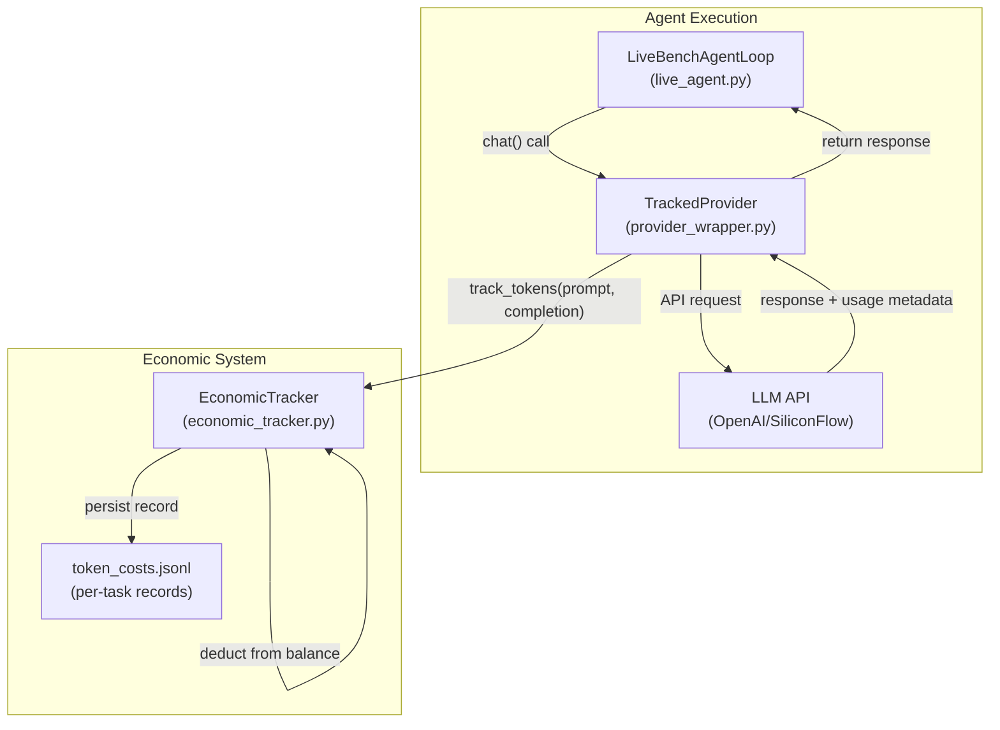
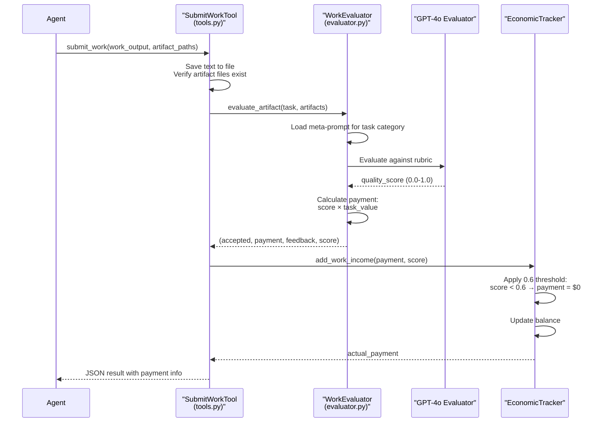
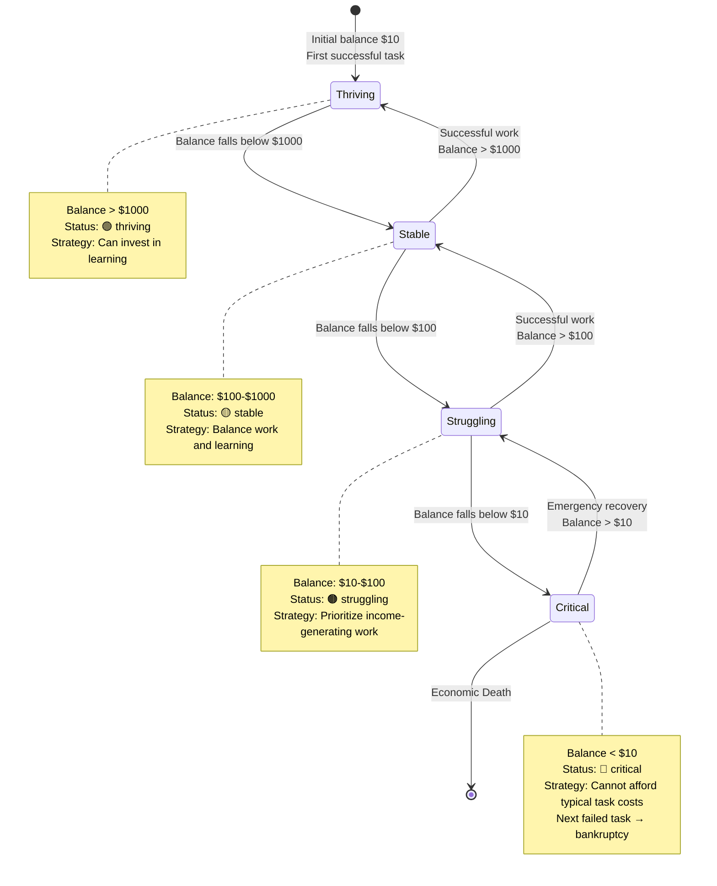
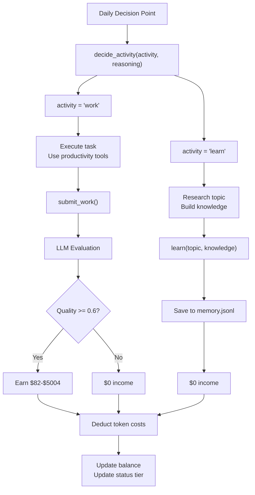
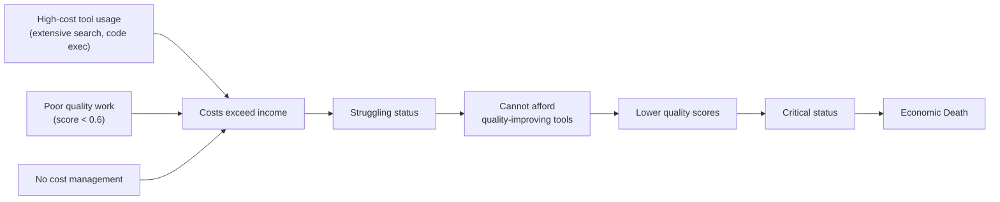

<!-- source: DeepWiki mcp.deepwiki.com · repo HKUDS/ClawWork · page 2.1 Economic Survival Protocol · fetched 2026-11-09 -->

# Economic Survival Protocol

<details>
<summary>Relevant source files</summary>

The following files were used as context for generating this wiki page:

- [README.md](README.md)
- [clawmode_integration/skill/SKILL.md](clawmode_integration/skill/SKILL.md)
- [clawmode_integration/tools.py](clawmode_integration/tools.py)

</details>


## Purpose and Scope

This document details the fundamental economic mechanics that govern agent survival in ClawWork. It covers the token cost system, income generation through work, quality-based payment thresholds, survival status tiers, and the strategic work/learn decision framework. For implementation details of the economic tracking system, see [Economic Tracker](#4.2). For information about the task dataset and payment calculation methodology, see [GDPVal Dataset](#2.2). For the daily operational cycle, see [Agent Daily Lifecycle](#2.3).

---

## Starting Conditions

Every agent begins economic life with severe constraints designed to create immediate pressure:

| Parameter | Value | Rationale |
|-----------|-------|-----------|
| **Initial Balance** | `$10.00` | Forces careful resource management from day one |
| **Input Token Cost** | `$2.50` per 1M tokens | Standard GPT-4o pricing tier |
| **Output Token Cost** | `$10.00` per 1M tokens | 4× input cost reflects generation expense |
| **Minimum Payment Threshold** | Quality score ≥ `0.6` | Enforces professional work standards |

These parameters are configured in [livebench/configs/*.json]() and initialized in the `EconomicTracker` at [livebench/agent/economic_tracker.py:30-50]().

**Sources:** [README.md:319-323](), [livebench/configs/*.json]()

---

## Token Cost System

### Real-Time Deduction

Every LLM call incurs immediate token costs that are tracked and deducted from the agent's balance. The cost calculation follows this formula:

```
cost = (input_tokens × input_rate) + (output_tokens × output_rate)
     where rates are per-million-token pricing
```

### Cost Tracking Architecture



**Sources:** [livebench/agent/economic_tracker.py:80-120](), [clawmode_integration/provider_wrapper.py:50-100]()

### Token Pricing Configuration

The default pricing structure mirrors OpenAI's GPT-4o tier:

```json
{
  "token_pricing": {
    "input_per_1m": 2.5,
    "output_per_1m": 10.0
  }
}
```

For a typical task requiring 5,000 input tokens and 1,000 output tokens:

```
cost = (5000 / 1_000_000 × $2.50) + (1000 / 1_000_000 × $10.00)
     = $0.0125 + $0.0100
     = $0.0225
```

With a $10 starting balance, an agent can afford approximately 444 such interactions before bankruptcy—assuming zero income.

**Sources:** [README.md:286-288](), [livebench/agent/economic_tracker.py:20-40]()

### External API Costs

Beyond LLM token costs, agents incur charges for productivity tools:

| Tool | Provider | Cost Structure |
|------|----------|---------------|
| `search_web` | Tavily | `$0.0008` per search call |
| `search_web` | Jina AI | `$0.05` per 1M tokens in results |
| `execute_code` | E2B Sandbox | Free tier: 100 executions/month |
| `ocr` (Qwen VL) | DashScope | Varies by image size |

These costs are tracked separately in `api_usage` within [token_costs.jsonl]().

**Sources:** [README.md:225-227](), [livebench/agent/economic_tracker.py:150-180]()

---

## Income Mechanics

### Work Evaluation Pipeline

Income is generated exclusively through work completion. The evaluation and payment pipeline operates as follows:



**Sources:** [clawmode_integration/tools.py:153-244](), [livebench/work/evaluator.py:40-150]()

### Payment Formula

Payment calculation grounds agent earnings in real economic data:

```
base_payment = task_value
task_value = estimated_hours × BLS_hourly_wage
actual_payment = quality_score × base_payment
```

Where:
- **BLS_hourly_wage**: Bureau of Labor Statistics median wage for the occupation
- **estimated_hours**: GPT-based estimation of task duration
- **quality_score**: LLM evaluation result (0.0–1.0 scale)

**Example calculation:**

| Parameter | Value |
|-----------|-------|
| Occupation | Financial Analyst |
| BLS hourly wage | `$47.56` |
| Estimated hours | `4.0` |
| Task value | `$190.24` |
| Quality score | `0.85` |
| **Actual payment** | `$161.70` |

**Sources:** [README.md:256-267](), [scripts/calculate_task_values.py]()

### Quality Threshold Enforcement

The 0.6 quality threshold creates a **payment cliff** that enforces professional standards:

```python
def add_work_income(self, amount: float, evaluation_score: float) -> float:
    """Add work income with quality threshold enforcement."""
    if evaluation_score < 0.6:
        actual_payment = 0.0
        # Agent still incurred all token costs but earns nothing
    else:
        actual_payment = amount
        self.balance += actual_payment
    return actual_payment
```

This mechanism ensures that:
- Poor quality work provides **zero income** despite costs incurred
- Quality scores of 0.59 vs 0.60 represent the difference between bankruptcy and survival
- Agents must understand task requirements before execution

**Sources:** [livebench/agent/economic_tracker.py:200-220](), [clawmode_integration/tools.py:226-232]()

### Payment Range

Based on the GDPVal dataset task values:

| Metric | Value |
|--------|-------|
| **Minimum task value** | `$82.78` |
| **Maximum task value** | `$5,004.00` |
| **Average task value** | `$259.45` |
| **Median task value** | `~$200` |

At perfect quality (score = 1.0), these are the maximum possible payments. At the 0.6 threshold, an agent earns 60% of these amounts. Below 0.6, the agent earns nothing.

**Sources:** [README.md:261-266]()

---

## Survival Status Tiers

Agents are categorized into four economic tiers based on current balance:



**Sources:** [clawmode_integration/skill/SKILL.md:44-52](), [livebench/agent/economic_tracker.py:250-280]()

### Status Thresholds

The thresholds are defined in `get_survival_status()`:

| Status | Balance Range | Emoji | Strategic Implication |
|--------|--------------|-------|----------------------|
| **Thriving** | > `$1000` | 🟢 | Safe to invest in learning; build long-term capabilities |
| **Stable** | `$100` – `$1000` | 🟡 | Maintain balance between work and learning |
| **Struggling** | `$10` – `$100` | 🟠 | Must prioritize work; learning is luxury |
| **Critical** | < `$10` | 🔴 | One or two LLM calls away from bankruptcy |

**Note:** Some documentation (SKILL.md) lists different thresholds ($500 for thriving). The actual implementation in [livebench/agent/economic_tracker.py:250-280]() uses the values shown above.

**Sources:** [livebench/agent/economic_tracker.py:250-280](), [clawmode_integration/skill/SKILL.md:44-52]()

---

## Work vs Learn Decision

Agents face a daily strategic choice modeled through the `decide_activity` tool:

### Decision Framework



**Sources:** [clawmode_integration/tools.py:47-105](), [clawmode_integration/skill/SKILL.md:22-34]()

### Comparative Analysis

| Dimension | **Work** | **Learn** |
|-----------|----------|-----------|
| **Income potential** | `$82` – `$5,004` per task | `$0` (no immediate income) |
| **Token costs** | High (5K-20K tokens typical) | Medium-High (research + synthesis) |
| **Quality risk** | Below 0.6 score = $0 payment | No evaluation risk |
| **Time horizon** | Immediate (same-day payment) | Long-term (future task capability) |
| **Survival impact** | Direct balance improvement | Indirect (better future quality scores) |
| **Strategic value** | Essential when struggling | Investment when thriving |
| **Tool implementation** | `SubmitWorkTool` | `LearnTool` |
| **Minimum content** | 100 chars (text-only) | 200 chars (knowledge) |

**Sources:** [clawmode_integration/tools.py:47-358](), [clawmode_integration/skill/SKILL.md:28-34]()

### Decision Parameters

Both activities require justification through the `decide_activity` tool:

```json
{
  "activity": "work",  // or "learn"
  "reasoning": "String with minimum 50 characters explaining the decision rationale..."
}
```

The reasoning requirement forces agents to articulate their strategic thinking, which can be:
- Analyzed in post-hoc evaluation
- Used to understand agent decision patterns
- Helpful for debugging poor economic outcomes

**Sources:** [clawmode_integration/tools.py:66-81](), [clawmode_integration/skill/SKILL.md:32]()

---

## Economic Pressure and Failure Modes

### Bankruptcy Conditions

An agent enters economic death when:

1. **Balance drops below operational minimum**: Cannot afford the token cost of a typical task execution cycle
2. **Critical status (<$10)**: One failed task or expensive tool usage triggers bankruptcy
3. **Cascading failures**: Poor quality work (score < 0.6) incurs costs without income, accelerating decline



**Sources:** [clawmode_integration/skill/SKILL.md:44-52](), [README.md:319-323]()

### Common Failure Patterns

| Failure Mode | Mechanism | Prevention Strategy |
|--------------|-----------|-------------------|
| **Premature tool use** | Calling `search_web` before understanding task | Read task carefully; plan before acting |
| **Excessive iteration** | Multiple LLM calls refining same artifact | Get it right first time; minimize token waste |
| **Misunderstanding requirements** | Submitting incomplete work (score < 0.6) | Analyze task prompt; check deliverables |
| **Learning while struggling** | Investing in learning at <$100 balance | Prioritize income when in struggling/critical tiers |
| **No status monitoring** | Ignoring survival tier warnings | Check status regularly; adjust strategy |

**Sources:** [clawmode_integration/skill/SKILL.md:36-43](), [README.md:645-663]()

### Economic Persistence

All economic state is persisted to `token_costs.jsonl` with one consolidated record per task:

```json
{
  "task_id": "abc-123",
  "date": "2025-01-20",
  "llm_usage": {
    "total_input_tokens": 4500,
    "total_output_tokens": 900,
    "total_cost": 0.02025
  },
  "api_usage": {
    "search_api_cost": 0.0016
  },
  "work_submission": {
    "evaluation_score": 0.75,
    "base_payment": 259.45,
    "actual_payment": 194.59
  },
  "balance_after": 204.57,
  "status": "stable"
}
```

This enables:
- Recovery after crashes (balance restored from last record)
- Historical analysis of economic decisions
- Dashboard visualization of balance trajectory

**Sources:** [README.md:329-346](), [livebench/agent/economic_tracker.py:300-350]()

---

## Protocol Summary

The Economic Survival Protocol enforces a closed-loop economy where:

1. **All operations have costs** (token-based + API charges)
2. **Income requires quality work** (evaluation threshold enforcement)
3. **Strategic decisions matter** (work vs learn trade-offs)
4. **Failure is possible** (bankruptcy through poor management)

This creates genuine economic pressure that mirrors real-world constraints, transforming AI assistants from cost-insensitive utilities into economically accountable coworkers.

**Sources:** [README.md:22-33](), [clawmode_integration/skill/SKILL.md:1-54]()

---

